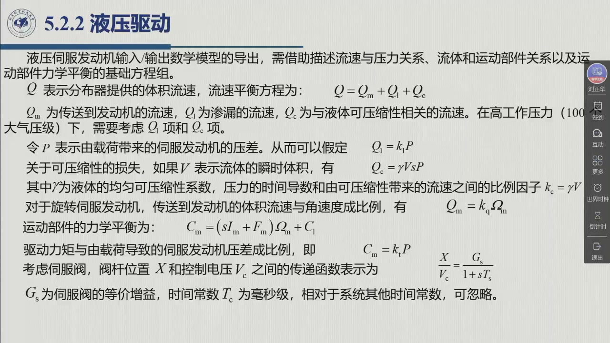

# 5.2.2 液压驱动

与电气驱动完全平行的另一半。教材的方法论是同一套：**先写基础方程组，再拼框图**。区别在于变量——没有电压电流，只有**流速与压力**；也因此多了两个电气侧不存在的麻烦：**渗漏**与**可压缩性**。录播 01:22:09–01:24:51。

## 5.2.2.1 六条基础方程

::: def 定义 5.2.3 · 液压驱动的基础方程组 {#def-5.2.3}
「无论液压伺服发动机的构造如何」，其输入/输出数学模型的导出都需要借助三类基础方程：**流速与压力的关系、流体与运动部件的关系、运动部件的力学平衡**（教材 §5.2.2）。令 $Q$ 为**分布器提供的体积流速**：

**（一）流速平衡**

$$Q=Q_m+Q_l+Q_c \tag{5.14}$$

其中 $Q_m$ 为**传送到发动机的流速**，$Q_l$ 为**渗漏的流速**，$Q_c$ 为**与液体可压缩性相关的流速**。教材强调：**在高工作压力（100 个大气压级）下，需要考虑 $Q_l$ 项和 $Q_c$ 项**。

**（二）渗漏**（$p$ 为由载荷造成的伺服发动机压差）

$$Q_l=k_l p \tag{5.15}$$

**（三）可压缩性**（$V$ 为流体瞬时体积，$\gamma$ 为液体的均匀可压缩性系数）

$$Q_c=\gamma V sp \tag{5.16}$$

注意比例因子 $k_c=\gamma V$ **取决于流体体积**：**旋转伺服发动机**中 $k_c$ 为常数；而**线性伺服器**中流体体积是变化的，**从而响应特性取决于工作点**。

**（四）流速与运动**

$$Q_m=k_q\Omega_m \tag{5.17}$$

传送到发动机的体积流速**与每单位时间的腔体容积变化成比例**；对旋转伺服发动机，这种变化与**角速度**成比例。

**（五）力学平衡**

$$C_m=(sI_m+F_m)\Omega_m+C_l \tag{5.18}$$

与电气驱动的 (5.3) 式**形式完全相同**。

**（六）驱动力矩与压差**

$$C_m=k_p p \tag{5.19}$$

**（七）伺服阀**（阀杆位置 $x$ 与控制电压 $v_c$ 之间）

$$\frac{x}{V_c}=\frac{G_c}{1+sT_c} \tag{5.20}$$

上式得益于**通过位置反馈得到的线性化影响**；$G_c$ 为伺服阀的**等价增益**，时间常数 $T_c$ 为**毫秒级**，相对系统其他时间常数可忽略。

**（八）分布器**（压差、流速与阀杆位移的关系**高度非线性**，在工作点处线性化）

$$p=k_x x-k_q Q \tag{5.21}$$
:::

::: method 方法 5.2.A · 与电气驱动逐条对照 {#method-5.2.A}
| 电气驱动 | 液压驱动 | 说明 |
|:--|:--|:--|
| (5.1) $V_a=(R_a+sL_a)I_a+V_g$ | (5.14)(5.15)(5.16) | 电气侧一个方程，液压侧拆成**渗漏 + 可压缩性**两项 |
| (5.2) $V_g=k_v\Omega_m$ | (5.17) $Q_m=k_q\Omega_m$ | 都是「转动产生一个抵消输入的效应」 |
| (5.3) $C_m=(sI_m+F_m)\Omega_m+C_l$ | (5.18) 同式 | **完全相同的机械侧方程** |
| (5.4) $C_m=k_tI_a$ | (5.19) $C_m=k_pp$ | 电流 ↔ 压差 |
| (5.5) 放大器 $G_v/(1+sT_v)$ | (5.20) 伺服阀 $G_c/(1+sT_c)$ | 一阶惯性，时间常数都可忽略 |
| （无对应） | (5.21) 分布器线性化 | 液压侧特有的非线性环节 |
:::

对照出来的结论就是 [5.2 驱动](sec5-2.md#sec-5.2.a) 那句：**框图结构平行，但压力反馈层是液压的结构特征，不像电流反馈那样可以拆掉**。

::: think 考点 · 老师原话（录播时间点）

> **建立过程照抄电气那一套**（01:21:57）：「这是电气系统。**（液压）系统呢，也同理可以参考前面电气系统的一个建立过程**」——老师明确把液压的建模路线说成「照着电气再做一遍」。这正是本节对照表的地位：**上课只需记住差别（渗漏、可压缩性、压力反馈去不掉），推导过程与电气是同一套。**
:::

::: think 考点 · 老师原话（录播时间点）

> **液压靠什么？**「对于液压发动机呢，可以通过**改变传送到发动机的流体的流速**，来实现对发动机的（控制）」（01:02:04）。

> **框图与电气驱动同形**：老师在这一页把液压框图与前面电气驱动的框图并排对照，指出两者**在结构上是对应的**（01:22:09）。
:::

::: think 默写点 · 合上书再写（主动回忆）

1. 液压驱动的六条基础方程分别是什么（写名称与变量）？
2. $Q_l$ 与 $Q_c$ 各代表什么？为什么高压下都不能忽略？
3. $k_c=\gamma V$ 在旋转式与直线式发动机上有什么不同？后果是什么？
4. 液压框图与电气框图在哪一处**不能**类比？为什么？

::: sol 核对

① 流速平衡 $Q=Q_m+Q_l+Q_c$；② 渗漏 $Q_l=k_lp$；③ 可压缩性 $Q_c=\gamma Vsp$；④ $Q_m=k_q\Omega_m$；⑤ 力学平衡 $C_m=(sI_m+F_m)\Omega_m+C_l$；⑥ $C_m=k_pp$。（另加伺服阀 (5.20) 与分布器线性化 (5.21)）。

$Q_l$ 是**渗漏流速**（正比于压差），$Q_c$ 是**与液体可压缩性相关的流速**。100 个大气压级的高压下渗漏与压缩效应都显著，忽略会带来大的模型误差。

旋转伺服发动机中流体体积恒定 ⇒ $k_c$ 为**常数**；线性伺服器中流体体积随行程变化 ⇒ **响应特性取决于工作点**。

压力反馈回路。它是液压伺服阀/分布器/发动机的**固有结构**，教材明确说「**除非引入适当变换器并实现相关控制电路，否则不能将其修正**」；电气驱动的电流反馈则是可选的设计取舍。

:::

:::

## 5.2.2 小结与常见错误

- **一句话**：液压驱动 = 电气驱动 + 渗漏与可压缩性两项，再减去可选的电流反馈。
- **六条方程**：流速平衡、渗漏、可压缩性、流速↔转速、力学平衡、力矩↔压差。
- **一个差别**：压力反馈去不掉（结构特征）；旋转式 $k_c$ 为常数，直线式与工作点有关。

::: think 常见错误清单 · 自查三条
1. 忘了 $Q_l$ 与 $Q_c$ 这两项——它们是液压驱动与电气驱动最主要的动态差别所在。
2. 把 $k_c$ 当成常数——只有**旋转式**才是；线性伺服器的响应随工作点变化。
3. 把伺服阀（一阶惯性，可忽略 $T_c$）与**分布器**（强非线性，需线性化）混为一个环节。
:::