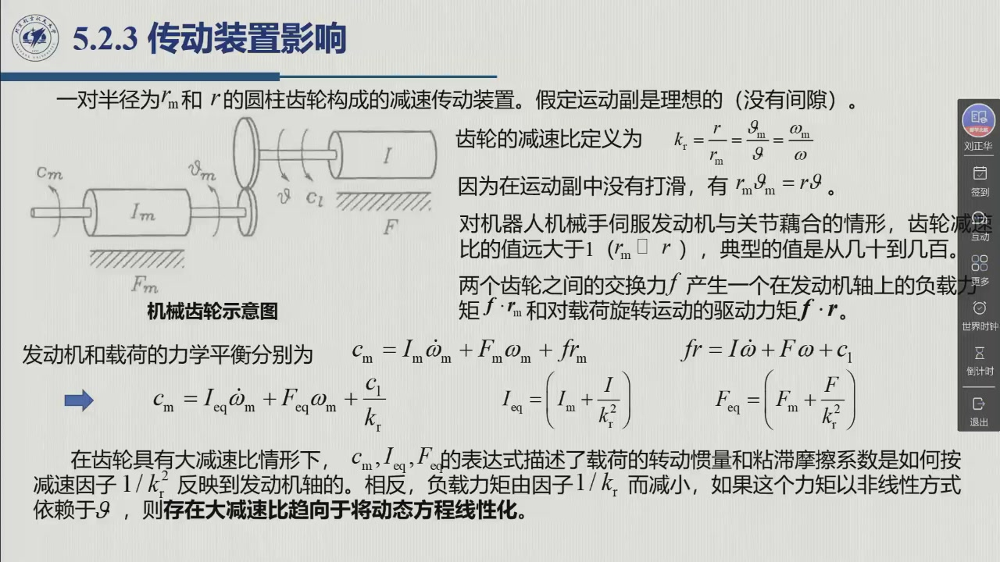
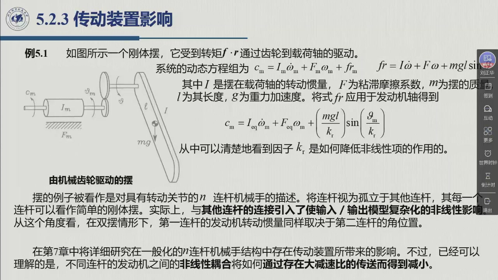

# 5.2.3 传动装置影响

§5.1.1 讲传动装置的**作用**，本节把它**量化**：齿轮到底怎样改变系统的惯量、摩擦与非线性。结论非常干净——**惯量与摩擦按减速比的平方缩小，负载力矩与非线性按减速比线性缩小**。这两条就是「大减速比让机器人变好控」的全部数学内容。录播 01:24:51–01:32:31。

## 5.2.3.1 齿轮模型与减速比

教材用一个**一对圆柱齿轮**（半径 $r_m$ 与 $r$）构成的机械齿轮来量化（教材图 5.7）：假定运动副是**理想的（没有间隙）**，并把伺服发动机旋转轴与相应关节轴连接起来。

::: def 定义 5.2.4 · 减速比与齿轮耦合 {#def-5.2.4}
记号约定（教材 §5.2.3）：伺服电机转子由绕其旋转轴的**转动惯量 $I_m$** 与**粘滞摩擦系数 $F_m$** 表征；同样地 $I$ 和 $F$ 表示**载荷**的转动惯量与粘滞摩擦系数。齿轮本身的转动惯量和摩擦系数**被包含在**上述参数里。

- $C_m$：发动机**驱动转矩**；$C_l$：施加到载荷的**负载转矩**；
- $\omega_m,\vartheta_m$：发动机轴的角速度与位置；$\omega,\vartheta$：载荷的相应量；
- $f$：两齿轮齿咬合时的**交换力**。

**减速比**定义为

$$k_r=\frac{\omega_m}{\omega}=\frac{r}{r_m} \tag{5.22}$$

这里两轴各自的正方向按传动关系选取，使 $k_r>0$；若外啮合两齿轮都按同一空间方向记角，则需另带反向符号。无打滑关系在本节的正向约定下为 $r_m\vartheta_m=r\vartheta$。

**典型值**：对机器人机械手伺服发动机与关节耦合的情形，减速比**远大于 1**（$r_m\ll r$），典型值**从几十到几百**。
:::

::: thm 定理 5.2.C · 等效惯量与等效摩擦 {#thm-5.2.C}
交换力 $f$ 在两个轴上分别产生**负载力矩 $f\,r_m$**（作用在发动机轴上）与**驱动力矩 $f\,r$**（作用于载荷）。于是发动机与载荷的力学平衡分别是

$$C_m=I_m\dot\omega_m+F_m\omega_m+fr_m \tag{5.23}$$
$$fr=I\dot\omega+F\omega+C_l \tag{5.24}$$

利用 $k_r$ 把载荷量折算到发动机轴、消去 $f$，得到**发动机轴上的等效力学平衡**：

$$C_m=I_{eq}\dot\omega_m+F_{eq}\omega_m+\frac{C_l}{k_r} \tag{5.25}$$

其中

$$I_{eq}=I_m+\frac{I}{k_r^2},\qquad F_{eq}=F_m+\frac{F}{k_r^2} \tag{5.26}$$

**读法（教材原话）**：在齿轮具有大减速比的情形下，式 (5.25)(5.26) 描述了**载荷的转动惯量和粘滞摩擦系数是如何按减速因子 $1/k_r^2$ 反映到发动机轴的**；相反，**负载力矩由因子 $1/k_r$ 而减小**。而且——**如果这个力矩以非线性方式依赖于 $\vartheta$，则存在大减速比将使其趋向于线性化动态方程**。
:::

这一条是本节的**全部要害**：$1/k_r^2$ 与 $1/k_r$ 两个因子解释了为什么工业机器人敢于用「小电机 + 大减速器」：

| 量 | 折算因子 | 减速比 100 时 |
|:--|:--|:--|
| 载荷转动惯量 $I$ | $1/k_r^2$ | 缩小 **10000 倍** |
| 载荷粘滞摩擦 $F$ | $1/k_r^2$ | 缩小 **10000 倍** |
| 负载力矩 $C_l$ | $1/k_r$ | 缩小 **100 倍** |
| 非线性项（如重力矩） | $1/k_r$（且自变量也缩小） | 显著弱化 |

对照 [@def-5.1.6] 第 1 条「低惯量」：**减速器降低载荷折算到电机轴的惯量；能否忽略它，还要与电机自身惯量比较**——这正是老师说的「惯量小就比较容易控制」（0:33:01）。

## 5.2.3.2 例 5.1：由齿轮驱动的刚体摆

::: ex 例 5.1 · 由机械齿轮驱动的摆（教材例 5.1） {#ex-5.2.D}
如图 5.8，一个**刚体摆**受到转矩 $f\cdot r$ 通过齿轮到载荷轴的驱动。系统的动态方程组为

$$C_m=I_m\dot\omega_m+F_m\omega_m+fr_m \tag{5.27}$$
$$fr=I\dot\omega+F\omega+mgl\sin\vartheta \tag{5.28}$$

其中 $I$ 是摆在载荷轴的转动惯量，$F$ 为粘滞摩擦系数，$m$ 为摆的质量，$l$ 为其长度，$g$ 为重力加速度。

**把 (5.28) 折算到发动机轴**，得到

$$C_m=I_{eq}\dot\omega_m+F_{eq}\omega_m+\frac{mgl}{k_r}\sin\frac{\vartheta_m}{k_r} \tag{5.29}$$

教材的评语是：「从中可以清楚地看到**因子 $k_r$ 是如何降低非线性项的作用的**」。

**这一步为什么重要？** 幅值除以 $k_r$，使负载重力项在电机端的绝对值减小；但坐标代换不消除正弦的非线性。只有把**电机角变化范围固定**，$\Delta\vartheta=\Delta\vartheta_m/k_r$ 才会随着减速比增大而变小，适合局部线性化。

如果任务要求关节转过同样的 $90^\circ$，则电机必须转过 $k_r\times90^\circ$，正弦的自变量仍覆盖原来的关节角范围。大减速比本身不保证整个工作区能用一条直线近似；还需比较负载项、耦合项与电机惯性项的实际大小。
:::

**推广到 n 连杆机械手**：教材指出，这个摆的例子「被看作是对具有转动关节的 $n$ 连杆机械手的描述」——**把连杆视为孤立于其他连杆，其每一个连杆可以看作简单的刚体摆**。当然，与其他连杆的连接会引入使输入/输出模型复杂化的非线性影响：「在**双摆**情形下，**第一连杆的发动机转动惯量同样取决于第二连杆的角位置**」。

结论：**「不同连杆的发动机之间的非线性耦合，将如何通过存在大减速比的（传动）而得到减小」**——第 7 章会详细研究这一点。

**老师把「两端情形」讲得很清楚**（01:29:05–01:29:49），值得单独记下来：

| | $k_r$ 很大（工业常态，典型几十到几百） | $k_r$ 接近 1（直驱或小减速比） |
|:--|:--|:--|
| 载荷惯量 $I/k_r^2$ | 比较 $I/(k_r^2I_m)$ 后判断能否忽略 | 负载惯量几乎原样落到电机轴，是否主导取决于 $I/I_m$ |
| 非线性项 $mgl\sin(\cdot)/k_r$ | 电机端幅值减小；固定电机小行程时可局部线性化 | 电机端负载项较大，需按实际范围建模 |
| 建模与控制的后果 | 剩余耦合及负载扰动足够小时，可采用独立关节近似 | 更需检查非线性与关节耦合，决定是否补偿 |
| $I_{eq}$ 的构成 | 当 $I/(k_r^2I_m)\ll1$ 时由 $I_m$ 主导 | 由给定惯量决定，不能只看 $k_r$ |

一句话：**$k_r$ 改变负载折算量级，是否可线性近似还取决于行程与参数**——这既解释了工业机械手为什么敢用「小电机 + 大减速器」，也解释了直驱（[@def-5.1.4]）为什么「对控制算法的要求非常高」（0:35:19）。

::: ex 例 5.2.E · 用动能与功率核对两个折算因子 {#ex-5.2.E}
取 $k_r=100$、$I_m=10^{-4}\ \mathrm{kg\cdot m^2}$、$I=0.05\ \mathrm{kg\cdot m^2}$，
载荷阻力矩 $C_l=10\ \mathrm{N\cdot m}$，电机速度 $\omega_m=100\ \mathrm{rad/s}$，暂不计摩擦。

::: sol 解
$\omega=\omega_m/k_r=1\ \mathrm{rad/s}$，动能为

$$T=\tfrac12 I_m\omega_m^2+\tfrac12 I\omega^2
=\tfrac12(I_m+I/k_r^2)\omega_m^2=0.525\ \mathrm J.$$

折算载荷惯量为 $5\times10^{-6}$，是电机惯量的 5%，是总等效惯量的约 4.76%；不要混淆两个分母。
负载折算力矩为 $0.1\ \mathrm{N\cdot m}$，两端功率一致：$0.1\times100=10\times1=10\ \mathrm W$。

若只把 $I$ 改为 $5\ \mathrm{kg\cdot m^2}$，同一减速比下折算载荷惯量是电机的 5 倍，便不能忽略。
:::
:::

::: think 迁移练习 · 固定电机行程与固定关节行程
$k_r=100$ 时，电机转 $2\pi$ 与关节转 $\pi/2$ 分别对应多大关节角范围？
以 $\sin\vartheta\approx\vartheta$ 计算两者终点的相对误差 $|\vartheta-\sin\vartheta|/|\sin\vartheta|$。

::: sol 核对
前者关节只转 $2\pi/100\approx0.06283$ rad，相对误差约 $0.0658\%$；
后者关节转 $\pi/2$，电机转 $50\pi$ rad，相对误差约 $57.08\%$，与减速比无关。
能说明两种范围的区别后，再读 [独立关节位置控制](sec5-2-4.md) 的近似假设。
:::
:::

::: think 考点 · 老师原话（录播时间点）

> **减速比把惯量「抹掉」**：老师在这一页反复指出，减速比一乘上，**负载惯量按平方缩小**、**负载力矩按一次方缩小**，所以「我控制这个关节就单独控制这个关节」（01:24:51、01:29:52）。

下句课堂概括需结合固定电机小行程、负载项足够小等条件，不能用于推出全关节工作区的精确线性性。

> **重力矩被线性化**：摆的例子要说明的是——大减速比下 $\sin\vartheta$ 在电机端近似成一条直线，「非线性项的作用被 $k_r$ 降低」（01:29:52）。
:::

::: think 默写点 · 合上书再写（主动回忆）

1. 写出 $I_{eq}$ 与 $F_{eq}$ 的表达式，并说明各自的折算因子。
2. 负载力矩折算到电机轴要乘什么因子？为什么它和非线性项的因子不同？
3. 摆的例子里，$k_r$ 通过哪两条途径削弱重力矩的非线性？
4. 把单摆推广到 $n$ 连杆时，多出来的是什么影响？第几章处理？

::: sol 核对

$I_{eq}=I_m+I/k_r^2$，$F_{eq}=F_m+F/k_r^2$——载荷惯量与摩擦按 $1/k_r^2$ 折算。

乘 $1/k_r$。因为惯量/摩擦是「速度的系数」，而力矩是「与速度量纲无关的外力」；前者在动力学方程里随 $\omega_m$ 的幂次变换，后者只做一次量纲折算。

① **幅值除以 $k_r$**；② 固定电机角变化范围时，关节角变化范围缩小，便于局部线性化；若固定关节行程，则没有这项范围收益。

多出的是**连杆之间的非线性耦合**（双摆情形下第一连杆的电机惯量还取决于第二连杆的角位置）。第 7 章（动力学）详细研究。

:::

:::

## 5.2.3 小结与常见错误

- **两个因子**：惯量与摩擦 $1/k_r^2$；负载力矩与非线性 $1/k_r$。
- **一个方程**：$C_m=I_{eq}\dot\omega_m+F_{eq}\omega_m+C_l/k_r$ ——后面几章到处用它。
- **一个推论**：大减速比有助于减小折算负载项；独立关节线性近似还需检验惯量比、耦合与实际行程。

::: think 常见错误清单 · 自查三条
1. 把两个折算因子都用成 $1/k_r$ 或都用成 $1/k_r^2$——记住**惯量/摩擦是平方，力矩是一次**。
2. 在 (5.29) 里只写 $mgl\sin\vartheta_m/k_r$ 而把 $k_r$ 放错位置——正确形式是 $\dfrac{mgl}{k_r}\sin\dfrac{\vartheta_m}{k_r}$（两个 $k_r$ 各在一处）。
3. 以为减速比只影响「力矩放大」——它对**惯量**的影响（平方缩小）往往更重要。
:::