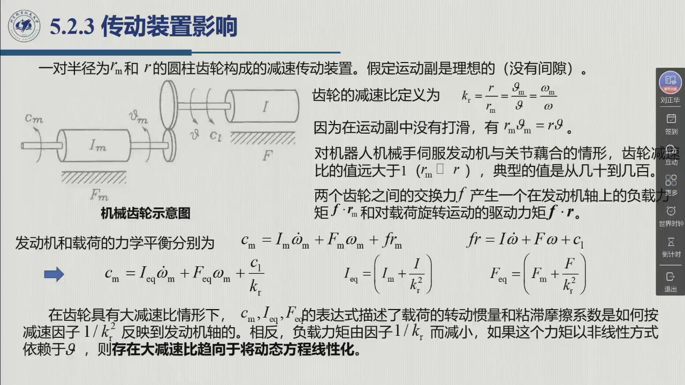
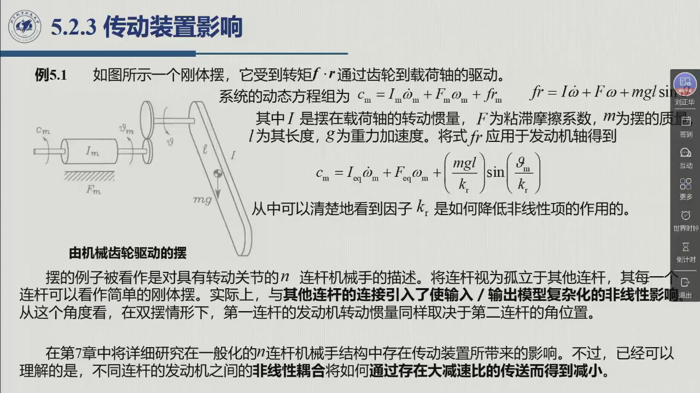

# 5.2.3 传动装置影响

前两节建立了电机和液压执行器本身的动态模型，但它们与关节之间通常还隔着一套减速传动装置（[§5.1.1](sec5-1-1.md)）。装上减速器以后，电机转角与关节转角不再相等，必须把关节端的惯量、摩擦和外加负载力矩统一折算到电机轴上，才能代入前两节的驱动方程，也为下一节独立关节位置控制给出等效对象。本节完成折算后，可到[两连杆第六关](../training/two-link.md#mission-drive)同时核对力矩变化与电机转速要求。课堂回看：01:24:51–01:32:31。

## 5.2.3.1 齿轮模型与减速比

考虑一对半径分别为 $r_m$ 与 $r$ 的无间隙、无弹性变形的圆柱齿轮，将伺服发动机轴连接到载荷（关节）轴。为避免外啮合反向带来的正负号混淆，先把两端正方向选成相容的转动方向（使两个转角按同向推进、减速比为正），然后分别列写两轴的力矩平衡，再消去齿间啮合力。

::: def 定义 5.2.4 · 减速比与齿轮耦合 {#def-5.2.4}
令 $I_m,F_m$ 为伺服电机转子的转动惯量和黏滞摩擦系数，$I,F$ 为载荷绕关节轴的转动惯量和黏滞摩擦系数（齿轮自身的转动惯量和摩擦分别归入对应轴的参数里）；$C_m$ 为发动机驱动转矩，$C_l$ 为施加到载荷的阻力矩；$\omega_m,\vartheta_m$ 为发动机轴角速度与转角，$\omega,\vartheta$ 为载荷轴角速度与转角；$f$ 为两轮啮合时的交换切向力。

在无打滑且两端正向相容的约定下，啮合弧长相等 $r_m\vartheta_m=r\vartheta$，于是定义减速比为

$$k_r=\frac{\omega_m}{\omega}=\frac{r}{r_m}>0. \tag{5.22}$$

若两轴按空间同一顺逆时针方向记角，外啮合副需另带负号。工业机械手用伺服电机与关节耦合时，典型减速比远大于 1（$r_m\ll r$），常见在几十到几百之间（01:26:15–01:26:40）。
:::

先用一次直觉估算，看折算系数为什么会分成一次和平方两类：由于两侧无损功率相等，$C_l\omega=C_{l,m}\omega_m$，力矩按 $1/k_r$ 折回电机轴；而转动惯量在动能 $\tfrac12 I\omega^2$ 里乘的是角速度平方，把 $\omega=\omega_m/k_r$ 代入就会多出一个 $1/k_r$，平方变成 $1/k_r^2$。下面从两轴力学平衡把这两个因子严密推出来（01:26:45–01:28:15）。

::: thm 定理 5.2.C · 等效惯量与等效摩擦 {#thm-5.2.C}
齿间啮合力 $f$ 对发动机轴构成阻力矩 $fr_m$，对载荷轴构成驱动转矩 $fr$，因此两轴的力矩平衡方程分别为

$$C_m=I_m\dot\omega_m+F_m\omega_m+fr_m, \tag{5.23}$$
$$fr=I\dot\omega+F\omega+C_l. \tag{5.24}$$

由 (5.22) 有 $r_m=r/k_r$、$\omega=\omega_m/k_r$、$\dot\omega=\dot\omega_m/k_r$。将 (5.24) 两边同除以 $k_r$，左端化成 $fr/k_r=fr_m$，右端把 $\omega$ 和 $\dot\omega$ 全部换算成电机侧角速度：

$$fr_m=\frac{I}{k_r^2}\dot\omega_m+\frac{F}{k_r^2}\omega_m+\frac{C_l}{k_r}.$$

将上式代回 (5.23) 消去啮合力 $f$，得到完全写在发动机轴上的等效动力学方程：

$$C_m=I_{eq}\dot\omega_m+F_{eq}\omega_m+\frac{C_l}{k_r}, \tag{5.25}$$

其中等效转动惯量与等效黏滞摩擦系数分别为

$$I_{eq}=I_m+\frac{I}{k_r^2},\qquad F_{eq}=F_m+\frac{F}{k_r^2}. \tag{5.26}$$
:::

两次 $1/k_r$ 的来历就在上面那一步代入里：惯量和黏滞摩擦先经过力臂比例 $1/k_r$，再经过速度／加速度换算 $\omega=\omega_m/k_r$，共得 $1/k_r^2$；而独立外加负载 $C_l$ 不含 $\omega$，只乘一次力臂比例 $1/k_r$。

| 量 | 折算到电机轴的因子 | $k_r=100$ 时的缩小倍数 |
|:--|:--|:--|
| 载荷转动惯量 $I$ | $1/k_r^2$ | 缩小 10000 倍 |
| 载荷黏滞摩擦 $F$ | $1/k_r^2$ | 缩小 10000 倍 |
| 负载力矩 $C_l$ | $1/k_r$ | 缩小 100 倍 |
| 位置相关非线性负载（如重力矩） | 幅值按 $1/k_r$，自变量同时按 $\vartheta=\vartheta_m/k_r$ 缩放 | 电机侧幅值缩小 100 倍，非线性函数形式仍在 |

注意表中折算值是站在电机轴看到的等效负载，并不意味着关节端实际承受的力矩变小了。另外，能否忽略折算惯量不能只看 $k_r$ 有多大，而要比较无量纲比值 $I/(k_r^2I_m)$：如果 $k_r=100$ 但载荷惯量 $I$ 同时比电机大上万倍，折算后仍与电机惯量相当。

## 5.2.3.2 例 5.1：由齿轮驱动的刚体摆

前面折算了一般负载 $C_l$。当负载随关节转角非线性变化时，减速比还会怎样影响非线性项？拿一个通过齿轮驱动的单自由度刚体摆来算（01:29:52–01:32:10）。

::: ex 例 5.1 · 由机械齿轮驱动的摆（教材例 5.1） {#ex-5.2.D}
如图 5.8，一个质量为 $m$、质心距关节轴长为 $l$、载荷轴转动惯量为 $I$、黏滞摩擦系数为 $F$ 的刚体摆，由电机经减速比 $k_r$ 的齿轮驱动。两轴的动力学方程为

$$C_m=I_m\dot\omega_m+F_m\omega_m+fr_m, \tag{5.27}$$
$$fr=I\dot\omega+F\omega+mgl\sin\vartheta. \tag{5.28}$$

将重力矩 $C_l=mgl\sin\vartheta$ 连同 $\vartheta=\vartheta_m/k_r$ 代入 (5.25)，折算到发动机轴得到

$$C_m=I_{eq}\dot\omega_m+F_{eq}\omega_m+\frac{mgl}{k_r}\sin\frac{\vartheta_m}{k_r}. \tag{5.29}$$

减速比在这里起了两重作用：第一，重力矩的幅值被除以 $k_r$，使负载项在电机端的绝对值缩小；第二，固定电机侧的运动范围 $\Delta\vartheta_m$ 时，关节侧转角变化 $\Delta\vartheta=\Delta\vartheta_m/k_r$ 随着 $k_r$ 增大而变小，围绕某个工作点做局部线性化（$\sin\vartheta\approx\vartheta$）的误差随之下降。

但是，坐标代换本身并不抹掉正弦函数的非线性。如果任务要求关节转过同样的 $90^\circ$，电机就必须转过 $k_r\times90^\circ$，正弦的自变量依然覆盖完整的 $0^\circ$ 到 $90^\circ$ 区间，大减速比并不能把大行程上的 $\sin\vartheta$ 变成一条直线。是否能略去负载或采用线性模型，仍需结合行程范围与 $I/(k_r^2I_m)$ 共同判断。
:::

把单摆推广到多连杆机械手时，每个关节后面的其余连杆都会随构形改变等效惯量、重力和哥氏／向心力耦合项（将在[第六章动力学](../ch06/sec6-1.md)精确写出）。大减速比通过 $1/k_r^2$ 和 $1/k_r$ 大幅压低了这些下游非线性耦合折回到电机轴的比重，所以老师在课上总结（01:28:03–01:32:50）：减速比很大时（典型几十到几百），可把多轴强耦合弱化到足以按各轴分别设计控制器；而减速比接近 1（直驱或低减速比）时，载荷惯量和下游耦合几乎原样落回电机轴，必须认真评估耦合影响并考虑在控制律里补偿。

| 对比维度 | $k_r$ 很大（几十到几百，工业常见） | $k_r$ 接近 1（直驱或小减速比） |
|:--|:--|:--|
| 载荷惯量折算 $I/k_r^2$ | 需核查 $I/(k_r^2I_m)$ 是否远小于 1，决定可否忽略 | 负载惯量几乎直接落回电机轴，取决于 $I/I_m$ |
| 非线性负载项 | 幅值按 $1/k_r$ 减小，固定电机小行程下易局部线性化 | 电机端非线性项幅值大，须按实际工作角建模 |
| 等效惯量 $I_{eq}$ 与控制策略 | 若 $I/(k_r^2I_m)\ll1$ 则由 $I_m$ 主导，常采用独立关节近似 | 需核查多轴动力学耦合与非线性补偿 |

下面用一组具体数字把动能、功率、惯量比以及“固定电机行程 vs 固定关节行程”的差别算出来。

::: ex 例 5.2.E · 用动能与功率核对两个折算因子 {#ex-5.2.E}
取 $k_r=100$、$I_m=10^{-4}\ \mathrm{kg\cdot m^2}$、$I=0.05\ \mathrm{kg\cdot m^2}$，载荷阻力矩 $C_l=10\ \mathrm{N\cdot m}$，电机速度 $\omega_m=100\ \mathrm{rad/s}$，暂不计摩擦。

::: sol 解
关节角速度为 $\omega=\omega_m/k_r=1\ \mathrm{rad/s}$，两轴总[动能](../recall.md#kinetic)为

$$T=\tfrac12 I_m\omega_m^2+\tfrac12 I\omega^2
=\tfrac12(I_m+I/k_r^2)\omega_m^2=0.525\ \mathrm J.$$

折算载荷惯量 $I/k_r^2=5\times10^{-6}\ \mathrm{kg\cdot m^2}$，是电机惯量 $I_m$ 的 5%，占总等效惯量 $I_{eq}=1.05\times10^{-4}\ \mathrm{kg\cdot m^2}$ 的约 4.76%（注意区分两个分母）。负载折算到电机侧的力矩为 $C_l/k_r=0.1\ \mathrm{N\cdot m}$，两端机械功率一致：$0.1\times100=10\times1=10\ \mathrm W$。

若仅把载荷惯量改为 $I=5\ \mathrm{kg\cdot m^2}$，即使减速比仍是 100，折算载荷惯量 $I/k_r^2=5\times10^{-4}\ \mathrm{kg\cdot m^2}$ 也是电机自身惯量的 5 倍，这时就不能忽略负载惯量。
:::
:::

::: think 迁移练习 · 固定电机行程与固定关节行程
$k_r=100$ 时，电机转 $2\pi$ 与关节转 $\pi/2$ 分别对应多大关节角范围？以 $\sin\vartheta\approx\vartheta$ 计算两者终点的相对误差 $|\vartheta-\sin\vartheta|/|\sin\vartheta|$。

::: sol 核对
前者关节只转 $2\pi/100\approx0.06283\ \mathrm{rad}$，相对误差约 $0.0658\%$；后者关节转 $\pi/2$，电机须转 $50\pi\ \mathrm{rad}$，相对误差约 $57.08\%$，与减速比大小无关。说明大减速比只有配合小关节角行程才能做全局小角度线性近似；理解这一区别后，再读下一节[独立关节位置控制](sec5-2-4.md)的近似前提。
:::
:::

## 5.2.3 小结与常见错误

理想无隙减速比 $k_r=\omega_m/\omega$ 把负载折算到电机轴：负载外力矩及非线性项幅值乘以 $1/k_r$，转动惯量和黏滞摩擦系数乘以 $1/k_r^2$（来自力臂和速度换算两次 $1/k_r$）。大减速比能大幅压低折算负载与下游耦合，但是否可忽略载荷惯量或做线性化近似，仍须分别检验惯量比 $I/(k_r^2I_m)$ 和实际关节运动范围。

::: think 常见错误清单 · 自查三条
1. 把两个折算因子混用：载荷惯量和黏滞摩擦按 $1/k_r^2$ 折算，外力矩按 $1/k_r$ 折算，不能全部写成一次方或平方。
2. 在刚体摆方程 (5.29) 中只写一个 $k_r$：正确形式为 $\dfrac{mgl}{k_r}\sin\dfrac{\vartheta_m}{k_r}$，幅值和角度自变量都要除以 $k_r$。
3. 以为只要 $k_r$ 够大，整条机械臂在全行程上就自动线性且互不耦合，忽略了大关节转角下的正弦非线性与惯量比检验。
:::
