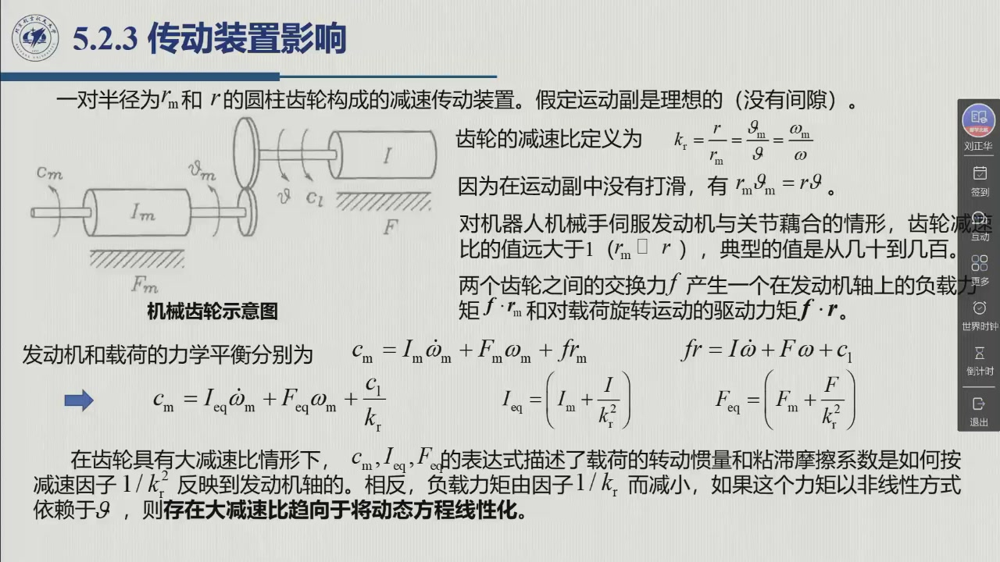
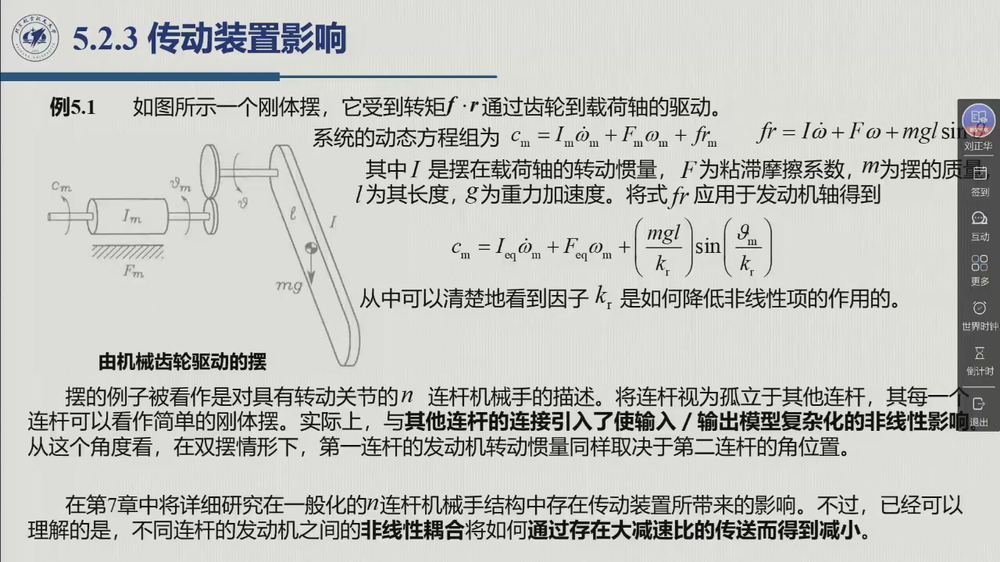

# 5.2.3 传动装置影响

第四章算出了关节速度。装上减速器以后，电机转速与关节速度不同，动力学方程也必须说明写在哪一侧。先从理想传动的[功率相等](../recall.md#gear)出发：如果电机转得更快，它需要提供的力矩应怎样变化？

下面始终标明轴侧，将负载折算到电机轴，分别说明力矩的一次因子和惯量、黏滞摩擦的平方因子。完成推导后，可在[两连杆第六关](../training/two-link.md#mission-drive)同时检查力矩变化与电机转速要求。录播对应01:24:51–01:32:31。

## 5.2.3.1 齿轮模型与减速比

用一对无间隙、无弹性变形的齿轮连接电机轴与负载轴。先把两端正方向选成相容方向，使减速比为正，再分别列转矩平衡；齿轮啮合力随后可以消去。

::: def 定义 5.2.4 · 减速比与齿轮耦合 {#def-5.2.4}
记号约定（教材 §5.2.3）：伺服电机转子由绕其旋转轴的**转动惯量 $I_m$** 与**粘滞摩擦系数 $F_m$** 表征；同样地 $I$ 和 $F$ 表示**载荷**的转动惯量与粘滞摩擦系数。齿轮本身的转动惯量和摩擦系数**被包含在**上述参数里。

- $C_m$：发动机**驱动转矩**；$C_l$：施加到载荷的**负载转矩**；
- $\omega_m,\vartheta_m$：发动机轴的角速度与位置；$\omega,\vartheta$：载荷的相应量；
- $f$：两齿轮齿咬合时的**交换力**。

**减速比**定义为

$$k_r=\frac{\omega_m}{\omega}=\frac{r}{r_m} \tag{5.22}$$

这里两轴各自的正方向按传动关系选取，使 $k_r>0$；若外啮合两齿轮都按同一空间方向记角，则需另带反向符号。无打滑关系在本节的正向约定下为 $r_m\vartheta_m=r\vartheta$。

**典型值**：对机器人机械手伺服发动机与关节耦合的情形，减速比**远大于 1**（$r_m\ll r$），典型值**从几十到几百**。
:::

::: thm 定理 5.2.C · 等效惯量与等效摩擦 {#thm-5.2.C}
交换力 $f$ 在两个轴上分别产生**负载力矩 $f\,r_m$**（作用在发动机轴上）与**驱动力矩 $f\,r$**（作用于载荷）。于是发动机与载荷的力学平衡分别是

$$C_m=I_m\dot\omega_m+F_m\omega_m+fr_m \tag{5.23}$$
$$fr=I\dot\omega+F\omega+C_l \tag{5.24}$$

利用 $k_r$ 把载荷量折算到发动机轴、消去 $f$，得到**发动机轴上的等效力学平衡**：

$$C_m=I_{eq}\dot\omega_m+F_{eq}\omega_m+\frac{C_l}{k_r} \tag{5.25}$$

其中

$$I_{eq}=I_m+\frac{I}{k_r^2},\qquad F_{eq}=F_m+\frac{F}{k_r^2} \tag{5.26}$$

将负载侧方程除以 $k_r$，$fr/k_r=fr_m$；再用 $\omega=\omega_m/k_r$、$\dot\omega=\dot\omega_m/k_r$：

$$fr_m=\frac{I}{k_r^2}\dot\omega_m+\frac{F}{k_r^2}\omega_m+\frac{C_l}{k_r}.$$

代回电机方程，就得到 (5.25)。惯量与摩擦出现两次 $1/k_r$，一次来自力矩臂比例，另一次来自速度或加速度换算；独立给定的负载力矩只经过前一次折算。
:::

下表汇总三个折算因子。它们描述负载在电机侧的等效值，并不表示关节实际承受的负载减小：

| 量 | 折算因子 | 减速比 100 时 |
|:--|:--|:--|
| 载荷转动惯量 $I$ | $1/k_r^2$ | 缩小 **10000 倍** |
| 载荷粘滞摩擦 $F$ | $1/k_r^2$ | 缩小 **10000 倍** |
| 负载力矩 $C_l$ | $1/k_r$ | 缩小 **100 倍** |
| 非线性项（如重力矩） | $1/k_r$；角度须按轴侧换算 | 电机侧幅值缩小100倍，非线性仍在 |

能否忽略折算惯量，取决于无量纲比值 $I/(k_r^2I_m)$。例如同样使用减速比100，若负载惯量同时放大100倍，其折算量也放大100倍。只报减速比，无法判断电机自身惯量是否主导响应。

## 5.2.3.2 例 5.1：由齿轮驱动的刚体摆

::: ex 例 5.1 · 由机械齿轮驱动的摆（教材例 5.1） {#ex-5.2.D}
如图 5.8，一个**刚体摆**受到转矩 $f\cdot r$ 通过齿轮到载荷轴的驱动。系统的动态方程组为

$$C_m=I_m\dot\omega_m+F_m\omega_m+fr_m \tag{5.27}$$
$$fr=I\dot\omega+F\omega+mgl\sin\vartheta \tag{5.28}$$

其中 $I$ 是摆在载荷轴的转动惯量，$F$ 为粘滞摩擦系数，$m$ 为摆的质量，$l$ 为其长度，$g$ 为重力加速度。

**把 (5.28) 折算到发动机轴**，得到

$$C_m=I_{eq}\dot\omega_m+F_{eq}\omega_m+\frac{mgl}{k_r}\sin\frac{\vartheta_m}{k_r} \tag{5.29}$$

教材的评语是：「从中可以清楚地看到**因子 $k_r$ 是如何降低非线性项的作用的**」。

**这一步为什么重要？** 幅值除以 $k_r$，使负载重力项在电机端的绝对值减小；但坐标代换不消除正弦的非线性。只有把**电机角变化范围固定**，$\Delta\vartheta=\Delta\vartheta_m/k_r$ 才会随着减速比增大而变小，适合局部线性化。

如果任务要求关节转过同样的 $90^\circ$，则电机必须转过 $k_r\times90^\circ$，正弦的自变量仍覆盖原来的关节角范围。大减速比本身不保证整个工作区能用一条直线近似；还需比较负载项、耦合项与电机惯性项的实际大小。
:::

多关节机械臂中，其他关节一旦改变构形，等效惯量、重力和速度耦合项也可能变化。因此不能把各杆永久当成独立单摆；应先用[第六章动力学](../ch06/sec6-1.md)求出这些项，再判断它们折到电机侧后是否足够小。

独立关节控制以这些折算项可以近似处理为前提，减速器并未切断连杆之间的力学联系。

下面比较大减速比与近直接驱动的两种情况。判断仍以同一任务、同一参数为准。

| | $k_r$ 很大（工业常态，典型几十到几百） | $k_r$ 接近 1（直驱或小减速比） |
|:--|:--|:--|
| 载荷惯量 $I/k_r^2$ | 比较 $I/(k_r^2I_m)$ 后判断能否忽略 | 负载惯量几乎原样落到电机轴，是否主导取决于 $I/I_m$ |
| 非线性项 $mgl\sin(\cdot)/k_r$ | 电机端幅值减小；固定电机小行程时可局部线性化 | 电机端负载项较大，需按实际范围建模 |
| 建模与控制的后果 | 剩余耦合及负载扰动足够小时，可采用独立关节近似 | 更需检查非线性与关节耦合，决定是否补偿 |
| $I_{eq}$ 的构成 | 当 $I/(k_r^2I_m)\ll1$ 时由 $I_m$ 主导 | 由给定惯量决定，不能只看 $k_r$ |

减速比改变电机侧负载的同时，也改变所需电机转速和转角范围。同一任务下，这几项要一起验算，不能只依据折算负载变小就省略动力学。

::: ex 例 5.2.E · 用动能与功率核对两个折算因子 {#ex-5.2.E}
取 $k_r=100$、$I_m=10^{-4}\ \mathrm{kg\cdot m^2}$、$I=0.05\ \mathrm{kg\cdot m^2}$，
载荷阻力矩 $C_l=10\ \mathrm{N\cdot m}$，电机速度 $\omega_m=100\ \mathrm{rad/s}$，暂不计摩擦。

::: sol 解
$\omega=\omega_m/k_r=1\ \mathrm{rad/s}$，[动能](../recall.md#kinetic)为

$$T=\tfrac12 I_m\omega_m^2+\tfrac12 I\omega^2
=\tfrac12(I_m+I/k_r^2)\omega_m^2=0.525\ \mathrm J.$$

折算载荷惯量为 $5\times10^{-6}$，是电机惯量的 5%，是总等效惯量的约 4.76%；不要混淆两个分母。
负载折算力矩为 $0.1\ \mathrm{N\cdot m}$，两端功率一致：$0.1\times100=10\times1=10\ \mathrm W$。

若只把 $I$ 改为 $5\ \mathrm{kg\cdot m^2}$，同一减速比下折算载荷惯量是电机的 5 倍，便不能忽略。
:::
:::

::: think 迁移练习 · 固定电机行程与固定关节行程
$k_r=100$ 时，电机转 $2\pi$ 与关节转 $\pi/2$ 分别对应多大关节角范围？
以 $\sin\vartheta\approx\vartheta$ 计算两者终点的相对误差 $|\vartheta-\sin\vartheta|/|\sin\vartheta|$。

::: sol 核对
前者关节只转 $2\pi/100\approx0.06283$ rad，相对误差约 $0.0658\%$；
后者关节转 $\pi/2$，电机转 $50\pi$ rad，相对误差约 $57.08\%$，与减速比无关。
能说明两种范围的区别后，再读 [独立关节位置控制](sec5-2-4.md) 的近似假设。
:::
:::

## 5.2.3 小结与常见错误

本节把负载折到电机侧：转矩除以 $k_r$，惯量与黏滞系数除以 $k_r^2$。平方来自速度也按减速比变化。大减速比减小折算项，但是否能忽略负载或采用线性近似，还取决于实际惯量比、关节行程和耦合。
