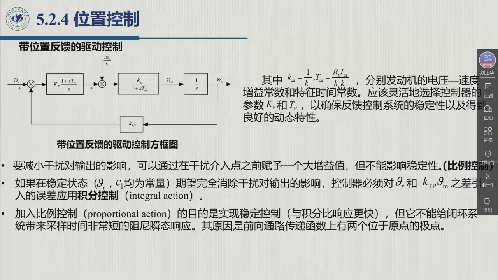
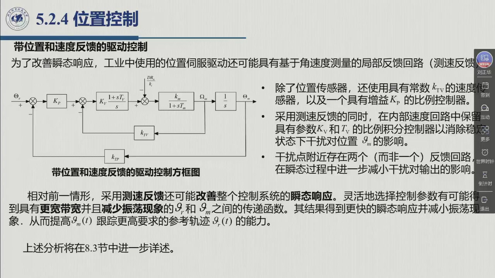

# 5.2.4 位置控制

前面三节把驱动写成了模型，本节用它来**设计控制器**——这是第 8 章（运动控制）的前奏。教材在这里给出的两个结构（**位置反馈**、**位置 + 速度反馈**）几乎所有伺服驱动器都还在用；而「为什么必须加积分」这一问，答案就在驱动的传递函数有两个原点极点里。录播 01:32:31–01:38:10。

## 5.2.4.1 从驱动模型到关节运动控制

教材的问题陈述是：在研究了电气/液压驱动的**角速度控制模式**之后，需要解决**一般的机械手连杆运动控制问题**——「寻找一种能够以自动化方式决定数值时间变化的结构来控制驱动，从而驱使关节执行期望的运动，使末端执行器完成给定的任务」。

流程：**末端执行器姿态轨迹 → 逆运动学（[@def-2.10.1] 的操作空间到关节空间）→ 各关节的期望轨迹 $\vartheta'(t)$**。

::: def 定义 5.2.5 · 独立关节近似 {#def-5.2.5}
教材先给出**最简解**：「首先近似地，设关节运动**独立于其他关节**的运动，即**可以将交互作用视为干扰**」。

于是问题化为：假定可以得到参考轨迹 $\vartheta'(t)$，要确保发动机角位置 $\vartheta_m$ 跟踪 $\vartheta'$（$\vartheta_m$ 由常数为 $k_{TP}$ 的传感器**准确测量**），**有必要借助于对发动机和载荷的模型不确定性与存在的干扰具有「鲁棒性」的反馈控制系统**。

**为什么选直流伺服电机**做关节位置控制？教材给的动机是：「这些执行器具有的**高度灵活性**，在大多数运动控制应用中提供了**优良的响应能力**」。
:::

**独立关节控制的合法性从哪来？** 就是上一节 [@thm-5.2.C] 的两条折算：大减速比把连杆间耦合按 $1/k_r$（力矩）与 $1/k_r^2$（惯量）削弱，剩下的部分当作干扰处理。第 8.3 节会把这条路走完。

## 5.2.4.2 位置反馈：为什么必须加积分

位置伺服需要一个**控制器**：它产生施加到功率放大器的信号，「信号能够自动生成驱动转矩，产生非常接近期望运动 $\vartheta'$ 的轴运动。其结构应该使得参考输入和测量输出之间的**误差最小化**，即使是在发动机、载荷和扰动的动态知识**不准确**的情形下」。

::: thm 定理 5.2.D · 位置反馈控制器：PI 的理由 {#thm-5.2.D}
**（一）干扰该由谁抑制。** 由教材式 (5.9)：**若驱动是速度控制的，则干扰达到最小**。此时（见式 5.6）负载力矩影响发动机轴速度的系数为 $\dfrac{R_a}{k_vk_t}$，**远小于** $\dfrac{1}{F_m}$（后者是传动为力矩控制情形下负载力矩的权）。

**（二）减小干扰影响的一般手段**：**在干扰介入点之前赋予一个大增益值**，同时不影响稳定性。

**（三）稳态要求 ⇒ 必须积分。** 如果在稳态（$\vartheta',\dot\vartheta'$ 均为常量）期望**完全消除**干扰对输出的影响，控制器必须对 $\vartheta'$ 与 $k_{TP}\vartheta_m$ 之差引入的误差应用**积分控制**（integral action）。

**（四）稳定性要求 ⇒ 还要比例。** 「加入**比例控制**的目的是实现稳定控制，但它**不能给闭环系统带来采样时间非常短的阻尼瞬态响应**。其原因是**前向通路传递函数上有两个位于原点的极点**。」

**结论**：采用对误差具有**积分 + 比例**控制的简单控制器（教材图 5.10），参数 $K_r$ 与 $T_p$ 应灵活选择，以确保稳定性并得到良好的动态特性。
:::

第 (四) 条最值得反复读：传递函数 $M(s)=\dfrac{k_m}{s(1+sT_m)}$ 里，$1/s$ 来自「电压 → 位置」的积分，另一个 $1/(1+sT_m)$ 在低频近似又贡献一个积分特性——**两个原点极点 ⇒ 纯比例闭环的相位裕度极差 ⇒ 必须有积分（提高低频增益、消除稳态误差）+ 比例（提供阻尼）配合**。

## 5.2.4.3 位置 + 速度反馈：测速反馈的作用

::: method 方法 5.2.E · 测速反馈的两条改进 {#method-5.2.E}
为了改善瞬态响应，工业中使用的位置伺服驱动还可能具有**基于角速度测量的局部反馈回路（测速反馈）**。具有**位置和速度反馈**的一般结构如图 5.11：除位置传感器外，还使用一个常数为 $k_{TV}$ 的**速度传感器**，以及一个增益为 $K_r$ 的**简单比例控制器**。**采用测速反馈的同时，在内部速度回路中保留具有参数 $K_v$ 和 $T_v$ 的比例积分控制器**，以消除稳定状态下干扰对位置 $\vartheta_m$ 的影响。

它带来两条改进：

1. **干扰抑制更强**：在干扰点附近存在**两个（而非一个）反馈回路**，期望在**瞬态过程中也能进一步减小**干扰对输出的影响；
2. **瞬态响应更好**：灵活选择控制参数，有可能得到具有**更宽带宽**并且**减少振荡**的 $\vartheta_m$ 与 $\vartheta'$ 之间的传递函数——其结果是**更快的瞬态响应并减小振荡**，从而提高 $\vartheta_m(t)$ 跟踪更高要求的参考轨迹 $\vartheta'(t)$ 的能力。
:::

**两条收尾结论**（教材 §5.2.4 末）：

::: note 两条推广 {#note-5.2.1}
**（一）用电流控制电机实现位置伺服。** 如果在传递函数 (5.11) 中使用 (5.13) 中的常数，且**用 $k_t/k_i$ 代替 $R_a/k_v$** 来衡量干扰 $D$ 的权重，就可以采用图 5.9–5.11 的结构。在此情形下，**功率放大器的电压增益 $G_v$ 将不会对控制行为起作用**——因为它已被包在电流环内部（对照 [@thm-5.2.A] 的说明）。

**（二）推广到齿轮耦合。** 上面给出的一般控制结构可以推广到**发动机通过齿轮耦合到负载**的情形：此时采用式 (5.25)(5.26) 就足够了，即**用 $I_{eq}$ 和 $F_{eq}$ 代替 $I_m$ 和 $F_m$，并用因子 $1/k_r$ 衡量干扰**。
:::

**「上述分析将在 8.3 节中进一步详述。」**——本节到此为止，控制器怎么设计、参数怎么取，是第 8 章的正题。

::: think 考点 · 老师原话（录播时间点）

> **位置环 + 速度环是工业标准结构**：老师在图 5.11 上指出，工业上常用的位置伺服就是「外面位置环、里面速度环（PI）」，速度环用来消除稳态干扰、改善瞬态（01:38:49）。

> **独立关节是「把耦合当干扰」**：这一节的出发点就是前面减速比的结论——耦合已被削弱，剩下的按干扰处理（01:32:31 起）。
:::

::: think 默写点 · 合上书再写（主动回忆）

1. 独立关节近似的含义是什么？它凭什么成立？
2. 位置伺服为什么必须同时有积分项与比例项？「两个原点极点」是什么意思？
3. 测速反馈带来哪两条改进？内部速度回路为什么还要保留积分？
4. 用电流控制电机做位置伺服时，$G_v$ 为什么不起作用？推广到齿轮耦合时要用哪些量替换？

::: sol 核对

**把关节之间的耦合当作干扰**，先假设各关节独立，再靠鲁棒反馈抑制耦合。成立依据：大减速比把耦合惯量按 $1/k_r^2$、把耦合力矩按 $1/k_r$ 削弱（[@thm-5.2.C]）。

积分项：稳态下**完全消除干扰**对输出的影响，必须对误差做积分。比例项：提供**稳定与阻尼**。`两个原点极点`指 $M(s)=k_m/[s(1+sT_m)]$ 中 $1/s$ 与低频下 $1/(1+sT_m)$ 的近似积分特性——纯比例控制给不出阻尼良好的瞬态响应。

① 干扰点附近有**两个反馈回路**，瞬态干扰抑制更强；② 可得到**更宽带宽、更少振荡**的传递函数，瞬态更快、跟踪能力更强。内部速度回路保留 PI 是为了**消除稳态下干扰对位置的影响**。

因为放大器已被包在**电流环内部**，只以 $1/k_i$ 的形式进入 $k_m$（[@thm-5.2.A]）。推广到齿轮耦合：用 $I_{eq},F_{eq}$ 代替 $I_m,F_m$，干扰按 $1/k_r$ 折算。

:::

:::

## 5.2.4 小结与常见错误

- **一条近似**：独立关节（耦合当干扰），依据是大减速比的削弱作用。
- **两个结构**：位置反馈（PI）与位置 + 速度反馈（外环位置、内环速度 PI）。
- **一条理由**：两个原点极点 ⇒ 纯比例不够，必须有积分消除稳态误差、比例提供阻尼。
- **两条推广**：电流控制电机（$G_v$ 失效、用 $k_t/k_i$ 衡量干扰）；齿轮耦合（用 $I_{eq},F_{eq}$，干扰 $1/k_r$）。

::: think 常见错误清单 · 自查三条
1. 只写「PI 控制器」而说不出**各自解决什么问题**——积分管稳态、比例管稳定/阻尼。
2. 认为测速反馈只是「多测一个量」——它的实质是**多一个反馈回路**，故瞬态干扰也被抑制。
3. 忘记速度控制驱动对干扰的抑制**更好**（$R_a/k_vk_t\ll1/F_m$）——这是选速度控制模式的理由。
:::