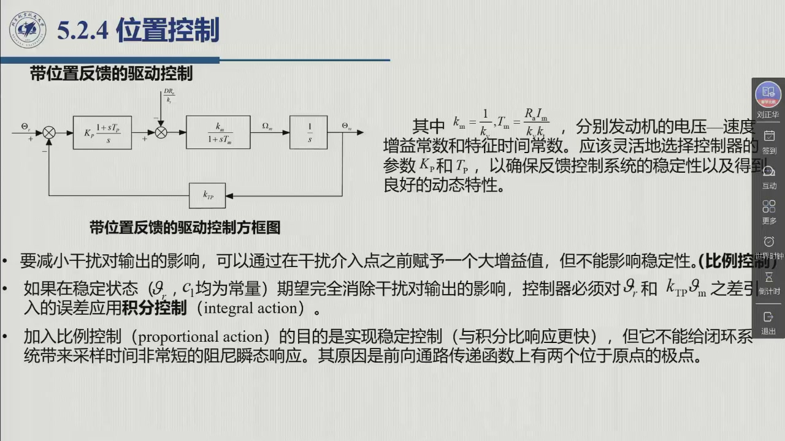
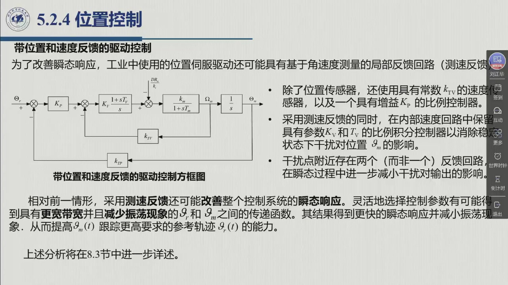

# 5.2.4 位置控制

上一节通过[减速比折算](sec5-2-3.md)把负载惯量、黏滞摩擦和负载力矩全部搬到了电机轴上。有了写在电机轴上的二阶对象模型，现在可以把控制系统搭起来了：从第四章得到的期望轨迹出发，用位置传感器读回实际转角，分别加入比例、积分和速度反馈，看每一项控制作用究竟改变了误差微分方程里的哪一项，以及恒定外部负载在什么条件下才能被彻底抵消。课堂回看：01:32:31–01:38:10。

先备好两个前置工具：[减速比与折算](../recall.md#gear)与[传递函数与极点](../recall.md#laplace)。下文 $\theta$ 表示电机轴角，期望电机轴角记 $\theta_d$；若上层规划给出关节角 $q_d$，须先乘减速比换成 $\theta_d=k_rq_d$。比较点两侧必须统一单位和轴侧，传感器电压先除以标定增益再与参考角相减。

## 5.2.4.1 从驱动模型到关节运动控制

真实机械手各连杆之间存在惯性和力矩耦合。上一节看到大减速比可以把其他连杆折算过来的影响压小，于是可以先做一个工程简化，把各轴分开控制。

::: def 定义 5.2.5 · 独立关节近似 {#def-5.2.5}
将其他关节的动力学耦合以及未建模负载扰动统一看成作用于本轴的外部干扰力矩，先为每个关节独立设计反馈控制器。这一近似的前提是实际惯量比 $I/(k_r^2I_m)$、速度和耦合扰动在控制能力内可控；大减速比会削弱折算耦合，但并未切断连杆间的物理联系。
:::

沿用 [§5.2.1](sec5-2-1.md) 忽略电感快速动态的电机模型，并在经减速器折算后把系数记作等效惯量 $I_{eq}>0$（$\mathrm{kg\cdot m^2}$）、等效阻尼 $b>0$（合并机械黏滞摩擦与速度控制模式下的反电动势阻尼，单位 $\mathrm{N\cdot m\cdot s/rad}$）、输入力矩增益 $k>0$ 以及沿正转方向阻碍运动的负载扰动 $d$，电机侧运动方程写成

$$I_{eq}\ddot\theta+b\dot\theta=ku-d.$$

取零负载（$d=0$）、零初值做拉普拉斯变换，得位置对控制输入的传递函数：

$$\frac{\Theta(s)}{U(s)}=\frac{k}{s(I_{eq}s+b)}=\frac{k/b}{s(1+sI_{eq}/b)}.$$

对象开环只有一个位于原点的极点 $s=0$（来自转速积分成角位置）和一个实负极点 $s=-b/I_{eq}$。注意 $1/(1+sT_m)$ 在低频时趋于常数 1，不是真正的原点极点（仅在低频带以外才像斜率 $-20\ \mathrm{dB/dec}$ 的积分斜率）；因此无积分器的纯比例控制面对负载扰动时仍会留下稳态误差。

## 5.2.4.2 位置反馈：比例能做到什么，为什么再加积分

先试最简单的纯比例控制，看看它会遇到什么问题。令[误差](../recall.md#error) $e=\theta_d-\theta$，目标位置 $\theta_d$ 固定不变（$\dot\theta_d=\ddot\theta_d=0$），则 $\dot\theta=-\dot e$、$\ddot\theta=-\ddot e$。将比例控制律 $u=K_Pe$ 代入对象方程：

$$I_{eq}(-\ddot e)+b(-\dot e)=kK_Pe-d \quad\Longrightarrow\quad I_{eq}\ddot e+b\dot e+kK_Pe=d.$$

无负载（$d=0$）时，只要 $K_P>0$，二阶误差方程系数全正，系统渐近稳定。对照[二阶模型](../recall.md#second-order)，自然频率 $\omega_n=\sqrt{kK_P/I_{eq}}$，阻尼比 $\zeta=\dfrac{b}{2\sqrt{I_{eq}kK_P}}$。如果一味靠增大 $K_P$ 来加快响应，阻尼比 $\zeta$ 会按 $1/\sqrt{K_P}$ 下降，阶跃超调和振荡随之变大。

更麻烦的是存在恒定负载力矩 $d\neq0$（例如连杆承受重力矩）：稳态时误差各阶导数为零（$\dot e=\ddot e=0$），直接给出稳态偏差

$$e_{ss}=\frac{d}{kK_P}.$$

取一组数字试算：$I_{eq}=b=k=1$，$K_P=4$，$d=0.4$，则稳态误差 $e_{ss}=0.4/4=0.1\ \mathrm{rad}$。只要负载 $d$ 不为零且比例增益 $K_P$ 有限，纯比例控制就不得不“带着一点误差才能输出顶住负载的力矩”。要彻底消掉这个稳态误差，就要加上积分环节，让持续存在的微小误差不断累积成一个稳态保持量。

::: thm 定理 5.2.D · PI 的作用及稳定条件 {#thm-5.2.D}
引入积分状态 $z$ 满足 $\dot z=e$，取比例积分（PI）控制律 $u=K_Pe+K_Iz$。在固定目标与恒定负载 $d$ 的平衡态下，必须有 $\dot z=0$，即稳态误差 $e_{ss}=0$；此时维持负载所需的控制量由积分项 $z_{ss}=d/(kK_I)$ 自动保存下来，使电机能在零位置误差下输出抵消负载的力矩。

但是增加积分环节把闭环系统从二阶升到了三阶，正参数不再自动保证稳定。将 $u=K_Pe+K_Iz$ 代入对象方程得 $I_{eq}\ddot e+b\dot e+kK_Pe+kK_Iz=d$，两边对时间求导并用 $\dot z=e$ 消去 $z$（恒定负载 $\dot d=0$）：

$$I_{eq}e^{(3)}+b\ddot e+kK_P\dot e+kK_Ie=0.$$

特征多项式为 $I_{eq}s^3+bs^2+kK_Ps+kK_I$，其 Routh 阵列第一列为 $I_{eq},\ b,\ kK_P-\dfrac{I_{eq}kK_I}{b},\ kK_I$。在各物理与控制参数为正的前提下，闭环稳定还必须满足（01:36:10–01:37:50）

$$bK_P>I_{eq}K_I.$$

仍取前面的算例（$I_{eq}=b=k=1$，$K_P=4$）：取 $K_I=1$ 时 $bK_P=4>1=I_{eq}K_I$，闭环稳定；若贪快把 $K_I$ 调大到 $5$，则 $4<5$，闭环发散失稳。工程中执行器饱和时还须配抗积分饱和处理，避免积分状态无限制累积。
:::

## 5.2.4.3 位置与速度反馈：阻尼从哪里增加

前面看到单靠增大 $K_P$ 会降低阻尼比，且加入积分会削弱相位裕度。工业伺服驱动器（01:37:53–01:39:10）通常同时引入角速度测量构成内层速度反馈，先看直接测速反馈项 $-K_D\dot\theta$ 改变了误差方程里的哪一项：将 $u=K_Pe-K_D\dot\theta$（固定目标下 $\dot\theta=-\dot e$）代回对象方程，得

$$I_{eq}\ddot e+(b+kK_D)\dot e+kK_Pe=d.$$

$K_D>0$ 直接把阻尼系数从 $b$ 加大到 $b+kK_D$，使阻尼比提高而不必牺牲刚度；但它不改变稳态平衡 $kK_Pe_{ss}=d$，可见“增加阻尼抑制振荡”与“用积分消除恒定负载偏差”各自独立，不能互相代替。

::: method 方法 5.2.E · 外位置环与内速度 PI {#method-5.2.E}
工业伺服更常采用串级控制：外环位置比例控制器生成期望转速 $\omega_d$，内环速度 PI 控制器跟踪该转速并抑制负载干扰：

$$\omega_d=K_x(\theta_d-\theta),\qquad
e_v=\omega_d-\dot\theta,\qquad
u=K_ve_v+K_{Iv}\int e_v\,\mathrm dt.$$

其中 $K_x$ 为外环位置增益，$K_v,K_{Iv}$ 为内环速度比例、积分增益（速度控制器中的积分作用在速度误差上，与对象自身把速度积分为位置的环节不同）。当速度内环足够快且跟踪精确时，可近似认为 $\dot\theta\approx\omega_d=K_xe$，在固定目标下化为 $\dot e\approx-K_xe$，呈一阶无超调衰减；但这是内环足够快时的近似，完整系统仍是高阶的。

把积分状态 $z_v=\int e_v\,\mathrm dt$ 和固定目标下的 $e_v=K_xe+\dot e$ 代回 $I_{eq}\ddot\theta+b\dot\theta=ku-d$，再对时间求导消去 $\dot z_v=e_v$（设 $d$ 为常数），得到完整三阶误差方程：

$$I_{eq}e^{(3)}+(b+kK_v)\ddot e+k(K_vK_x+K_{Iv})\dot e+kK_{Iv}K_xe=0.$$

所有参数为正时，同样要用 Routh 判据核查稳定性条件：

$$(b+kK_v)(K_vK_x+K_{Iv})>I_{eq}K_{Iv}K_x.$$

实际工程设计还须进一步纳入采样周期、测量噪声、执行器延迟和饱和限幅检验。
:::

::: note 两条推广 {#note-5.2.1}
第一，若驱动器开启了高增益电流内环（力矩控制发电机，[§5.2.1](sec5-2-1.md)），功放增益 $G_v$ 被包进电流环内部，前向增益和干扰权重须改按 $k_t/k_i$ 与 $1/F_m$ 选取，不能原样套用电压驱动下的反电动势阻尼系数。第二，经过减速器驱动关节负载时，上述模型中的惯量和阻尼用折算后的 $I_{eq},F_{eq}$ 替换，负载扰动按 $d/k_r$ 折算（[§5.2.3](sec5-2-3.md)）。
:::

::: think 独立检查
1. 已有一个机械位置积分器，为何比例控制下仍可能有恒定负载误差？
2. $I_{eq}=2,b=3,k=1,K_P=4$ 时，PI 的 $K_I$ 应满足什么稳定条件？
3. 加入速度反馈 $K_D=2$ 后，二阶误差方程哪个系数改变？固定负载偏差是否因此为零？

::: sol 核对
1. 机械位置积分器位于负载扰动注入点之后，指令端与负载端传递函数不同；稳态平衡直接由 $kK_Pe_{ss}=d$ 给出非零偏差。
2. 由 $bK_P>I_{eq}K_I$ 得 $3\times4>2K_I$，结合 $K_I>0$ 得 $0<K_I<6$（等号处为临界稳定，不是渐近稳定）。
3. 速度项系数由 $3$ 变为 $3+1\times2=5$（阻尼增大）；稳态仍满足 $kK_Pe_{ss}=d$，恒定负载偏差不变。
:::
:::

## 5.2.4 小结与常见错误

在独立关节近似下，经减速折算的单轴模型为 $I_{eq}\ddot\theta+b\dot\theta=ku-d$。比例反馈提供刚度但有稳态负载偏差 $d/(kK_P)$；加入积分能消除恒定负载稳态误差，但须满足稳定条件 $bK_P>I_{eq}K_I$；加入测速反馈或串级速度 PI 环可增加阻尼并抑制瞬态干扰。多关节耦合的精确动态补偿将在第七章展开。

::: think 常见错误清单 · 自查三条
1. 只记“PI 控制器”，却说不清比例与积分的分工，也忘了检查三阶闭环的稳定性界限 $bK_P>I_{eq}K_I$。
2. 以为加入测速反馈能顺带消除恒定负载下的稳态位置误差（实际上速度反馈在稳态时 $\dot\theta=0$，不影响 $e_{ss}=d/(kK_P)$）。
3. 在串级控制中把内环足够快时的一阶近似 $\dot e\approx-K_xe$ 当成完整系统的真实阶次，忽视了内环带宽与稳定性校验。
:::
