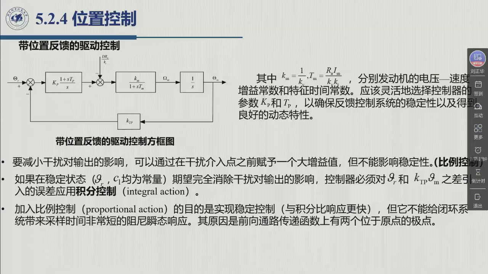
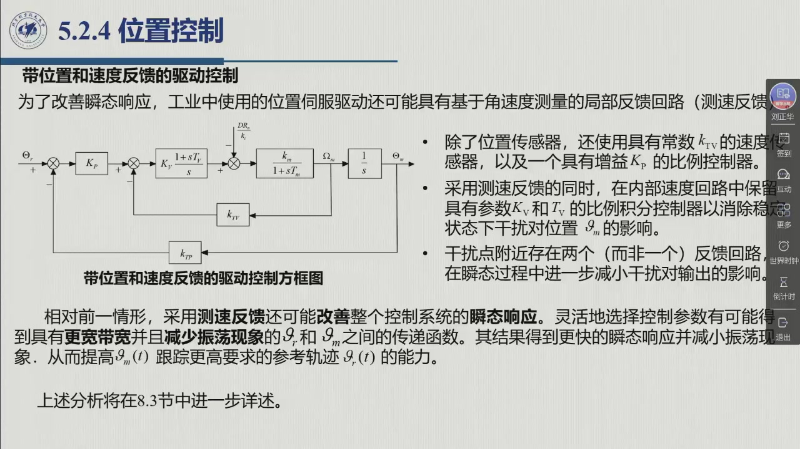

# 5.2.4 位置控制

上一节将负载惯量和力矩折算到电机侧。有了轴侧模型，现在可以计算反馈怎样修正位置偏差，以及恒定负载下还会剩下什么误差。本节依次加入比例、积分和速度反馈，比较它们改变了误差方程中的哪一项。录播对应01:32:31–01:38:10。

先恢复两个前置概念：[减速比与折算](../recall.md#gear)、[传递函数与极点](../recall.md#laplace)。以下 $\theta$ 表电机轴角，参考记 $\theta_d$；若任务给关节角 $q_d$，须先换成 $\theta_d=k_rq_d$。所有反馈比较量必须采用相同单位和比例，传感器电压须先除以标定增益。

## 5.2.4.1 从驱动模型到关节运动控制

::: def 定义 5.2.5 · 独立关节近似 {#def-5.2.5}
将其他关节的耦合、未建模负载等作为扰动，先为每个轴设计独立反馈。这个近似需要用实际惯量比、速度和负载检查；大减速比减小折算负载，并不自动消除所有耦合。
:::

沿用本章电机模型，忽略电感的快速动态后，可将机械侧写成

$$I_{eq}\ddot\theta+b\dot\theta=ku-d.$$

这里 $I_{eq}>0$ 是折算到电机侧的惯量（kg·m²），$b>0$ 是黏滞及反电动势形成的等效阻尼（N·m·s/rad），$k>0$ 把控制输入 $u$ 换成驱动力矩，$d$ 为沿正运动方向的阻力矩。第七章将保留更完整的机械臂模型；这里先研究这条线性近似。

无负载、零初值下，位置对输入的传递函数是

$$\frac{\Theta(s)}{U(s)}=\frac{k}{s(I_{eq}s+b)}
=\frac{k/b}{s(1+sI_{eq}/b)}.$$

**这里有一个原点极点 $s=0$，另一个极点是 $s=-b/I_{eq}$。** $1/(1+sT_m)$ 在低频趋近常数1，不是积分器。只有再加入 PI 控制器的积分环节，开环才多出一个原点极点。

## 5.2.4.2 位置反馈：比例能做到什么，为什么再加积分

取[误差约定](../recall.md#error) $e=\theta_d-\theta$，先考虑固定目标。比例控制 $u=K_Pe$ 代回模型；因 $\dot\theta=-\dot e$、$\ddot\theta=-\ddot e$，得到

$$I_{eq}\ddot e+b\dot e+kK_Pe=d.$$

无负载时，$K_P>0$ 给一条具有正系数的稳定二阶误差方程。对照[二阶模型](../recall.md#second-order)，有 $\omega_n=\sqrt{kK_P/I_{eq}}$、$\zeta=b/(2\sqrt{I_{eq}kK_P})$。提高 $K_P$ 会提高自然频率，却降低该模型的阻尼比，不能只靠增大比例同时保证快速和少振荡。

有恒定负载时，稳态导数为零，故

$$e_{ss}=\frac{d}{kK_P}.$$

例如 $I_{eq}=b=k=1$、$K_P=4$、$d=0.4$，稳态误差为0.1 rad。要减小偏差，可提高比例增益或补偿负载；若加入反馈积分，持续存在的偏差会使控制量继续积累。

::: thm 定理 5.2.D · PI 的作用及稳定条件 {#thm-5.2.D}
令积分状态 $z$ 满足 $\dot z=e$，控制律为 $u=K_Pe+K_Iz$。固定目标、恒定负载时，平衡要求 $e=0$，而积分值 $z=d/(kK_I)$ 保留抵消负载所需的输入。积分状态可以非零，误差则为零。

但稳定性必须另外检查。代入模型后，对误差方程再求导、用 $\dot z=e$ 消去积分，得到

$$I_{eq}e^{(3)}+b\ddot e+kK_P\dot e+kK_Ie=0.$$

特征多项式 $I_{eq}s^3+bs^2+kK_Ps+kK_I$ 的 Routh 第一列为 $I_{eq},b,kK_P-I_{eq}kK_I/b,kK_I$。在各参数正的前提下，稳定还须满足

$$bK_P>I_{eq}K_I.$$

例如上述参数取 $K_I=1$ 满足条件，取 $K_I=5$ 则不满足。积分能消除这条稳定模型下的恒定负载偏差，但过大的积分增益可使系统失稳；实际饱和时还需防止积分继续累积。
:::

## 5.2.4.3 位置与速度反馈：阻尼从哪里增加

先在同一简化模型上加入测速反馈，取固定目标下 $u=K_Pe-K_D\dot\theta$。代回并换成误差变量：

$$I_{eq}\ddot e+(b+kK_D)\dot e+kK_Pe=d.$$

$K_D>0$ 增加了速度项系数，即增加模型阻尼；它不改变恒定负载下的 $e_{ss}=d/(kK_P)$。因此“抑制振荡”和“消除恒定偏差”是两种不同要求。速度反馈本身不等于积分。

::: method 方法 5.2.E · 外位置环与内速度 PI {#method-5.2.E}
常用串级结构先由位置误差生成期望速度，再由速度环调节电机：

$$\omega_d=K_x(\theta_d-\theta),\qquad
 e_v=\omega_d-\dot\theta,\qquad
 u=K_ve_v+K_{Iv}\int e_vdt.$$

$K_x$ 是外环位置增益，$K_v,K_{Iv}$ 是速度环比例、积分增益。位置环先生成速度目标，速度环再生成驱动输入；速度控制器中的积分与“速度积分成位置”属于不同的环节。

内环足够快且跟踪良好时，可近似取 $\dot\theta=\omega_d=K_xe$。固定目标下 $\dot e=-\dot\theta$，所以 $\dot e=-K_xe$。这个一阶结果依靠内环近似；完整模型并没有自动降为一阶。

仍用本节的机械模型，令 $z_v=\int e_vdt$。固定目标时 $e_v=K_xe+\dot e$。把控制律代入机械方程，再对误差方程求导消去 $z_v$，得到

$$I_{eq}e^{(3)}+(b+kK_v)\ddot e+k(K_vK_x+K_{Iv})\dot e+kK_{Iv}K_xe=0.$$

在所有参数为正时，还需检查 Routh 条件

$$(b+kK_v)(K_vK_x+K_{Iv})>I_{eq}K_{Iv}K_x.$$

可见串级结构仍需由完整特征方程判断稳定性。真实驱动中的采样、延迟和限幅，也应加入相应模型继续检查。
:::

::: note 两条推广 {#note-5.2.1}
电流闭环能使力矩近似跟随指令，此时要按电流驱动的机械模型重新取 $k,b$，不能原样照搬电压驱动的反电动势阻尼。经减速器连接负载时，用 $I_{eq},F_{eq}$ 替换本体参数，阻力矩按 $1/k_r$ 折算。是否能忽略电气动态，取决于所研究频率与内环带宽。
:::

::: think 独立检查
1. 已有一个机械位置积分器，为何比例控制下仍可能有恒定负载误差？
2. $I_{eq}=2,b=3,k=1,K_P=4$ 时，PI 的 $K_I$ 应满足什么稳定条件？
3. 加入速度反馈 $K_D=2$ 后，二阶误差方程哪个系数改变？固定负载偏差是否因此为零？

::: sol 核对
1. 原点极点说明参考到位置的开环关系，不自动消除在不同位置进入的负载扰动；直接由平衡式得 $kK_Pe_{ss}=d$。
2. $3\times4>2K_I$，结合 $K_I>0$ 得 $0<K_I<6$。等号处不是渐近稳定。
3. 速度系数由3变为 $3+1\times2=5$；稳态仍由 $kK_Pe_{ss}=d$ 决定。
:::
:::

## 5.2.4 小结与常见错误

比例根据当前偏差修正，积分保存持续抵消恒定负载的输入，速度反馈增加本模型的阻尼。先写误差方程，再检查极点与负载平衡，才知道每一项解决什么问题。真实机械臂的耦合补偿与跟踪控制在第七章继续。
