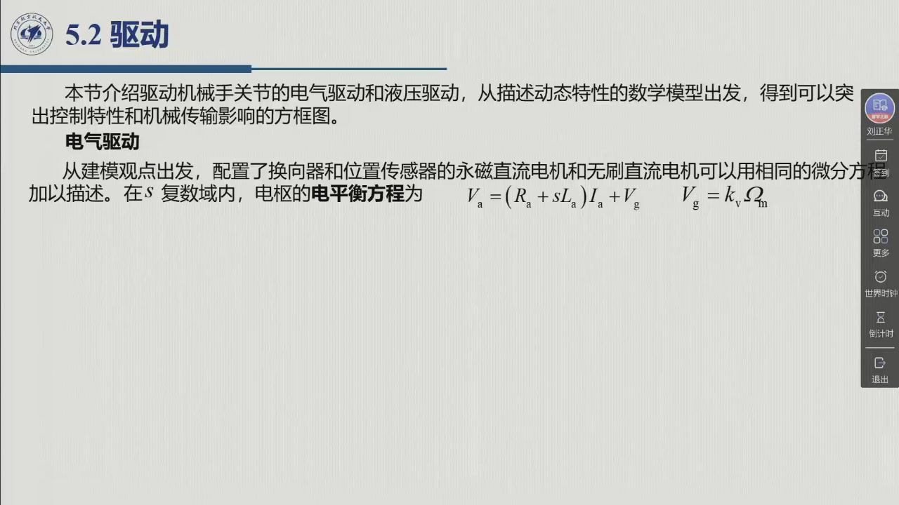

# 5.2 驱动

§5.1 讲的是**部件**，本节讲**整条驱动链的动态行为**。教材开篇一句就定下了方法（§5.2）：

> 「本节介绍驱动机械手关节的电气驱动和液压驱动的工作。**从描述动态特性的数学模型出发，得到可以突出控制特性和机械传输影响的方框图。**」

也就是说：本节不满足于「电机有电阻电感」这种定性描述，而是要把每一段写成传递函数，最后拼成一张**能拿去设计控制器**的框图——这张框图将在第 8 章（运动控制）里被直接使用。录播 01:03:28–01:44:57。

<aside class="lesson-brief" aria-label="5.2 学习简报">

PREREQUISITE<strong>你需要先会</strong>
拉普拉斯变换与传递函数；一阶惯性环节 $G/(1+sT)$ 的时域含义；功率放大器在两种电机上的形态（[@thm-5.1.D]）。

TARGET<strong>本节要建立</strong>
电气驱动的四个基本方程（电枢电平衡、反电动势、力学平衡、力矩方程）与含电流反馈的驱动框图；**速度控制发电机 / 力矩控制发电机**两种特性的由来与统一传递函数 $M(s)=k_m/[s(1+sT_m)]$；液压驱动的六条方程与它的完全类比；传动装置如何按 $1/k_r$ 改写等效惯量与摩擦；位置控制加上积分的理由与测速反馈的作用。

CHECKPOINT<strong>学完的标准</strong>
能默写电枢电平衡与力学平衡两组方程；能说出「为什么独立关节控制时**不建议**在回路里加电流反馈」，而集中控制时**必须**加；能把液压驱动的框图与电气驱动框图逐框对应起来；能背出 $I_{eq}$ 与 $F_{eq}$ 的表达式。

</aside>

## 两条路线与一条类比

本节要建立的两个模型**结构完全平行**，教材特意点明：「**图 5.2 和图 5.6 的结构比较清楚地显示了电气驱动和液压驱动动态特性的类比关系**」。这个类比可以一次性记住：

| 电气驱动 | 液压驱动 | 角色 |
|:--|:--|:--|
| 电枢电压 $v_a$ | 阀杆位移 $x$ | **控制作用的入口** |
| 电枢电流 $i_a$ | 压差 $p$ | **与输出力矩成正比的内变量** |
| 电流反馈回路（传感器 $k_i$） | 压力反馈回路 | 局部反馈（结构特征） |
| 电枢电感 $L_a$、电阻 $R_a$ | 可压缩性流速 $Q_c$、渗漏 $Q_l$ | 造成**动态滞后**的储能/泄漏项 |

但教材随即给出一句重要的**警告**：**「这种类比不应令人相信，可以由液压驱动来实现速度控制发电机或力矩控制发电机的作用」**——压力反馈回路是液压系统的**固有结构特征**，「除非引入适当变换器并实现相关控制电路，否则不能将其修正」。换句话说：电气驱动可以**选用**要不要电流反馈，液压驱动的压力反馈**去不掉**。

::: think 考点 · 老师原话（录播时间点）

> **执行系统是心脏、是肌肉**：「整个上面就是咱们的关节执行系统……是（机器人）机械系统的**心脏**，相当于咱们**人体的肌肉**这部分」（01:03:27）。

> **接下来改从数学模型看**：「咱们下面的几个 PPT 呢，主要就是**从数学模型的角度出发**，来分析咱们驱动系统或者执行系统的（性能）」（01:03:49）。
:::

::: think 默写点 · 合上书再写（主动回忆）

1. 本节的方法是什么（一句话）？
2. 电气驱动与液压驱动的框图里，哪两个变量互为类比？哪一个变量各自与输出力矩成正比？
3. 为什么说液压的压力反馈「去不掉」，而电气的电流反馈可以「不用」？

::: sol 核对

从描述动态特性的**数学模型**出发，画出能突出**控制特性**与**机械传输影响**的方框图。

控制入口：电枢电压 $v_a$ ↔ 阀杆位移 $x$；与输出力矩成正比的量：电枢电流 $i_a$ ↔ 压差 $p$。

因为压力反馈是液压伺服阀/分布器/发动机这一物理结构的**固有特征**，除非额外引入变换器与控制电路才能改；而电流反馈在电气驱动里是一个**可以取舍的设计选择**（例如为抑制干扰力矩可以不加）。

:::

:::

## 5.2 小结与常见错误

- **一条方法论**：从**数学模型**出发，把每一段写成方程，最后拼成能拿去设计控制器的**框图**（本节给出的两张图，第 8 章直接使用）。
- **一组类比**：电气驱动与液压驱动的框图**结构平行**（控制入口、与力矩成正比的内变量、局部反馈回路），但**压力反馈是液压的结构特征、去不掉**，电流反馈则是可取舍的设计选择。
- **本章其余各节的引子**：5.2.1 建立电气模型、5.2.2 建立液压模型、5.2.3 量化传动装置的影响、5.2.4 用它设计位置环。

::: think 常见错误清单 · 自查三条
1. 以为「电气与液压可以互相替代特性」——教材明确警示：**不能**由液压实现速度 / 力矩控制发电机的作用（或反之）。
2. 把驱动建模当成纯理论——这里的每一张框图都在第 8 章的控制器设计里出现。
3. 漏掉「局部反馈」这一层——电气侧是电流环、液压侧是压力环，这是两者动态差别的关键所在。
:::
