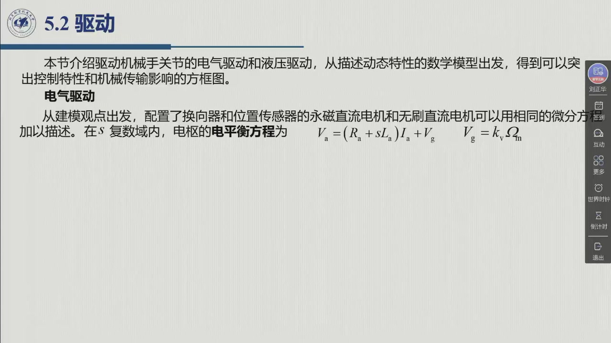

# 5.2 驱动

知道部件组成后，还需预测它们怎样响应。增加控制电压时，电流受电气方程约束，转子也需要加速过程；接入负载后，响应还会改变。本节把输入、内部变量与机械输出连成方程，再判断哪些动态可以省略。课堂回看：01:03:28–01:44:57。

建立[传递函数](../recall.md#laplace)之前，先回答三个问题：输入是电压还是参考电流，输出是转速还是位置，负载力矩从哪里进入。同一台电机换一个输入端口，得到的模型就可能不同。

## 两条路线与一条类比

电气驱动从电压平衡和机械平衡出发；液压驱动从流量平衡、压差关系和机械平衡出发。两者都先求产生驱动力矩的内部变量，再由净力矩决定加速度。

| 建模问题 | 电气侧 | 液压侧 |
|:--|:--|:--|
| 从哪里施加命令 | 电枢电压，或电流环的参考输入 | 伺服阀命令或阀杆位移 |
| 什么量产生力矩 | 电枢电流 $i_a$ | 执行器压差 $p$ |
| 还要保存什么动态 | 电感中的电流变化 | 流体压缩引起的压力变化 |
| 运动怎样影响输入侧 | 转速产生反电动势 | 运动消耗流量，负载压差影响阀流量 |

表中对应关系帮助组织方程，但不能将两种介质逐项替换。还要区分物理关系与附加控制：反电动势由电机转动产生，电流反馈则需要另设测量与控制回路；同样，液压压差与流量之间的耦合，并不等于另加了压力反馈环。

不装压力传感器，负载压差仍会影响阀流量；装上传感器后，则可以进一步设计压力或力矩反馈，并重新分析闭环模型。因此控制接口不能只从框图外形判断，模型中的物理耦合也应保留。

接下来的顺序是：在 [§5.2.1](sec5-2-1.md) 中保留电流与转速两个动态，逐步得到电气驱动的降阶模型；在 [§5.2.2](sec5-2-2.md) 中对流量和压力做同类消元；在 [§5.2.3](sec5-2-3.md) 把负载折算到电机侧；最后用 [§5.2.4](sec5-2-4.md) 的位置反馈检查跟踪与负载偏差。

::: think 检查理解
一个驱动器接受“电流指令”，另一个接受“电压指令”。能否直接用同一个输入增益和时间常数比较它们？为什么无负载传递函数还不能回答“加上负载后位置偏差多少”？

::: sol 核对
不能。两者输入端口和单位不同，内部闭环也不同。负载是另一个输入，必须保留它到输出的通路，再结合位置控制器求闭环响应。
:::
:::
