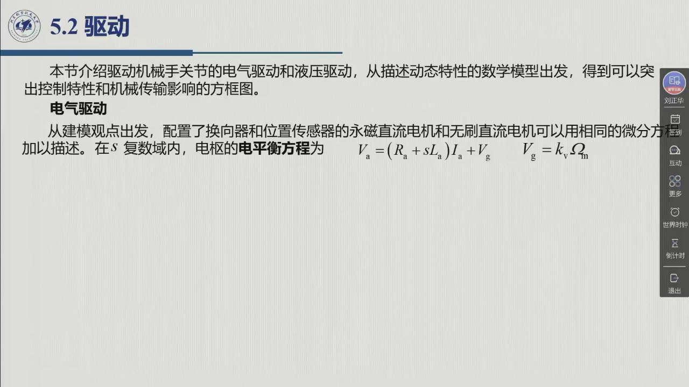

# 5.2 驱动

[§5.1](sec5-1.md) 到 [§5.1.4](sec5-1-4.md) 在“能量—驱动—传动—测量”链上排出了能源、功放、伺服发动机和传动装置四个部件并算清了稳态功率账。知道了部件构成，下一步就要预测它们随时间怎样响应：突然提高控制电压时，电流因为电感不会瞬间跳变，转子因为惯量也不会立刻达到目标转速，接上外部负载后响应还会进一步改变。本节转向驱动动态建模，把控制输入、内部变量和机械运动写成微分方程与[传递函数](../recall.md#laplace)，画成能够直接用于第七章控制律设计的方框图（01:03:28–01:04:30）。课堂回看：01:03:28–01:44:57。

写传递函数之前要先确定三个口径：控制命令接在电压端口还是电流环参考端；输出取角速度还是角位置；负载阻力矩作为第二个输入从哪一步进入。同一台电机换一个输入端口，得到的开环增益和主时间常数就不同。

## 两条路线与一条类比

电气驱动和液压驱动的物理变量不同，建模结构却完全平行：两者都先写驱动介质的平衡方程求出内部产力变量（电枢电流 $i_a$ 或执行器压差 $p$），再由力矩平衡决定转子加速度，同时把转速反过来对输入侧的抵消效应保留在方程里。

| 建模环节 | 电气侧 | 液压侧 |
|:--|:--|:--|
| 控制命令入口 | 电枢电压 $v_a$，或电流环参考输入 $v_c'$ | 伺服阀指令 $v_c$ 或阀杆位移 $x$ |
| 产生力矩的内部变量 | 电枢电流 $i_a$ | 执行器两侧压差 $p$ |
| 造成滞后的储能与损耗项 | 电感 $L_a$ 中的电流变化、电阻 $R_a$ 压降 | 流体可压缩性流量 $Q_c$、渗漏流量 $Q_l$ |
| 运动对输入侧的反馈 | 转速产生反电动势 $v_g=k_v\omega_m$ | 运动消耗容积流量，负载压差改变阀口流量 |

对照两列能帮助记忆方程结构，但不能把两类执行器当作等价替代。最重要的是分清“物理自然耦合”和“额外传感器闭环”：反电动势由转子切割磁感线自然产生，而电枢电流环是人为加装传感器 $k_i$ 与调节器构成的局部反馈；在液压侧，负载压差直接影响阀口流量是机械与流体结构的固有特征，即便不装压力传感器它也存在，因此液压驱动无法像电机去掉电流环那样直接拆掉压力耦合（若加装压力传感器，则是再叠一层主动控制）。

接下来四小节的推进路线是：[§5.2.1](sec5-2-1.md) 从电气与机械四方程消元得到电压驱动和电流环两种电机模型；[§5.2.2](sec5-2-2.md) 用同一消元思路处理液压驱动的流量与压差；[§5.2.3](sec5-2-3.md) 加上减速器，把关节端的惯量、摩擦和负载折算回电机轴；[§5.2.4](sec5-2-4.md) 在轴侧模型上加入位置与测速反馈，分析稳态偏差与瞬态阻尼。

::: think 检查理解
1. 一个驱动器接受“电流指令”，另一个接受“电压指令”。能否直接用同一个输入增益和时间常数比较它们？
2. 为什么无负载传递函数还不能回答“加上负载后位置偏差多少”？
3. 电气侧的电流反馈与液压侧的压差—流量耦合，在设计自由度上有什么区别？

::: sol 核对
1. 不能。两者输入端口和单位不同，内部闭环结构也不同，得到的等效增益与时间常数表达式不同。
2. 负载阻力矩是独立的扰动输入，必须保留它到输出的传递通道，再结合位置控制器求出闭环稳态误差与响应。
3. 电流反馈是电气驱动中可按控制目标取舍的设计环路；而液压中负载压差对阀流量的影响是结构固有的物理耦合，不加额外传感器与调节回路无法直接取消。
:::
:::

## 5.2 小结与常见错误

驱动建模从物理平衡方程出发，建立从控制输入和负载扰动到关节速度、位置的传递函数与方框图。电气驱动与液压驱动在方程形式上平行对照（电枢电流对应压差、反电动势对应运动耗流），但电流反馈可选、液压阀口的压差耦合固有存在。

::: think 常见错误清单 · 自查三条
1. 把电气和液压的类比当成性能等价：两者端口特性和固有耦合不同，不能假设液压能直接照搬电机的速度／力矩模式切换。
2. 忽略负载输入通道，只写参考指令到位置的无负载传递函数，导致后续无法分析恒定负载带来的稳态偏差。
3. 把电机自身的反电动势（物理耦合）与电流反馈（外加测量闭环）混为一谈。
:::
