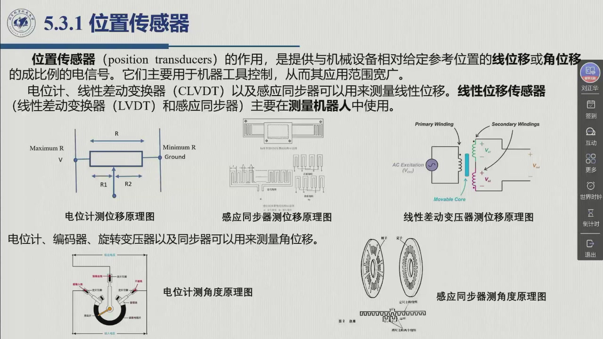
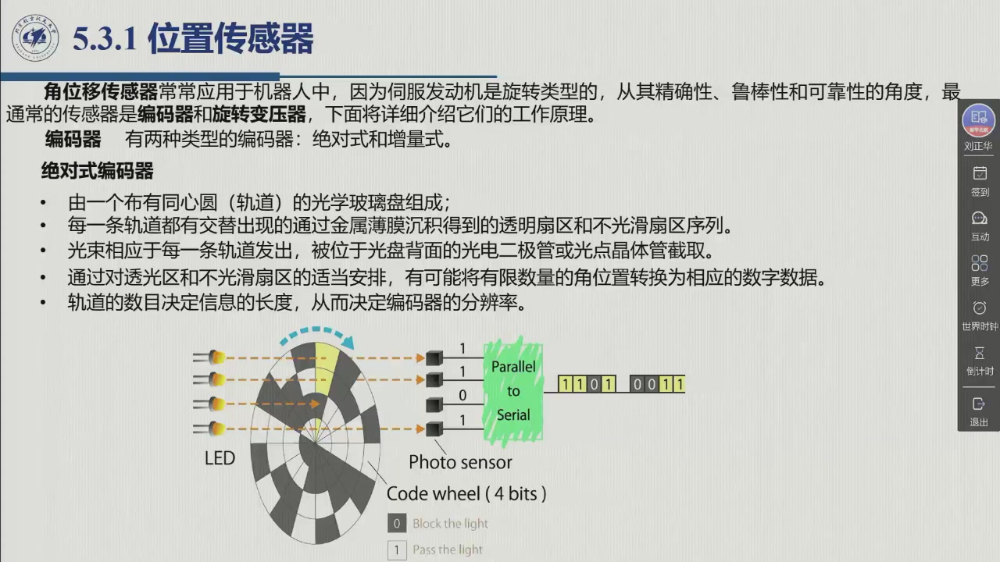
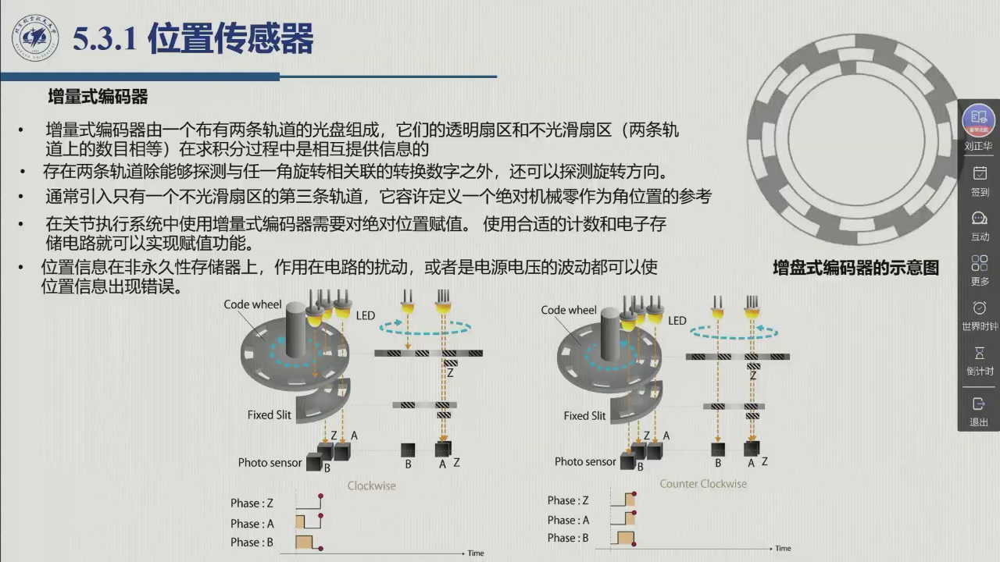
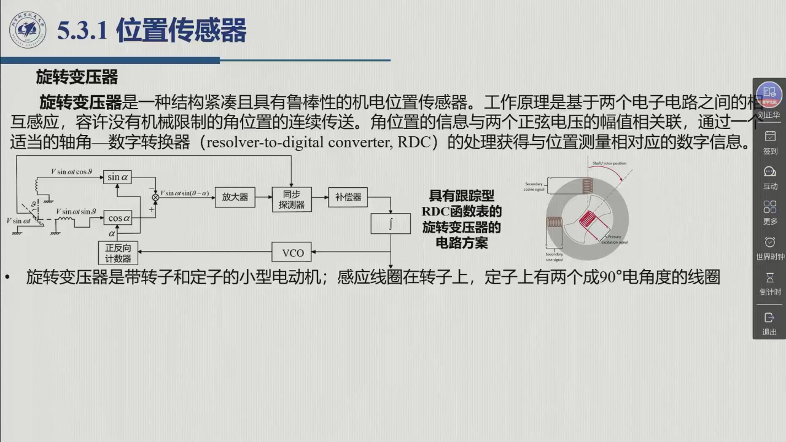

# 5.3.1 位置传感器

本节兑现上一节的第一个基本反馈量：**位置**。器件清单不长，但要分清三件事——**电位计**这类最直观的接触式器件为什么退居教学图纸；**编码器**为什么分成绝对式与增量式两族，各自的「坑」在哪（格雷码、判向、圈数与掉电）；以及**旋转变压器**为什么在精度与鲁棒性上是另一条路线。顺路回答三个工程问题：12 轨的编码器够不够、减速之后谁去记圈数、增量式为什么必须回到零位。录播 01:48:03–01:57:55。

## 5.3.1.1 位置传感器的定义与器件清单

::: def 定义 5.3.2 · 位置传感器 position transducers {#def-5.3.2}
**位置传感器**的作用，是提供与机械设备**相对给定参考位置的线位移或角位移成比例的电信号**。它们主要用于**机器工具（机床）控制**，因而应用范围宽广（教材 §5.3.1）。

按测量对象分两张清单：

| 测什么 | 可用器件 |
|:--|:--|
| **线位移** | **电位计**、**线性差动变换器**（linear variable-differential transformer, **LVDT**）、**感应同步器**（inductosyn） |
| **角位移** | **电位计**、**编码器**（encoder）、**旋转变压器**（resolver）、**同步器**（synchro） |

**机器人上更常用角位移传感器**，原因是伺服的发动机是旋转型的——注意这条对**移动关节（棱柱关节）也成立**：即使关节本身做平动，上游的伺服发动机仍然输出转角。从**精确性、鲁棒性和可靠性**的角度，最常用的两类是**编码器**与**旋转变压器**，它们的工作原理是本节的主体；线位移传感器（LVDT 与感应同步器）则主要在**测量机器人**中使用。
:::

**先说被教材一笔带过的电位计，因为课件上给了它两张原理图。** 电位计（potentiometer）的做法最直观：把一段电阻体两端分别接到电源电压 $V$ 与地，**滑动触点（电刷）** 在电阻体上移动，把总电阻分成 $R_1$、$R_2$ 两段，输出就是触点到某一端的那段分压——触点越靠近 $V$ 端（课件标注 Maximum R），输出越大；越靠近接地端（Minimum R），输出越小。测角度的版本把这根电阻体弯成一段圆弧（课件右下：阻力片 + 滑动触点 + 输出电压），电刷随轴一起转。

::: think 电位计的两条工程短处（本教程按课件原理图补注）
教材只把电位计列进器件清单、没有展开。按上面的分压原理图，它的短处是自明的：

1. **线性度**：分压关系 $V_{\text{out}}/V$ 只在「电阻体均匀、输出端不取电流」的理想条件下严格正比于位移；绕组 / 膜层的均匀性、负载效应都会让它变成**近似**线性，教材因此把它与「精确性」要求高的场合分开。
2. **噪声与磨损**：滑动触点是**接触式**的，摩擦、磨损、接触电阻的跳动都会直接叠加到输出上，而且这类器件寿命有限、长期使用后阻值还会变化。

这也解释了为什么教材把「精确性、鲁棒性和可靠性」最好的一档让给编码器与旋转变压器：**它们都不靠接触传递信息。**（本节后文只按教材与课件展开这两类。）
:::

## 5.3.1.2 绝对式编码器：码盘、分辨率与格雷码

::: def 定义 5.3.3 · 编码器 encoder {#def-5.3.3}
编码器有**两种类型**：**绝对式**（absolute）与**增量式**（incremental）。**绝对式编码器**的构造是：

- 一个布有**同心圆（轨道）** 的**光学玻璃盘**；
- 每一条轨道都有交替出现的、通过**金属薄膜沉积**得到的**透明扇区**与**不光滑扇区**序列；
- 光束相应于每一条轨道发出，被位于光盘背面的**光电二极管或光电晶体管**截取（课件图注：LED 对 photo sensor）；
- 通过对透光区与不光滑扇区的适当安排，可以把**有限数量的角位置转换为相应的数字数据**；
- **轨道的数目决定信息的长度（字长），从而决定编码器的分辨率。**

光学编码器把信号处理电子装置做在盒子里，直接提供数字位置测量，与控制计算机通过接口相连。
:::

**一圈能分辨多细？** 分辨率完全由轨道数（位数）决定：$n$ 条轨道给出 $2^n$ 个角位置。关节控制需要的典型分辨率先由老师算了一遍——12 条轨道。

::: ex 例 5.3.A · 12 轨编码器的角分辨率与齿轮减速后的换算 {#ex-5.3.A}
**题 1**：某关节用 **12 轨**绝对式编码器，一圈能分辨多少个角位置？每格对应多少度？

**题 2**：若关节与发动机之间有一个减速比为 $k_r$ 的减速器，编码器装在**发动机侧**，关节侧的分辨率是多少？

**题 3**：此时为什么还要另配一套装置去记「圈数」？

**解**：

1. $2^{12}=4096$ 个角位置，即分辨率为**每圈 1/4096**，每格对应 $360^{\circ}/4096\approx0.0879^{\circ}$。老师 01:52:00 的原话：「相当于把 360 度分成 4096（份），它的分辨率每个度数就是 4096 分之 360。」——对关节控制而言，教材给出「**最少 12 个轨道**」这个量级。
2. 减速器做的是**定量变换**（[@def-5.1.3]）：关节侧转一圈，发动机侧要转 $k_r$ 圈（「在关节处的一圈相应于发动机处的几圈」）。编码器在发动机侧数它的 4096 格，折算到关节侧就是 $360^{\circ}/(4096\,k_r)$——**关节侧的等效分辨率被减速比放大了 $k_r$ 倍**。
3. 因为 12 轨的绝对式编码器**只在一圈之内**给出唯一读数（「这种编码器在一圈内就能提供准确的测量」）；跨圈之后码字重复，单靠码盘分不出转到第几圈。所以需要「**一个简单的电子装置来计数并存储实际的圈数**」：每次经过零位就把圈数**加 1**（反方向则**减 1**），而「加还是减」要由转向决定（老师 01:52:44–01:52:57）。
:::

**为什么不用普通二进制码？** 这就引出了本节第一个「考试型」结论——码盘上的码制不能随手选。

::: thm 定理 5.3.B · 格雷码：一次只变一位 {#thm-5.3.B}
**（一）问题：同时发生多重转换。** 若码盘按普通二进制编码，从一个扇区转到另一个扇区时**可能同时有多个位发生翻转**：老师举的例子是从 $0001$ 到 $0010$（1 变 2），「其实是两位变」。光电元件与码道的安装不可能绝对对齐，多位同时翻转的那一瞬间，读出的码字**既不是起点也不是终点**，于是产生**不准确的测量**。

**（二）对策：格雷码。** 实际中不采用二进制编码，改用**格雷码**（Gray code）：它的性质是**相邻两个码字只相差一位**——「每一个（码字）到下一个……相连的都是变化一位」。因此**每次转换仅发生一次对比的变化**，多位同时翻转引起的**测量不确定性被消除**（教材 §5.3.1、课件 01:51:43 页）。

**（三）规模：4 轨分辨 16 个角位置。** 教材以 4 条轨道为例给出示意与码表（表 5.1，$2^4=16$）。

**表 5.1 格雷码的码表（教材表 5.1）**

| # | 编码 | # | 编码 |
|:--|:--|:--|:--|
| 0 | 0000 | 8 | 1100 |
| 1 | 0001 | 9 | 1101 |
| 2 | 0011 | 10 | 1111 |
| 3 | 0010 | 11 | 1110 |
| 4 | 0110 | 12 | 1010 |
| 5 | 0111 | 13 | 1011 |
| 6 | 0101 | 14 | 1001 |
| 7 | 0100 | 15 | 1000 |

盯住表里的相邻两行：从 7 到 8 是 $0100\to1100$，从 15 绕回 0 是 $1000\to0000$——**永远只翻一位**。这就是「格雷码不按大小顺序，但按圈顺序」的全部秘密（老师 01:51:13：「它就不（像）普通的二进制编码对应了」）。
:::

## 5.3.1.3 增量式编码器：计数、判向与置零

**绝对式给出「我在哪」，增量式只给出「我动了多少」。** 教材的判断很明确：增量式编码器**结构简单、价格低廉，因此使用范围比绝对式编码器更广泛**。它的构造与绝对式相似——也是一个光学盘，但只有**两条轨道**：两条轨道上透明扇区与不光滑扇区的**数目相等**，且两路信号**相互正交**（相位相差 90° 电角度）。这两条轨道除了给出与角旋转相关联的**转换（脉冲）数目**，还额外地提供了**旋转方向（符号）**。

**第三条轨道：机械零位。** 通常还会引入第三条轨道，上面**只有一个不光滑扇区**，它允许定义**一个绝对的机械零**，作为角位置的参考（教材 §5.3.1、图 5.13）。

**判向靠「谁先来」。** 老师把 A/B 两路的分工讲得很干脆（01:53:40–01:54:21）：

> **A 先升沿 ⇒ 顺时针（clockwise）；B 先升沿 ⇒ 逆时针（counter-clockwise）**——「每次都是 A 先升（沿），然后 B 在这个（后面），它就是 clockwise」；反过来「每次都是 B 先于 A……它就是 counter-clockwise」。所以「这（两路）主要是为了进行方向的判断」，具体由后续的逻辑 / 算法完成。

**Z 相负责「转了几圈」。** 第三条轨道的作用是记圈数：「每次经过（零位）就加一圈或者是减一圈」，同样要**配合 A、B 判断方向**（老师 01:54:24–01:54:36）。

**增量式的结构性弱点：绝对位置必须被「赋值」，而它是易失的。** 在关节执行系统中使用增量式编码器，显然需要**对绝对位置赋值**——用合适的**计数与电子存储电路**来实现（上电后先回零位、再从零位累加，就是这一赋值过程的具体做法）。教材特意提醒：**位置信息保存在非永久性（易失）存储器上**，因此作用在电路上的扰动、或者**电源电压的波动**，都可能使位置信息出现错误。**这一缺陷在绝对式编码器上不存在**，因为角位置信息直接编码在码盘上——掉电重上电，它仍然知道自己在哪里。

**顺带一条通向下一节的线索**：编码器盒子里的电子装置直接给出数字位置；**若使用外接电路，速度测量可以从位置测量重建**——每次转换产生一个脉冲时，有三条可能的途径（见 §5.3.2）。处理器件里最常用的就是编码器本身：老师说「编码器其实是最常用的」（01:56:15–01:56:18）。

## 5.3.1.4 旋转变压器与线性位移传感器

::: note 注 5.3.1 · 另两类器件：旋转变压器与线性位移传感器 {#note-5.3.1}
**旋转变压器**（resolver）是一种**结构紧凑且具有鲁棒性**的机电位置传感器。它的工作原理基于**两个电子电路之间的相互感应**，容许**没有机械限制**的角位置的**连续传送**（可以一直转下去，没有机械限位）。角位置的信息与**两个正弦电压的幅值**相关联，经适当的**轴角—数字转换器**（resolver-to-digital converter, **RDC**）处理后，获得与位置测量相对应的数字信息。

**线性位移一侧**：**线性差动变换器**（LVDT，课件图注为 AC 激磁 + 一次绕组 + 可动铁芯 + 两个二次绕组，输出随铁芯位移变化）与**感应同步器**（inductosyn，尺面上印制绕组、随位移输出相位 / 幅值变化的信号）——「线性位移传感器（LVDT 和感应同步器）主要在**测量机器人**中使用」。此外，教材把**同步器**（synchro）与旋转变压器并列，作为可测角位移的器件（教材未展开其原理）。
:::

**旋转变压器的结构：一台「小电动机」。** 从结构上看，它是一个**带转子和定子的小型电动机**：**感应（激磁）线圈在转子上**，而**定子上有两个相互成 90° 电角度的线圈**。给转子输入一个正弦电压 $V\sin\omega t$（典型频率范围 **0.4 kHz～10 kHz**），定子线圈上就会产生电压，其**幅值取决于旋转角 $\theta$**（两路分别正比于 $\sin\theta$ 与 $\cos\theta$）。这就是「角位置信息藏在两个正弦电压的幅值里」的含义。

**跟踪型 RDC：一条闭环把幅值变成数字。** 教材图 5.14 给出带跟踪型 RDC 函数表的电路方案（课件 01:56:23 页），信号链如下：

1. 定子两路电压送入**两个数字乘法器**，乘法器的另一个输入是**数字量 $\alpha$**；
2. 两路输出求**代数和**，得到 $V\sin\omega t\,\sin(\theta-\alpha)$；
3. 该信号经**放大**后送**同步探测器**，其**滤波后的输出与 $\sin(\theta-\alpha)$ 成比例**；
4. 得到的信号经适当的**补偿**后**积分**，再送入**电压控制振荡器**（voltage-controlled oscillator, **VCO**，即电压—频率转换器）；
5. VCO 的输出**脉冲**送入一个**正反向计数器**；计数器输出寄存器上的数字量 $\alpha$，就是角 $\theta$ 的测量。

**这条回路为什么值得记住？** 因为它按**反馈原理**工作：$\alpha$ 被驱赶到与 $\theta$ 一致（此时 $\sin(\theta-\alpha)\to0$）。回路中存在**两个积分器**（其中一个就是正反向计数器），这**确保只要转子常速转动，就不会有（数字的）位置和（模拟的）速度测量误差**；但 $\alpha$ 这个字上会发生**舍入误差**，从而影响位置测量。**补偿措施**的作用是赋予系统适当的**稳定性与带宽**。若还希望直接拿到数字量的速度，则必须再加一个 **A/D 转换器**。

**精度定位**：旋转变压器是**非常精确**的传感器——教材说在 RDC 的输出中可以获得「**1/16 比特**」的分辨率（原文照录；英文原版作 *a resolution of 1 bit out of 16*，本教程理解为「16 位量级的细分辨」，译文疑有讹，存疑待考）。

**把全部器件并到一张表上看**（本教程整理，内容均取自教材 §5.3.1 的定性表述；教材未给出的项标「—」）：

| 器件 | 测什么 | 原理要点 | 教材给出的分辨率 / 精度 | 成本与复杂度 | 教材给出的典型用途 |
|:--|:--|:--|:--|:--|:--|
| **电位计** | 线 / 角位移 | 滑动触点取电阻分压 | 教材未给（接触式，仅在清单中列出） | 低 | 并入器件清单（机床等一般控制） |
| **绝对式编码器** | 角位移 | 多轨码盘 + 光电读码，格雷码消除多重转换 | 12 轨 ⇒ 1/4096 每圈 | 较高 | 关节控制 |
| **增量式编码器** | 角位移（增量） | 双轨正交判向 + 单扇区零位轨；脉冲计数 | 由轨道（线数）决定，教材未给数值 | 结构简单、**价格低廉** | 关节执行系统，使用范围**比绝对式更广** |
| **旋转变压器** | 角位移 | 转子激磁、定子正交绕组的互感应 + 跟踪型 RDC | 非常精确（「1/16 比特」，原文照录） | 高（需 RDC 与补偿环节） | 机器人关节（紧凑、鲁棒、无机械限位） |
| **同步器** synchro | 角位移 | 与旋转变压器并列的角位移器件（教材未展开） | — | — | 教材列为可测角位移的器件 |
| **LVDT** | 线位移 | 一次绕组 + 可动铁芯 + 二次绕组差分输出 | — | — | **测量机器人** |
| **感应同步器** | 线位移 | 尺面印制绕组，随位移变化的信号 | — | — | **测量机器人** |

::: think 考点 · 老师原话（录播时间点）

> **二进制码为什么不能用。** 「二进制编码有个缺陷是什么呢？就是从一个扇区转到另一个扇区的时候，它有可能**同时变化两位**」；「比如说从 0001 到 0010……其实是两位变」（01:50:00、01:50:27）。

> **格雷码的规则与目的。** 「实际过程中就（改）用格雷码编码。格雷码的（特点）是，每一个到下一个……**相连的都是变化一位**」（01:50:55）；目的就是「消除由于相连扇区变换的过程中，从多个扇区（码位）的高低转换引起的不准确测量」（01:51:31）。

> **12 轨与 360/4096。** 「对于关节控制，所需要的分辨率，一般**最少需要 12 个轨道**；12 个轨道的话，就是 2 的 12 次方，其实是有 **4096**……相当于把 360 度分成 4096（份），它的分辨率每个度数就是 **4096 分之 360**」（01:51:45–01:52:08）。这一问是本节最可能被直接考到的算术。

> **减速之后要记圈数。** 「如果存在齿轮减速的情况，关节处转一圈，这时候（电机）一侧其实转几圈……这时候我们就需要一个（简易）的电子装置来计数，实际转了多少圈需要记录」；规则是「每次转到 0 位的时候，它就（加）1，或者是减，因为它是不同方向」（01:52:16–01:52:57）。

> **增量式三轨的分工。** 「增量式编码器一般是有三个位置」；「有两个轨道是配合使用的，A 和 B，（这）主要是为了进行**方向的判断**」；「（第）三道（轨道）的作用是（记）**圈数**，每次经过（零位）就加一圈或者是减一圈，当然也得配合 A、B（判断）方向」（01:53:04、01:53:45、01:54:24）。

> **绝对式与增量式的读法差别。** 「绝对式的每一个扇区都有一个角度值；增量式的，其实它是通过**累计**的（计数）——通过一次，它就是亮一次，下面就加个 1」（01:53:16–01:53:38）。

> **原理细节老师要求自学。** 编码器与旋转变压器的内部电路，「下面具体的原理是我们自己再去看一下，我们就不详细地展开了」（01:56:41、01:56:44）；转速计那几张图同理（01:59:26）。复习时以**结构、信号形式与工程结论**为主，电路级细节按「扩展知识面」处理（01:59:29–01:59:44）。
:::

::: think 默写点 · 合上书再写（主动回忆）

1. 位置传感器的输出是什么量？线位移与角位移各有哪些器件？为什么机器人上更常用角位移传感器（对移动关节也成立）？
2. 绝对式编码器的分辨率由什么决定？「12 轨」对应多少格、多少度？加了减速比 $k_r$ 之后为什么还要记圈数、怎么记？
3. 普通二进制编码在扇区切换时会出什么问题？格雷码凭什么消除它？增量式编码器三条轨道（A/B/Z）各自负责什么？
4. 旋转变压器的角位置信息藏在哪？跟踪型 RDC 回路里的两个积分器保证了什么？它的分辨率定位是什么？

::: sol 核对

输出是**与相对给定参考位置的线位移或角位移成比例的电信号**，主要用于机床控制。线位移：**电位计、LVDT、感应同步器**；角位移：**电位计、编码器、旋转变压器、同步器**。更常用角位移是因为**伺服的发动机是旋转型的**——即使关节做平动（棱柱关节），上游仍是回转运动。

分辨率由**轨道数（位数 $n$）**决定，$2^n$ 个角位置。12 轨 ⇒ **4096** 格 / 圈，每格 $360^{\circ}/4096\approx0.0879^{\circ}$。有减速比 $k_r$ 时，关节一圈 = 发动机侧 $k_r$ 圈，关节侧分辨率提高 $k_r$ 倍；但绝对式**只在一圈内唯一**，跨圈读数重复，所以要「一个简单的电子装置计数并存储圈数」——经过零位时按转向加 1 或减 1。

二进制码在扇区切换时**可能同时翻转多位**（如 $0001\to0010$），对齐误差使读数既非起点也非终点 ⇒ 不准确。格雷码**相邻码字只差一位**，每次转换只发生一次对比变化 ⇒ 不确定性被消除。增量式三轨：**A/B 相差 90° 用来判向**（A 先升沿为顺时针，B 先升沿为逆时针），**Z 相（单个不光滑扇区）定义机械零并用于记圈**。

藏在**两个正弦电压的幅值**里（定子两个互成 90° 电角度的绕组，幅值分别随 $\sin\theta$、$\cos\theta$ 变化）。跟踪型 RDC 把 $\alpha$ 追赶到 $\theta$，回路的**两个积分器（其一是正反向计数器）保证转子常速转动时位置与速度测量无误差**（$\alpha$ 的舍入误差仍会影响位置）。精度定位：**非常精确**，RDC 输出可获得教材所称的「1/16 比特」分辨率。

:::

:::

## 5.3.1 小结与常见错误

- **两张清单**：线位移——电位计、LVDT、感应同步器；角位移——电位计、编码器、旋转变压器、同步器。机器人上**角位移更常用**（发动机是旋转型，移动关节亦然），主力是**编码器与旋转变压器**。
- **一条原理线**：光电码盘 ⇒ 轨道数 = 位数 = 分辨率；码制改用**格雷码**消除多重转换的不确定性（相邻只变一位）；12 轨 ⇒ 每圈 1/4096。
- **一组对照**：绝对式**直接编码**（掉电不失忆，但一圈内唯一 ⇒ 需记圈数）；增量式**脉冲计数 + 判向 + 零位**（结构简单便宜、使用更广，但位置存在易失存储器里，扰动与电源波动会摧毁它）。
- **一条闭环**：旋转变压器用互感应把角位置放进两个正弦电压的幅值，再由**跟踪型 RDC** 用反馈原理转成数字（两个积分器保证恒速下无误差）；LVDT 与感应同步器则属于「测量机器人」用的线性位移器件。

::: think 常见错误清单 · 自查三条
1. 把**增量式**当成「精度更低的绝对式」——差别不在精度，而在**读数结构**：一个是绝对编码、一个是增量计数加零位，掉电后行为完全不同。
2. 忘了码制的理由：能说出「用格雷码」，却说不清它对付的是**多位同时翻转**这一具体现象（也答不出 $0001\to0010$ 这个反例）。
3. 混淆**发动机侧与关节侧**：分辨率、圈数、减速比三件事必须各归各位——编码器装在发动机侧时，关节一圈对应发动机侧 $k_r$ 圈，故关节侧分辨率被放大，而圈数计数必须另做。
:::