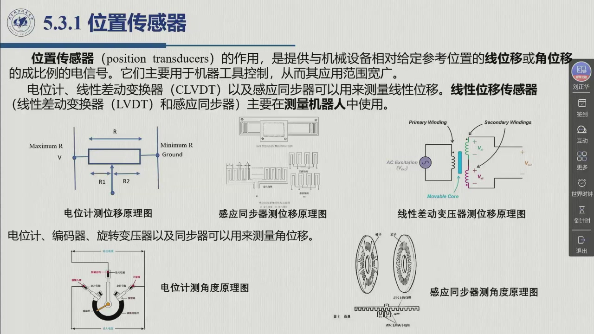
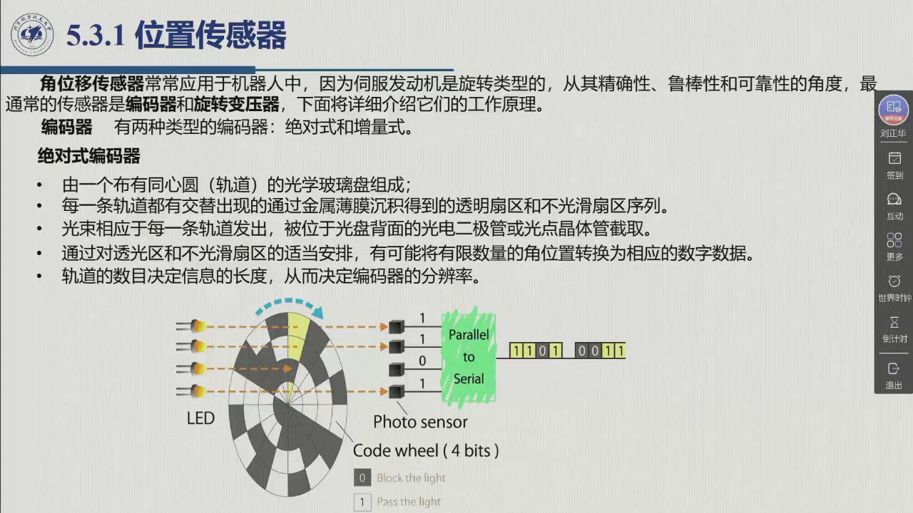
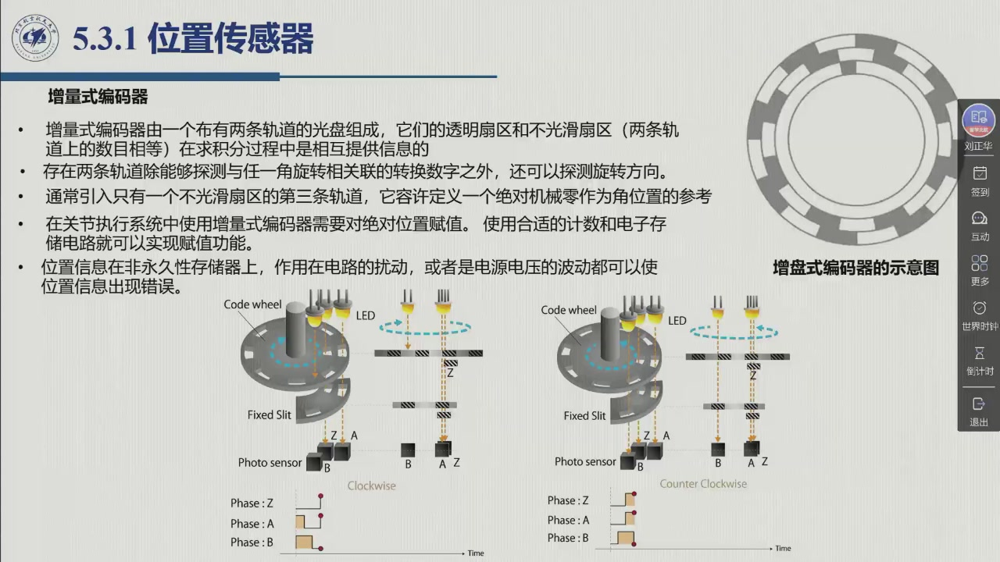
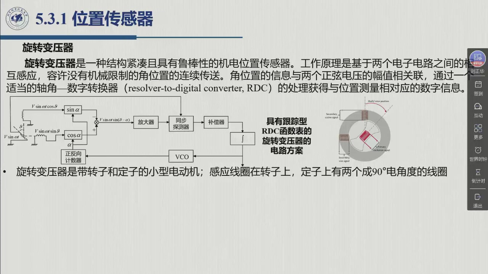

# 5.3.1 位置传感器

上一节把位置反馈接进了关节伺服外环。不论控制器要的是角度还是直线位移，硬件送进来的原始信号通常是电位计电压、数字码字或正余弦模拟幅值，而且只有相对于某个参考零位才有意义。本节讲清楚这些电信号怎样转换成轴位移：先看接触式电位计的分压原理与短板，再重点拆解机器人最常用的光电编码器（绝对式格雷码、12 轨分辨率与圈数计数，以及增量式 A/B 判向与 Z 相零位）和旋转变压器。课堂回看：01:48:03–01:57:55。

## 5.3.1.1 位置传感器的定义与器件清单

按测量对象，位置传感器分为线位移和角位移两大类；由于机械手主要使用旋转型伺服发动机，即便移动关节由丝杠驱动，工程上也经常在电机轴端用角位移传感器间接测位置（不过这会带入丝杠导程和传动间隙误差，要求极高时才直接测关节直线位移）。

::: def 定义 5.3.2 · 位置传感器 position transducers {#def-5.3.2}
位置传感器将相对于给定参考零位的线位移或角位移转换为可读取的电信号，其输出与物理位移的对应关系须经标定确认。按教材分类：线位移器件包括电位计、线性差动变压器（LVDT）和感应同步器（后两者常用于精密测量机器人）；角位移器件包括电位计、编码器、旋转变压器（resolver）和同步器（synchro），其中工业机械手最常用编码器与旋转变压器。
:::

先用最直观的电位计看分压原理。在长度 $L$ 的均匀电阻体两端加电压 $U$，滑动触点在距接地端位置 $x$ 处取分压；若输出端不取电流，则输出电压为

$$U_{out}=U\frac{x}{L}.$$

把电阻体弯成圆弧即可测角位移。但实际接入有限输入阻抗电路时分压比会偏移，加上滑动触点本身存在摩擦、磨损和接触电阻波动，线性度和寿命受限，因此精密关节伺服大多改用非接触式的光电或电磁器件。

## 5.3.1.2 绝对式编码器：码盘、分辨率与格雷码

如果希望把圆周直接切成若干离散扇区，由光电开关读出当前落在哪一格里、掉电重启后也不用回零，就用到绝对式编码器。

::: def 定义 5.3.3 · 编码器 encoder {#def-5.3.3}
编码器将转角转换为数字信号，分为绝对式和增量式两类。绝对式编码器采用布有 $n$ 条同心圆轨道的光学玻璃码盘（每条轨道沉积透明与不透明扇区），由光源与光电接收阵列同时读取 $n$ 位二进制码字，将一圈分成 $N=2^n$ 个可分辨区间；增量式编码器则在运动中输出连续脉冲，通过累计脉冲数和参考零位恢复位置。
:::

用一道算术题建立关节控制的轨道数与减速比概念（01:51:45–01:52:57）。

::: ex 例 5.3.A · 12 轨编码器的角分辨率与齿轮减速后的换算 {#ex-5.3.A}
对于关节控制，一般要求至少 12 轨单圈绝对读数。共有 $N=2^{12}=4096$ 个位置区间，因此电机轴的量化步距（角分辨率）为

$$\Delta\theta_m=\frac{2\pi}{4096}\approx0.001534\ \mathrm{rad}
=0.087890625^\circ.$$

若编码器装在电机轴上、减速比 $k_r=100$，关节转过一圈电机要转 100 圈，折算到关节侧的理想量化步距缩小为

$$\Delta q=\frac{\Delta\theta_m}{100}\approx1.534\times10^{-5}\ \mathrm{rad}
=0.00087890625^\circ.$$

注意这里算的是理想[量化分辨率](../recall.md#sensor)，不是整机绝对定位精度；实际定位误差还要计入安装偏心、码盘刻线误差、齿轮齿隙和轴系弹性。同时，单圈码盘每转一圈就重复一遍 4096 个码字，装在高速电机侧跨圈工作时无法仅靠单圈码字分辨“正处于第几圈”，必须另加电子圈数计数器（经过零位时按转向加减一圈）或选用带掉电记忆的多圈编码器。
:::

绝对式码盘如果直接用普通二进制码刻线，扇区交界处会出故障（01:50:00–01:51:35）：拿四位二进制从 7（$0111$）跳到 8（$1000$）为例，四条轨道的光电管必须在同一瞬时同时翻转；只要安装对齐略有先后，读出来的瞬间码字就可能是 $1111$ 或 $0000$，跳到完全不相干的角度去。把相邻码字改成每次只变一位，就能堵住这个漏洞。

::: thm 定理 5.3.B · 格雷码：一次只变一位 {#thm-5.3.B}
格雷码使任意相邻两个区间（包括 15 绕回 0）的编码仅相差一位。这样在扇区边界过渡时最多只有一位在高低电平间切换，读数只会落在相邻两个区间之一，不会拼出远处的错码。

| # | 编码 | # | 编码 |
|:--|:--|:--|:--|
| 0 | 0000 | 8 | 1100 |
| 1 | 0001 | 9 | 1101 |
| 2 | 0011 | 10 | 1111 |
| 3 | 0010 | 11 | 1110 |
| 4 | 0110 | 12 | 1010 |
| 5 | 0111 | 13 | 1011 |
| 6 | 0101 | 14 | 1001 |
| 7 | 0100 | 15 | 1000 |

核对 7（0100）到 8（1100）以及 15（1000）到 0（0000），均只有最左边一位改变。格雷码消除了多位异步翻转带来的错码歧义，但不能消除量化步距本身、边界抖动或零位安装偏置；读出格雷码字符串后也须先转成自然二进制再换算角度。
:::

## 5.3.1.3 增量式编码器：计数、判向与置零

绝对式码盘需要十多条同心轨道，工艺和成本都高。如果只要知道转轴“刚动了多少、往哪边动”，只刻两条相位差四分之一信号周期（90° 电角度）的均匀光栅轨道（A 相与 B 相）就够了，这就是使用更广泛的增量式编码器（01:53:04–01:54:48）。

仅看一路脉冲只能数步数，分不清正转还是反转；把 A、B 两路先后一比较，方向立刻出来：例如约定 A 相先跳变、B 相滞后四分之一周期（状态序列 $00\to10\to11\to01\to00$）时计数器加一，反过来 B 先于 A 时计数器减一（具体对应顺时针还是逆时针取决于观察轴端与接线约定）。

若每圈每路光栅给出 $P$ 个脉冲周期，同时检测 A、B 两路的所有上升沿与下降沿（四倍频解码），一圈的总有效计数为 $N=4P$（只检测单沿则计数减半或四分之一），因此只报线数 $P$ 不说明倍频方式就无法算步距 $2\pi/N$。

增量式编码器通常还有第三条轨道 Z 相，每转一圈在固定位置输出一个窄脉冲作为圈内零位标记，用来校验圈内参考或辅助整机回零（Z 相与关节机械零位之间通常仍有固定偏置，须经标定对齐）。建立起初始参考角 $\theta_0$ 后，位置由累计有符号计数 $c$ 算出：

$$\theta=\theta_0+\frac{2\pi}{N}c.$$

增量式编码器结构简单便宜，但计数保存在易失计数器里；若丢脉冲或断电丢失状态（除非配后备电池记住计数与圈数），重新上电后通常要找回 Z 相和机械参考才能重新建立 $\theta_0$。

## 5.3.1.4 旋转变压器与线性位移传感器

光电玻璃码盘怕油污、震动和高温，环境恶劣的关节往往改用电磁感应式的旋转变压器（01:56:15–01:56:55）。

::: note 注 5.3.1 · 另两类器件：旋转变压器与线性位移传感器 {#note-5.3.1}
旋转变压器结构类似一台小型交流电机，通过转子与定子间的电磁互感应把轴角编码到两路正交感应电压的幅值中，结构紧凑、耐冲击且无机械限位。线位移一侧的线性差动变压器（LVDT）靠可动铁芯改变两个二次绕组的差分感应幅值测直线位移，感应同步器利用平面印制绕组的周期耦合关系测量位移，两者主要见于精密测量机器人。器件选型须按安装环境、量程、读出电路与标定精度评估，不能简单按名称排序精度高低。
:::

给旋转变压器转子施加角频率为 $\omega_c$（典型 0.4–10 kHz，注意这是激磁载波频率，与轴转速 $\dot\theta$ 无关）的正弦激磁电压，定子上互成 90° 电角度的两组绕组分别感应出正弦和余弦调幅信号：

$$u_s=K\sin\theta\sin\omega_ct,\qquad
u_c=K\cos\theta\sin\omega_ct.$$

同步解调去掉载波 $\sin\omega_ct$ 后得到正比于 $\sin\theta$ 与 $\cos\theta$ 的信号，修正通道增益和零偏即可用 $\operatorname{atan2}$ 求出圈内角度。

工业上常把这两路信号送入跟踪型轴角数字转换器（RDC）：电路内部维护一个数字估计角 $\alpha$，把正弦通道乘 $\cos\alpha$、余弦通道乘 $\sin\alpha$ 再相减，利用两角差正弦恒等式得到

$$u_s\cos\alpha-u_c\sin\alpha
=K(\sin\theta\cos\alpha-\cos\theta\sin\alpha)\sin\omega_ct
=K\sin(\theta-\alpha)\sin\omega_ct.$$

经同步解调滤去载波后，小误差下 $\sin(\theta-\alpha)\approx\theta-\alpha$，闭环中的补偿器、积分器和正反向计数器不断驱动 $\alpha$ 追赶真实角 $\theta$（含两个积分器的理想二型环路在转子常速转动时位置稳态误差为零，实际仍受字长量化舍入、通道失配与激磁噪声限制；例如 16 位数字字长表示一圈分成 $2^{16}$ 个区间，不要把输出字长位数直接混同于实际物理精度）。

::: think 检查理解
1. 一个每圈1024周期的A/B编码器采用四倍频解码，其有效角步距与12位单圈绝对编码器有何关系？
2. 码盘使用格雷码，是否就能消除零位和安装误差？
3. 单圈编码器读出相同码字，电机是否一定在同一圈？Z相是否天然就是关节零位？
4. 旋转变压器的载波频率为什么不能当作转子速度？

::: sol 核对
1. 四倍频产生 $4\times1024=4096$ 个有效计数，理想量化步距同为 $2\pi/4096\approx0.08789^\circ$。
2. 不能。格雷码仅消除相邻区间切换时多位不同步翻转引起的过渡错码，不解决零位偏置或码盘安装偏心。
3. 不一定。单圈码字每转重复，跨圈需另记圈数；Z 相只是编码器每圈一次的参考脉冲，与关节机械零位间通常存在固定偏置，须标定对齐。
4. 载波频率 $\omega_c$ 由外部激磁电路固定提供，被测轴角信息调制在两路正交信号的幅值比中，不是由转速决定的输出频率。
:::
:::

## 5.3.1 小结与常见错误

角位移位置传感器是关节伺服的主力。绝对式编码器直接输出多轨编码（用格雷码消除相邻切换的多位跳变错码），12 轨一圈分 4096 份，经减速比 $k_r$ 折算后关节侧步距缩小 $k_r$ 倍但跨圈仍需记圈数；增量式编码器靠正交 A/B 两相脉冲计数判向并由 Z 相标定零位；旋转变压器以电磁耦合和跟踪型 RDC 实现恶劣环境下的高精度非接触测角。

::: think 常见错误清单 · 自查三条
1. 把“12 位／16 位分辨率”直接当成机械手关节的实际绝对定位精度，忽略偏心、齿隙、弹性与标定误差。
2. 答不出格雷码解决的具体故障：它防止的是普通二进制在区间边界（如 $0111\to1000$）多位不同步翻转产生的过渡错码。
3. 忘记单圈绝对编码器装在减速器电机端时跨圈码字会重复，以及增量式编码器算步距必须确认是否做了四倍频。
:::
