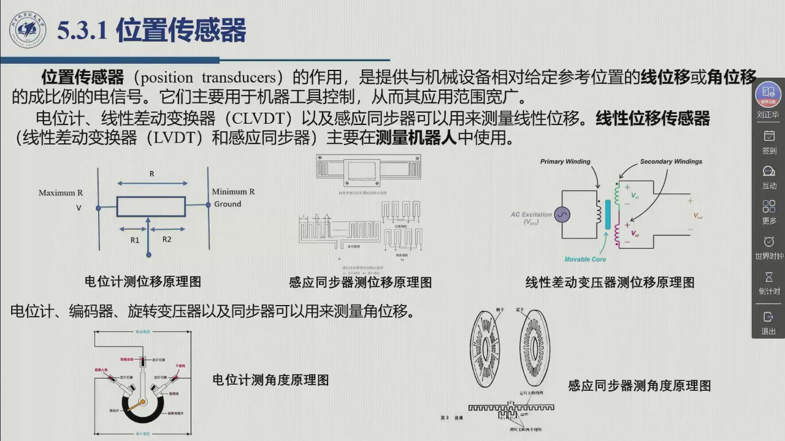
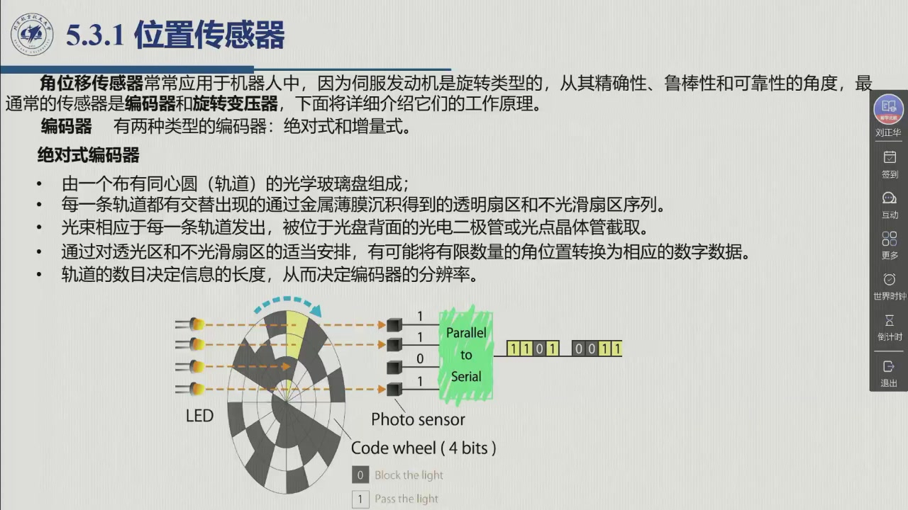
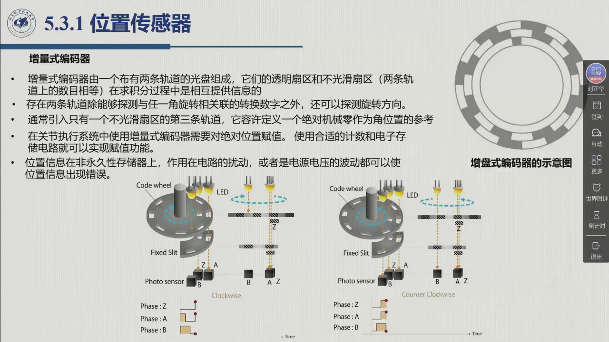
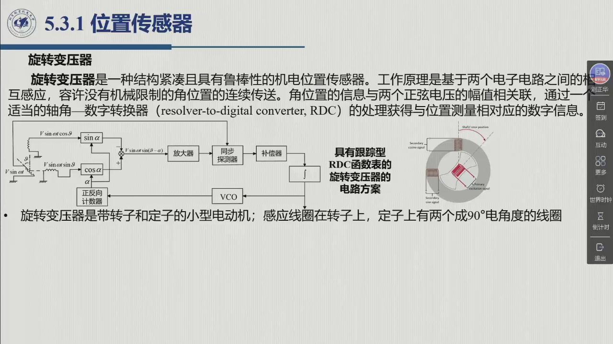

# 5.3.1 位置传感器

位置读数必须相对某个参考位置才有意义。传感器可以输出电压，也可以输出码字；控制器需要知道怎样把它换成角度或位移。本节先从电位计的分压理解测量比例，再区分编码器的绝对读数、增量计数与参考零位。课堂回看：01:48:03–01:57:55。

## 5.3.1.1 位置传感器的定义与器件清单

::: def 定义 5.3.2 · 位置传感器 position transducers {#def-5.3.2}
位置传感器把相对参考位置的线位移或角位移转换为可读取的信号。输出与位置的关系需要标定，并不要求所有器件都直接输出线性模拟电压。

| 被测量 | 本节涉及的器件 |
|:--|:--|
| 线位移 | 电位计、线性差动变压器（LVDT）、感应同步器 |
| 角位移 | 电位计、编码器、旋转变压器（resolver）、同步器（synchro） |
:::

测量位置可以选在电机侧，也可以选在关节侧。旋转电机通过丝杠驱动移动关节时，电机转角能间接给出位移估计，但其中仍包含传动误差。是否需要直接测关节位移，要结合任务要求判断。

电位计在均匀电阻体上移动触点。若全长为 $L$、供电为 $U$，从接地端量出的触点位置为 $x$，并假定输出不取电流，则

$$U_{out}=U\frac{x}{L}.$$

角位移电位计以圆弧电阻体实现类似的比例关系。输出接入有限阻抗后，分压比会改变；触点摩擦、磨损和接触电阻也会影响读数。因此比例模型只描述理想关系，这些误差仍须另行分析。

## 5.3.1.2 绝对式编码器：码盘、分辨率与格雷码

::: def 定义 5.3.3 · 编码器 encoder {#def-5.3.3}
编码器把轴位置转换为数字信息。绝对式编码器为可分辨位置提供相应码字；增量式编码器输出随运动变化的脉冲，由计数和已知参考位置恢复位置。

本节用多轨光学码盘说明单圈绝对编码：光源和读出器同时读取各轨的透光／不透光状态，合成码字。若共有 $n$ 位且使用全部码字，一圈可分为 $N=2^n$ 个位置区间。
:::

::: ex 例 5.3.A · 12 轨编码器的角分辨率与齿轮减速后的换算 {#ex-5.3.A}
12位单圈读数有 $N=4096$ 个区间，电机轴的量化步距为

$$\Delta\theta_m=\frac{2\pi}{4096}\approx0.001534\ \mathrm{rad}
=0.087890625^\circ.$$

若编码器在电机侧、减速比 $k_r=100$，关节侧对应的理想步距为

$$\Delta q=\frac{\Delta\theta_m}{100}\approx1.534\times10^{-5}\ \mathrm{rad}
=0.00087890625^\circ.$$

这是[分辨率](../recall.md#sensor)的折算，不是整机关节定位精度。零位、安装、齿隙和弹性误差仍须另计。

单圈码字每转一圈重复，因此电机跨圈时还需要圈数信息。若关节转一圈要求电机转100圈，单圈码盘只读出其中的圈内位置，不能独自判断处于第几圈。多圈信息是否能掉电保持，要看具体编码器和存储结构，不能仅凭“绝对式”名称推断。
:::

::: thm 定理 5.3.B · 格雷码：一次只变一位 {#thm-5.3.B}
普通二进制从 $0111$ 变成 $1000$ 时，四位都要改变。若各轨读出时刻略有差异，可能短暂拼出不属于相邻两个位置的码字。

格雷码让相邻位置只改变一位，减少这种多位不同步造成的大跳变。它不消除量化、电子噪声或全部过渡歧义，边界附近仍可能在相邻码字间变化。

| # | 编码 | # | 编码 |
|:--|:--|:--|:--|
| 0 | 0000 | 8 | 1100 |
| 1 | 0001 | 9 | 1101 |
| 2 | 0011 | 10 | 1111 |
| 3 | 0010 | 11 | 1110 |
| 4 | 0110 | 12 | 1010 |
| 5 | 0111 | 13 | 1011 |
| 6 | 0101 | 14 | 1001 |
| 7 | 0100 | 15 | 1000 |

检查7到8及15回到0，都只改变一位。码字先表示位置区间，再按编码规则转换成角度；不能把格雷码字符串当普通二进制数直接解读。
:::

## 5.3.1.3 增量式编码器：计数、判向与置零

典型增量式编码器的 A、B 两路相差四分之一信号周期。只数一路脉冲可以知道运动量，比较两路先后则能知道方向。这里的90°是信号的电相位，不是轴必须相差90°机械角。

可以把 $00\to10\to11\to01\to00$ 约定为正向，每遇到下一个状态计数加一，反向序列则减一。哪种先后对应“顺时针”，取决于接线、观察轴端和正方向定义，不能作为所有编码器的通用规则。

若每圈每路产生 $P$ 个周期，同时统计 A、B 两路的上升和下降沿，则有效计数为 $N=4P$；只采用一种边沿时计数会不同。给出“线数”后，还须说明解码倍频方式，才能计算 $2\pi/N$。

第三路Z相通常每圈给出一次参考标记，可用于校验圈内参考或辅助回零。它与关节机械零位之间仍可能有固定偏置，不能直接等同。它也不在任意时刻提供完整圈数，位置恢复仍需计数、判向与状态保持。

使用增量读数时，应先建立参考角 $\theta_0$，之后由累计计数 $c$ 计算

$$\theta=\theta_0+\frac{2\pi}{N}c.$$

丢失脉冲或累计状态都会使位置读数偏离实际。掉电后是否需要回零，取决于参考与计数状态是否可靠保留；不能仅按增量式、绝对式两个名称概括所有系统的恢复行为。

## 5.3.1.4 旋转变压器与线性位移传感器

::: note 注 5.3.1 · 另两类器件：旋转变压器与线性位移传感器 {#note-5.3.1}
旋转变压器利用电磁耦合，把轴角编码到两路正弦、余弦信号。线性差动变压器利用可动铁芯改变二次绕组差分输出，测量线位移；感应同步器则通过相应绕组的周期耦合关系提供位置信息。

这些是不同测量原理。应按安装、量程、读出电路和标定误差比较，不能只按器件名称排列精度高低。
:::

教材的旋转变压器模型取交流激磁，两路信号写成

$$u_s=K\sin\theta\sin\omega_ct,\qquad
u_c=K\cos\theta\sin\omega_ct.$$

$\omega_c$ 是激磁载波角频率，与被测轴角速度 $\dot\theta$ 不同。同步解调去除载波后，得到与 $\sin\theta$、$\cos\theta$ 成比例的两个量，校正通道比例和零偏后，可用 $\operatorname{atan2}$ 恢复圈内角度。

跟踪型轴角数字转换器（RDC）则维护一个估计角 $\alpha$。用正弦通道乘 $\cos\alpha$、余弦通道乘 $\sin\alpha$，再相减：

$$u_s\cos\alpha-u_c\sin\alpha
=K\sin(\theta-\alpha)\sin\omega_ct.$$

解调后得到误差信号 $\sin(\theta-\alpha)$。在误差较小的工作区间内，它近似为 $\theta-\alpha$，闭环据此更新估计角。补偿器决定稳定性和带宽，数字量化及实际信号误差仍会限制读数。

理想稳定回路对特定输入可以做到零稳态误差，真实器件仍受信号与量化误差限制。因此不能称其位置、速度“永远没有误差”。输出字长也只规定可表示区间的数量：“16位”既不是实际精度，也不是“1/16比特”。

::: think 检查理解
1. 一个每圈1024周期的A/B编码器采用四倍频解码，其有效角步距与12位单圈绝对编码器有何关系？
2. 码盘使用格雷码，是否就能消除零位和安装误差？
3. 单圈编码器读出相同码字，电机是否一定在同一圈？Z相是否天然就是关节零位？
4. 旋转变压器的载波频率为什么不能当作转子速度？

::: sol 核对
四倍频产生4096计数，理想步距同为 $2\pi/4096$。格雷码主要处理相邻区间多位切换，不解决安装或零位。单圈码字不能区分圈数，Z相与机械零位还需标定。载波由激磁电路给定，轴角信息在两通道幅值中。
:::
:::
