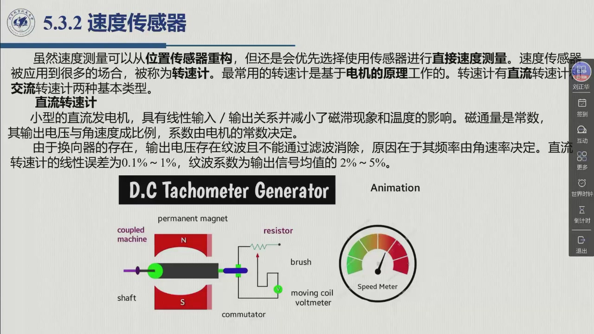

# 5.3.2 速度传感器

上一节已经用[编码器](../recall.md#sensor)读出了位置，但 [§5.2.4](sec5-2-4.md) 的伺服回路里还有一个提供阻尼和带宽的速度内环。既然位置读数随时间都在变，能不能只靠位置对时间求差分得到速度，什么时候又必须专门装一台测速发电机（转速计）直接测速？本节先算清位置差分重建速度的噪声和延迟账，再对照直流转速计与交流转速计的测量原理及误差来源。课堂回看：01:54:48–02:00:11。

## 5.3.2.1 直接测量，还是从位置重建

先试着直接用位置编码器重建速度：取已经做好跨圈展开（否则从 $2\pi$ 跳回 $0$ 会算出一个巨大的虚假负速度）的相邻两次位置读数 $\theta_{k-1},\theta_k$，除以采样间隔 $\Delta t$：

$$\hat\omega_k=\frac{\theta_k-\theta_{k-1}}{\Delta t}.$$

这个公式算出的只是 $\Delta t$ 窗口里的平均速度，而不是无噪声的瞬时导数。如果相邻两次读数含有独立零均值噪声、标准差同为 $\sigma_\theta$，那么差值 $\theta_k-\theta_{k-1}$ 的方差是两者之和 $2\sigma_\theta^2$，除以 $\Delta t$ 后速度估计的标准差变为

$$\sigma_\omega=\frac{\sqrt2\sigma_\theta}{\Delta t}.$$

两难立刻出现：要想降低延迟，就得把 $\Delta t$ 取得很小，但 $\sigma_\omega$ 会按 $1/\Delta t$ 成倍放大（若噪声相关还须计入协方差，且量化台阶本身就会制造尖峰，见下图）。

::: method 方法 5.3.A · 从位置信号重建速度的三条途径 {#method-5.3.A}
对每圈输出 $N$ 个有效脉冲的编码器，重建速度常用三种读出方案（01:55:29–01:56:12）：

1. **固定时间窗计数法（测频法）**：在固定窗口 $T_w$ 内统计有符号脉冲数 $\Delta c$，得 $\hat\omega=\dfrac{2\pi\Delta c}{NT_w}$。一个脉冲对应的速度分辨率为 $\dfrac{2\pi}{NT_w}$：高速时窗口内脉冲多、相对误差小；低速时窗口里只有一两个甚至零个脉冲，相对量化误差急剧恶化，拉长 $T_w$ 又会增大延迟。
2. **测脉冲周期法（测周法）**：测相邻两个脉冲的间隔 $T_p$（方向仍由 A/B 相位决定），得 $|\hat\omega|=\dfrac{2\pi}{NT_p}$。计时相对误差满足 $|\delta\omega|/|\omega|\approx|\delta T_p|/T_p$：低速时 $T_p$ 很长，高频时钟计周期精度高，但必须等到下一个脉冲到来才更新；高速时 $T_p$ 极短，会撞上定时器时钟分辨率下限。因此高速适合测频法，低速适合测周法。
3. **频率—电压转换法**：用频率—电压（F/V）转换电路把脉冲频率变成模拟电压输出（注意是把频率转成电压，不要把输入输出方向写反）。
:::

下左图画出匀速转动时的编码器阶梯读数，右图对它直接做采样差分：因为台阶水平段连续两次读数相同，差分输出是零；一旦跨过台阶，差分又跳出一个高尖峰，只有一段窗口里的平均值才等于真实转速。低通滤波或状态观测器能在噪声和相位滞后之间折中，但无法凭空增加原始信息量。因此当系统在宽速域（尤其是低速段）要求高带宽、低噪声速度反馈时，工程上常优先加装直接测速传感器（转速计）。

<figure>
<svg class="figure-svg" viewBox="0 0 920 390" xmlns="http://www.w3.org/2000/svg" role="img" aria-labelledby="fig-532-diff-t fig-532-diff-d">
<title id="fig-532-diff-t">位置量化台阶与差分出的速度：瞬时值不可用，平均值才对</title>
<desc id="fig-532-diff-d">左图：编码器给出的位置是阶梯状的量化曲线，与真实的匀速直线（斜坡）之间最多差一级台阶；右图：对阶梯做差分，得到的速度信号在大部分时间为零、在每个台阶跳变处出现尖峰，虚线表示其平均值等于真实转速。</desc>
<marker id="f532-m" markerWidth="9" markerHeight="9" refX="7" refY="3" orient="auto"><path d="M0,0 L7,3 L0,6 Z" fill="var(--muted)"/></marker>
<line class="diagram-axis" x1="70" y1="250" x2="436" y2="250"/>
<line class="diagram-axis" x1="70" y1="250" x2="70" y2="56"/>
<line class="diagram-muted" x1="70" y1="238" x2="420" y2="96"/>
<path class="diagram-accent" d="M 70,230 L 112,230 L 112,212 L 154,212 L 154,195 L 196,195 L 196,178 L 238,178 L 238,161 L 280,161 L 280,144 L 322,144 L 322,127 L 364,127 L 364,110 L 406,110 L 406,97 L 430,97"/>
<text class="diagram-text" x="76" y="48">位置 θ</text>
<text class="diagram-text" x="440" y="256">时间 t</text>
<text class="diagram-note" x="250" y="212">真实位置（匀速上坡）</text>
<text class="diagram-note" x="96" y="286">① 编码器读数：量化台阶（每格一份）</text>
<line class="diagram-axis" x1="500" y1="250" x2="884" y2="250"/>
<line class="diagram-axis" x1="500" y1="250" x2="500" y2="56"/>
<line class="diagram-muted" x1="500" y1="170" x2="884" y2="170"/>
<path class="diagram-accent" d="M 500,240 L 538,240 L 542,90 L 546,240 L 580,240 L 584,90 L 588,240 L 622,240 L 626,90 L 630,240 L 664,240 L 668,90 L 672,240 L 706,240 L 710,90 L 714,240 L 748,240 L 752,90 L 756,240 L 790,240 L 794,90 L 798,240 L 832,240 L 836,90 L 840,240 L 884,240"/>
<text class="diagram-text" x="506" y="48">速度 ω</text>
<text class="diagram-note" x="726" y="162">平均 = 真实转速</text>
<text class="diagram-note" x="546" y="286">② 对位置差分：平段为 0，跳变处出尖峰</text>
<line class="diagram-muted" x1="70" y1="304" x2="884" y2="304"/>
<text class="diagram-note" x="70" y="332">平滑段来自「台阶没变」⇒ 差分输出 0；尖峰来自「台阶跳了一格」⇒ 差分输出一个大数。</text>
<text class="diagram-note" x="70" y="358">把采样间隔 Δt 取得越小，尖峰越高：噪声被 1/Δt 放大；真实速度越低（斜坡越平缓），相对误差越大。</text>
<text class="diagram-note" x="70" y="382">「从位置重建速度」的两难（本教程绘）</text>
</svg>
<figcaption>量化位置产生台阶，直接差分可能产生零值与尖峰交替的速度估计。估计表现还取决于采样时间、计数分辨率和真实运动。</figcaption>
</figure>

## 5.3.2.2 直流转速计

直流转速计是一台专用于测速的小型永磁直流发电机（01:57:20–01:58:30）：永磁体提供恒定磁通，转子转动产生的反电动势电压 $u=K_{TV}\omega$ 正比于角速度（$K_{TV}$ 为测速灵敏度系数，单位 $\mathrm{V\cdot s/rad}$），电压正负极性直接表示旋转方向。设计时会专门抑制磁滞和温度漂移以保持线性度（课件典型示例量级：线性误差约 0.1%–1%，纹波系数约均值的 2%–5%，使用器件手册时仍应核对分母是满量程还是当前读数）。加上零偏 $b$、换向纹波 $r(t)$ 和随机噪声 $n(t)$，实际读数写成

$$u=K_{TV}\omega+b+r(t)+n(t).$$

直接出电压避开了位置微分放大噪声的问题，但仍要注意两件事：第一，低速时真实信号 $K_{TV}\omega$ 很小，固定零偏 $b$ 除以很小的速度后相对误差仍会很大；第二，机械换向器片间切换引起的周期纹波 $r(t)$ 很难用单个固定低通滤波器彻底滤除（01:58:00–01:58:22），因为若每圈换向 $m$ 次，纹波频率 $f_r=m|\omega|/(2\pi)$ 会随转速跑。高速时纹波频率高，固定低通能压住它；可转速降下来以后，纹波频率滑进有用速度动态的频带里，滤波就会把真实变速响应一起削弱或拖出延迟。

## 5.3.2.3 交流转速计

为了去掉直流转速计的电刷摩擦和随转速漂移的换向纹波，可以改用交流转速计（01:58:35–02:00:11）。先注意它和普通同步交流发电机的区别：同步发电机输出电压的**频率**正比于转速，而交流转速计把转速放进感应电压的**幅值**里。它的定子上装有两组相互正交的绕组，中间是轻质杯形转子：给一组定子绕组通入固定频率 $\omega_c$（典型 400 Hz）的正弦激磁电压，静止时正交绕组无感应；转子转动后，另一组定子绕组上感应出同频率调幅电压（$K$ 为互感调幅比例系数，单位 $\mathrm{V\cdot s/rad}$）：

$$u_o=K\omega\sin\omega_ct,$$

转向信息保存在输出相对激磁电压是同相还是反相里。把输出乘上同频参考信号 $\sin\omega_ct$ 做同步解调，利用三角恒等式 $\sin^2\omega_ct=(1-\cos2\omega_ct)/2$ 展开：

$$u_o\sin\omega_ct=\frac{K\omega}{2}(1-\cos2\omega_ct).$$

注意这里的二倍频项 $\cos2\omega_ct$ 出现在**乘法解调之后**（原始输出仍是载波 $\omega_c$），而且频率 $2\omega_c$ 固定不变、不随转速漂移。只要有用速度变化远慢于 $2\omega_c$ 且解调相位对准，用固定低通滤波器就能滤去二倍频纹波，恢复出正比于 $\omega$（带符号）的低频速度信号。

交流转速计取消了机械电刷触点，杯形转子的附加转动惯量也很小；代价是转子静止时定子绕组与测量回路间存在电磁寄生耦合，仍会输出微小的剩余电压，同时滤波带宽选择仍要在载波抑制与信号延迟之间权衡。

| 测速方案 | 直接获得的量 | 要重点检查的误差与限制 |
|:--|:--|:--|
| 固定窗计数（测频） | 窗口内平均速度 | 低速脉冲少导致量化误差大，拉长窗增延迟 |
| 测脉冲周期（测周） | 相邻脉冲间平均速度 | 高速撞定时器分辨率，低速须等下一个脉冲才更新 |
| 位置采样差分 | 相邻采样间平均速度 | $1/\Delta t$ 放大位置噪声与量化台阶、需跨圈展开 |
| 直流转速计 | 极性速度电压 | 零偏、电刷磨损、换向纹波频率随转速变化难固定滤波 |
| 交流转速计 | 载波调幅信号 | 同步解调后滤二倍频、静止剩余电压、解调相位误差 |

::: think 检查理解
1. 位置噪声不变，把差分间隔缩短一半，独立噪声模型下的速度噪声标准差怎样变化？
2. 周期法在低速下计时相对精度较好，为什么却不一定能更快更新？
3. 为什么转速计没有经过数值微分，低速相对误差仍可能很大？
4. 交流同步解调后的二倍频项从哪一步产生？

::: sol 核对
1. 由 $\sigma_\omega=\sqrt2\sigma_\theta/\Delta t$，差分间隔减半使速度噪声标准差变为两倍。
2. 周期法需要等待下一个脉冲到来才能完成一次周期测量，低速时脉冲间隔长，更新周期随之变慢。
3. 直流转速计的零偏、剩余电压和噪声相对固定，在低速下有效信号很小时，绝对误差除以小转速仍产生很大的相对误差。
4. 来自同频正弦解调相乘 $\sin\omega_ct\cdot\sin\omega_ct=\frac12(1-\cos2\omega_ct)$；原始输出载波仍为 $\omega_c$。
:::
:::

## 5.3.2 小结与常见错误

从编码器重建速度可用测频（适于高速）、测周（适于低速）或 F/V 转换，位置直接差分会把噪声按 $1/\Delta t$ 放大并在低速量化台阶间出现尖峰。直流转速计以极性电压直接输出转速但受电刷和变速换向纹波限制；交流转速计无触点、惯量小，解调后纹波在固定的二倍载波频率易于滤除，但静止时有寄生耦合剩余电压。

::: think 常见错误清单 · 自查三条
1. 记反测频与测周的适用区：测频在固定时间窗数脉冲（适于高速），测周在相邻脉冲间计高频时钟（适于低速）。
2. 混淆两种转速计的纹波：直流转速计换向纹波频率随转速变化、单个固定滤波器难以全速域消除；交流转速计同步解调后纹波落在固定的 $2\omega_c$。
3. 以为不用数值微分就没有低速误差：模拟转速计的固定零偏、剩余电压和温漂在低速小信号下同样会造成较大相对误差。
:::
