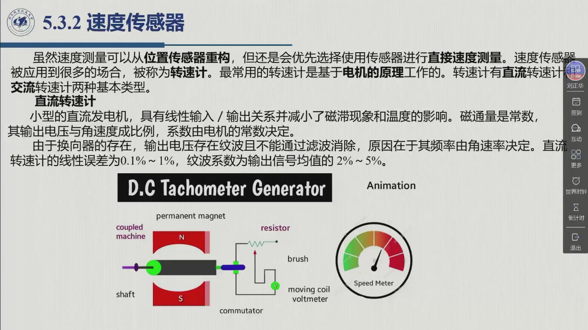

# 5.3.2 速度传感器

位置已经读回来了，速度还需要单独测吗？——把位置对时间做数值微分，数学上当然成立；工程上却常常不够用。本节就回答这个取舍：什么情况下用「从位置信号重建」，什么情况下必须上**转速计**（tachometer）直接测；再交代转速计的两种基本类型——**直流**与**交流**——各自靠什么把转速变成电压、又各自付了什么代价。录播 01:57:55–02:00:11。

## 5.3.2.1 直接测量，还是从位置重建

教材先把话说清楚：**虽然速度测量可以从位置传感器重构，一般情况下，人们还是会优先选择使用合适的传感器进行直接速度测量。** 这类器件被统称为**转速计**（tachometer），应用场合非常多；而**最常用的转速计是基于电机的原理工作的**，两种基本类型是**直流（DC）转速计**与**交流（AC）转速计**（教材 §5.3.2）。

老师把这两条路线叫做**直接测量**与**间接测量**（01:54:44–01:55:19）：间接测量即「用编码器测量角位置」，再做「角位置和时间的**数值微分**」，就得到转动的角速度；但「要（对）速度进行精确的测量时，就得采用速度传感器」直接测（01:57:08–01:57:18）。

::: method 方法 5.3.A · 从位置信号重建速度的三条途径 {#method-5.3.A}
教材 §5.3.1 末尾给出：如果每次转换产生一个**脉冲**，速度测量可以通过三种可能的途径获得：

1. 使用**电压—频率转换器**——把脉冲串变成与频率成正比的**模拟**电压输出；
2. （数字地）**测量脉冲序列的频率**——固定时间窗内数脉冲个数；
3. （数字地）**测量脉冲序列的抽样时间**——即测出相邻脉冲之间的**周期**。

**怎么选**：后两种都是数字方法，教材直接给了分工——**前者（频率法）适合于高速测量，后者（周期 / 抽样时间法）适合于低速测量**。

**为什么是这个分工**（本教程补注，定量推导属「检测技术」课程的内容——老师 01:55:35 亦如此交代）：频率法在固定的时间窗内数脉冲，转速高时窗口里脉冲多、计数量大，±1 个脉冲的计数误差相对很小；转速低时窗口里只有寥寥几个脉冲，同样的 ±1 就被放大成很大的相对误差。周期法反过来：测一个脉冲的周期，低速时周期长、定时器相对精度高；高速时周期太短，反而撞上定时器的分辨率极限。
:::

<figure>
<svg class="figure-svg" viewBox="0 0 920 390" xmlns="http://www.w3.org/2000/svg" role="img" aria-labelledby="fig-532-diff-t fig-532-diff-d">
<title id="fig-532-diff-t">位置量化台阶与差分出的速度：瞬时值不可用，平均值才对</title>
<desc id="fig-532-diff-d">左图：编码器给出的位置是阶梯状的量化曲线，与真实的匀速直线（斜坡）之间最多差一级台阶；右图：对阶梯做差分，得到的速度信号在大部分时间为零、在每个台阶跳变处出现尖峰，虚线表示其平均值等于真实转速。</desc>
<marker id="f532-m" markerWidth="9" markerHeight="9" refX="7" refY="3" orient="auto"><path d="M0,0 L7,3 L0,6 Z" fill="var(--muted)"/></marker>
<line class="diagram-axis" x1="70" y1="250" x2="436" y2="250"/>
<line class="diagram-axis" x1="70" y1="250" x2="70" y2="56"/>
<line class="diagram-muted" x1="70" y1="238" x2="420" y2="96"/>
<path class="diagram-accent" d="M 70,230 L 112,230 L 112,212 L 154,212 L 154,195 L 196,195 L 196,178 L 238,178 L 238,161 L 280,161 L 280,144 L 322,144 L 322,127 L 364,127 L 364,110 L 406,110 L 406,97 L 430,97"/>
<text class="diagram-text" x="76" y="48">位置 θ</text>
<text class="diagram-text" x="440" y="256">时间 t</text>
<text class="diagram-note" x="250" y="212">真实位置（匀速上坡）</text>
<text class="diagram-note" x="96" y="286">① 编码器读数：量化台阶（每格一份）</text>
<line class="diagram-axis" x1="500" y1="250" x2="884" y2="250"/>
<line class="diagram-axis" x1="500" y1="250" x2="500" y2="56"/>
<line class="diagram-muted" x1="500" y1="170" x2="884" y2="170"/>
<path class="diagram-accent" d="M 500,240 L 538,240 L 542,90 L 546,240 L 580,240 L 584,90 L 588,240 L 622,240 L 626,90 L 630,240 L 664,240 L 668,90 L 672,240 L 706,240 L 710,90 L 714,240 L 748,240 L 752,90 L 756,240 L 790,240 L 794,90 L 798,240 L 832,240 L 836,90 L 840,240 L 884,240"/>
<text class="diagram-text" x="506" y="48">速度 ω</text>
<text class="diagram-note" x="726" y="162">平均 = 真实转速</text>
<text class="diagram-note" x="546" y="286">② 对位置差分：平段为 0，跳变处出尖峰</text>
<line class="diagram-muted" x1="70" y1="304" x2="884" y2="304"/>
<text class="diagram-note" x="70" y="332">平滑段来自「台阶没变」⇒ 差分输出 0；尖峰来自「台阶跳了一格」⇒ 差分输出一个大数。</text>
<text class="diagram-note" x="70" y="358">把采样间隔 Δt 取得越小，尖峰越高：噪声被 1/Δt 放大；真实速度越低（斜坡越平缓），相对误差越大。</text>
<text class="diagram-note" x="70" y="382">「从位置重建速度」的两难（本教程绘）</text>
</svg>
<figcaption>从位置重建速度（本教程绘）：左边是编码器给出的**量化**位置，右边是它的差分。注意两件事——**瞬时值满是尖峰**（所以简单差分输出不能直接当速度反馈用，还得靠滤波或更聪明的估计算法），而**平均值是对的**（所以低速时用周期法、高速时用频率法，本质上都是在「算平均」这件事上做文章）。</figcaption>
</figure>

::: think 总结 · 两条路线的误差结构：为什么工程上仍优先直接测量
把两条路线各自的误差来源摆在一起，取舍就清楚了：

| 路线 | 误差 / 噪声来源 | 低速时表现 |
|:--|:--|:--|
| **从位置重建**（差分 / 数值微分） | 位置量的**量化台阶**与测量噪声，被差分（因子约 $1/\Delta t$）**放大**；采样越密、$\Delta t$ 越小，放大越强 | **最差**：噪声不变而真实速度变小，相对误差急剧上升 |
| **直接测量**（转速计） | 传感器自身的指标：直流转速计的线性误差与**残余纹波**、交流转速计的**剩余电压** | 由器件指标决定，与转速高低无关 |

这就是教材「优先直接测量」的工程含义，也解释了两种用法并存的原因：**手上已经有编码器、精度要求一般**时，用重建（省一个器件）；**需要对速度做准确测量**时，另装转速计——老师 01:57:08 的原话正是「很多时候需要对速度进行精确的测量，就是需要进行直接速度的测量」。
:::

## 5.3.2.2 直流转速计

**直流转速计是实际应用中使用最多的一类**，它实质上是一台**小型的直流发电机**，磁场由**永磁体**提供。教材特意指出它「在其构造中（有）特别设计」，目的是两件事：获得**线性的输入 / 输出关系**，以及**减小磁滞现象和温度的影响**——因为这两者都会破坏线性度、进而影响测量的准确性（老师 01:57:31–01:57:50）。

**输出关系很简单**：由于**磁通量是常数**，当转子转动起来以后，**输出电压与角速度成比例**，比例系数由电机的常数决定。换句话说，它是一台「**天然的速度传感器**」：不需要微分、不需要计数器，转速进去、电压出来，而且方向信息就藏在电压的**极性**里。

**它最大的缺陷：换向器带来的纹波。**

::: think 直流转速计的纹波为什么「不能通过滤波消除」（教材 §5.3.2）
教材的推理只有一步，但要读懂它需要想清楚滤波器的工作方式：

- 换向器每转过一个片间就切换一次电枢回路，因此输出电压上叠加着**与换向次数同步的纹波**；
- 关键在下一句：**纹波的频率由角速率决定**——转速变了，纹波频率就跟着变；
- 而滤波器（低通、陷波）都是**按固定频率设计**的：中心频率选在 20 Hz 的滤波器，转速一变就跑偏了。转速越低纹波频率越低，直到滑进有用信号的频带里，**根本无法用固定的滤波电路剔除**。

所以教材给出的指标里，纹波是一项**写进器件规格**的固有误差。老师 01:58:09 的总结很直白：「纹波是不能通过滤波来消除的，（因为）它的频率其实是由角速率来决定的。」
:::

**教材给出的直流转速计指标**：

| 项目 | 教材给出的内容 |
|:--|:--|
| 构造 | 小型直流发电机，磁场由**永磁体**提供；构造上特别设计以获得线性输入 / 输出关系、减小磁滞与温度影响 |
| 输出关系 | 磁通量为常数 ⇒ **输出电压与角速度成比例**，系数由电机常数决定 |
| 纹波 | 换向器 ⇒ 残余纹波，**不能通过滤波消除**（频率由角速率决定） |
| **线性误差** | **0.1%～1%** |
| **纹波系数** | 输出信号**均值的 2%～5%** |
| 地位 | 「在大多数实际应用中使用」——三个本体量里，速度是最容易直接换成模拟电压的一个 |

## 5.3.2.3 交流转速计

**为了避开纹波，换一种电机。** 教材的思路是：直流转速计的输出因为纹波而有缺陷，那就用**交流转速计**。但要先破一个误解——**交流转速计与交流发电机是有区别的**：如果用**同步发电机**，输出信号的**频率**与角速度成正比（*频率*随速度变，幅值不变），而我们要的是「**幅值**与速度成正比」的交流电压。老师把这句话说得很清楚（01:59:02）：「如果采用同步发电机的话，输出信号的频率是与角速度成正比的，而不是幅值。」

**于是需要一台结构不同的电机**：交流转速计的**定子上有两个相互正交的绕组**，还有一个**杯形转子**。工作原理：

- 给其中一个定子绕组通入**幅值不变**的正弦电压（激磁频率通常设为 **400 Hz**）；
- 另一个定子绕组上就会感应出**频率相同**的正弦电压；
- 该电压的**幅值与角速度成正比**，相位**与转动方向有关**——与输入电压**同相**或者是**反相**；
- 用一个**同步探测器**就可以得到角速度的**模拟值**（相位即携带了转向信息）。

**纹波这次为什么能滤掉？** 教材给出一句干净的结论：这种情况下的输出信号，其**基频是电源频率的 2 倍**，这个频率**固定不变**（不随转速跑），「因而选择一个合适的滤波器就可以消除输出信号的纹波」。这正是交流方案相对直流方案的**方法论优势**：把「随速度漂移的频率」换成「固定频率」，让滤波器有活可干。

**优点与缺点**（教材 §5.3.2）：

- **性能**：交流转速计的性能可以与直流转速计**相媲美**；
- **两个优点**：**不存在摩擦触点**（没有换向器与电刷），以及使用**杯形转子**时**转动惯量比较小**——后者意味着传感器对被测轴的机械负载更小，动态测量更「轻」；
- **一个缺点**：存在**剩余电压**（residual voltage）。其产生原因是：当**转子处于静止状态**时，定子线圈和测量电路之间存在**难以克服的寄生耦合**——所以哪怕转速为零，输出也不严格为零。

**两张转速计对照表**（本教程整理，内容均取自教材 §5.3.2）：

| | **直流转速计** | **交流转速计** |
|:--|:--|:--|
| 原理 | 小型直流发电机，永磁磁场 | 定子两个互成正交的绕组 + 杯形转子；一相交流激磁（典型 400 Hz） |
| 输出与转速的关系 | 输出电压**幅值** ∝ 角速度（系数为电机常数） | 感应电压幅值 ∝ 角速度，频率与激磁相同（400 Hz） |
| 转向信息 | 输出电压的**极性** | 感应电压相对激磁的**相位**（同相 / 反相），由同步探测器读出 |
| 纹波 | 换向器纹波，频率随转速变，**不能滤除** | 输出基频 = 电源频率的 **2 倍**（固定），**可用合适滤波器消除** |
| 教材给出的指标 | 线性误差 **0.1%～1%**；纹波系数为输出信号**均值的 2%～5%** | 性能可与直流媲美；另有剩余电压（未给数值） |
| 优点 | 多数实际应用采用；结构简单 | **无摩擦触点**；**杯形转子转动惯量小** |
| 缺点 | 纹波无法滤除 | **剩余电压**（转子静止时定子线圈与测量电路的寄生耦合） |

::: think 考点 · 老师原话（录播时间点）

> **速度的两条测法，按精度要求选。** 「其实对于电机的速度的判断或者测量，我们可以采用直接测量和间接测量的方式，很多时候可以采用间接测量」——用编码器测角位置，「那么角位置和时间的数值微分，其实就可以得到转动的角速度」；但「要进行速度准确测量的时候，就得采用速度（传感器）测量」（01:54:44–01:55:29）。

> **频率法管高速，周期法管低速。** 「比如说脉冲（序列）频率的这种方法，**高速旋转的时候我采用这种方法**，我看频率……对于**低速的时候**，（用）另外一种方法」（01:55:53–01:56:05）。

> **转速计的两大类型。** 「常用的转速计是基于电动机的原理（工作的），主要有**直流转速计**和**交流转速计**。直流转速计其实是一个**小型的直流发电机**」；「（输入）的速度和（输出）电压之间是有线（性）关系的。但是设计过程中要减少**磁滞**现象（和）**温度**的影响，因为它们会影响这个线性度，同时也影响测量的准确性」（01:57:24–01:57:48）。

> **直流转速计的纹波不可滤。** 「由于有换向器的存在，输出电压是存在**纹波**的……纹波是不能通过滤波来消除的，它的频率其实是由角速率来决定的」；转速越快，纹波频率越高（01:58:00–01:58:16）。指标「也列了**线性误差**以及（纹波系数与输出）信号均值的关系，可以参考」（01:58:22）——即 0.1%～1% 与 2%～5% 这两个数。

> **交流转速计要「另造一台电机」。** 「交流转速计不需要用换向器」（01:58:36）；「交流转速计与交流发电机是有区别的……如果采用同步发电机的话，输出信号的频率是与角速度成正比，而不是幅值」（01:58:48–01:59:04）；「为了获得幅值与速度成正比的（交流电压），这个时候就需要利用一个结构（与）同步发电机不同的（电）机，需要两个相互正交的绕组，（加）一个杯形转子」（01:59:08–01:59:24）。

> **优点与缺点各一句。** 优点：「不存在摩擦的触点，而且杯形转子的转动惯量是比较小的」（01:59:44–01:59:50）；缺点：「它是有**剩余电压**的，因为转子静止的时候，（定）子线圈和（测量电路）之间是有**寄生耦合**的」（01:59:56–02:00:07）。
:::

::: think 默写点 · 合上书再写（主动回忆）

1. 速度的两条获取路线是什么？从位置重建有哪三条途径，高速与低速各用哪种数字方法、为什么？
2. 直流转速计由什么构成？输出与转速是什么关系？它最大的缺陷是什么——为什么它「不能通过滤波消除」？教材给了哪两个指标数？
3. 交流转速计为什么不能直接用同步发电机？它靠什么结构做到「幅值 ∝ 速度」？纹波为什么这次能滤掉？
4. 交流转速计的两个优点、一个缺点各是什么？缺点背后的物理原因是什么？

::: sol 核对

**直接测量**（转速计）与**从位置重建**（数值微分）。三条途径：① 电压—频率转换器（模拟输出）；② 数字测**脉冲频率**；③ 数字测**抽样时间 / 周期**。后两者中，**频率法适合高速**（固定时间窗内脉冲多、±1 计数误差可忽略），**周期法适合低速**（周期长、计时相对精度高；高速时周期太短、撞上定时器分辨率）。

**小型直流发电机，磁场由永磁体提供**（构造上特别设计以保证线性、减小磁滞与温度影响）。磁通量为常数 ⇒ **输出电压与角速度成比例**，系数由电机常数决定。缺陷是换向器带来的**残余纹波**；因为**纹波频率由角速率决定**，会随转速漂移，固定参数的滤波器无法剔除。两个指标：**线性误差 0.1%～1%**，**纹波系数为输出信号均值的 2%～5%**。

因为**同步发电机的输出频率 ∝ 角速度**（频率随速度变），而我们需要的是**幅值** ∝ 速度。交流转速计用**定子上两个相互正交的绕组 + 杯形转子**、一相以幅值不变的正弦电压激磁（典型 400 Hz），另一相感应出同频率、幅值 ∝ 角速度、相位随转向（同相 / 反相）的电压，再用同步探测器得到模拟值。它的输出**基频是电源频率的 2 倍**——**固定不变**，所以选一个合适的滤波器就能消除纹波。

优点：**不存在摩擦触点**；**杯形转子转动惯量小**。缺点：**剩余电压**——转子静止时，定子线圈与测量电路之间存在难以克服的**寄生耦合**，输出不严格为零。

:::

:::

## 5.3.2 小结与常见错误

- **一条取舍**：速度可以**从位置重建**（三条途径：压频转换模拟输出 / 数字测频率 / 数字测周期；高速用频率法、低速用周期法），但工程上**优先直接测量**——差别在误差结构：重建的误差被差分放大、低速时最糟。
- **两种转速计**：直流（小型直流发电机，输出电压 ∝ 角速度，线性误差 0.1%～1%、纹波系数 2%～5%，纹波**无法滤除**）；交流（正交双绕组 + 杯形转子，**幅值** ∝ 角速度、相位带转向，纹波基频 = 2 倍电源频率故**可滤除**）。
- **一对优缺点**：交流方案无摩擦触点、杯形转子惯量小，代价是**剩余电压**（静止时的寄生耦合）。
- **一句话**：转速计是三个本体量里唯一「换个物理量直接读」的器件——转速进去，电压出来。

::: think 常见错误清单 · 自查三条
1. 把「速度可以从位置重建」当成「所以不需要速度传感器」——重建能省一个器件，但它的噪声被差分放大、低速时最不可靠；**要精确测速就得直接测**。
2. 混淆两种「测频率」：**同步发电机**的输出频率 ∝ 转速（这是发电机的性质，不是我们要的）；交流转速计要做的是让**幅值** ∝ 转速（所以要用正交绕组 + 杯形转子的特殊结构）。
3. 记反纹波这一对：直流转速计的纹波**滤不掉**（频率随转速漂移），交流转速计的纹波**滤得掉**（基频固定 = 2 倍电源频率）——把「为什么」一起记住，才不会记反。
:::