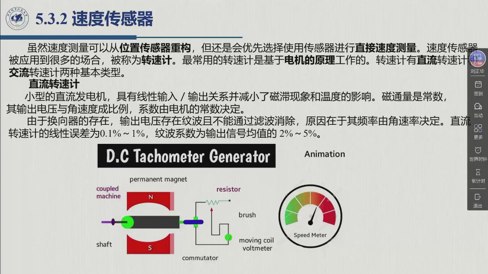

# 5.3.2 速度传感器

速度既可以由直接测速器件获得，也可以从[编码器](../recall.md#sensor)的计数与时间估计。两条路线都有误差：位置差分会放大量化和噪声，直接测速器件也有零偏、纹波和带宽限制。应先说明速度范围与允许延迟，再选择方法。课堂回看：01:57:55–02:00:11。

## 5.3.2.1 直接测量，还是从位置重建

先取已经展开跨圈跳变的位置读数 $\theta_k$，在采样间隔 $\Delta t$ 内求平均速度：

$$\hat\omega_k=\frac{\theta_k-\theta_{k-1}}{\Delta t}.$$

它估计的是这段时间内的平均值，不是无需条件即可得到的瞬时导数。如果位置噪声相互独立、标准差均为 $\sigma_\theta$，差值噪声方差为 $2\sigma_\theta^2$，因此速度噪声标准差为

$$\sigma_\omega=\frac{\sqrt2\sigma_\theta}{\Delta t}.$$

减小 $\Delta t$ 可以减少平均窗口带来的延迟，却会增强这条差分中的噪声影响。若存在相关噪声，应保留协方差，不能直接套独立样本公式。角度若在0与 $2\pi$ 之间跳变，还须先做跨圈展开，否则一次正常过零会被算成很大的反向速度。

::: method 方法 5.3.A · 从位置信号重建速度的三条途径 {#method-5.3.A}
对每圈 $N$ 个有效脉冲的编码器，可用三种读出方式。

固定窗口 $T_w$ 内累计有符号计数 $\Delta c$，得

$$\hat\omega=\frac{2\pi\Delta c}{NT_w}.$$

一计数对应的速度变化为 $2\pi/(NT_w)$。低速时窗口里脉冲少，相对量化误差变大；增大窗口可改善分辨，但会延长更新时间。

若测相邻脉冲周期 $T_p$，则

$$|\hat\omega|=\frac{2\pi}{NT_p},$$

方向另由A/B相位判断。计时误差较小时，相对速度误差约等于相对周期误差：$|\delta\omega|/|\omega|\approx|\delta T_p|/T_p$。低速时周期较长，计时相对误差较小，但必须等待下一个脉冲；高速时周期很短，计时分辨率可能不足。

也可以用频率—电压转换电路把脉冲频率变成模拟输出。这里应称“频率—电压”，不能把转换方向写反。
:::

下图将量化位置与直接差分对照。有限计数分辨率本身就可能产生平台与尖峰，因此平台不一定表示轴静止，尖峰也不一定来自真实的突然加速。

<figure>
<svg class="figure-svg" viewBox="0 0 920 390" xmlns="http://www.w3.org/2000/svg" role="img" aria-labelledby="fig-532-diff-t fig-532-diff-d">
<title id="fig-532-diff-t">位置量化台阶与差分出的速度：瞬时值不可用，平均值才对</title>
<desc id="fig-532-diff-d">左图：编码器给出的位置是阶梯状的量化曲线，与真实的匀速直线（斜坡）之间最多差一级台阶；右图：对阶梯做差分，得到的速度信号在大部分时间为零、在每个台阶跳变处出现尖峰，虚线表示其平均值等于真实转速。</desc>
<marker id="f532-m" markerWidth="9" markerHeight="9" refX="7" refY="3" orient="auto"><path d="M0,0 L7,3 L0,6 Z" fill="var(--muted)"/></marker>
<line class="diagram-axis" x1="70" y1="250" x2="436" y2="250"/>
<line class="diagram-axis" x1="70" y1="250" x2="70" y2="56"/>
<line class="diagram-muted" x1="70" y1="238" x2="420" y2="96"/>
<path class="diagram-accent" d="M 70,230 L 112,230 L 112,212 L 154,212 L 154,195 L 196,195 L 196,178 L 238,178 L 238,161 L 280,161 L 280,144 L 322,144 L 322,127 L 364,127 L 364,110 L 406,110 L 406,97 L 430,97"/>
<text class="diagram-text" x="76" y="48">位置 θ</text>
<text class="diagram-text" x="440" y="256">时间 t</text>
<text class="diagram-note" x="250" y="212">真实位置（匀速上坡）</text>
<text class="diagram-note" x="96" y="286">① 编码器读数：量化台阶（每格一份）</text>
<line class="diagram-axis" x1="500" y1="250" x2="884" y2="250"/>
<line class="diagram-axis" x1="500" y1="250" x2="500" y2="56"/>
<line class="diagram-muted" x1="500" y1="170" x2="884" y2="170"/>
<path class="diagram-accent" d="M 500,240 L 538,240 L 542,90 L 546,240 L 580,240 L 584,90 L 588,240 L 622,240 L 626,90 L 630,240 L 664,240 L 668,90 L 672,240 L 706,240 L 710,90 L 714,240 L 748,240 L 752,90 L 756,240 L 790,240 L 794,90 L 798,240 L 832,240 L 836,90 L 840,240 L 884,240"/>
<text class="diagram-text" x="506" y="48">速度 ω</text>
<text class="diagram-note" x="726" y="162">平均 = 真实转速</text>
<text class="diagram-note" x="546" y="286">② 对位置差分：平段为 0，跳变处出尖峰</text>
<line class="diagram-muted" x1="70" y1="304" x2="884" y2="304"/>
<text class="diagram-note" x="70" y="332">平滑段来自「台阶没变」⇒ 差分输出 0；尖峰来自「台阶跳了一格」⇒ 差分输出一个大数。</text>
<text class="diagram-note" x="70" y="358">把采样间隔 Δt 取得越小，尖峰越高：噪声被 1/Δt 放大；真实速度越低（斜坡越平缓），相对误差越大。</text>
<text class="diagram-note" x="70" y="382">「从位置重建速度」的两难（本教程绘）</text>
</svg>
<figcaption>量化位置产生台阶，直接差分可能产生零值与尖峰交替的速度估计。估计表现还取决于采样时间、计数分辨率和真实运动。</figcaption>
</figure>

滤波与状态估计能够调整噪声和延迟的取舍，但不能增加原始信息。直接测量也不是精确测速的必要条件；应在任务速度范围内，比较整个方案的误差与动态表现。

## 5.3.2.2 直流转速计

直流转速计利用小型直流发电机的反电动势关系，把转速变成输出电压。理想关系为 $u=K_{TV}\omega$，电压极性表示转向。实际读数可写成

$$u=K_{TV}\omega+b+r(t)+n(t),$$

其中 $b$ 为零偏，$r(t)$ 为纹波，$n(t)$ 为其他噪声。磁场、温度与测量电路还会影响比例和线性度。直接输出电压省去了位置差分，却不等于没有测量误差；低速时固定零偏占有效信号的比例也会变大。

换向会产生与轴转动相关的周期纹波。若每圈有 $m$ 次相应周期，纹波频率随 $m|\omega|/(2\pi)$ 改变。低通滤波在纹波明显高于有用速度变化频带时可以衰减它；转速降低后，两者可能进入相近频带，滤波便会同时削弱真实动态或增加延迟。

滤波可以衰减纹波，但单个固定滤波器不能在全部转速下都将它无失真地彻底去除，不能据此说“任何滤波都不起作用”。课件中的线性误差、纹波百分比只作器件量级示例；使用实际指标时，还需确认分母是满量程还是当前读数。

## 5.3.2.3 交流转速计

教材介绍的交流转速计用交流激磁和正交绕组，把速度编码为感应电压的幅值与相位。它与仅用输出频率表示转速的测速方案不同：这里先利用固定载波，再同步解调得到速度。

在简化模型中，可把输出写成

$$u_o=K\omega\sin\omega_ct.$$

乘同频参考并利用 $\sin^2\omega_ct=(1-\cos2\omega_ct)/2$，有

$$u_o\sin\omega_ct=\frac{K\omega}{2}(1-\cos2\omega_ct).$$

在速度变化相对载波较慢、解调相位正确的条件下，滤去二倍载波项，就得到与 $\omega$ 成比例的低频信号。转向由符号或相位恢复。二倍频项出现在解调后，不应把“原始输出载波”与“解调后的纹波”说成同一个频率。

该结构可避免机械换向接触，杯形转子也可减轻附加惯量。但静止时仍可能因寄生耦合出现剩余电压，通道比例、解调相位与电路噪声也影响测速。选取滤波带宽仍要兼顾载波抑制和真实速度变化的保留。

| 方法 | 直接获得的量 | 要重点检查的误差 |
|:--|:--|:--|
| 固定窗计数 | 窗口内平均速度 | 少量脉冲量化、窗口延迟 |
| 测周期 | 脉冲间平均速度 | 计时分辨率、等待时间、转速变化 |
| 位置差分 | 两采样间平均速度 | 位置噪声、量化、跨圈处理 |
| 直流转速计 | 速度相关电压 | 零偏、换向纹波、比例漂移 |
| 交流转速计 | 载波上的速度信号 | 解调误差、剩余电压、滤波延迟 |

::: think 检查理解
1. 位置噪声不变，把差分间隔缩短一半，独立噪声模型下的速度噪声标准差怎样变化？
2. 周期法在低速下计时相对精度较好，为什么却不一定能更快更新？
3. 为什么转速计没有经过数值微分，低速相对误差仍可能很大？
4. 交流同步解调后的二倍频项从哪一步产生？

::: sol 核对
速度噪声标准差变为两倍。周期法需要等待相邻脉冲，低速等待更久。有限零偏与噪声除以很小的真实信号后，相对误差会很大。二倍频项来自输出与同频参考相乘后的三角恒等式，不能据此把原始载波说成二倍激磁频率。
:::
:::
