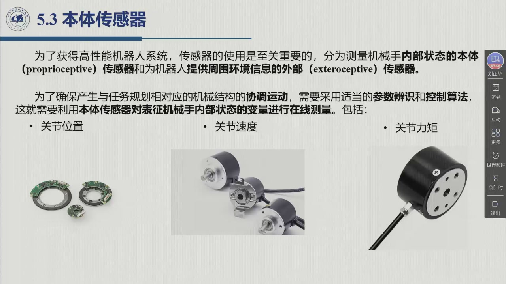

# 5.3 本体传感器

前面的章节把「执行」这一半讲完了：从能源到功放、伺服发动机、传动装置，最后落在关节上；驱动控制回路里也画出了两个反馈方块。但从 §5.2 一路看下来会留下一个缺口——**回路里那两个方块（位置传感器、速度传感器）还没有交代**。从这一节起，我们转到「执行」的对偶：**把关节自己的状态读回来**。教材把机器人用的传感器一分为二——测量机械手内部状态的**本体传感器**（proprioceptive sensors），和为机器人提供周围环境信息的**外部传感器**（exteroceptive sensors）。本节先立起这条分界，再看本体传感器的清单里，为什么**位置与速度**会成为关节伺服的两个基本反馈量。录播 01:45:39–01:48:03。

## 5.3.1 本体传感器与外部传感器

**传感器的地位，教材第一句话就说尽了**：「为了获得高性能机器人系统，传感器的使用是至关重要的。」紧接着是分类——把传感器分成测量**机械手内部状态**的本体传感器与提供**周围环境信息**的外部传感器，是「有意义」的（教材 §5.3）。这条分界不是学术洁癖：它决定了两类器件此后各自挂在哪一半回路上，也决定了本章 §5.3 与 §5.4 的分工。

::: def 定义 5.3.1 · 本体传感器 proprioceptive sensors {#def-5.3.1}
为了确保产生与任务规划相对应的机械结构的**协调运动**，需要采用适当的**参数辨识和控制算法**；这就要求用**本体传感器**对表征机械手**内部状态**的变量进行**在线测量**（教材 §5.3）。这些变量是：

- **关节位置**（joint positions）
- **关节速度**（joint velocities）
- **关节力矩**（joint torques）

三个量缺一不可：「协调运动」意味着各关节按规划好的时间律一起动，而要让算法知道每个关节**现在在哪、动得多快、正受多大力**，唯一的来源就是本体传感器。注意「在线」两个字——这些量不是标定一次就完事，而是要在运动过程中持续读回（这正是前面几章的控制算法能落地的前提）。
:::

三个量在本书里各有归宿：**关节位置**与**关节速度**就是下面两小节的主题（[§5.3.1 位置传感器](sec5-3-1.md)、[§5.3.2 速度传感器](sec5-3-2.md)）；**关节力矩**则是唯一一个「名分」有交叉的量——教材把它列为本体量（内部状态变量），而承载测力的力传感器却与力、触觉、接近、距离、视觉一起被列进了**外部传感器**。

::: think 易混点 · 关节力矩算本体量还是外部量（教材 §5.3 的分类）
教材的两处表述看似打架，其实是两个视角：

- 从**被测量**看，关节力矩是机械手自己的内部状态，属于本体量；
- 从**器件**看，机器人上常用的力传感器（腕力传感器）装在最远端，测的是**末端与环境交互**的力与力矩，提取的是环境的信息，所以教材把它归入外部传感器。

两者之间隔着静力学的雅可比转置映射 $\tau=J^{\mathrm T}F$（[@def-3.8.1]）：测到末端的广义力，就能折算出等效的关节力矩。一句话：**分类看「测什么」，不看「装在哪」。**
:::

**外部传感器这一侧，教材给了一份短清单**：力传感器、触觉传感器、接近传感器、距离传感器、视觉传感器；此外，声音、湿度、烟尘、压力、温度这类针对具体应用的特殊传感器也属于这一类。它们的目标不同于本体传感器——**提取表征机器人与环境目标交互作用的特征，以提高系统的自动化程度**。教材还给了一句很「高」的话：可用传感器的**数据融合**可以应用于（高层）任务规划，而任务规划反过来把机器人表征为一个「**由感知到执行的智能联系**」（教材 §5.3）。清单里每一类的展开见 [5.4 外部传感器](sec5-4.md)，本节只取这条分界本身。

## 5.3.2 位置与速度：关节伺服的两个基本反馈量

回到上一节 §5.2.4 留下的缺口。驱动控制回路最朴素的形态只有**位置反馈**：测出关节（发动机）转角，与参考位置 $\vartheta_r$ 比较，误差经控制器产生指令（教材图 5.9、5.10）。但只靠位置环配比例控制器，**瞬态响应**并不理想——前向通路上有两个位于原点的极点，系统缺少阻尼。工业上的做法是在位置环里再套一个**局部反馈回路**：用角速度测量构成**测速反馈**，于是一般结构变成「带位置和速度反馈的驱动控制」（教材图 5.11），回路里**除了位置传感器之外，还要用一个具有常数 $k_{TV}$ 的速度传感器**。

<figure>
<svg class="figure-svg" viewBox="0 0 920 430" xmlns="http://www.w3.org/2000/svg" role="img" aria-labelledby="fig-53-loop-t fig-53-loop-d">
<title id="fig-53-loop-t">关节伺服的「位置环 + 速度环」与它们各自所需的传感器</title>
<desc id="fig-53-loop-d">参考位置 θr 经位置比较、比例控制器、速度比较、PI 控制器、功率放大器、伺服发动机与积分环节，给出关节位置 θm；内环由测速反馈（转速计 k-TV）闭合，外环由位置传感器（编码器或旋转变压器）闭合，负载力矩干扰注入发动机输入端。图下对照本体传感器的三个量与外部传感器的五个成员。</desc>
<defs>
<marker id="f53-m" markerWidth="9" markerHeight="9" refX="7" refY="3" orient="auto"><path d="M0,0 L7,3 L0,6 Z" fill="var(--muted)"/></marker>
</defs>
<circle class="diagram-node" cx="86" cy="130" r="15"/>
<text class="diagram-note" x="79" y="124">+</text>
<text class="diagram-note" x="79" y="148">−</text>
<text class="diagram-text" x="14" y="136">θ<tspan class="sb">r</tspan></text>
<line class="diagram-axis" x1="38" y1="130" x2="68" y2="130" marker-end="url(#f53-m)"/>
<rect class="diagram-node" x="112" y="106" width="100" height="48" rx="8"/>
<text class="diagram-text" x="162" y="126" text-anchor="middle">位置控制器</text>
<text class="diagram-note" x="162" y="145" text-anchor="middle">（比例，K<tspan class="sb">r</tspan>）</text>
<line class="diagram-axis" x1="104" y1="130" x2="230" y2="130" marker-end="url(#f53-m)"/>
<circle class="diagram-node" cx="248" cy="130" r="14"/>
<text class="diagram-note" x="242" y="124">+</text>
<text class="diagram-note" x="242" y="148">−</text>
<rect class="diagram-node" x="274" y="106" width="130" height="48" rx="8"/>
<text class="diagram-text" x="339" y="126" text-anchor="middle">速度控制器（PI）</text>
<text class="diagram-note" x="339" y="145" text-anchor="middle">K<tspan class="sb">v</tspan>, T<tspan class="sb">v</tspan></text>
<line class="diagram-axis" x1="264" y1="130" x2="414" y2="130" marker-end="url(#f53-m)"/>
<circle class="diagram-node" cx="432" cy="130" r="14"/>
<text class="diagram-note" x="426" y="124">+</text>
<text class="diagram-note" x="426" y="148">−</text>
<line class="diagram-muted" x1="432" y1="56" x2="432" y2="112" marker-end="url(#f53-m)"/>
<text class="diagram-note" x="432" y="46" text-anchor="middle">干扰 D（负载力矩）</text>
<line class="diagram-axis" x1="448" y1="130" x2="474" y2="130" marker-end="url(#f53-m)"/>
<rect class="diagram-node" x="476" y="108" width="88" height="44" rx="8"/>
<text class="diagram-text" x="520" y="127" text-anchor="middle">功率放大器</text>
<text class="diagram-note" x="520" y="145" text-anchor="middle">G<tspan class="sb">v</tspan></text>
<line class="diagram-axis" x1="566" y1="130" x2="596" y2="130" marker-end="url(#f53-m)"/>
<rect class="diagram-node" x="598" y="96" width="140" height="68" rx="8"/>
<text class="diagram-text" x="668" y="120" text-anchor="middle">伺服发动机</text>
<text class="diagram-note" x="668" y="142" text-anchor="middle">k<tspan class="sb">m</tspan>/(1+sT<tspan class="sb">m</tspan>)</text>
<line class="diagram-axis" x1="740" y1="130" x2="768" y2="130" marker-end="url(#f53-m)"/>
<text class="diagram-note" x="758" y="118" text-anchor="middle">Ω<tspan class="sb">m</tspan></text>
<rect class="diagram-node" x="772" y="108" width="66" height="44" rx="8"/>
<text class="diagram-text" x="805" y="136" text-anchor="middle">1/s</text>
<line class="diagram-axis" x1="840" y1="130" x2="868" y2="130" marker-end="url(#f53-m)"/>
<text class="diagram-text" x="856" y="118" text-anchor="middle">θ<tspan class="sb">m</tspan></text>
<line class="diagram-muted" x1="752" y1="152" x2="752" y2="214"/>
<line class="diagram-muted" x1="752" y1="214" x2="654" y2="214"/>
<rect class="diagram-fill-sage" x="438" y="192" width="216" height="44" rx="8"/>
<text class="diagram-text" x="546" y="211" text-anchor="middle">转速计（速度传感器）</text>
<text class="diagram-note" x="546" y="229" text-anchor="middle">k<tspan class="sb">TV</tspan> · §5.3.2</text>
<line class="diagram-muted" x1="438" y1="214" x2="248" y2="214" marker-end="url(#f53-m)"/>
<line class="diagram-muted" x1="248" y1="214" x2="248" y2="146"/>
<line class="diagram-muted" x1="838" y1="152" x2="838" y2="330"/>
<line class="diagram-muted" x1="838" y1="330" x2="714" y2="330"/>
<rect class="diagram-fill-accent" x="420" y="308" width="294" height="44" rx="8"/>
<text class="diagram-text" x="567" y="327" text-anchor="middle">位置传感器（编码器 / 旋转变压器）</text>
<text class="diagram-note" x="567" y="345" text-anchor="middle">§5.3.1</text>
<line class="diagram-muted" x1="420" y1="330" x2="86" y2="330" marker-end="url(#f53-m)"/>
<line class="diagram-muted" x1="86" y1="330" x2="86" y2="146"/>
<text class="diagram-note" x="150" y="204">内环 · 速度（阻尼与带宽）</text>
<text class="diagram-note" x="150" y="300">外环 · 位置（精度）</text>
<text class="diagram-text" x="30" y="388">本体传感器（本节）：关节位置 · 关节速度 · 关节力矩</text>
<text class="diagram-note" x="30" y="412">外部传感器（§5.4）：力 · 触觉 · 接近 · 距离 · 视觉</text>
<text class="diagram-note" x="560" y="388">力矩一路由电流环间接给出：电流经 1/k<tspan class="sb">t</tspan> 与驱动力矩相关（教材 §5.2.1）</text>
<text class="diagram-note" x="560" y="412">教材图 5.11「带位置和速度反馈的驱动控制方框图」的简化重绘（本教程绘）</text>
</svg>
<figcaption>位置环与速度环（本教程绘）：两个环各需要一个本体传感器——外环的位置传感器与内环的转速计。<b>注意回路里两个求和点各配电一个「−」号</b>，这就是「两个（而非一个）反馈回路」在干扰点附近的含义；教材图 5.11 的完整形式（含 $k_{TV}$、$K_v,T_v$ 与 PI 的 $1+sT_v$ 结构）见 §5.2.4。</figcaption>
</figure>

::: thm 定理 5.3.A · 位置与速度是关节伺服的两个基本反馈量 {#thm-5.3.A}
驱动控制回路里，真正「基本」的反馈量只有两个（教材 §5.2.4，图 5.9–5.11）：

1. **位置**——外环的反馈量。由位置传感器测出关节（发动机）转角，与参考位置 $\vartheta_r$ 比较，误差经控制器（典型为 PI）产生指令；没有它就没有位置伺服本身。
2. **速度**——内环（局部反馈回路）的反馈量。它由**速度传感器**测出，以常数 $k_{TV}$ 反馈到内环；采用测速反馈的同时，内部速度回路保留具有参数 $K_v$ 和 $T_v$ 的**比例积分控制器**，以消除稳态下干扰对位置的影响。

测速反馈买到的是**动态性能**：灵活选择控制参数，可以得到**更宽的带宽**且**振荡现象更少**的传递函数，其结果是更快的瞬态响应并减小振荡，从而提高 $\vartheta_m(t)$ 跟踪更苛刻参考轨迹 $\vartheta_r(t)$ 的能力（教材 §5.2.4，定量分析见 §8.3）。工程上为什么恒常保留这两个环？因为在**干扰点附近存在两个（而非一个）反馈回路**，瞬态过程中的干扰抑制也会进一步增强。
:::

**于是本节之后的两条线也就定了。** 位置与速度既然同属「两个基本反馈量」，它们的传感器就构成了 §5.3 的主干：§5.3.1 解决位置怎么测（器件与分辨率），§5.3.2 解决速度怎么测（直接测量与从位置重建）。第三个本体量——关节力矩——则由电流环间接给出（教材 §5.2.1：基于电流测量的力矩伺服，电流通过增益 $1/k_t$ 与驱动力矩相关），它的「外部对应物」在 §5.4 的力传感器里兑现。

::: think 考点 · 老师原话（录播时间点）

> **本体讲完才轮到外部。** 「以上是内部传感器，外部传感器（是）下一节」（02:00:07）——本节只负责内部一侧，外部传感器的展开在 §5.4。

> **同一台机器人上，速度有两条测法，工程上分场合用。** 「如果我们（要）对速度进行精确的测量……就需要进行直接速度的测量」（01:57:08–01:57:18）；在此之前则「很多时候可以采用间接测量」——用编码器测角位置，「那么角位置和时间的数值微分，其实就可以得到转动的角速度」（01:54:58–01:55:19）。

> **器件里的主角。** 「以上是编码器，编码器其实是最常用的」（01:56:15–01:56:18）——位置一侧把力气花在编码器上是划算的。

> **转录说明（本教程按语）。** 本节总述这几个自然段正落在课间休息上：转录稿在 01:39:18（「请咱们休息一下」）之后直接跳到 01:49:59，中间没有语音。所以本节总述部分的技术内容按教材 §5.3 与课件页（01:44:57–01:46:21 三张标题页）整理，老师原话只能取 01:49:59 之后进入 §5.3.1 的内容。
:::

::: think 默写点 · 合上书再写（主动回忆）

1. 本体传感器在线测量的三个内部状态量是什么？「在线」这两个字为什么不能省？
2. 本体传感器与外部传感器各自闭环的是哪一半？外部传感器的五个典型成员是哪些？它们共同的目标是什么？
3. 关节伺服的两个基本反馈量是什么？内环（测速反馈）买到的是什么？为什么说「干扰点附近存在两个而非一个反馈回路」？
4. 「关节力矩」被列为本体量，力传感器却被归入外部传感器——两者如何统一？

::: sol 核对

**关节位置、关节速度、关节力矩**三项。不能省「在线」：这些量要在运动过程中持续读回，参数辨识与控制算法（第 8–10 章）都依赖实时的关节状态，而不是一次性的标定值。

本体传感器闭环的是「**机械手自己**」（内部状态量），外部传感器闭环的是「**机器人与世界的关系**」（周围环境信息与交互特征）。五个典型成员：**力传感器、触觉传感器、接近传感器、距离传感器、视觉传感器**（另有声音、湿度、烟尘、压力、温度等专用传感器）。共同目标：**提取表征机器人与环境目标交互作用的特征，以提高系统的自动化程度**。

**位置与速度**。内环买到的是**动态性能**：更宽带宽、更少振荡、更快的瞬态响应，从而能跟踪更苛刻的参考轨迹。因为干扰注入点在两个环的内侧，干扰到输出之间有**两条**反馈通路，故瞬态干扰也被更强地抑制。

关节力矩是机械手**自身的内部状态**，所以是本体量；而实际测力的器件（腕力传感器）测的是**末端与环境的交互力/力矩**，提取的是环境信息，故教材把力传感器列为外部传感器。两者由静力学映射 $\tau=J^{\mathrm T}F$ 联系（[@def-3.8.1]）——**分类看测什么，不看装在哪**。

:::

:::

## 5.3 小结与常见错误

- **一条分界**：本体传感器测机械手的**内部状态量**（关节位置 / 速度 / 力矩，在线测量）；外部传感器提供**周围环境**信息（力 / 触觉 / 接近 / 距离 / 视觉，另有声音、湿度、烟尘、压力、温度等专用传感器）。
- **一段动机**：为了让机械结构产生「与任务规划相对应的**协调运动**」，参数辨识与控制算法必须拿到实时的关节状态——这是本体传感器存在的理由，也是它「在线」的由来。
- **一句结论**：位置与速度是关节伺服的**两个基本反馈量**（外环位置、内环速度），相位对应下来，本节之后就是位置传感器（§5.3.1）与速度传感器（§5.3.2）两条器件线索；力矩一路由电流环间接给出。
- **一个易混点**：关节力矩是本体内量，力传感器是外部器件——用 $\tau=J^{\mathrm T}F$（[@def-3.8.1]）把两者接起来看。

::: think 常见错误清单 · 自查三条
1. 把「本体传感器」理解成「装在机器人身上的传感器」——分类依据是**测什么**：机器人自身的内部状态量（本体），还是环境与交互信息（外部）。
2. 以为「有了编码器就不需要任何别的传感器」——位置、速度、力矩是**三个**量，且位置一侧还有一圈「从位置重建速度」的取舍要算（见 §5.3.2）。
3. 把测速反馈当成「多加一个测量」——它的实质是**多一个反馈回路**：既改善动态性能（带宽、振荡），又让干扰点附近变成两个环，瞬态干扰抑制更强。
:::