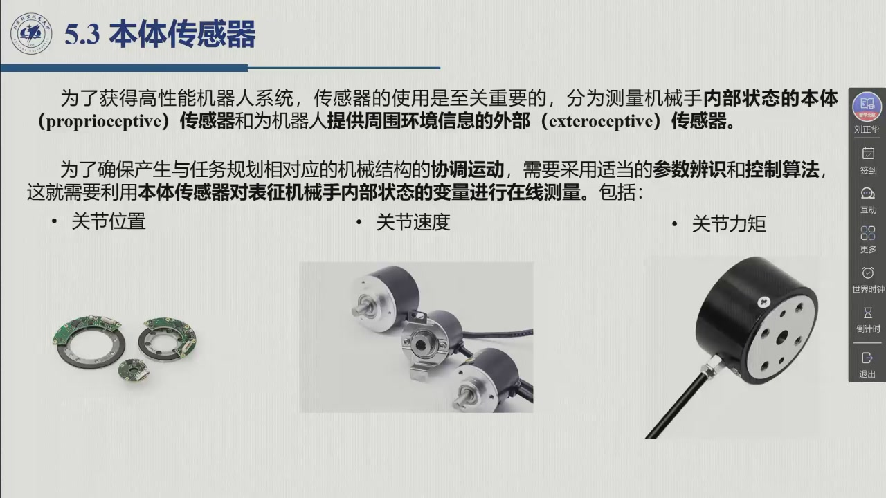

# 5.3 本体传感器

前两节完成了“能量—驱动—传动—测量”链的驱动一侧：能源经功放、发动机和减速器推动关节，[§5.2.4](sec5-2-4.md) 的位置与速度反馈控制框图也画好了。但如果电机负载、摩擦或零位偏离模型，控制器若不知道关节实际转到了哪里、转得多快，就无法修正指令。从本节起转向这条链的测量一侧：先界定本体传感器与外部传感器的分工，再把位置与速度两个关节伺服基本反馈量接到 [§5.3.1](sec5-3-1.md) 和 [§5.3.2](sec5-3-2.md) 的器件原理上。课堂回看：01:44:57–01:48:03（本节概述落于课间休息前后，分类与例举同时参照 00:17:36–00:18:59 及教材 §5.3）。

## 5.3.1 本体传感器与外部传感器

机器人传感器按被测量分为测量自身内部状态的本体传感器和感知环境交互的外部传感器。

::: def 定义 5.3.1 · 本体传感器 proprioceptive sensors {#def-5.3.1}
本体传感器在线测量表征机械手内部状态的三个物理量：关节位置、关节速度和关节力矩，为参数辨识与闭环运动控制提供实时反馈（00:18:17–00:18:59）。外部传感器则提供周围环境及机器人与环境交互的信息，例如目标图像、距离或末端接触力。

分类依据是被测量的物理归属与用途，不看传感器安装位置：装在手腕上的相机用来观测外部工件，仍属外部传感器；关节内部的应变片测该关节传递的力矩，则属本体测量。
:::

列出三个本体量，不表示每台机器人都必须各自独立安装三套传感器。工程上常常把某些量从已有测量和模型间接算出来：比如用编码器测位置后对时间差分估计速度（[§5.3.2](sec5-3-2.md)），或者用电流传感器和电磁转矩公式 $c_m=k_ti_a$ 估计电机电磁转矩。但间接估计省掉硬件的同时会引入量化阶梯、延迟或模型参数漂移，而且电流估计出的是电机电磁力矩，扣除转子加速、摩擦和减速器损耗后才对应关节输出力矩。

::: intuition 动手实验 · 传感器装在哪儿（3D）
逐一选中编码器、速度测量、关节应变、腕力和相机。对每一项回答两个问题：它直接读出的物理量是什么？控制器若需要另一个量，还要经过哪一步变换或估计？

:::

::: note 关节力矩与腕部六维力的关系
教材既把关节力矩列为本体状态量，又把力传感器归入外部传感器，两者按测量对象统一：本体关节力矩刻画机器人自身动力学平衡，腕力传感器测末端与环境接触的合力与合力矩。在 [§3.8](../ch03/sec3-8.md) 的静力学约定下，末端广义力 $F$ 通过雅可比转置 $J^{\mathrm T}F$ 映射到各关节负载；若存在连杆加速、重力或关节摩擦，则必须计入完整动力学项，不能仅靠腕力读数反推出全部关节驱动力矩。
:::

## 5.3.2 位置与速度：关节伺服的两个基本反馈量

回到 [§5.2.4](sec5-2-4.md) 的串级位置控制结构：外环位置误差 $e=\theta_d-\theta$ 决定还有多远没走到，内环速度反馈项用来加快响应或增加阻尼（$-K_D\dot\theta$ 在二阶模型里直接增大速度项系数）。下图把这两路测量放进控制回路里，对应位置传感（[§5.3.1](sec5-3-1.md)）和测速反馈（[§5.3.2](sec5-3-2.md)），第三路关节力矩则可由电流环经 $1/k_t$ 间接反映或另设轴转矩传感。

::: thm 定理 5.3.A · 位置与速度是关节伺服的两个基本反馈量 {#thm-5.3.A}
位置反馈把关节当前转角送回外环求和点以消除位置偏差，速度反馈把角速度送回内环求和点以提供阻尼、改善瞬态响应并多加一层扰动抑制回路。两个量服务于闭环里不同的控制任务；但实际能否提高带宽或稳定性，还须同时校核测量噪声、采样延迟、正负反馈符号和增益匹配。
:::

实际接入图中的两个比较点时，必须统一轴侧、比例、单位和零位：如果位置编码器装在电机轴上读出的是 $\theta_m$，而任务给定的是关节角 $q$，在理想减速比下需先按 $\theta_m=k_rq$（并计入零位偏置与传动误差）对齐后再相减；模拟传感器输出的电压则必须先除以标定系数换算成角度或角速度。

<figure>
<svg class="figure-svg" viewBox="0 0 920 430" xmlns="http://www.w3.org/2000/svg" role="img" aria-labelledby="fig-53-loop-t fig-53-loop-d">
<title id="fig-53-loop-t">关节伺服的「位置环 + 速度环」与它们各自所需的传感器</title>
<desc id="fig-53-loop-d">参考位置 θr 经位置比较、比例控制器、速度比较、PI 控制器、功率放大器、伺服发动机与积分环节，给出关节位置 θm；内环由测速反馈（转速计 k-TV）闭合，外环由位置传感器（编码器或旋转变压器）闭合，负载力矩干扰注入发动机输入端。图下对照本体传感器的三个量与外部传感器的五个成员。</desc>
<defs>
<marker id="f53-m" markerWidth="9" markerHeight="9" refX="7" refY="3" orient="auto"><path d="M0,0 L7,3 L0,6 Z" fill="var(--muted)"/></marker>
</defs>
<circle class="diagram-node" cx="86" cy="130" r="15"/>
<text class="diagram-note" x="79" y="124">+</text>
<text class="diagram-note" x="79" y="148">−</text>
<text class="diagram-text" x="14" y="136">θ<tspan class="sb">r</tspan></text>
<line class="diagram-axis" x1="38" y1="130" x2="68" y2="130" marker-end="url(#f53-m)"/>
<rect class="diagram-node" x="112" y="106" width="100" height="48" rx="8"/>
<text class="diagram-text" x="162" y="126" text-anchor="middle">位置控制器</text>
<text class="diagram-note" x="162" y="145" text-anchor="middle">（比例，K<tspan class="sb">r</tspan>）</text>
<line class="diagram-axis" x1="104" y1="130" x2="230" y2="130" marker-end="url(#f53-m)"/>
<circle class="diagram-node" cx="248" cy="130" r="14"/>
<text class="diagram-note" x="242" y="124">+</text>
<text class="diagram-note" x="242" y="148">−</text>
<rect class="diagram-node" x="274" y="106" width="130" height="48" rx="8"/>
<text class="diagram-text" x="339" y="126" text-anchor="middle">速度控制器（PI）</text>
<text class="diagram-note" x="339" y="145" text-anchor="middle">K<tspan class="sb">v</tspan>, T<tspan class="sb">v</tspan></text>
<line class="diagram-axis" x1="264" y1="130" x2="414" y2="130" marker-end="url(#f53-m)"/>
<circle class="diagram-node" cx="432" cy="130" r="14"/>
<text class="diagram-note" x="426" y="124">+</text>
<text class="diagram-note" x="426" y="148">−</text>
<line class="diagram-muted" x1="432" y1="56" x2="432" y2="112" marker-end="url(#f53-m)"/>
<text class="diagram-note" x="432" y="46" text-anchor="middle">干扰 D（负载力矩）</text>
<line class="diagram-axis" x1="448" y1="130" x2="474" y2="130" marker-end="url(#f53-m)"/>
<rect class="diagram-node" x="476" y="108" width="88" height="44" rx="8"/>
<text class="diagram-text" x="520" y="127" text-anchor="middle">功率放大器</text>
<text class="diagram-note" x="520" y="145" text-anchor="middle">G<tspan class="sb">v</tspan></text>
<line class="diagram-axis" x1="566" y1="130" x2="596" y2="130" marker-end="url(#f53-m)"/>
<rect class="diagram-node" x="598" y="96" width="140" height="68" rx="8"/>
<text class="diagram-text" x="668" y="120" text-anchor="middle">伺服发动机</text>
<text class="diagram-note" x="668" y="142" text-anchor="middle">k<tspan class="sb">m</tspan>/(1+sT<tspan class="sb">m</tspan>)</text>
<line class="diagram-axis" x1="740" y1="130" x2="768" y2="130" marker-end="url(#f53-m)"/>
<text class="diagram-note" x="758" y="118" text-anchor="middle">Ω<tspan class="sb">m</tspan></text>
<rect class="diagram-node" x="772" y="108" width="66" height="44" rx="8"/>
<text class="diagram-text" x="805" y="136" text-anchor="middle">1/s</text>
<line class="diagram-axis" x1="840" y1="130" x2="868" y2="130" marker-end="url(#f53-m)"/>
<text class="diagram-text" x="856" y="118" text-anchor="middle">θ<tspan class="sb">m</tspan></text>
<line class="diagram-muted" x1="752" y1="152" x2="752" y2="214"/>
<line class="diagram-muted" x1="752" y1="214" x2="654" y2="214"/>
<rect class="diagram-fill-sage" x="438" y="192" width="216" height="44" rx="8"/>
<text class="diagram-text" x="546" y="211" text-anchor="middle">转速计（速度传感器）</text>
<text class="diagram-note" x="546" y="229" text-anchor="middle">k<tspan class="sb">TV</tspan> · §5.3.2</text>
<line class="diagram-muted" x1="438" y1="214" x2="248" y2="214" marker-end="url(#f53-m)"/>
<line class="diagram-muted" x1="248" y1="214" x2="248" y2="146"/>
<line class="diagram-muted" x1="838" y1="152" x2="838" y2="330"/>
<line class="diagram-muted" x1="838" y1="330" x2="714" y2="330"/>
<rect class="diagram-fill-accent" x="420" y="308" width="294" height="44" rx="8"/>
<text class="diagram-text" x="567" y="327" text-anchor="middle">位置传感器（编码器 / 旋转变压器）</text>
<text class="diagram-note" x="567" y="345" text-anchor="middle">§5.3.1</text>
<line class="diagram-muted" x1="420" y1="330" x2="86" y2="330" marker-end="url(#f53-m)"/>
<line class="diagram-muted" x1="86" y1="330" x2="86" y2="146"/>
<text class="diagram-note" x="150" y="204">内环 · 速度（阻尼与带宽）</text>
<text class="diagram-note" x="150" y="300">外环 · 位置（精度）</text>
<text class="diagram-text" x="30" y="388">本体传感器（本节）：关节位置 · 关节速度 · 关节力矩</text>
<text class="diagram-note" x="30" y="412">外部传感器（§5.4）：力 · 触觉 · 接近 · 距离 · 视觉</text>
<text class="diagram-note" x="560" y="388">力矩一路由电流环间接给出：电流经 1/k<tspan class="sb">t</tspan> 与驱动力矩相关（教材 §5.2.1）</text>
<text class="diagram-note" x="560" y="412">教材图 5.11「带位置和速度反馈的驱动控制方框图」的简化重绘（本教程绘）</text>
</svg>
<figcaption>位置误差先生成速度参考，速度误差再进入驱动。内外环的输入、测量比例和动态必须分别核对。</figcaption>
</figure>

接下来两小节分别展开[位置传感器](sec5-3-1.md)和[速度传感器](sec5-3-2.md)的工作原理、分辨率计算与误差来源。

::: think 检查理解
1. 装在手腕上的相机为什么仍可能属于外部感知？
2. 电机电流已经测到，是否就知道关节承受的所有负载力矩？
3. 为什么把编码器码值直接与关节参考角相减通常没有意义？

::: sol 核对
1. 分类依据是被测量的归属和用途，不是安装位置；腕上相机感知的是外部环境目标，因此属外部感知。
2. 电流首先对应电机电磁转矩，扣除转子惯性加速、电机与传动摩擦并按传动比折算后，才能对应关节端负载。
3. 码值和关节参考角在单位、零位、比例和轴侧上可能均不一致，必须统一换算到同一物理口径后再求误差。
:::
:::

## 5.3 小结与常见错误

本体传感器在线测量关节位置、速度和力矩，为运动控制闭合机器人自身状态的反馈环；位置和速度分别构成关节伺服的外环与内环反馈量，力矩可由电流估计或直接测轴扭矩。外部传感器的环境感知将在 [§5.4](sec5-4.md) 展开。

::: think 常见错误清单 · 自查三条
1. 按“是否装在机器人身上”区分本体与外部传感器，正确判据是被测量是自身状态还是环境交互。
2. 以为只要测到电机电流就能代替所有力矩测量，忽视了惯性、摩擦和传动损失对电磁力矩的消耗。
3. 在伺服比较点把未换算单位、零偏或减速比的传感器读数直接和关节参考量相减。
:::
