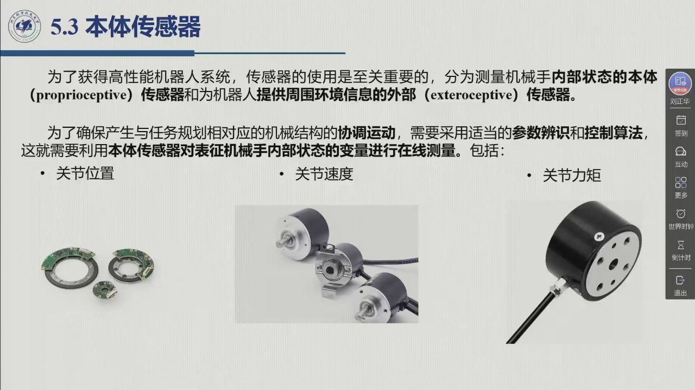

# 5.3 本体传感器

驱动模型预测关节会怎样运动，传感器则提供实际发生了什么的信息。若电机负载、摩擦或零位与模型不同，仅靠预测就无法知道偏差。反馈控制因此需要在运动中不断读回测量值，再与参考值比较。课堂回看：01:45:39–01:48:03。

## 5.3.1 本体传感器与外部传感器

::: def 定义 5.3.1 · 本体传感器 proprioceptive sensors {#def-5.3.1}
本体传感器测量机器人自身的运动或负载状态，例如关节位置、关节速度和关节力矩。外部传感器则提供环境及机器人与环境交互的信息，例如目标图像、距离或末端接触力。

分类依据是被测量及其用途，不是传感器是否安装在机器人上。腕上的相机仍可用于感知外部目标，关节内部的应变测量则可用于估计该关节的负载。
:::

这三个量不表示每台机器人都必须分别安装三类传感器。某些量可以从其他测量和模型估计，例如由编码器估速度，或按 $c_m=k_ti_a$ 估电机电磁力矩。估计能减少器件，但会引入模型、量化、滤波或动态误差。

从电流估计力矩时，先得到的是电机模型中的电磁力矩。扣除转子加速、摩擦和传动损失等需求后，才涉及传动输出与外部负载。因此电磁力矩、传动输出力矩和末端接触力不能直接互换。

::: intuition 动手实验 · 传感器装在哪儿（3D）
逐一选中编码器、速度测量、关节应变、腕力和相机。对每一项回答两个问题：它直接读出的物理量是什么？控制器若需要另一个量，还要经过哪一步变换或估计？

:::

::: note 关节力矩与腕部六维力的关系
关节力矩是本体量，腕部传感器的合力、合力矩常用于描述环境接触，两者并不矛盾。它们测的不是同一组数。

在[§3.8](../ch03/sec3-8.md)所规定的静力假设、符号、参考点与表达坐标系下，末端广义力通过 $J^{\mathrm T}F$ 贡献到关节负载。若存在重力、惯性和摩擦，还须加入这些项；不能仅由腕力测量恢复全部关节驱动力矩。
:::

## 5.3.2 位置与速度：关节伺服的两个基本反馈量

在 [§5.2.4](sec5-2-4.md) 的位置控制中，误差 $e=\theta_d-\theta$ 要求实际位置测量；速度反馈项 $-K_D\dot\theta$ 则要求速度测量或估计。两者服务于不同的控制项。

::: thm 定理 5.3.A · 位置与速度是关节伺服的两个基本反馈量 {#thm-5.3.A}
位置反馈告诉控制器离目标还有多远，速度反馈告诉它当前朝哪个方向、以多快的速度运动。在本章的二阶模型中，负的速度反馈增加速度项系数，从而增加阻尼。

这是控制律与模型共同得到的结果，不是只要增加一个速度传感器就必然使系统更快、更稳定。传感噪声、延迟、反馈符号和增益都必须一起考虑。
:::

下图先由位置误差生成速度目标，再由速度误差生成驱动命令。两个比较点都要检查两侧的单位、零位和轴侧，统一后才能相减。

<figure>
<svg class="figure-svg" viewBox="0 0 920 430" xmlns="http://www.w3.org/2000/svg" role="img" aria-labelledby="fig-53-loop-t fig-53-loop-d">
<title id="fig-53-loop-t">关节伺服的「位置环 + 速度环」与它们各自所需的传感器</title>
<desc id="fig-53-loop-d">参考位置 θr 经位置比较、比例控制器、速度比较、PI 控制器、功率放大器、伺服发动机与积分环节，给出关节位置 θm；内环由测速反馈（转速计 k-TV）闭合，外环由位置传感器（编码器或旋转变压器）闭合，负载力矩干扰注入发动机输入端。图下对照本体传感器的三个量与外部传感器的五个成员。</desc>
<defs>
<marker id="f53-m" markerWidth="9" markerHeight="9" refX="7" refY="3" orient="auto"><path d="M0,0 L7,3 L0,6 Z" fill="var(--muted)"/></marker>
</defs>
<circle class="diagram-node" cx="86" cy="130" r="15"/>
<text class="diagram-note" x="79" y="124">+</text>
<text class="diagram-note" x="79" y="148">−</text>
<text class="diagram-text" x="14" y="136">θ<tspan class="sb">r</tspan></text>
<line class="diagram-axis" x1="38" y1="130" x2="68" y2="130" marker-end="url(#f53-m)"/>
<rect class="diagram-node" x="112" y="106" width="100" height="48" rx="8"/>
<text class="diagram-text" x="162" y="126" text-anchor="middle">位置控制器</text>
<text class="diagram-note" x="162" y="145" text-anchor="middle">（比例，K<tspan class="sb">r</tspan>）</text>
<line class="diagram-axis" x1="104" y1="130" x2="230" y2="130" marker-end="url(#f53-m)"/>
<circle class="diagram-node" cx="248" cy="130" r="14"/>
<text class="diagram-note" x="242" y="124">+</text>
<text class="diagram-note" x="242" y="148">−</text>
<rect class="diagram-node" x="274" y="106" width="130" height="48" rx="8"/>
<text class="diagram-text" x="339" y="126" text-anchor="middle">速度控制器（PI）</text>
<text class="diagram-note" x="339" y="145" text-anchor="middle">K<tspan class="sb">v</tspan>, T<tspan class="sb">v</tspan></text>
<line class="diagram-axis" x1="264" y1="130" x2="414" y2="130" marker-end="url(#f53-m)"/>
<circle class="diagram-node" cx="432" cy="130" r="14"/>
<text class="diagram-note" x="426" y="124">+</text>
<text class="diagram-note" x="426" y="148">−</text>
<line class="diagram-muted" x1="432" y1="56" x2="432" y2="112" marker-end="url(#f53-m)"/>
<text class="diagram-note" x="432" y="46" text-anchor="middle">干扰 D（负载力矩）</text>
<line class="diagram-axis" x1="448" y1="130" x2="474" y2="130" marker-end="url(#f53-m)"/>
<rect class="diagram-node" x="476" y="108" width="88" height="44" rx="8"/>
<text class="diagram-text" x="520" y="127" text-anchor="middle">功率放大器</text>
<text class="diagram-note" x="520" y="145" text-anchor="middle">G<tspan class="sb">v</tspan></text>
<line class="diagram-axis" x1="566" y1="130" x2="596" y2="130" marker-end="url(#f53-m)"/>
<rect class="diagram-node" x="598" y="96" width="140" height="68" rx="8"/>
<text class="diagram-text" x="668" y="120" text-anchor="middle">伺服发动机</text>
<text class="diagram-note" x="668" y="142" text-anchor="middle">k<tspan class="sb">m</tspan>/(1+sT<tspan class="sb">m</tspan>)</text>
<line class="diagram-axis" x1="740" y1="130" x2="768" y2="130" marker-end="url(#f53-m)"/>
<text class="diagram-note" x="758" y="118" text-anchor="middle">Ω<tspan class="sb">m</tspan></text>
<rect class="diagram-node" x="772" y="108" width="66" height="44" rx="8"/>
<text class="diagram-text" x="805" y="136" text-anchor="middle">1/s</text>
<line class="diagram-axis" x1="840" y1="130" x2="868" y2="130" marker-end="url(#f53-m)"/>
<text class="diagram-text" x="856" y="118" text-anchor="middle">θ<tspan class="sb">m</tspan></text>
<line class="diagram-muted" x1="752" y1="152" x2="752" y2="214"/>
<line class="diagram-muted" x1="752" y1="214" x2="654" y2="214"/>
<rect class="diagram-fill-sage" x="438" y="192" width="216" height="44" rx="8"/>
<text class="diagram-text" x="546" y="211" text-anchor="middle">转速计（速度传感器）</text>
<text class="diagram-note" x="546" y="229" text-anchor="middle">k<tspan class="sb">TV</tspan> · §5.3.2</text>
<line class="diagram-muted" x1="438" y1="214" x2="248" y2="214" marker-end="url(#f53-m)"/>
<line class="diagram-muted" x1="248" y1="214" x2="248" y2="146"/>
<line class="diagram-muted" x1="838" y1="152" x2="838" y2="330"/>
<line class="diagram-muted" x1="838" y1="330" x2="714" y2="330"/>
<rect class="diagram-fill-accent" x="420" y="308" width="294" height="44" rx="8"/>
<text class="diagram-text" x="567" y="327" text-anchor="middle">位置传感器（编码器 / 旋转变压器）</text>
<text class="diagram-note" x="567" y="345" text-anchor="middle">§5.3.1</text>
<line class="diagram-muted" x1="420" y1="330" x2="86" y2="330" marker-end="url(#f53-m)"/>
<line class="diagram-muted" x1="86" y1="330" x2="86" y2="146"/>
<text class="diagram-note" x="150" y="204">内环 · 速度（阻尼与带宽）</text>
<text class="diagram-note" x="150" y="300">外环 · 位置（精度）</text>
<text class="diagram-text" x="30" y="388">本体传感器（本节）：关节位置 · 关节速度 · 关节力矩</text>
<text class="diagram-note" x="30" y="412">外部传感器（§5.4）：力 · 触觉 · 接近 · 距离 · 视觉</text>
<text class="diagram-note" x="560" y="388">力矩一路由电流环间接给出：电流经 1/k<tspan class="sb">t</tspan> 与驱动力矩相关（教材 §5.2.1）</text>
<text class="diagram-note" x="560" y="412">教材图 5.11「带位置和速度反馈的驱动控制方框图」的简化重绘（本教程绘）</text>
</svg>
<figcaption>位置误差先生成速度参考，速度误差再进入驱动。内外环的输入、测量比例和动态必须分别核对。</figcaption>
</figure>

若位置传感器装在电机轴上，控制器收到的是电机角 $\theta_m$；任务却可能给关节角 $q$。理想传动下二者满足 $\theta_m=k_rq$，实际还要说明零位偏置和传动误差。若比较点使用电压，测量电压也要按标定系数换成相应角度，不能直接把伏特与弧度相减。

接下来分别说明[位置怎样读出](sec5-3-1.md)和[速度怎样获得](sec5-3-2.md)。阅读器件原理时，逐一确认所测轴、参考零位、输出单位和误差来源，便能把读数换成控制方程需要的反馈量。

::: think 检查理解
1. 装在手腕上的相机为什么仍可能属于外部感知？
2. 电机电流已经测到，是否就知道关节承受的所有负载力矩？
3. 为什么把编码器码值直接与关节参考角相减通常没有意义？

::: sol 核对
分类看测量对象与用途。电流先对应电磁力矩，还须考虑加速、摩擦和传动；动态接触还需完整负载模型。码值和关节角必须先统一轴侧、比例、单位和零位，才能构成有意义的误差。
:::
:::
