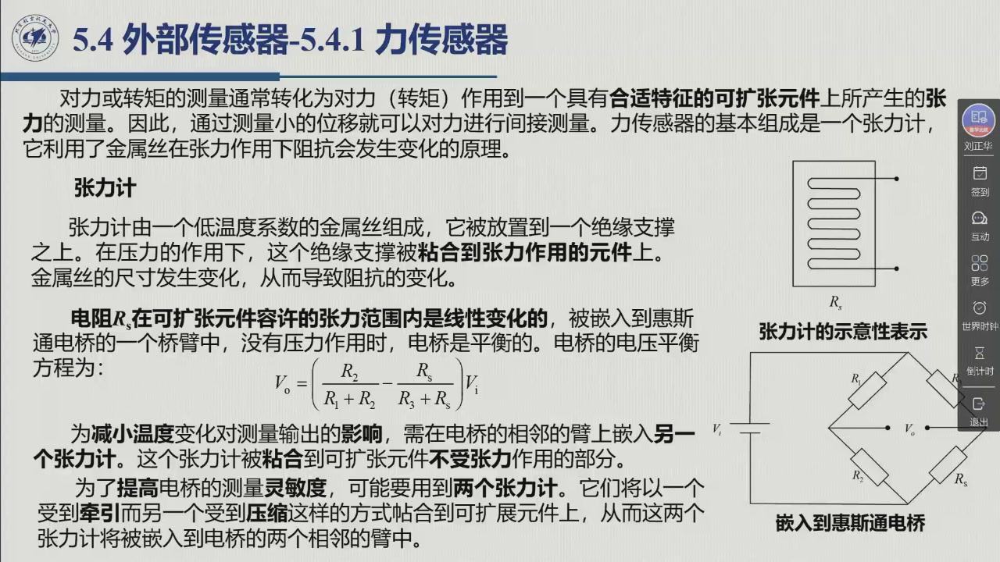
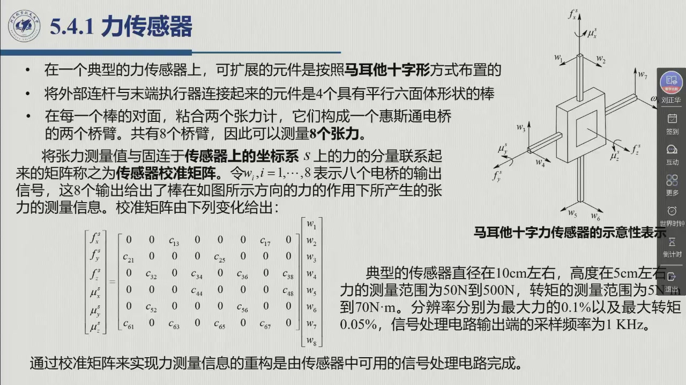

# 5.4.1 力传感器

当机械手抓持工件、打磨表面或插拔装配时，关节编码器只能告诉你关节转到哪儿，看不出接触面顶了多大力。本节走完外部传感器链上的第一条通路“接触力 → 电信号 → 任务力系”：先用应变片与惠斯通电桥把微小变形变成电压，再比较测单轴力矩的轴转矩传感器和测六维力的腕力传感器，最后用第三章的静力学对偶关系把读数从传感器自身坐标系换算到任务约束坐标系。课堂回看：02:01:51–02:11:31。

## 5.4.1.1 从力到电信号：张力计与惠斯通电桥

力无法像电压那样直接进模数转换器，工程上先把力和力矩加载到弹性敏感元件上产生微小弹性变形，再测量金属丝在应变下的电阻变化（02:00:32–02:02:15）。

::: def 定义 5.4.2 · 张力计（应变片）strain gauge {#def-5.4.2}
贴在弹性体上的低温度系数金属丝（教材译作张力计，本节按应变片理解）随弹性体产生相同的相对伸长量（无量纲应变 $\varepsilon=\Delta l/l$），其电阻相对变化在小变形线性区内正比于应变：

$$\frac{\Delta R}{R}=G\varepsilon,$$

其中 $G$ 为灵敏系数。应变片测的是粘贴处的局部应变，必须通过弹性体结构和整机标定才能还原为作用力或力矩。
:::

单个应变片的 $\Delta R/R$ 往往只有千分之几，直接测电阻容易被导线电阻淹没，因此把它接入惠斯通电桥的一个桥臂（02:02:08–02:02:50）。供电电压为 $V_i$、按电桥输出极性取两分压支路中点电压差时，得教材式 (5.30)：

$$V_o=\left(\frac{R_2}{R_1+R_2}-\frac{R_s}{R_3+R_s}\right)V_i.$$

先拿四臂相等的无负载情形校验：取 $R_1=R_2=R_3=R$，敏感臂电阻未受力时 $R_s=R$，两个分压比同为 $\frac12$，电桥平衡输出 $V_o=0$。受力后敏感臂变为 $R_s=R+\Delta R$，代入通分：

$$\frac{V_o}{V_i}=\frac12-\frac{R+\Delta R}{2R+\Delta R}
=\frac{2R+\Delta R-2(R+\Delta R)}{2(2R+\Delta R)}
=-\frac{\Delta R}{2(2R+\Delta R)}.$$

当 $|\Delta R|\ll R$ 时分母中的 $\Delta R$ 可略去，化为线性关系

$$\frac{V_o}{V_i}\approx-\frac{\Delta R}{4R}=-\frac{G\varepsilon}{4},$$

负号仅由桥臂接法与表笔极性决定。

实际贴片还须处理温度漂移和微弱信号两个问题（02:02:53–02:04:20）：环境温度变化同样会让金属丝电阻改变，如果把另一枚同规格应变片接到同一半桥的相邻臂 $R_3$ 上并贴在不受力的同材料部位，温度引起的相同 $\Delta R_T$ 在两项分压中同时出现而相互抵消；如果受弯梁一侧受拉、一侧受压（应变 $+\varepsilon$ 与 $-\varepsilon$ 符号相反），把两枚应变片分别贴在受拉面和受压面并接入电桥相邻臂，分子中的两路电阻变化反而相加，使灵敏度翻倍并同时抵消共模温漂（抗干扰效果仍取决于贴片对称性与温度场均匀度）。

## 5.4.1.2 关节力矩的测量：轴转矩传感器

前面在 [§5.2.1](sec5-2-1.md) 用电流和转矩常数 $c_m=k_ti_a$ 间接估计电机转矩，但磁链和电阻参数会随温升漂移，且包含不了传动摩擦。如果要直接测出传往关节的那一段力矩，可以在电机与关节之间插入一段中空弹性转轴（02:04:25–02:05:30）。

这段中空轴的结构设计兼顾两个相反要求：抗扭刚度要足够低，使传递扭矩产生明显扭转角和主应力；抗弯刚度要足够高，抑制关节弯矩串扰；再把应变片沿轴线成 $45^\circ$（扭转主应变方向）贴成电桥，并经集电环与石墨电刷供电、引出信号（这是旋转轴引出电桥信号的一种典型结构）。

<figure>
<svg class="figure-svg" viewBox="0 0 900 300" xmlns="http://www.w3.org/2000/svg" role="img" aria-labelledby="fig-5412-t fig-5412-d">
<title id="fig-5412-t">轴转矩传感器：夹在马达与关节之间的中空转轴</title>
<desc id="fig-5412-d">左侧为伺服马达，右侧为关节，中间一段中空转轴，转轴表面按 45 度粘贴应变片（惠斯通电桥）；转轴下方用集电环与石墨电刷把电桥信号引出，输出与作用转矩成比例的不平衡信号。标注：低抗扭刚度使扭转产生可测的张力，高抗弯刚度避免弯曲干扰。</desc>
<defs>
<marker id="f5412-a" markerWidth="9" markerHeight="9" refX="7" refY="3" orient="auto"><path d="M0,0 L7,3 L0,6 Z" fill="var(--muted)"/></marker>
</defs>
<rect x="30" y="60" width="110" height="80" rx="8" fill="none" stroke="var(--line-strong)" stroke-width="1.4"/>
<text class="diagram-note" x="85" y="105" text-anchor="middle">伺服马达</text>
<line x1="140" y1="100" x2="162" y2="100" stroke="var(--muted)" stroke-width="1.6" marker-end="url(#f5412-a)"/>
<rect x="165" y="75" width="260" height="50" fill="none" stroke="var(--fig-blue)" stroke-width="1.8"/>
<rect x="165" y="93" width="260" height="14" fill="none" stroke="var(--line-strong)" stroke-width="1.2" stroke-dasharray="5 4"/>
<line x1="200" y1="75" x2="238" y2="125" stroke="var(--fig-gold)" stroke-width="2"/>
<line x1="300" y1="75" x2="338" y2="125" stroke="var(--fig-gold)" stroke-width="2"/>
<text class="diagram-note" x="295" y="66" text-anchor="middle">中空转轴：应变片按 45° 粘贴（惠斯通电桥）</text>
<line x1="425" y1="100" x2="447" y2="100" stroke="var(--muted)" stroke-width="1.6" marker-end="url(#f5412-a)"/>
<rect x="450" y="60" width="110" height="80" rx="8" fill="none" stroke="var(--line-strong)" stroke-width="1.4"/>
<text class="diagram-note" x="505" y="105" text-anchor="middle">关节</text>
<text class="diagram-note" x="600" y="80">低抗扭刚度：扭转有可测张力</text>
<text class="diagram-note" x="600" y="106">高抗弯刚度：弯曲不干扰</text>
<text class="diagram-note" x="600" y="132">测得转矩 ≠ $C_m$</text>
<text class="diagram-note" x="600" y="156">（缺惯性、摩擦与上游传动）</text>
<rect x="345" y="150" width="42" height="28" rx="4" fill="none" stroke="var(--line-strong)"/>
<rect x="352" y="157" width="28" height="14" rx="3" fill="none" stroke="var(--fig-gold)"/>
<text class="diagram-note" x="366" y="200" text-anchor="middle">集电环 + 石墨电刷</text>
<line x1="400" y1="164" x2="556" y2="200" stroke="var(--muted)" stroke-width="1.4" marker-end="url(#f5412-a)"/>
<rect x="560" y="176" width="300" height="62" rx="8" fill="none" stroke="var(--line-strong)"/>
<text class="diagram-note" x="710" y="202" text-anchor="middle">输出：与作用转矩成比例的不平衡信号</text>
<text class="diagram-note" x="710" y="224" text-anchor="middle">（电刷—集电环同时给电桥供激励）</text>
</svg>
<figcaption>弹性轴段把传递力矩转换为可测应变，电桥信号从旋转侧引出。测量位置决定它反映哪一段传递力矩，不能与电机电磁力矩直接混用。</figcaption>
</figure>

注意测量点口径：轴转矩传感器夹在马达与关节之间，测到的是通过该弹性截面的传递转矩，它不包含测量点上游的转子加速惯性矩、摩擦损耗和齿轮损耗，因此并不等于执行系统框图里的电机电磁力矩 $C_m$。

## 5.4.1.3 腕力传感器：六维力/力矩与「马耳他十字」

轴转矩传感器只能测单轴扭矩。为了在与环境接触时同时测出空间三个方向的力和三个方向的力矩，需要在末杆与末端执行器之间安装六维腕力传感器（02:05:34–02:09:18）。

::: def 定义 5.4.3 · 腕力传感器 wrist force sensor {#def-5.4.3}
六维腕力传感器用一组弹性变形元件连接远端连杆与末端执行器，测量作用在传感器坐标系 $s$ 原点处、沿 $s$ 轴表达的三维合力 $f^s$ 和合力矩 $\mu^s$。结构设计要求在任意方向外力或外力矩作用下至少有一个弹性元件发生可测变形，且单个力分量尽量只激发最少数目元件以减少交叉耦合；因为工程上难以做到六个分量完全独立解耦（02:06:23–02:06:45），教材示例用“马耳他十字”的 4 根平行六面体弹性棒正反面共 8 个电桥测量 $w_1,\dots,w_8$ 来重构 6 个广义力分量。
:::

用标准已知砝码和力矩对传感器标定后，把去零偏的 8 路电桥读数 $w\in\mathbb R^8$ 线性映射为传感器坐标系里的六维力矢量 $F^s=[f^s;\mu^s]$。

::: thm 定理 5.4.A · 传感器校准矩阵（式 5.31） {#thm-5.4.A}
对马耳他十字结构，稀疏校准矩阵 $C_{cal}\in\mathbb R^{6\times8}$ 给出六维广义力分量：

$$\begin{bmatrix}f^s_x\\ f^s_y\\ f^s_z\\ \mu^s_x\\ \mu^s_y\\ \mu^s_z\end{bmatrix}=
\begin{bmatrix}
0&0&c_{13}&0&0&0&c_{17}&0\\
c_{21}&0&0&0&c_{25}&0&0&0\\
0&c_{32}&0&c_{34}&0&c_{36}&0&c_{38}\\
0&0&0&0&c_{45}&0&0&c_{48}\\
0&c_{52}&0&0&0&c_{56}&0&0\\
c_{61}&0&c_{63}&0&c_{65}&0&c_{67}&0
\end{bmatrix}
\begin{bmatrix}w_1\\ w_2\\ w_3\\ w_4\\ w_5\\ w_6\\ w_7\\ w_8\end{bmatrix}. \tag{5.31}$$

读表时逐行看对应关系：例如第 1 行 $f_x^s=c_{13}w_3+c_{17}w_7$ 只依赖 3 号和 7 号读数，最后一行 $\mu_z^s=c_{61}w_1+c_{63}w_3+c_{65}w_5+c_{67}w_7$ 依赖四个奇号读数（02:07:55–02:08:33）。前三行系数把电读数换成牛顿（N），后三行系数换成牛·米（N·m）。
:::

注意从数学上判断是否真能从 $w$ 唯一还原 $F^s$：必须核查前向加载模型 $w=HF^s$ 中矩阵 $H\in\mathbb R^{8\times6}$ 是否列满秩（否则不同受力组合会给出同一组电桥输出），仅仅“通道数 8 大于未知数 6”本身不足以保证可辨识。教材给出的典型商用腕力传感器量级为：直径约 10 cm、高约 5 cm，力测量范围 50–500 N（分辨率 0.1%），力矩范围 5–70 N·m（分辨率 0.05%），采样率约 1 kHz。

## 5.4.1.4 从传感器坐标系到约束坐标系：等价力/力矩

信号处理电路算出了 $[f^s_s;\mu^s_s]$，还不能直接喂给第八章的力控制律（02:09:20–02:11:31）。原因有两个：传感器出厂时只知道自己的坐标系 $s$，而任务是在接触点或约束坐标系 $c$ 中控制力和力矩，两系的坐标轴方向不同，而且力矩对不同的原点取矩会相差一个“力臂叉乘力”的附加力偶。

::: method 方法 5.4.B · 传感器坐标系 → 约束坐标系的等价力/力矩变换 {#method-5.4.B}
设 $R_s^c$ 把 $s$ 系下的向量旋转表达到 $c$ 系，$r_{cs}^c$ 为从 $c$ 原点指向 $s$ 原点的位置向量（在 $c$ 系中表达）。先把力和力矩都旋转到 $c$ 系的坐标轴下，再把原本关于 $s$ 原点的力矩迁移到 $c$ 原点（力作用在 $s$ 原点上相对 $c$ 原点产生力臂 $r_{cs}^c$）：

$$f_c^c=R_s^cf_s^s,\qquad
\mu_c^c=R_s^c\mu_s^s+r_{cs}^c\times f_c^c.$$

将叉乘写成[叉乘矩阵](../recall.md#skew) $S(r^c_{cs})$，合并为分块矩阵（教材式 5.32）：

$$\begin{bmatrix}f^c_c\\ \mu^c_c\end{bmatrix}=
\begin{bmatrix}R^c_s&O\\S(r^c_{cs})R^c_s&R^c_s\end{bmatrix}
\begin{bmatrix}f^s_s\\ \mu^s_s\end{bmatrix}. \tag{5.32}$$

注意左下块必须先用 $R_s^c$ 把力转到 $c$ 系再左乘 $S(r_{cs}^c)$，不能把不同坐标系下的向量直接叉乘。这一变换与 [§3.8.2](../ch03/sec3-8.md#sec-3.8.2) 中广义速度与广义力的对偶变换完全同形。
:::

变换矩阵是否随时间变化，取决于 $s$ 系和 $c$ 系的相对安装位姿：如果 $c$ 系选在刚性固连于末端工具上的特征点，那么即使机械臂整体在空间运动，两系相对位姿 $r_{cs}^c,R_s^c$ 仍可保持恒定；如果 $c$ 系固定在外部工件或环境表面上而末端在滑动或转动，则必须用正运动学实时更新它们。另外，坐标变换只是把同一总力系换到新原点与新坐标轴下表达，如果工具本身有重力和运动惯性，提取纯环境接触力前仍需另做重力与惯性补偿。

下面用作业 5.6 的数值算一遍（验证 $s$ 系下的力与力矩换到 $c$ 系后力矩为何会消成零）。

::: ex 例题 5.4.C · 接触情形下的等价力与力矩（作业 5.6 的算例） {#ex-5.4.C}
已知传感器坐标系 $s$ 相对约束坐标系 $c$ 的位姿及测量值为

$$r^c_{cs}=\begin{bmatrix}-0.3\\0\\0.2\end{bmatrix}\mathrm{m},\qquad
R^c_s=\begin{bmatrix}0&0&1\\0&-1&0\\1&0&0\end{bmatrix},\qquad
f^s_s=\begin{bmatrix}20\\0\\0\end{bmatrix}\mathrm{N},\qquad
\mu^s_s=\begin{bmatrix}0\\6\\0\end{bmatrix}\mathrm{N\cdot m}.$$

求约束坐标系 $c$ 下的等价力 $f^c_c$ 与等价力矩 $\mu^c_c$。

**解**：先旋转力分量：

$$f^c_c=R^c_sf^s_s=\begin{bmatrix}0&0&1\\0&-1&0\\1&0&0\end{bmatrix}\begin{bmatrix}20\\0\\0\end{bmatrix}=\begin{bmatrix}0\\0\\20\end{bmatrix}\mathrm{N}.$$

写出 $S(r^c_{cs})=\begin{bmatrix}0&-0.2&0\\0.2&0&0.3\\0&-0.3&0\end{bmatrix}$，分别计算力臂迁移项与力矩旋转项：

$$S(r^c_{cs})R^c_sf^s_s=\begin{bmatrix}0&-0.2&0\\0.2&0&0.3\\0&-0.3&0\end{bmatrix}\begin{bmatrix}0\\0\\20\end{bmatrix}=\begin{bmatrix}0\\6\\0\end{bmatrix}\mathrm{N\cdot m},\qquad
R^c_s\mu^s_s=\begin{bmatrix}0&0&1\\0&-1&0\\1&0&0\end{bmatrix}\begin{bmatrix}0\\6\\0\end{bmatrix}=\begin{bmatrix}0\\-6\\0\end{bmatrix}\mathrm{N\cdot m}.$$

两项相加得

$$\mu^c_c=\begin{bmatrix}0\\6\\0\end{bmatrix}+\begin{bmatrix}0\\-6\\0\end{bmatrix}=\begin{bmatrix}0\\0\\0\end{bmatrix}\mathrm{N\cdot m}.$$

**结果读法**：$c$ 系下的合力为沿 $+z_c$ 轴的 $20\ \mathrm N$，而关于 $c$ 原点的合力矩恰好抵消为零。这说明 $s$ 系测到的“$20\ \mathrm N$ 力加 $6\ \mathrm{N\cdot m}$ 力偶”与 $c$ 系里“一条直接穿过 $c$ 原点的 $20\ \mathrm N$ 纯力”是同一个空间力系，只是参考原点选在了作用线外还是作用线上。
:::

::: think 检查理解
1. 为什么应变片的输出不是不经标定即可直接使用的力？
2. 八个通道恢复六个量，为什么不能只凭“八大于六”证明一定能恢复？
3. 仅改变表达坐标轴和改变力矩参考点，分别需要矩阵中的哪一部分？
4. 机械臂运动时，何种情况下传感器与工具之间的力变换仍为常量？

::: sol 核对
1. 应变片直接给出电阻相对变化，经过电桥变成电压；必须通过弹性体受力—应变模型与实测标定矩阵，并扣除零偏和交叉耦合，才能得到力与力矩。
2. 能否恢复取决于前向关系 $w=HF^s$ 中 $H$ 是否列满秩（各通道组合线性无关），通道数多于 6 不自动保证满秩。
3. 只换表达坐标轴用对角线上的两个旋转块 $R_s^c$；改变力矩参考点还必须加上左下角的力臂迁移块 $S(r^c_{cs})R_s^c$。
4. 当约束／工具坐标系与传感器坐标系刚性固连时，两系间的相对位置 $r^c_{cs}$ 与姿态 $R_s^c$ 不随机械臂运动改变，变换矩阵保持常量。
:::
:::

## 5.4.1 小结与常见错误

力传感器通过弹性体把接触力转化为应变，再经应变片与惠斯通电桥输出电压（可用对称邻臂贴片补偿温漂和翻倍灵敏度）。单轴关节扭矩可用低抗扭、高抗弯的中空转轴配 45° 应变片直接测量，其读数不含上游惯性、摩擦与传动损耗；六维腕力传感器利用校准矩阵从多路电桥恢复传感器系下的力系，再经式 (5.32) 的旋转与力臂迁移换算到约束坐标系用于控制。

::: think 常见错误清单 · 自查三条
1. 把轴转矩传感器的测得转矩当成电机电磁转矩 $C_m$：测量截面选在电机与关节之间时，不包含上游转子加速惯性矩与上游摩擦。
2. 直接把腕力传感器输出 $F^s$ 送进接触点控制律，忘掉换坐标轴，或换参考点时漏掉左下角力臂迁移项 $S(r^c_{cs})R^c_sf^s_s$。
3. 误以为机械臂一动，$s$ 到 $c$ 的力变换矩阵就一定变化（仅当 $c$ 相对 $s$ 运动时才变；若两者刚性固连在末端工具上，相对变换保持恒定）。
:::
