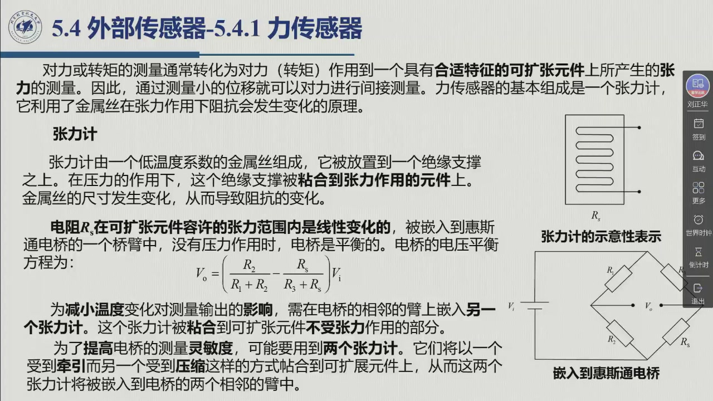
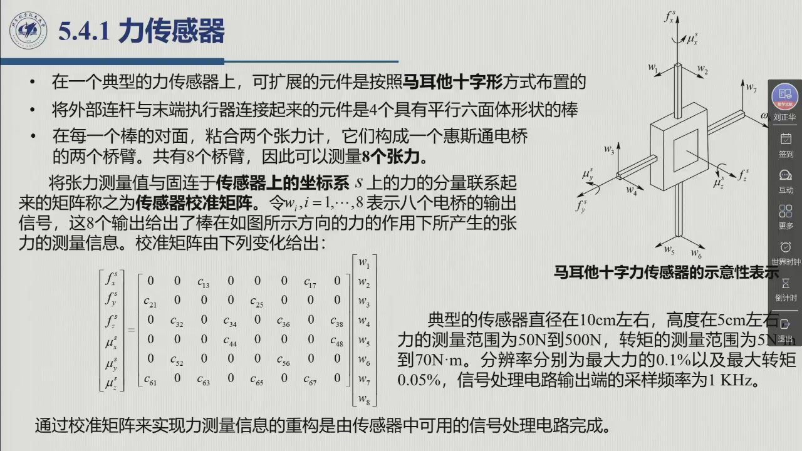

# 5.4.1 力传感器

力传感器的输出往往是电压或数字量，而不是已经写好的接触力。必须先建立“负载—弹性变形—应变—电信号”的关系，再确定负载的方向、参考点和表达坐标系。本节沿这条链推导，最后用已有静力学完成坐标换算。课堂回看：02:01:51–02:11:31。

## 5.4.1.1 从力到电信号：张力计与惠斯通电桥

::: def 定义 5.4.2 · 张力计（应变片）strain gauge {#def-5.4.2}
应变片粘贴在弹性体上，用电阻变化反映该处应变。应变 $\varepsilon=\Delta l/l$ 是相对长度变化，无量纲；在小变形测量范围内，可用灵敏系数 $G$ 写成

$$\frac{\Delta R}{R}=G\varepsilon.$$

应变不是力本身。还要由弹性体结构和标定关系，将应变对应到作用力或力矩。教材中的“张力计”在本节按应变片理解。
:::

惠斯通电桥把几个电阻组成两条分压支路，再读取两支路中点的电压差。按图中输出极性，供电为 $V_i$ 时，教材式 (5.30) 为

$$V_o=\left(\frac{R_2}{R_1+R_2}-\frac{R_s}{R_3+R_s}\right)V_i.$$

若四个初始电阻均为 $R$，无负载时两个比值均为 $1/2$，所以 $V_o=0$。现在只有敏感臂变成 $R_s=R+\Delta R$：

$$\frac{V_o}{V_i}=\frac12-\frac{R+\Delta R}{2R+\Delta R}
=-\frac{\Delta R}{2(2R+\Delta R)}
\approx-\frac{\Delta R}{4R}=-\frac{G\varepsilon}{4}.$$

线性近似要求 $|\Delta R|\ll R$；负号由桥路连接和输出极性决定。这样从电阻变化到输出电压的比例便有了明确依据。

温度也会改变电阻。若在相邻桥臂使用匹配的应变片，使两者经历近似相同温度而只有一片承受目标应变，可以让部分共同温度影响相抵。若利用梁受弯时两侧一拉一压，则可把相反符号的应变接入合适桥臂，使目标信号在差分输出中增强。效果都依赖布置和匹配，不是简单多贴一片就能消除全部温漂。

## 5.4.1.2 关节力矩的测量：轴转矩传感器

由电流和 $k_t$ 可以估计电磁力矩，若要测量某段传动真正传递的力矩，也可在该处插入带应变测量的弹性轴段。轴段扭转产生应变，电桥再把它转换为输出。

设计时要在信号强度与关节刚度之间取舍，并减少弯曲等其他载荷的串扰。应变片方向、轴截面和桥路共同决定选择性；45°贴片可以测得扭转相关应变，但不能单独保证弯曲与温度影响为零。

<figure>
<svg class="figure-svg" viewBox="0 0 900 300" xmlns="http://www.w3.org/2000/svg" role="img" aria-labelledby="fig-5412-t fig-5412-d">
<title id="fig-5412-t">轴转矩传感器：夹在马达与关节之间的中空转轴</title>
<desc id="fig-5412-d">左侧为伺服马达，右侧为关节，中间一段中空转轴，转轴表面按 45 度粘贴应变片（惠斯通电桥）；转轴下方用集电环与石墨电刷把电桥信号引出，输出与作用转矩成比例的不平衡信号。标注：低抗扭刚度使扭转产生可测的张力，高抗弯刚度避免弯曲干扰。</desc>
<defs>
<marker id="f5412-a" markerWidth="9" markerHeight="9" refX="7" refY="3" orient="auto"><path d="M0,0 L7,3 L0,6 Z" fill="var(--muted)"/></marker>
</defs>
<rect x="30" y="60" width="110" height="80" rx="8" fill="none" stroke="var(--line-strong)" stroke-width="1.4"/>
<text class="diagram-note" x="85" y="105" text-anchor="middle">伺服马达</text>
<line x1="140" y1="100" x2="162" y2="100" stroke="var(--muted)" stroke-width="1.6" marker-end="url(#f5412-a)"/>
<rect x="165" y="75" width="260" height="50" fill="none" stroke="var(--fig-blue)" stroke-width="1.8"/>
<rect x="165" y="93" width="260" height="14" fill="none" stroke="var(--line-strong)" stroke-width="1.2" stroke-dasharray="5 4"/>
<line x1="200" y1="75" x2="238" y2="125" stroke="var(--fig-gold)" stroke-width="2"/>
<line x1="300" y1="75" x2="338" y2="125" stroke="var(--fig-gold)" stroke-width="2"/>
<text class="diagram-note" x="295" y="66" text-anchor="middle">中空转轴：应变片按 45° 粘贴（惠斯通电桥）</text>
<line x1="425" y1="100" x2="447" y2="100" stroke="var(--muted)" stroke-width="1.6" marker-end="url(#f5412-a)"/>
<rect x="450" y="60" width="110" height="80" rx="8" fill="none" stroke="var(--line-strong)" stroke-width="1.4"/>
<text class="diagram-note" x="505" y="105" text-anchor="middle">关节</text>
<text class="diagram-note" x="600" y="80">低抗扭刚度：扭转有可测张力</text>
<text class="diagram-note" x="600" y="106">高抗弯刚度：弯曲不干扰</text>
<text class="diagram-note" x="600" y="132">测得转矩 ≠ $C_m$</text>
<text class="diagram-note" x="600" y="156">（缺惯性、摩擦与上游传动）</text>
<rect x="345" y="150" width="42" height="28" rx="4" fill="none" stroke="var(--line-strong)"/>
<rect x="352" y="157" width="28" height="14" rx="3" fill="none" stroke="var(--fig-gold)"/>
<text class="diagram-note" x="366" y="200" text-anchor="middle">集电环 + 石墨电刷</text>
<line x1="400" y1="164" x2="556" y2="200" stroke="var(--muted)" stroke-width="1.4" marker-end="url(#f5412-a)"/>
<rect x="560" y="176" width="300" height="62" rx="8" fill="none" stroke="var(--line-strong)"/>
<text class="diagram-note" x="710" y="202" text-anchor="middle">输出：与作用转矩成比例的不平衡信号</text>
<text class="diagram-note" x="710" y="224" text-anchor="middle">（电刷—集电环同时给电桥供激励）</text>
</svg>
<figcaption>弹性轴段把传递力矩转换为可测应变，电桥信号从旋转侧引出。测量位置决定它反映哪一段传递力矩，不能与电机电磁力矩直接混用。</figcaption>
</figure>

测量位置决定力矩的含义。若传感器在电机与负载之间，它测量的是通过该截面传递的力矩。电机电磁力矩还要承担转子加速和上游摩擦，不能直接用同一个 $C_m$ 代替传感器读数。旋转轴上的电桥如何供电和传出信号也是结构问题，图中的电刷与集电环只是一种实现。

## 5.4.1.3 腕力传感器：六维力/力矩与「马耳他十字」

::: def 定义 5.4.3 · 腕力传感器 wrist force sensor {#def-5.4.3}
六维腕力传感器用弹性结构连接远端连杆与工具。其输出用于恢复关于传感器原点、沿传感器坐标轴表达的三维合力 $f^s$ 和合力矩 $\mu^s$。

不同方向的负载通常会同时影响多个应变通道，因此要标定交叉耦合。教材的马耳他十字结构用八路测量说明这种重构；八路是该例的安排，不是所有六维传感器必须超过六路的定理。
:::

::: thm 定理 5.4.A · 传感器校准矩阵（式 5.31） {#thm-5.4.A}
令 $w\in\mathbb R^8$ 为经过零点处理的八路读数，标定矩阵 $C_{cal}\in\mathbb R^{6\times8}$ 将其转换为 $F^s=[f^s;\mu^s]$。教材给出的稀疏结构为

$$\begin{bmatrix}f^s_x\\ f^s_y\\ f^s_z\\ \mu^s_x\\ \mu^s_y\\ \mu^s_z\end{bmatrix}=
\begin{bmatrix}
0&0&c_{13}&0&0&0&c_{17}&0\\
c_{21}&0&0&0&c_{25}&0&0&0\\
0&c_{32}&0&c_{34}&0&c_{36}&0&c_{38}\\
0&0&0&0&c_{45}&0&0&c_{48}\\
0&c_{52}&0&0&0&c_{56}&0&0\\
c_{61}&0&c_{63}&0&c_{65}&0&c_{67}&0
\end{bmatrix}
\begin{bmatrix}w_1\\ w_2\\ w_3\\ w_4\\ w_5\\ w_6\\ w_7\\ w_8\end{bmatrix} \tag{5.31}$$

每一行恢复一个力或力矩分量。例如第一行是 $f_x^s=c_{13}w_3+c_{17}w_7$。系数的单位应将读数单位转换为 N 或 N·m，不能把六行都按同一物理单位理解。
:::

六维负载能否由读数恢复，取决于前向模型 $w=HF^s$ 中 $H$ 是否列满秩；否则不同负载可能产生相同读数。实际用已知标准负载标定时，还要检查噪声、零偏和有效载荷范围。增加通道可能提供冗余信息，但通道数量本身不能保证可辨识或高精度。

## 5.4.1.4 从传感器坐标系到约束坐标系：等价力/力矩

标定后的六个分量仍以传感器原点取矩、沿传感器轴表达。若控制目标在接触点，需按力臂迁移力矩；若任务轴不同，还需旋转分量。两项应分别写清后再合并。

::: method 方法 5.4.B · 传感器坐标系 → 约束坐标系的等价力/力矩变换 {#method-5.4.B}
令 $R_s^c$ 把传感器系 $s$ 的分量换成任务系 $c$ 的分量；$r_{cs}^c$ 从 $c$ 原点指向 $s$ 原点，并用 $c$ 系表达。先换力的分量，再迁移力矩：

$$f_c^c=R_s^cf_s^s,\qquad
\mu_c^c=R_s^c\mu_s^s+r_{cs}^c\times f_c^c.$$

把[叉乘矩阵](../recall.md#skew)代入，得教材式 (5.32)：

$$\begin{bmatrix}f^c_c\\ \mu^c_c\end{bmatrix}=
\begin{bmatrix}R^c_s&O\\S(r^c_{cs})R^c_s&R^c_s\end{bmatrix}
\begin{bmatrix}f^s_s\\ \mu^s_s\end{bmatrix}.$$

左下块先将力旋转到 $c$ 系，再计算关于新原点的力矩；不能在换基前用另一坐标系的力臂做叉乘。完整对偶关系见 [§3.8.2](../ch03/sec3-8.md#sec-3.8.2)。
:::

变换是否恒定，取决于 $s$ 与 $c$ 的相对位姿。若二者刚性固连，即使机械臂整体移动，相对变换也可不变；若 $c$ 固定在工件上而传感器随工具运动，则通常需要更新。不能把条件写成“只有末端静止才保持不变”。

此外，坐标变换只能重写同一力系，不能自行去掉工具重力、工具惯性或传感器零偏。要把腕部测得的总负载解释为纯接触力，还需相应补偿和符号约定。

::: ex 例题 5.4.C · 接触情形下的等价力与力矩（作业 5.6 的算例） {#ex-5.4.C}
已知图 5.16 所示的接触情形中，传感器坐标系 $s$ 相对约束坐标系 $c$ 的位置与方位，以及力传感器的测量值：

$$r^c_{cs}=\begin{bmatrix}-0.3\\0\\0.2\end{bmatrix}\mathrm{m},\qquad
R^c_s=\begin{bmatrix}0&0&1\\0&-1&0\\1&0&0\end{bmatrix},\qquad
f^s_s=\begin{bmatrix}20\\0\\0\end{bmatrix}\mathrm{N},\qquad
\mu^s_s=\begin{bmatrix}0\\6\\0\end{bmatrix}\mathrm{N\cdot m}$$

求**接触坐标系下的等价力与力矩**。

**解**：代入 [@method-5.4.B] 的变换式。先算力（只有旋转块）：

$$f^c_c=R^c_sf^s_s=\begin{bmatrix}0&0&1\\0&-1&0\\1&0&0\end{bmatrix}\begin{bmatrix}20\\0\\0\end{bmatrix}=\begin{bmatrix}0\\0\\20\end{bmatrix}\mathrm{N}$$

再算力矩，两项分开写（$S(r^c_{cs})=\begin{bmatrix}0&-0.2&0\\0.2&0&0.3\\0&-0.3&0\end{bmatrix}$）：

$$S(r^c_{cs})R^c_sf^s_s=\begin{bmatrix}0&-0.2&0\\0.2&0&0.3\\0&-0.3&0\end{bmatrix}\begin{bmatrix}0\\0\\20\end{bmatrix}=\begin{bmatrix}0\\6\\0\end{bmatrix}\mathrm{N\cdot m},\qquad
R^c_s\mu^s_s=\begin{bmatrix}0\\-6\\0\end{bmatrix}\mathrm{N\cdot m}$$

$$\mu^c_c=\begin{bmatrix}0\\6\\0\end{bmatrix}+\begin{bmatrix}0\\-6\\0\end{bmatrix}=\begin{bmatrix}0\\0\\0\end{bmatrix}\mathrm{N\cdot m}$$

**结果怎么读**：合力为20 N，沿 $c$ 系的 $z$ 轴；合力矩为零，因为迁移项与旋转项相互抵消。$s$ 系中的“20 N的力与6 N·m的力偶”，和 $c$ 系中“经过原点的纯力”描述同一力系。关于 $c$ 系原点的合力矩为零，说明合力的作用线通过这个原点。
:::

::: think 检查理解
1. 为什么应变片的输出不是不经标定即可直接使用的力？
2. 八个通道恢复六个量，为什么不能只凭“八大于六”证明一定能恢复？
3. 仅改变表达坐标轴和改变力矩参考点，分别需要矩阵中的哪一部分？
4. 机械臂运动时，何种情况下传感器与工具之间的力变换仍为常量？

::: sol 核对
要先建立负载、弹性体和桥路的比例，并处理零偏与串扰。恢复能力取决于前向测量对六维负载是否列满秩。换表达轴用旋转块，换力矩参考点还要力臂叉乘。两系刚性固连时，相对位姿可保持恒定。
:::
:::
