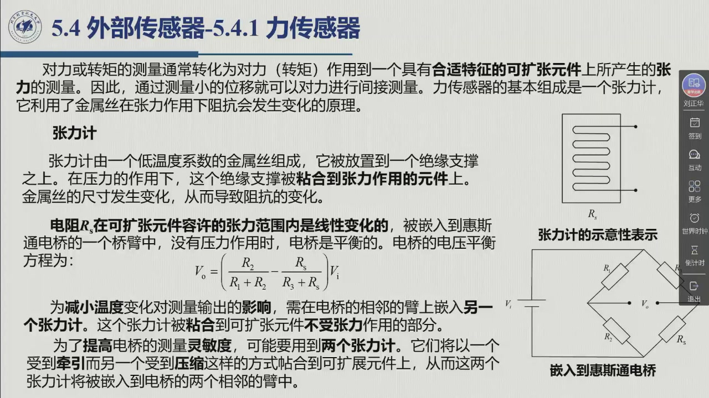
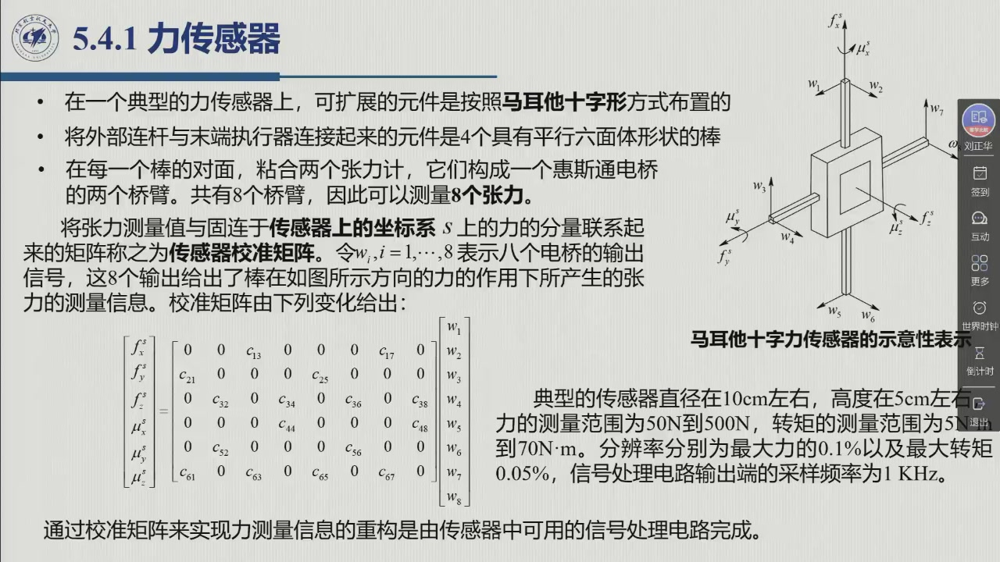

# 5.4.1 力传感器

外部传感器的第一站是**接触**。只要末端执行器碰到环境，关节上的编码器就再也说不出接触面上发生了什么：力有多大、朝哪个方向、会不会把工件别坏。本节把「力 → 电信号」这条链拆开看：先讲最基本的**张力计与惠斯通电桥**，再讲**轴转矩传感器**（关节力矩怎么测），然后是腕上的**六维力传感器**（3 个力分量 + 3 个力矩分量怎么解耦、怎么重构），最后回答一个容易被忽略的问题——测到的力是相对**哪个坐标系**的，怎么变换到真正要用的那个坐标系里去。录播 02:01:51–02:11:31。

## 5.4.1.1 从力到电信号：张力计与惠斯通电桥

教材 §5.4.1 的第一句就是全节的方法论：

> 对力或转矩的测量通常转化为对力（转矩）作用到一个具有**合适特征的可扩张元件**上所产生的**张力**的测量。因此，通过测量**小的位移**就可以对力进行**间接**测量。

也就是说，力传感器本身并不「直接感知力」：它先让力去**变形一个弹性体**，再去测这个变形。老师 02:00:32 的版本更直白：「力传感器一般也都是基于**张力测量**原理来进行测量的」——他把这条链一路讲到了电路（02:00:53–02:01:46）：力作用在张力敏感元件上 ⇒ 元件产生**应变** ⇒ 贴在元件上的金属丝**同样应变**（「我们认为它的应变跟张力敏感元件上的应变是一样的」）⇒ 金属丝**电阻变化** ⇒ 电流 / 电压变化。**力与最后那个电压之间，是一串可以逐段标定的关系。**

::: def 定义 5.4.2 · 张力计（应变片）strain gauge {#def-5.4.2}
**张力计**是力传感器最基本的组成元件，它利用**金属丝在张力作用下电阻发生变化**的原理。

- **构造**（图 5.15a）：一根**低温度系数**的金属丝，布置在一个**绝缘支撑**上；在压/应力的作用下，这个绝缘支撑被**粘合**到受张力作用的元件上。金属丝的尺寸随之变化，导致**电阻变化**。
- **选型原则**：使电阻 $R_s$ 在可扩张元件的**容许张力范围内线性变化**。
- **电桥**：为了把电阻变化变成电信号，张力计被嵌入**惠斯通电桥的一个桥臂**；在张力计上**没有应力**时，电桥是**平衡**的（输出为零）。电桥的电压平衡由下式描述（式 5.30）：

$$V_o=\left(\frac{R_2}{R_1+R_2}-\frac{R_s}{R_3+R_s}\right)V_i$$

- **温度补偿**：如果温度变化，没有外力时金属丝也会改变长度——这会污染测量输出。解决办法是在电桥**相邻的臂**上再嵌入**另一个张力计**，并把它粘合到可扩张元件**不受张力作用**的部分。两个张力计处于同一环境，温度引起的那部分电阻变化就在电桥里被**相减抵消**。
- **提高灵敏度**：可能要用到**两个张力计**，让它们以「**一个受牵引、一个受压缩**」的方式贴到可扩展元件上，并嵌入电桥的**两个相邻臂**——同一位置的两种应变符号相反，于是两路的信号变化在输出中**相加**。
:::

老师 02:03:44 用一个**梁**的例子说明第二条设计（灵敏度）为什么自然可行：梁受弯曲时，「上面其实是**受拉**的，下面是**受压**的」；于是在同一位置上下各贴一个张力计，「它的灵敏度是大体**相反**的」——一路增、一路减，电桥输出就把两路的变化都收进来。他同时强调这两个技巧都是**力传感器**的通用手段：「这个也是材料（力学）的一个（道理）」。

## 5.4.1.2 关节力矩的测量：轴转矩传感器

要让伺服电机当**力矩控制发生器**用，就得知道它到底输出了多大力矩。教材给出一条常见但「有条件」的捷径：**间接测量**——例如测永磁直流伺服马达的**电枢电流**。间接测量的软肋是：它把转矩与被测量之间的联系建立在若干**参数**（磁链、电阻…）上，而这些参数会漂移。教材的判据是：**如果需要确保对这种参数变化的不敏感性，就需要利用直接的转矩测量**。

直接测量怎么做？**把张力计装在一段「可扩展设备」上，让这段设备夹在马达与关节之间**——典型实现是一段**中空转轴**。教材给出三个设计要点：

1. **低抗扭刚度**：转轴要「软」到扭转时能产生足够大的变形，让张力计读出信号；
2. **高抗弯刚度**：转轴同时要「硬」到弯曲变形足够小，保证张力计的电阻变化**由扭转引起、而不是由弯曲引起**；
3. **张力与转矩成正比**：设计必须确保「作用的转矩和引起的张力成比例关系」，否则标定无从谈起。

**信号怎么引出来？** 靠**石墨电刷**把安装在中空转轴（本身构成惠斯通电桥结构）上的张力计与**集电环**连接起来——既为电桥提供**输入信号**，又同时测量**与作用转矩成比例的不平衡信号**。

老师说这叫「结构设计」里的一门手艺（02:04:31–02:05:06）：「这空心轴呢，它要保证……有**低的抗扭刚度**、有**高的抗弯刚度**。这可以保证应变片或者这个张力计的电阻变化是由**扭转**引起的，而不是由**弯曲**引起的」；具体做法上「一般是 **45 度设计**」——应变片沿与轴线成 45° 的方向粘贴，正好对准扭转产生的**主应力方向**。

<figure>
<svg class="figure-svg" viewBox="0 0 900 300" xmlns="http://www.w3.org/2000/svg" role="img" aria-labelledby="fig-5412-t fig-5412-d">
<title id="fig-5412-t">轴转矩传感器：夹在马达与关节之间的中空转轴</title>
<desc id="fig-5412-d">左侧为伺服马达，右侧为关节，中间一段中空转轴，转轴表面按 45 度粘贴应变片（惠斯通电桥）；转轴下方用集电环与石墨电刷把电桥信号引出，输出与作用转矩成比例的不平衡信号。标注：低抗扭刚度使扭转产生可测的张力，高抗弯刚度避免弯曲干扰。</desc>
<defs>
<marker id="f5412-a" markerWidth="9" markerHeight="9" refX="7" refY="3" orient="auto"><path d="M0,0 L7,3 L0,6 Z" fill="var(--muted)"/></marker>
</defs>
<rect x="30" y="60" width="110" height="80" rx="8" fill="none" stroke="var(--line-strong)" stroke-width="1.4"/>
<text class="diagram-note" x="85" y="105" text-anchor="middle">伺服马达</text>
<line x1="140" y1="100" x2="162" y2="100" stroke="var(--muted)" stroke-width="1.6" marker-end="url(#f5412-a)"/>
<rect x="165" y="75" width="260" height="50" fill="none" stroke="var(--fig-blue)" stroke-width="1.8"/>
<rect x="165" y="93" width="260" height="14" fill="none" stroke="var(--line-strong)" stroke-width="1.2" stroke-dasharray="5 4"/>
<line x1="200" y1="75" x2="238" y2="125" stroke="var(--fig-gold)" stroke-width="2"/>
<line x1="300" y1="75" x2="338" y2="125" stroke="var(--fig-gold)" stroke-width="2"/>
<text class="diagram-note" x="295" y="66" text-anchor="middle">中空转轴：应变片按 45° 粘贴（惠斯通电桥）</text>
<line x1="425" y1="100" x2="447" y2="100" stroke="var(--muted)" stroke-width="1.6" marker-end="url(#f5412-a)"/>
<rect x="450" y="60" width="110" height="80" rx="8" fill="none" stroke="var(--line-strong)" stroke-width="1.4"/>
<text class="diagram-note" x="505" y="105" text-anchor="middle">关节</text>
<text class="diagram-note" x="600" y="80">低抗扭刚度：扭转有可测张力</text>
<text class="diagram-note" x="600" y="106">高抗弯刚度：弯曲不干扰</text>
<text class="diagram-note" x="600" y="132">测得转矩 ≠ $C_m$</text>
<text class="diagram-note" x="600" y="156">（缺惯性、摩擦与上游传动）</text>
<rect x="345" y="150" width="42" height="28" rx="4" fill="none" stroke="var(--line-strong)"/>
<rect x="352" y="157" width="28" height="14" rx="3" fill="none" stroke="var(--fig-gold)"/>
<text class="diagram-note" x="366" y="200" text-anchor="middle">集电环 + 石墨电刷</text>
<line x1="400" y1="164" x2="556" y2="200" stroke="var(--muted)" stroke-width="1.4" marker-end="url(#f5412-a)"/>
<rect x="560" y="176" width="300" height="62" rx="8" fill="none" stroke="var(--line-strong)"/>
<text class="diagram-note" x="710" y="202" text-anchor="middle">输出：与作用转矩成比例的不平衡信号</text>
<text class="diagram-note" x="710" y="224" text-anchor="middle">（电刷—集电环同时给电桥供激励）</text>
</svg>
<figcaption>轴转矩传感器的结构与信号通路（本教程绘）：中空转轴是「弹性体 + 电桥」的合体，45° 粘贴的应变片保证电阻变化只认扭转；电刷与集电环把它与静止侧的电路连起来。右侧最后两行是教材特意提醒的**口径差别**：这样测到的是「伺服器传到关节的力矩」，不是执行系统框图里的驱动力矩 $C_m$。</figcaption>
</figure>

**一个必须记住的口径**（教材 §5.4.1）：这样测出的力矩「与执行系统框图中的驱动力矩 $C_m$ **不一致**」，因为「这样的测量**没有计入**惯性和摩擦力矩的作用，以及**位于测量点上游的传动装置**的作用」——测量点选在哪儿，就决定了你「看不见」哪些量。

## 5.4.1.3 腕力传感器：六维力/力矩与「马耳他十字」

::: def 定义 5.4.3 · 腕力传感器 wrist force sensor {#def-5.4.3}
当机械手**末端执行器与工作环境相接触**时，**力传感器**容许测量相对于**附着在其上的坐标系**的**力的 3 个分量**和**力矩的 3 个分量**（合称六维力/力矩）。

- **装在哪**：传感器作为**腕上的一个连接设备**，连接机械手的**外链（远端连杆）**与**末端执行器**（图 5.16）。
- **怎么连接**：通过**适当数量**的可扩展元件在力和力矩作用下产生的**张力**实现；张力计被粘合在**每一个**提供张力的元件上。
- **放置要求**：元件必须以**灵活的方式**放置，以确保**至少有一个元件**在任何可能方向的力和力矩作用下会产生**轻微的变形**——否则某个方向的力就会「测不到」。
- **解耦要求**：固连在传感器坐标系上的**一个单独分量**应该能够产生**最少可能数量**的变形，以获得力分量之间**解耦**的良好结构。
- **为什么变形数要大于 6**：由于**难以做到完全解耦**，为了重构力和力矩向量的 6 个分量，所需要的**明显变形数量应该大于 6**。
:::

老师 02:06:23 把「解耦」翻译成了最好懂的一句话：「最好的情况下，就是我测六个分量，每个分量对应一个（组）张力计的（电桥），这样其实是最好……**但实际的过程中，不可能完全解耦**」——「目前没有人设计出来这种完全解耦的一种结构」。教材举的典型结构就是**马耳他十字**（图 5.17），它的要点是四条：

- 可扩展元件按**马耳他十字形**方式布置；
- 把外部连杆与末端执行器连接起来的元件是 **4 个平行六面体形状的棒**；
- 在**每一个棒的对面**粘合**两个张力计**，它们构成一个惠斯通电桥的**两个桥臂**；
- 一共有 **8 个桥臂**，因此可以测量 **8 个张力** $w_1,\dots,w_8$。

老师的读图法（02:07:12）：「相当于为了（提高）灵敏度，用每个方向的（力），让我们上下分别（贴）一些张力（计）」——**八路测量、六个未知量**，这正是下面那个矩阵要处理的问题。

::: thm 定理 5.4.A · 传感器校准矩阵（式 5.31） {#thm-5.4.A}
把**张力测量值**与**固连于传感器上的坐标系 $s$** 的**力的分量**联系起来的矩阵，称为**传感器校准矩阵**（sensor calibration matrix）。令 $w_i,\ i=1,\dots,8$ 表示八个电桥的输出信号，则

$$\begin{bmatrix}f^s_x\\ f^s_y\\ f^s_z\\ \mu^s_x\\ \mu^s_y\\ \mu^s_z\end{bmatrix}=
\begin{bmatrix}
0&0&c_{13}&0&0&0&c_{17}&0\\
c_{21}&0&0&0&c_{25}&0&0&0\\
0&c_{32}&0&c_{34}&0&c_{36}&0&c_{38}\\
0&0&0&0&c_{44}&0&0&c_{48}\\
0&c_{52}&0&0&0&c_{56}&0&0\\
c_{61}&0&c_{63}&0&c_{65}&0&c_{67}&0
\end{bmatrix}
\begin{bmatrix}w_1\\ w_2\\ w_3\\ w_4\\ w_5\\ w_6\\ w_7\\ w_8\end{bmatrix} \tag{5.31}$$

**读法**：每一行给出一个分量是**哪几个张力**的线性组合，每个 $c_{ij}$ 是标定出来的系数。重构由**传感器中可用的信号处理电路**完成；工程上系数通常由厂商标定给出，用户不自己标。

**为什么需要它**：因为**完全解耦做不到**——因此所需的明显变形数（8）要**大于** 6 个待求分量。矩阵的稀疏结构（每行少数几个非零）正是「尽可能解耦」的结果。
:::

**八个张力怎么变成六个分量？答案是一个标定出来的矩阵。** 把张力测量值与**固连于传感器上的坐标系 $s$** 上的**力的分量**联系起来的矩阵，称为**传感器校准矩阵**（sensor calibration matrix）。令 $w_i,\ i=1,\dots,8$ 表示八个电桥的输出信号，则（教材式 5.31）：

$$\begin{bmatrix}f^s_x\\ f^s_y\\ f^s_z\\ \mu^s_x\\ \mu^s_y\\ \mu^s_z\end{bmatrix}=
\begin{bmatrix}
0&0&c_{13}&0&0&0&c_{17}&0\\
c_{21}&0&0&0&c_{25}&0&0&0\\
0&c_{32}&0&c_{34}&0&c_{36}&0&c_{38}\\
0&0&0&0&c_{44}&0&0&c_{48}\\
0&c_{52}&0&0&0&c_{56}&0&0\\
c_{61}&0&c_{63}&0&c_{65}&0&c_{67}&0
\end{bmatrix}
\begin{bmatrix}w_1\\ w_2\\ w_3\\ w_4\\ w_5\\ w_6\\ w_7\\ w_8\end{bmatrix}$$

**读这个矩阵的方法**：每一行给出一个分量是**哪几个张力**的线性组合，每个 $c_{ij}$ 是标定出来的系数。老师的两个例子（02:07:58–02:08:32）：

- **$f^s_x$** 只看第 1 行：$f^s_x=c_{13}w_3+c_{17}w_7$——「它就（与）这个数和这个数 $w_3$（有关）……再相加，就得到了 $x$ 方向的力」；
- **$\mu^s_z$** 看最后一行：$\mu^s_z=c_{61}w_1+c_{63}w_3+c_{65}w_5+c_{67}w_7$——「这一方向的矩，（与）一、三、五、七（号张力计有关）」。

**谁来算**：通过校准矩阵实现力测量信息的**重构**，由**传感器中可用的信号处理电路**完成（教材 §5.4.1）。老师 02:08:39 补了一句工程现实：「咱们一般也不是自己（标定），主要是用这种（成品传感器）」，系数由厂商给出。

**典型指标**（教材 §5.4.1）：传感器**直径约 10 cm、高约 5 cm**；**力的测量范围 50 N 到 500 N**，**转矩 5 N·m 到 70 N·m**；**分辨率分别为最大力的 0.1% 与最大转矩的 0.05%**；信号处理电路输出端的**采样频率为 1 kHz**。

## 5.4.1.4 从传感器坐标系到约束坐标系：等价力/力矩

到这里，六个数已经算出来了。但教材紧接着泼了一盆冷水：

> 力传感器的测量值**不能被直接应用于力/运动控制算法**，原因在于测量信息表征的是**作用在传感器上的等价力**，但是它与**作用在机械手末端执行器上的力是不同的**。

差别从哪来？**参考点与参考方向不同**。传感器有它自己的坐标系 $s$（六个数都写在 $s$ 里），而真正要做力控制的是**接触点附近的那个坐标系**——教材称**约束坐标系** $c$（第 9 章正式引入）。同一个力系，在 $s$ 里是一组分量，在 $c$ 里是另一组分量，两者之间要靠一个**坐标变换**沟通：

::: method 方法 5.4.B · 传感器坐标系 → 约束坐标系的等价力/力矩变换 {#method-5.4.B}
由两坐标系间的力变换关系（教材式 3.116），得到力传感器要用的结论（式 5.32）：

$$\begin{bmatrix}f^c_c\\ \mu^c_c\end{bmatrix}=
\begin{bmatrix}R^c_s & O\\ S(r^c_{cs})R^c_s & R^c_s\end{bmatrix}
\begin{bmatrix}f^s_s\\ \mu^s_s\end{bmatrix}$$

**要准备哪两个量**（两者都在坐标系 $c$ 中表示）：

1. $r^c_{cs}$：**坐标系 $s$ 的原点在坐标系 $c$ 中的位置**；
2. $R^c_s$：**坐标系 $s$ 相对于坐标系 $c$ 的方位**。

**与 [3.8.2](../ch03/sec3-8.md#sec-3.8.2) 的对偶结构对照**：平移块 $S(r^c_{cs})R^c_s$ 与旋转块 $R^c_s$ 的搭配，和那里「速度变换的转置 = 力变换」是**同一套结构**——同一条对偶，换了两个坐标系重新出现。力矩那一行分两项读：**旋转项** $R^c_s\mu^s_s$（把力矩的方向转过去）加**平移迁移项** $S(r^c_{cs})R^c_s f^s_s$（把力挪一个新的参考点，附加的力偶）。

**一条使用条件**（教材特意点明）：$r^c_{cs}$ 与 $R^c_s$ 这两个量「只有当**末端执行器是静止的**时候两个参数才保持恒定不变」——一旦末端在动，参考系本身在变，变换就要跟着更新。
:::

老师 02:09:24 把这条变换放回了知识的坐标里：「**所有的测量其实都是相对于（它）自己的坐标系的**」——因为出厂时不知道你要怎么用。到第 9 章会引入**约束坐标系**：「所有的工件和（环境）之间的接触就是有约束的，包括**人工约束**和**自然约束**」，一般需要在那个坐标系里表示力或计算力。至于怎么换算，他直接指回了第三章的对偶：「就是用（前面）给大家提的那个叫**广义雅可比矩阵**，或者是广义雅可比矩阵的**转置**……这也是有对偶关系」（02:10:23）——「我们只要知道这两个空间之间的**相对姿态关系**和**相对位置关系**，那么……就可以得到同一个力在两个空间的转换」（02:11:07）。

::: ex 例题 5.4.C · 接触情形下的等价力与力矩（作业 5.6 的算例） {#ex-5.4.C}
已知图 5.16 所示的接触情形中，传感器坐标系 $s$ 相对约束坐标系 $c$ 的位置与方位，以及力传感器的测量值：

$$r^c_{cs}=\begin{bmatrix}-0.3\\0\\0.2\end{bmatrix}\mathrm{m},\qquad
R^c_s=\begin{bmatrix}0&0&1\\0&-1&0\\1&0&0\end{bmatrix},\qquad
f^s_s=\begin{bmatrix}20\\0\\0\end{bmatrix}\mathrm{N},\qquad
\mu^s_s=\begin{bmatrix}0\\6\\0\end{bmatrix}\mathrm{N\cdot m}$$

求**接触坐标系下的等价力与力矩**。

**解**：代入 [@method-5.4.B] 的变换式。先算力（只有旋转块）：

$$f^c_c=R^c_sf^s_s=\begin{bmatrix}0&0&1\\0&-1&0\\1&0&0\end{bmatrix}\begin{bmatrix}20\\0\\0\end{bmatrix}=\begin{bmatrix}0\\0\\20\end{bmatrix}\mathrm{N}$$

再算力矩，两项分开写（$S(r^c_{cs})=\begin{bmatrix}0&-0.2&0\\0.2&0&0.3\\0&-0.3&0\end{bmatrix}$）：

$$S(r^c_{cs})R^c_sf^s_s=\begin{bmatrix}0&-0.2&0\\0.2&0&0.3\\0&-0.3&0\end{bmatrix}\begin{bmatrix}0\\0\\20\end{bmatrix}=\begin{bmatrix}0\\6\\0\end{bmatrix}\mathrm{N\cdot m},\qquad
R^c_s\mu^s_s=\begin{bmatrix}0\\-6\\0\end{bmatrix}\mathrm{N\cdot m}$$

$$\mu^c_c=\begin{bmatrix}0\\6\\0\end{bmatrix}+\begin{bmatrix}0\\-6\\0\end{bmatrix}=\begin{bmatrix}0\\0\\0\end{bmatrix}\mathrm{N\cdot m}$$

**结果怎么读**：接触坐标系下的**等效力**是 20 N（沿 $c$ 的 $z$ 轴），**等价力矩为零**——**平移迁移项与旋转项恰好互相抵消**。物理含义是：$s$ 系里那「20 N 的力 + 6 N·m 的力偶」这两个分量，与 $c$ 系里「一个过原点的纯力」描述的是**同一个力系**，只是写法不同；等价力矩为零说明这个力的**作用线恰好穿过 $c$ 系的原点**。
:::

::: think 考点 · 老师原话（录播时间点）

> **测量链是一条可以逐段标定的关系。** 「力作用在张力敏感元件上……张力敏感元件会产生应变……我们认为它的应变跟张力敏感元件上的应变是一样的」（02:01:05–02:01:18）。

> **不直接用一个张力计的读数。** 「为了更准确地测量，我们不直接测量一个张力计的读数，我们一般把它接到（电桥）」（02:02:00–02:02:11）——「当不发生（应变）的时候，电桥平衡，就是输出是零；当我们发生（应变）的时候……电桥是有输出」（02:02:24–02:02:41）。

> **温度与灵敏度各靠一个「外加的张力计」。** 「温度会影响金属丝的电阻（和电压）……其实我们可以再加一个（张力计），接到这个相邻的臂上，但是呢，这个相邻的臂上它不贴在有应变的地方……那么温度（引起的变化）就可以通过这个（电桥）减掉了」（02:02:50–02:03:26）；提高灵敏度则「一般可以用两个张力计来配合使用」（02:03:31）。

> **梁的上下。** 「比如说一个梁，它受这样一个（弯）……那上面其实是受拉的，下面是受压的，那我们其实可以上面贴一个，下面贴一个」（02:03:44–02:03:55）。

> **完全解耦做不到。** 「最好的情况下，就是我测六个分量，每个分量对应一个张力计的（电桥）……但实际的过程中，不可能完全（解耦）」「目前没有人设计出来这种完全解耦的一种结构」（02:06:24–02:06:41）。

> **测量永远是相对自己的坐标系。** 「所有的测量其实都是相对于（它）自己的坐标系的，因为我们不知道实际应用的情况是什么样的」（02:09:26–02:09:37）；「在第 9 章大家会（接触）到一个约束坐标系」（02:09:40）。
:::

::: think 默写点 · 合上书再写（主动回忆）

1. 「力 → 张力 → 电阻 → 电压」这条链上，各环节的物理关系是什么？为什么张力计要嵌入惠斯通电桥而不是直接测电阻？
2. 温度补偿与提高灵敏度各自的办法是什么？为什么都要求「再加一个张力计」？
3. 轴转矩传感器的中空转轴为什么必须**低抗扭刚度 + 高抗弯刚度**？它测到的力矩为什么不等于 $C_m$？
4. 腕力传感器的 8 个张力如何变成 6 个分量？写出式（5.32），并说出它成立的附加条件。

::: sol 核对

力作用在**可扩张元件（弹性体）**上产生张力/应变；粘合其上的**低温度系数金属丝**随之变形，尺寸变化导致电阻 $R_s$ 变化（在容许张力范围内线性）；张力计嵌入**惠斯通电桥的一个桥臂**，电桥无应力时平衡，有应力时输出与 $R_s$ 的变化相关——所以测的是**电压**而不是直接测电阻（直接测电阻既受引线/接触电阻干扰，也难以做到高灵敏度与线性）。

**温度补偿**：在电桥**相邻臂**再嵌一个张力计，粘在**不受张力作用**的部位，两个张力计同处一个温度环境，温度引起的电阻变化在电桥里相减抵消。**提高灵敏度**：用两个张力计，**一个受拉、一个受压**，贴在可扩展元件上并嵌入**相邻两臂**，两路应变符号相反 ⇒ 输出变化相加（梁的上下表面正是这种情形）。

**低抗扭刚度**：扭转时产生足够大的、可被张力计读出的变形；**高抗弯刚度**：把弯曲变形压小，保证电阻变化**由扭转引起而不是弯曲引起**（应变片一般按 45° 粘贴、对准主应力方向）。这样测出的是**伺服器传到关节的力矩**，它**没有计入惯性和摩擦力矩**，也**没有计入测量点上游传动装置**的作用，因此与执行系统框图里的驱动力矩 $C_m$ 不一致。

八个电桥输出 $w_1,\dots,w_8$ 经**传感器校准矩阵** $C$（式 5.31）线性组合成 6 个分量：$[f^s_x,f^s_y,f^s_z,\mu^s_x,\mu^s_y,\mu^s_z]^{\mathrm T}=C[w_1,\dots,w_8]^{\mathrm T}$，每一行说明该分量由哪几个张力决定（如 $f^s_x=c_{13}w_3+c_{17}w_7$、$\mu^s_z=c_{61}w_1+c_{63}w_3+c_{65}w_5+c_{67}w_7$），重构由传感器自带的信号处理电路完成。

$$\begin{bmatrix}f^c_c\\ \mu^c_c\end{bmatrix}=\begin{bmatrix}R^c_s & O\\ S(r^c_{cs})R^c_s & R^c_s\end{bmatrix}\begin{bmatrix}f^s_s\\ \mu^s_s\end{bmatrix}$$

其中 $r^c_{cs}$ 是 $s$ 的原点在 $c$ 中的位置、$R^c_s$ 是 $s$ 相对 $c$ 的方位（两者都在 $c$ 中表示）。附加条件：这两个量只有在**末端执行器静止**时才保持不变。

:::

:::

## 5.4.1 小结与常见错误

- **一条测量链**：力 ⇒ 可扩张元件的张力/应变 ⇒ 张力计金属丝的电阻变化 ⇒ 惠斯通电桥的电压输出（式 5.30）；温度补偿与灵敏度靠**第二个张力计**（相邻臂 / 一拉一压）。
- **两种直接测量**：**轴转矩传感器**（中空转轴：低抗扭、高抗弯、45° 粘贴、电刷—集电环引信号；口径 ≠ $C_m$）；**腕力传感器**（六维、马耳他十字、8 张力 → **校准矩阵**式 5.31 → 6 分量，典型量程 50–500 N / 5–70 N·m，1 kHz 采样）。
- **一步变换**：测量值写在**传感器坐标系 $s$** 里，要用于控制必须换到**约束坐标系 $c$**（式 5.32）；平移迁移项与旋转项各司其职，且 $r^c_{cs}$、$R^c_s$ 只在末端**静止**时不变。

::: think 常见错误清单 · 自查三条
1. 把张力计当成「传感器」的**全部**——它只是一个桥臂元件；真正的输出要靠**电桥 + 标定**（力传感器的基本组成才是张力计，但测量系统远不止它）。
2. 认为测到的力/力矩**可以直接用**——测量值是相对**传感器坐标系**的等价力/力矩，与末端执行器上的力不同；必须变换到约束坐标系（式 5.32）。
3. 算变换时漏掉**平移迁移项** $S(r^c_{cs})R^c_s f^s_s$——力的参考点一挪，就会多出一个力偶；漏掉它，力矩至少错一项（[@ex-5.4.C] 里这一项恰好与旋转项等值反向，是被数据「藏起来」了，不是没有）。
:::