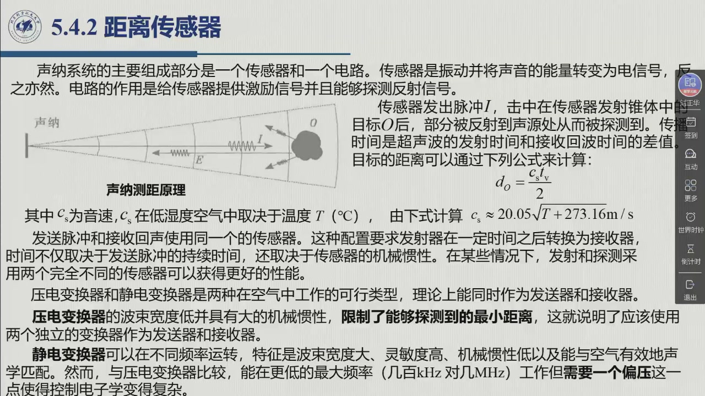
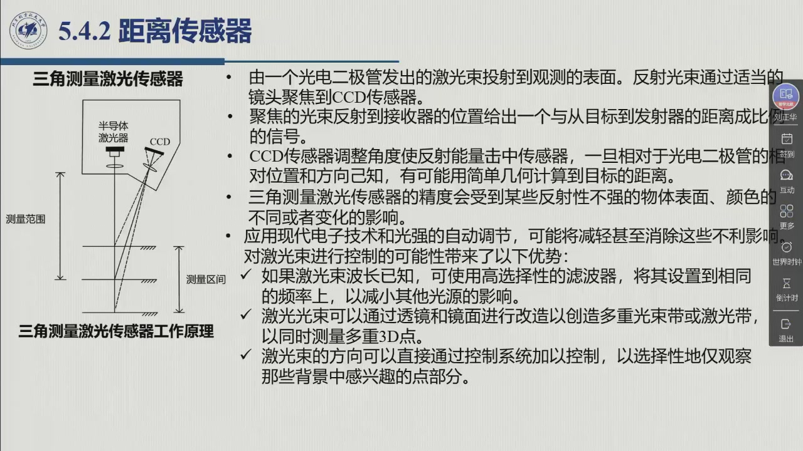

# 5.4.2 距离传感器

测距器的读数需要同时说明“离谁多远”和“沿哪个观测方向”。一次回波也不等于整个视场中的目标都被看见：反射、遮挡和波束范围决定了它实际覆盖的区域。本节先计算传播时间法，再用简单几何推导三角测量。课堂回看：02:14:15–02:20:35。

## 5.4.2.1 从「有没有」到「多远、在哪个方位」

::: def 定义 5.4.4 · 接近传感器与距离传感器（含敏感距离） {#def-5.4.4}
接近传感器通常判断目标是否进入可检测范围；距离传感器还给出与距离相关的数值。敏感距离表示规定条件下的检测范围，通常还与目标材料、尺寸和反射条件有关。

若传感器提供扫描方向，可把距离配到该方向。单个数值并不自动给出准确三维位置，还须知道测量原点、朝向、视场与返回信号来自哪里。
:::

## 5.4.2.2 声纳：用回波计时

声纳发出声脉冲并接收回波。先采用最简单的几何假设：发射与接收近似共点，目标在一次测量中运动可忽略，回波沿同一路径往返，介质中的传播速度为 $c_s$。

::: thm 定理 5.4.B · 声纳测距方程与音速的温度修正 {#thm-5.4.B}
若目标单程距离为 $d_o$，声波走过的总路程为 $2d_o$，因此 $c_st_v=2d_o$，即

$$d_o=\frac{c_st_v}{2}. \tag{5.33}$$

$t_v$ 是发射到接收的往返时间，不能当成单程时间。在低湿度空气的教材近似中，温度 $T$ 用摄氏度表示：

$$c_s\approx20.05\sqrt{T+273.16}\ \mathrm{m/s}. \tag{5.34}$$

介质和环境条件改变时，应使用相应传播速度；不能把空气近似直接用于水中。
:::

例如取 $c_s=340$ m/s、往返时间6 ms，则 $d_o=340\times0.006/2=1.02$ m。漏掉分母2会算成2.04 m。对小误差展开，$\delta d\approx(t_v\delta c_s+c_s\delta t_v)/2$；这说明测温和计时都会影响距离，而不是只提高定时器分辨率就足够。

同一个换能器兼作发射与接收时，发射脉冲结束后还可能有振铃及接收恢复时间。若最早可接收的时刻为 $t_b$，则相应近距离盲区约为 $c_st_b/2$。双换能器可以改变部分限制，但还须考虑其几何与串扰，不能只把机械惯量大小当成唯一原因。

波束有宽度，反射也有方向性，回波可能受三类情况影响：表面将能量反射到接收器之外，造成漏检；同一波束覆盖多个目标，难以确定返回来源；多次反射的回波被当作直达路径，形成错误距离。因此没有回波，并不足以证明前方没有障碍。

压电换能器通过电场和机械形变交换能量，静电换能器利用膜片与电场耦合完成收发。两类器件的带宽、灵敏度、偏压、声学匹配和振铃均依具体结构而定。课件中的单一型号和参数用于举例，不应外推成所有声纳的统一量程或波束角。

## 5.4.2.3 激光：传播时间法与三角测量法

::: method 方法 5.4.C · 两种激光测距传感器：原理与取舍 {#method-5.4.C}
脉冲传播时间法用激光器发光、光电接收器收光，再测往返延迟。按与声纳相同的几何假设，

$$d=\frac{ct}{2}.$$

取 $c\approx3\times10^8$ m/s，1 mm距离差对应的往返时间差为 $2\times10^{-3}/c\approx6.7$ ps。这里计算的是往返延迟，不能把单程1 mm的约3.3 ps直接代入该分辨率关系。实际测距精度还受波形、信噪比、标定与估计方法影响。

若每隔 $T_r$ 发一次相同脉冲，且只根据返回时刻识别脉冲，则超过一个重复周期的回波可能与后续脉冲混淆，简单无歧义距离为 $cT_r/2$。具体编码、门控与解模糊方法可以改变这一限制；任意接收窗口长度不能不加说明地当作脉冲重复周期。

三角测量则用激光光斑在接收器上的位置求距离。它依赖发射端与接收端的已知相对几何，而不是靠测极短的往返时间。
:::

把三角测量算一次。取接收光心为 $(0,0)$，光轴沿 $z$；发射器位于 $(b,0)$，光束也沿 $z$。光斑在目标上的位置为 $(b,Z)$。虚拟像平面距光心 $f$，由相似三角形得

$$\frac{x_p}{f}=\frac{b}{Z},\qquad Z=\frac{fb}{x_p}.$$

例如 $b=50$ mm、$f=10$ mm、$x_p=2$ mm，求得 $Z=250$ mm；$x_p$ 变为1 mm时，$Z=500$ mm。这组几何中距离与光斑位置是反比，不能概括成总是成正比。实际结构还要考虑基线方向、像素尺度和零位，由标定模型处理。

<figure>
<svg class="figure-svg" viewBox="0 0 900 340" xmlns="http://www.w3.org/2000/svg" role="img" aria-labelledby="fig-5423-t fig-5423-d">
<title id="fig-5423-t">三种测距原理：声纳回波计时、激光传播时间、激光三角测量</title>
<desc id="fig-5423-d">三个并列的小图。左：声纳发出脉冲 I，经锥形波束击中目标 O 后回波 E 返回，距离由 d_o = c_s t_v / 2 给出；中：半导体激光器发出光脉冲，经目标反射回光电二极管，距离由光速乘时间的一半给出；右：激光器与 CCD 之间是一条基线，激光光斑落在目标表面后扩散反射回 CCD，光斑位置与距离由标定几何联系，靠标定解三角形。</desc>
<defs>
<marker id="f5423-a" markerWidth="9" markerHeight="9" refX="7" refY="3" orient="auto"><path d="M0,0 L7,3 L0,6 Z" fill="var(--muted)"/></marker>
</defs>
<text class="diagram-text" x="150" y="26" text-anchor="middle">① 声纳：回波计时</text>
<text class="diagram-text" x="460" y="26" text-anchor="middle">② 激光传播时间：光脉冲计时</text>
<text class="diagram-text" x="760" y="26" text-anchor="middle">③ 激光三角测量：光斑位置</text>
<line x1="130" y1="48" x2="130" y2="112" stroke="var(--line-strong)" stroke-width="3"/>
<path d="M130,56 L272,30 L272,130 L130,104" fill="none" stroke="var(--line)" stroke-dasharray="5 4"/>
<circle cx="250" cy="80" r="18" fill="none" stroke="var(--muted)" stroke-width="1.4"/>
<text class="diagram-note" x="250" y="85" text-anchor="middle">$O$</text>
<line x1="238" y1="100" x2="150" y2="100" stroke="var(--fig-blue)" stroke-width="1.6" marker-end="url(#f5423-a)"/>
<text class="diagram-note" x="140" y="150">$d_o=c_st_v/2$</text>
<text class="diagram-note" x="60" y="174">$c_s\approx20.05\sqrt{T+273.16}$ m/s</text>
<rect x="330" y="50" width="76" height="26" rx="4" fill="none" stroke="var(--line-strong)"/>
<text class="diagram-note" x="368" y="68" text-anchor="middle">半导体激光器</text>
<rect x="330" y="98" width="76" height="26" rx="4" fill="none" stroke="var(--line-strong)"/>
<text class="diagram-note" x="368" y="116" text-anchor="middle">光电二极管</text>
<line x1="406" y1="63" x2="556" y2="63" stroke="var(--fig-blue)" stroke-width="1.6" marker-end="url(#f5423-a)"/>
<line x1="556" y1="80" x2="410" y2="110" stroke="var(--fig-gold)" stroke-width="1.6" marker-end="url(#f5423-a)"/>
<line x1="560" y1="40" x2="560" y2="122" stroke="var(--muted)" stroke-width="2"/>
<text class="diagram-note" x="572" y="60">目标</text>
<text class="diagram-note" x="330" y="156">距离 $=c\,t/2$（单点）</text>
<text class="diagram-note" x="330" y="180">1 mm 分辨率 ≈ 6.7 ps 计时</text>
<rect x="630" y="50" width="60" height="26" rx="4" fill="none" stroke="var(--line-strong)"/>
<text class="diagram-note" x="660" y="68" text-anchor="middle">激光器</text>
<rect x="822" y="50" width="60" height="26" rx="4" fill="none" stroke="var(--line-strong)"/>
<text class="diagram-note" x="852" y="68" text-anchor="middle">CCD</text>
<line x1="662" y1="80" x2="850" y2="80" stroke="var(--line-strong)" stroke-width="1.2" stroke-dasharray="4 3"/>
<text class="diagram-note" x="756" y="96" text-anchor="middle">基线 $b$：一条边 + 两个角</text>
<line x1="668" y1="78" x2="702" y2="196" stroke="var(--fig-blue)" stroke-width="1.6" marker-end="url(#f5423-a)"/>
<line x1="704" y1="196" x2="846" y2="80" stroke="var(--fig-gold)" stroke-width="1.6" marker-end="url(#f5423-a)"/>
<line x1="626" y1="200" x2="880" y2="200" stroke="var(--muted)" stroke-width="2"/>
<text class="diagram-note" x="712" y="222">反射必须是扩散的</text>
<text class="diagram-note" x="630" y="252">光斑在 CCD 上的位置</text>
<text class="diagram-note" x="630" y="274">∝ 目标到发射端的距离</text>
<text class="diagram-note" x="450" y="316" text-anchor="middle">三种原理都只给出「一个方向上的一个距离」——要成图，必须扫描或多波束</text>
</svg>
<figcaption>声纳与脉冲激光先测往返时间，三角测量先测光斑位置。前两者仍需传播速度，后者需基线、成像关系与标定。</figcaption>
</figure>

扫描可让单束测距依次获得多个方向的信息，但传播时间法本身既不限于单点，也不要求必须机械扫描。解释数据时，应以实际通道、视场和采样方式为准。

三角测量需要接收器看见可定位的光斑，传播时间法需要能识别的返回信号。表面颜色、反射、遮挡和环境光都可能影响结果；水下与低能见度条件同样需要按波长、介质和距离分析，不能写成“光学一律不能用、声纳一定是唯一选择”。激光器还须遵守所用设备的眼睛安全条件。

::: think 检查理解
1. 在 $c_s=340$ m/s的假设下，1 ms往返时间对应多远？若接收器需要1 ms才能恢复，会形成多大的近距离盲区？
2. 为什么表面存在而没有返回信号，并不矛盾？
3. 上面的三角测量中，光斑坐标减半为何使估计深度翻倍？
4. “1 mm对应约3 ps”放入往返测距关系时，漏了哪一步？

::: sol 核对
两问均为 $340\times0.001/2=0.17$ m。返回信号还依赖反射方向、覆盖和检测条件。由 $Z=fb/x_p$ 可直接看出反比。单程与往返的时间不同，1 mm距离差需要约6.7 ps的往返时间差。
:::
:::
