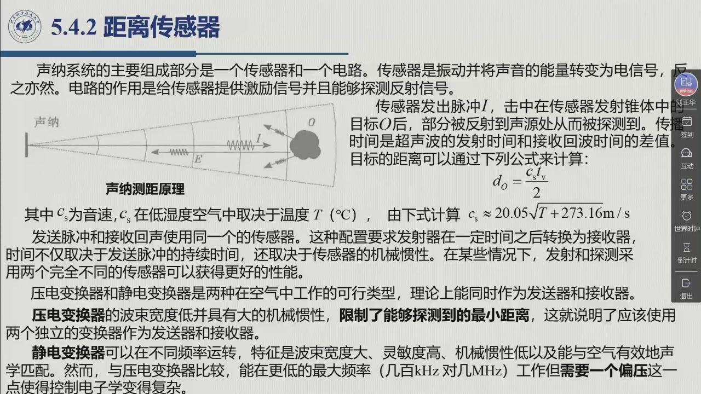
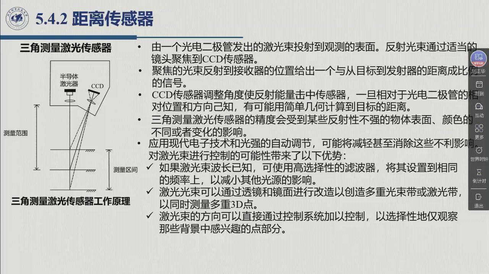

# 5.4.2 距离传感器

力传感器管的是「碰到了之后」；距离传感器管的是「**还没碰到之前**」——在指定方向上、多远有东西。这是机器人从盲操作走向自主的第一类外部信息，也是老师口中「在自动驾驶上比较多」的一类（02:11:42）。本节讲两条技术路线：**声纳**（用声音的回波计时）与**激光**（用光，又分传播时间法与三角测量法），以及它们各自的盲区、波束、镜面反射陷阱和量程—精度取舍。录播 02:14:15–02:20:35（外部传感器的功能与接近传感器一段自 02:11:36 起）。

<aside class="lesson-brief" aria-label="5.4.2 学习简报">

PREREQUISITE<strong>你需要先会</strong>
外部传感器的定位与「自主行为需要环境信息」这条线索（[@def-5.4.1]、[@note-5.4.1]）；操作空间与关节空间的划分（[@def-2.10.1]）——避障是在**操作空间**里谈的。

TARGET<strong>本节要建立</strong>
接近传感器与**敏感距离**、距离传感器给出的**结构化数据**（距离 + 方位）；声纳的**传播时间**原理与式（5.33）（5.34）；波束宽度与角分辨率、盲区与收发一体/分离的取舍；压电与静电两类变换器的差别；镜面反射引起**非检测平面 / 非检测角 / 误检测**三种失效；激光的**传播时间法**（模糊时间间隔、单点、扫描）与**三角测量法**（基线 + 光斑位置 + 标定）的原理与取舍。

CHECKPOINT<strong>学完的标准</strong>
能写出 $d_o=c_st_v/2$ 并解释为什么除以 2、为什么音速要用温度修正；能说出为什么「用一个变换器收发」会限制最小可测距离；能一眼区分 ToF 与三角测量（一个靠**时间**、一个靠**光斑位置**），并各举一条短板；能说出声纳在什么环境下是唯一可行的方案。

</aside>

## 5.4.2.1 从「有没有」到「多远、在哪个方位」

教材给外部传感器的那句总纲，正落在这一节的开场：

> 外部传感器的基本功能是提供机器人以**自主方式**进行「智能」行为所需要的信息。为此，在工作空间中**探测目标的存在**并且测量其**相对机器人在指定方向上的距离**至关重要。

顺着这句，距离信息被分成两档——先「有没有」，再「多远、在哪个方位」：

::: def 定义 5.4.4 · 接近传感器与距离传感器（含敏感距离） {#def-5.4.4}
- **接近传感器**（proximity sensor）是**距离传感器的简化形式**：在**没有物理接触**的情况下，**仅能探测**传感器**敏感部位附近**的目标存在；这类传感器能够探测到目标的距离定义为**敏感距离**。
- **更一般的情况下**，**距离传感器**能够提供**结构化的数据信息**：这些信息由**测量目标的距离**和**相应的方位信息**给出，即在空间中探测**目标相对于传感器的位置信息**。

**这些数据用来做什么**（教材原话）：**避障、建立环境地图、识别目标**。

**两类主力**：机器人应用中最常用的距离传感器，是那些基于**声波在弹性流体中传播**的传感器（即**声纳** sonars），以及利用**光线传播特征**的**激光**（lasers）。教材本节只展开这两类；接近传感器的具体实现（电感、电容、光电等）不在此列。
:::

老师 02:12:04 用「人走路」打了比方：机器人要实现智能，「它得了解环境的特征……它需要根据环境的特征来进行**决策**，而不是（由）人告诉它怎么走、怎么动」——「环境的信息怎么了解呢？就需要传感器」，其中一类就是接近传感器（02:12:40）。

## 5.4.2.2 声纳：用回波计时

教材先说清了它的**立身之本**：声纳使用声音脉冲和它们的回波测量距离，因为**音速对给定媒介（空气、水）是已知的**，到目标的距离与回波的**传播时间**成比例。所谓传播时间（time-of-flight），就是「声波从传感器到目标，然后再回到传感器所用的时间」。它的优点是**成本低、重量轻、功耗低、计算量小**；而「在某些应用中，比如在**水下和低能见度环境**，声纳常常是**唯一可行**的感觉方式」。老师 02:13:50 把后半句讲得更绝对：「因为激光在水下基本上就不能工作了」；低能见度环境也是同理，「那时候其实声纳也是唯一的可行的一个方式」。

::: thm 定理 5.4.B · 声纳测距方程与音速的温度修正 {#thm-5.4.B}
传感器发出脉冲 $I$，击中在传感器**发射锥体**中的目标 $O$ 后，部分能量被反射回声源从而被探测到。**传播时间** $t_v$ 是超声波的**发射时间**和**接收回波时间**的差值，则目标的距离由下式计算（式 5.33）：

$$d_o=\frac{c_st_v}{2}$$

其中 $c_s$ 为**音速**；在**低湿度空气**中，$c_s$ 取决于温度 $T$（℃），由下式计算（式 5.34）：

$$c_s\approx20.05\sqrt{T+273.16}\ \mathrm{m/s}$$

**为什么除以 2**：$t_v$ 是「去 + 回」的总时间，而 $d_o$ 只是单程距离。**为什么必须修温度**：音速随温度变化（约 0.6 m/s 每 ℃），工程上要么测温补偿，要么承认那部分误差。
:::

**频率与波束。** 绝大多数声纳工作在**超声**频段（高于 20 kHz；人耳约 20 Hz–20 kHz）；机器人技术中的典型频率范围是 **20 kHz 到 200 kHz**，用压电石英晶体可以达到 MHz 级。在这个范围内，发射波的能量可看作集中在**一个锥形体**内，其**带宽取决于频率以及传感器直径**；机器人技术中最普遍的传感器，能量束的波束宽度**通常不小于 15°**——「显然，对更小的带宽，可以得到更高的**角分辨率**」。

**系统与收发方式。** 声纳系统的主要组成是一个**传感器**和一个**电路**：传感器振动、并在声能与电能之间双向转换；电路负责给传感器提供**激励信号**，并**探测反射信号**。图 5.18 的方案里，发射与接收用**同一个传感器**；这要求发射器「在一定时间之后转换为接收器」，而这个时间「不仅取决于发送脉冲的持续时间，还取决于传感器的**机械惯性**」。老师 02:15:31 点出了后果：压电变换器机械惯性大，转换要花较长时间——「那么呢，我们如果用一个（传感器），就可能声音都反回来了，但是我（还）没转换到接收的这种模式呢，这时候就会影响测量」，「或者是我（的）距离不能太近，就只能测比较远的距离」——**这就是盲区的来历**；「在某些情况下，发射和探测采用两个完全不同的传感器可以获得更好的性能」。

**两类变换器**（教材 §5.4.2，在空气中工作的两种可行类型）：

| | 压电变换器（piezoelectric） | 静电变换器（electrostatic） |
|:--|:--|:--|
| 原理 | 某些**晶体材料**在电场作用下变形；作用电压达到晶体**共振频率**时发生振动 | 作为**电容器**：极板移动/变形时电容变化（镀金塑料薄膜作移动极板，圆形有槽铝质支撑板作固定极板） |
| 收发 | 理论上可同时作发送器与接收器，但**共振型** ⇒ 带宽低、**机械惯性大** ⇒ 严重限制**最小可测距离** | 接收时：声压使薄膜变形 ⇒ 电容变化 ⇒ 电压变化（电荷常值时）；发送时：给电容器电脉冲序列，薄膜共振，电场感应的电振动产生机械力 |
| 短板 | 与空气的**声阻抗匹配效率低**（常装圆锥形凹喇叭来匹配）；机械惯性大 = 盲区大 | 需**偏压**（控制电子学复杂）；最大频率更低（**几百 kHz** 对几 MHz） |
| 长处 | 结构简单、可达很高频率 | 可在**不同频率**运转 ⇒ 带宽大、灵敏度高、**机械惯性低**、与空气**声学匹配好** |

**一个可以记住的实例**：教材提到**人造偏光板声纳**（Polaroid sonar），起初为**自动聚焦系统**开发，后来在一些机器人应用中广泛用作距离传感器。其 600 系列传感器用**电容（静电）变换器**，直径约 **4 cm**，工作在 **50 kHz**，波束宽度 **15°**，最大可检测距离约 **10 m**，最小距离约 **15 cm**，在整个测量范围内**精度为 ±1%**；偏置电压 200 V，传输中的电流吸收峰值为 2 A。

**精度取决于三者**：变换器本身的特性、激励/检测电路的特性、以及**声波击中的表面的反射特性**。最后这一条会带来三种典型失效（图 5.19）：

1. **非检测平面**：光滑表面可能产生传感器**检测不到**的回声；
2. **非检测角**：如果入射角超过**临界角**——临界角取决于工作频率和反射材料（Polaroid 对胶合板上的光滑表面为 **65°**，即从法线到反射面 **25°**）——回波就「跑掉」了。老师 02:16:29 的描述是「（如果）测量（的是）一个平面，（入射角）大于一个角度」，那声音「就不能返回，接收不了……这个时候我们在进行障碍探测的时候，我们就认为它是**没有障碍**的」——这正是漏检的危险；
3. **误检测**：复杂环境下的镜面反射会引发**多重反射**，造成距离测量误差或**虚检**——老师 02:17:10：「我们觉得它们在这个位置……它从这儿发过来，（两次反射）时间是一样的」——于是凭空多出一个**虚拟目标**。

## 5.4.2.3 激光：传播时间法与三角测量法

**先问为什么用激光。** 教材列了四条理由：能用**轻重量光源产生很亮的光束**；可以**不显眼地使用红外线**；**聚光性好**，能给出**很窄的光束**；**单频光源**使得对不需要的频率做抑制滤波更容易，而且不会像全谱光源那样「从折射中耗散很多」。

光学测距的激光传感器有两种类型：**传播时间传感器**和**三角测量传感器**。

::: method 方法 5.4.C · 两种激光测距传感器：原理与取舍 {#method-5.4.C}
**① 传播时间（time-of-flight）传感器**

- **原理**：测量光脉冲从光源传播到观测目标、再回到探测器（通常与光源配置在一起）的**时间**；传播时间乘以**光速**（对空气温度做适当调整）得到距离测量值。结构与声纳的思路相同：**发射端是半导体激光器，接收端是光电二极管**，由时间测量单元与微处理器读出（课件 02:18:31 页）。
- **精度受什么限制**：最小观测时间（也就是**最小可观测距离**）、**接收器的时间精度**、**激光脉冲的时间宽度**。这些不只是技术原因——**成本**常常是决定因素：要获得 **1 mm 的分辨率，需要约 3 ps** 的时间精度，而这只有**昂贵的技术**才能达到。
- **模糊时间间隔**（ambiguous time interval）：传感器周期性地发出光脉冲，用返回脉冲的时间算距离；为简化电子检测，接收器**只在时间窗口 $\Delta t$ 内**接收信号。但这个窗口里也可能收到**先前被更远表面反射回来**的脉冲——于是测量对 $\frac12c\Delta t$ 的倍数**不明确**（典型值 **20 m 到 40 m**）。在一定条件下，假定距离是**平稳变化**的，可用合适的算法得到真实的深度。
- **单点 → 扫掠**：传播时间传感器只传输**单一光束**，距离只从**单个表面点**获得。要获得更丰富的信息（距离向量甚至图像），就让激光束**扫过现场**；通常用**一组镜面**扫光束，而**不移动激光器和检测器本身**——「因为镜面更轻，而且运动伤害更少」（老师 02:19:14：「一般我们不移动激光器和检测器本身，我们可以采用（镜面）反射扫描的（方式）来对整个表面特征（成像）」）。
- **典型指标**（移动机器人应用）：测距范围 **5～100 m**，精度 **5～10 mm**，数据获取频率 **1000～25000 Hz**。

**② 三角测量（triangulation）传感器**

- **原理**：由**一个光电二极管**发出的激光束投射到观测表面，**反射光束**通过适当的**镜头聚焦到 CCD 传感器**上（反射**必须是扩散的**）。聚焦光束**落在接收器上的位置**给出一个**与「目标到发射器距离」成比例**的信号；由 CCD 的测量值，可以调整传感器角度使反射能量击中传感器。
- **怎么变成距离**：一旦 CCD 相对光电二极管的**相对位置和方向已知**（通过一个适当的**标定**过程），就可能用**简单的几何计算**得到目标的距离。教材脚注把几何说清了：三角测量法以三角形的性质和**余弦定理**为基础——只要知道一个三角形的**两个角**和**一条边**，就可以决定另外两边；在这里，**一条边**是发射端（激光）与接收端（CCD）之间的**基线**，**一个角**由发射端相对于这条边的方位决定，**另一个角**可由图像平面上激光光线的位置算出来。「但在工程上，要计算上述量并不容易，所以一般使用适当的**标定技术**以回避计算过程」而直接获得距离测量值。
- **精度受什么影响**：反射性不强的物体表面、**颜色的不同或变化**。应用现代电子技术和**光强的自动调节**，可能减轻甚至消除这些不利影响。

**两者的分界一句话**：**ToF 靠「计时」，三角测量靠「光斑位置」**。前者量程大、单点、需要扫描、有模糊时间；后者结构简单、近距离精度好（工业上常做成量程几厘米到几米的「光幕」），但对表面颜色与反射特性敏感。
:::

<figure>
<svg class="figure-svg" viewBox="0 0 900 340" xmlns="http://www.w3.org/2000/svg" role="img" aria-labelledby="fig-5423-t fig-5423-d">
<title id="fig-5423-t">三种测距原理：声纳回波计时、激光传播时间、激光三角测量</title>
<desc id="fig-5423-d">三个并列的小图。左：声纳发出脉冲 I，经锥形波束击中目标 O 后回波 E 返回，距离由 d_o = c_s t_v / 2 给出；中：半导体激光器发出光脉冲，经目标反射回光电二极管，距离由光速乘时间的一半给出；右：激光器与 CCD 之间是一条基线，激光光斑落在目标表面后扩散反射回 CCD，光斑在 CCD 上的位置与距离成比例，靠标定解三角形。</desc>
<defs>
<marker id="f5423-a" markerWidth="9" markerHeight="9" refX="7" refY="3" orient="auto"><path d="M0,0 L7,3 L0,6 Z" fill="var(--muted)"/></marker>
</defs>
<text class="diagram-text" x="150" y="26" text-anchor="middle">① 声纳：回波计时</text>
<text class="diagram-text" x="460" y="26" text-anchor="middle">② 激光传播时间：光脉冲计时</text>
<text class="diagram-text" x="760" y="26" text-anchor="middle">③ 激光三角测量：光斑位置</text>
<line x1="130" y1="48" x2="130" y2="112" stroke="var(--line-strong)" stroke-width="3"/>
<path d="M130,56 L272,30 L272,130 L130,104" fill="none" stroke="var(--line)" stroke-dasharray="5 4"/>
<circle cx="250" cy="80" r="18" fill="none" stroke="var(--muted)" stroke-width="1.4"/>
<text class="diagram-note" x="250" y="85" text-anchor="middle">$O$</text>
<line x1="238" y1="100" x2="150" y2="100" stroke="var(--fig-blue)" stroke-width="1.6" marker-end="url(#f5423-a)"/>
<text class="diagram-note" x="140" y="150">$d_o=c_st_v/2$</text>
<text class="diagram-note" x="60" y="174">$c_s\approx20.05\sqrt{T+273.16}$ m/s</text>
<rect x="330" y="50" width="76" height="26" rx="4" fill="none" stroke="var(--line-strong)"/>
<text class="diagram-note" x="368" y="68" text-anchor="middle">半导体激光器</text>
<rect x="330" y="98" width="76" height="26" rx="4" fill="none" stroke="var(--line-strong)"/>
<text class="diagram-note" x="368" y="116" text-anchor="middle">光电二极管</text>
<line x1="406" y1="63" x2="556" y2="63" stroke="var(--fig-blue)" stroke-width="1.6" marker-end="url(#f5423-a)"/>
<line x1="556" y1="80" x2="410" y2="110" stroke="var(--fig-gold)" stroke-width="1.6" marker-end="url(#f5423-a)"/>
<line x1="560" y1="40" x2="560" y2="122" stroke="var(--muted)" stroke-width="2"/>
<text class="diagram-note" x="572" y="60">目标</text>
<text class="diagram-note" x="330" y="156">距离 $=c\,t/2$（单点）</text>
<text class="diagram-note" x="330" y="180">1 mm 分辨率 ≈ 3 ps 计时</text>
<rect x="630" y="50" width="60" height="26" rx="4" fill="none" stroke="var(--line-strong)"/>
<text class="diagram-note" x="660" y="68" text-anchor="middle">激光器</text>
<rect x="822" y="50" width="60" height="26" rx="4" fill="none" stroke="var(--line-strong)"/>
<text class="diagram-note" x="852" y="68" text-anchor="middle">CCD</text>
<line x1="662" y1="80" x2="850" y2="80" stroke="var(--line-strong)" stroke-width="1.2" stroke-dasharray="4 3"/>
<text class="diagram-note" x="756" y="96" text-anchor="middle">基线 $b$：一条边 + 两个角</text>
<line x1="668" y1="78" x2="702" y2="196" stroke="var(--fig-blue)" stroke-width="1.6" marker-end="url(#f5423-a)"/>
<line x1="704" y1="196" x2="846" y2="80" stroke="var(--fig-gold)" stroke-width="1.6" marker-end="url(#f5423-a)"/>
<line x1="626" y1="200" x2="880" y2="200" stroke="var(--muted)" stroke-width="2"/>
<text class="diagram-note" x="712" y="222">反射必须是扩散的</text>
<text class="diagram-note" x="630" y="252">光斑在 CCD 上的位置</text>
<text class="diagram-note" x="630" y="274">∝ 目标到发射端的距离</text>
<text class="diagram-note" x="450" y="316" text-anchor="middle">三种原理都只给出「一个方向上的一个距离」——要成图，必须扫描或多波束</text>
</svg>
<figcaption>三种测距原理对照（本教程绘）：声纳靠**回波计时**（一出一回，除以 2），激光传播时间靠**光脉冲计时**（材料换成光，逻辑不变，代价是 3 ps 级的计时要求），激光三角测量则完全不看时间——它看**光斑落在 CCD 上的位置**，本质是解一个已知基线与两个角的三角形。</figcaption>
</figure>

**激光束可控，还额外送来三条优势**（教材 §5.4.2）：

1. 波长已知时（例如可见红色激光的 **670 nm**），可以用**高选择性的滤波器**设置到相同频率，以减小其他光源的影响；
2. 通过透镜和镜面改造光束，可以创造**多重光束带或激光带**，**同时测量多重 3D 点**；
3. 光束方向可**直接由控制系统控制**，从而选择性地**只看背景中感兴趣的那部分点**。

**代价与风险**（教材同样明确）：这类传感器的主要缺点是**激光功率带来的潜在眼睛安全风险**，特别是当使用**不可见激光频率**（通常是**红外**的）时；以及**金属或抛光物体**造成的**虚假镜面反射**。

**工业上长什么样**：老师 02:20:31 播放了一段厂商演示视频——**Micro-Epsilon 的激光三角测量（laser triangulation）传感器 optoNCDT**（视频标题页见课件 02:20:44 页）。看完之后他 02:21:15 提到这类器件「一般（在）智能（车辆）、（测）物体的距离」上用得多，此外「也可以用来测（车）轮的**圆度**或者**形状**」——**线激光 + 三角测量**正是工业测量里最常见的一种用法。

::: think 考点 · 老师原话（录播时间点）

> **声纳的唯一性。** 「对于某些环境，比如**水下和低能见度**的环境，（声纳）可能是**唯一可行**的一个方式」；「因为激光在水下基本上就不能工作了」（02:13:46–02:13:58）。

> **一进一出的距离。** 「如果我们能测量声音发出去之后、（返回）之后（的）这个时间，这时候我们就可以知道这个（双程的）距离，（取）平均值，一出一回，就到了它的这个距离值」（02:14:27–02:14:43）。

> **为什么盲区存在。** 「采用压电变换（器）的时候，它是有比较大的一个**机械惯性**，这个时候呢，假如它从发送转（为）接收，其实是需要比较长的一个时间……我们如果用一个（传感器），就可能声音都反回来了，但是我（还）没（转）化（到）接收的这种模式」（02:15:31–02:15:51）。

> **镜面反射的两个坑（漏检与虚检）。** 「测量的一个平面，（入射角）大于一个角度……那（声波）就不能反（回），接收不了……这个时候我们在进行障碍探测的时候，我们就认为它是**没有障碍**的」（02:16:29–02:16:47）；「（有）很光滑的（表面）……它通过多重（反射）回来……我们觉得它们在这个位置，它从这儿发过来……**时间是一样的**」——于是有一个**虚拟目标**（02:17:07–02:17:22）。

> **三角测量的本质。** 「（三角测量）是基于三角形的（性质）与**余弦定理**，这个（激光）反射回来，反射到 **CCD** 接收器上……这个接收器的那个刻度和这个距离之间，它是可以建立一个（函数）关系的」（02:20:00–02:20:30）——「根据刻度，就可以直接读出来这个（目标）的距离」（02:21:03）。
:::

::: think 默写点 · 合上书再写（主动回忆）

1. 写出声纳测距方程与音速的温度修正式；为什么是 $t_v/2$ 而不是 $t_v$？
2. 收发用一个变换器会带来什么限制？压电与静电两类变换器各的短板是什么？
3. 声纳的三种典型失效分别是什么？各自的物理原因是什么？
4. 激光测距的两条路线在原理上差在哪？各写一条量程/精度层面的特征数字。

::: sol 核对

$d_o=\dfrac{c_st_v}{2}$；$c_s\approx20.05\sqrt{T+273.16}$ m/s。因为 $t_v$ 是**发射到接收回波**的总时间，声波走了**去 + 回**两个 $d_o$；音速随温度变化，所以低湿度空气中要用温度修正（或测温补偿）。

用一个变换器收发时，发射器要「在一定时间之后转换为接收器」，这段时间由**脉冲持续时间 + 传感器的机械惯性**决定；机械惯性越大，转换越慢 ⇒ **最小可测距离（盲区）越大**。**压电**变换器：共振型，带宽低、**机械惯性大**（盲区大），与空气声阻抗匹配差（需圆锥凹喇叭）；**静电**变换器：机械惯性低、灵敏度高、声学匹配好，但**需要偏压**、最大频率更低（几百 kHz 对几 MHz）、控制电子学复杂。

① **非检测平面**：光滑表面产生检测不到的回声；② **非检测角**：入射角超过**临界角**（取决于频率与材料；Polaroid 对光滑胶合板为 65°，即离法线 25°），回波偏离接收方向 ⇒ **漏检**（误以为没有障碍）；③ **误检测**：镜面反射引起**多重反射**，出现路程相同却来自别的方向的回波 ⇒ 测距误差或**虚拟目标**。

**传播时间法**靠**计时**：距离 = 光速 × 传播时间（对空气温度调整）；受最小观测时间、接收器时间精度、脉冲宽度制约，有**模糊时间间隔**（对 $\frac12c\Delta t$ 的倍数不明确，典型 20–40 m），只测**单点**、要成图需扫描；移动机器人用途：**5～100 m**、**5～10 mm**、**1000～25000 Hz**。**三角测量法**靠**光斑位置**：激光投到表面、扩散反射经镜头成像到 **CCD**，光斑位置给出与距离成比例的信号，用**基线 + 两个角**解三角形（工程上靠**标定**）；短板是对**表面反射性与颜色**敏感（现代电子技术与光强自动调节可减轻）。

:::

:::

## 5.4.2 小结与常见错误

- **两档信息**：接近传感器只回答「敏感距离内有没有」；距离传感器给出**结构化数据**——距离 + 方位。数据用于**避障、建环境地图、识别目标**。
- **声纳**：$d_o=c_st_v/2$、$c_s\approx20.05\sqrt{T+273.16}$；便宜、轻、省电、算得少，水下与低能见度下**唯一可行**；代价是**盲区**（机械惯性）、**波束 ≥ 15°** 的角分辨率限制、以及镜面反射带来的**漏检/虚检**。
- **激光**：**传播时间法**（$c\,t/2$；模糊时间、单点需扫描、1 mm ≈ 3 ps）与**三角测量法**（基线 + 光斑位置 + 标定）；激光束可控 ⇒ 窄带滤光、多光束带、选择性观察；风险是**眼睛安全**与**镜面反射**。

::: think 常见错误清单 · 自查三条
1. 忘记**除以 2**（把往返时间当成单程），或用**未经温度修正**的音速去算高精度距离。
2. 把「没收到回波」当成「没有障碍」——**非检测平面/非检测角**下正是这样骗人的；反过来，**多重反射**会凭空造出虚拟目标（虚检）。
3. 混用两类激光测距的短板：**传播时间法**的问题是计时精度与模糊时间间隔（远距离、单点），**三角测量法**的问题是表面颜色与反射特性（近距离、工业光幕）——一个错在「时间」，一个错在「光斑」。
:::