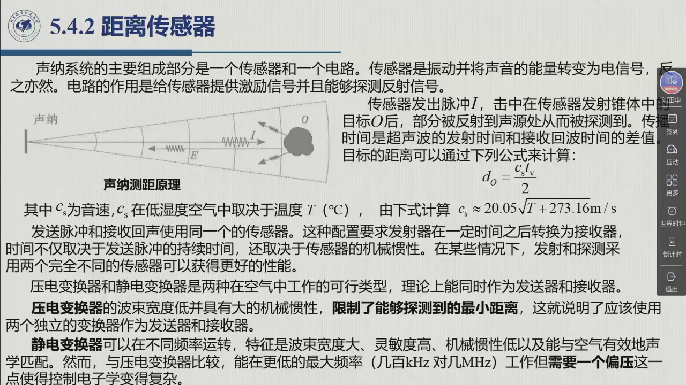
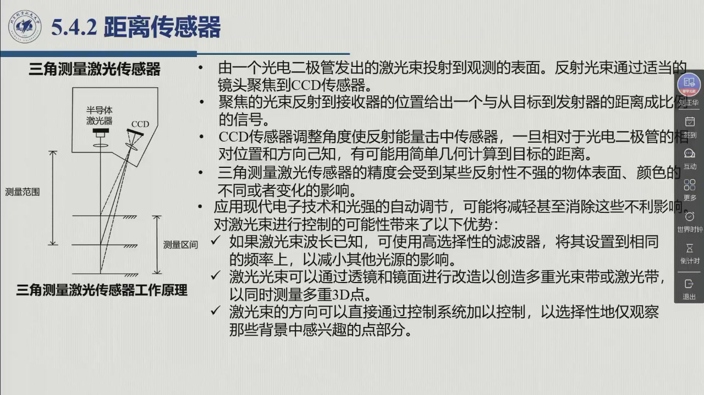

# 5.4.2 距离传感器

上一节的力传感器在末端碰到物体之后才给出读数；要想让机械手或移动机器人在碰撞发生之前主动绕开障碍、识别工作空间里的工件方位，就需要在“能量—驱动—传动—测量”链的外部测量端加上距离传感器。测距读数只有同时标明测量原点、观测方向以及反射和波束条件，才能变成三维空间里可信的障碍物位置。本节先区分“有没有”和“有多远”，再依次推导声纳回波计时与激光的传播时间法、三角测量法。课堂回看：02:14:15–02:20:35（定位与接近传感并参照 02:11:36–02:14:15）。

## 5.4.2.1 从「有没有」到「多远、在哪个方位」

外部传感使机器人能依据周围环境主动决策而不再盲走（02:12:04–02:12:40）。按输出信息量，非接触探测分成接近传感器和距离传感器两档。

::: def 定义 5.4.4 · 接近传感器与距离传感器（含敏感距离） {#def-5.4.4}
接近传感器是距离传感器的简化形式：无需物理接触，仅判断目标是否落入规定的敏感距离内（只回答“有没有”）；距离传感器则给出定量的距离读数和相应观测方位，用于避障、建立环境地图和目标识别。只有把单方向的距离读数配上传感器自身位姿、波束方向和视场范围，才能得到障碍物相对机器人的空间位置。
:::

## 5.4.2.2 声纳：用回波计时

在空气或水中，如果传播速度 $c_s$ 已知，就能把声音脉冲从发出到返回的时间变成距离。声纳成本低、功耗小、计算量轻；在水下或粉尘浓烟等低能见度环境里激光难以穿透时，声纳常成为首选甚至唯一可行的测距手段（02:13:45–02:14:15）。

先在最简几何假设下建方程：发射和接收共点，测量瞬间目标静止，声波沿原路往返。

::: thm 定理 5.4.B · 声纳测距方程与音速的温度修正 {#thm-5.4.B}
声波从传感器到达单程距离为 $d_o$ 的目标再返回，总路程为 $2d_o$，因此由往返传播时间 $t_v$（emission 到 echo 的时间差）得（教材式 5.33）

$$d_o=\frac{c_st_v}{2}. \tag{5.33}$$

在低湿度空气中，音速 $c_s$ 随摄氏温度 $T$（$^\circ\mathrm C$）变化（教材式 5.34）：

$$c_s\approx20.05\sqrt{T+273.16}\ \mathrm{m/s}. \tag{5.34}$$

介质改变（如进入水中）必须更换对应介质的声速，不能套用空气公式。
:::

拿一组数代入核对：取 $c_s=340\ \mathrm{m/s}$，往返时间 $t_v=6\ \mathrm{ms}$，则 $d_o=340\times0.006/2=1.02\ \mathrm m$（若漏掉分母 2 会直接算成 2 倍距离 $2.04\ \mathrm m$）。把小误差展开，$\delta d_o\approx\frac12(t_v\delta c_s+c_s\delta t_v)$：这说明高精度测距同时受测温精度和计时分辨率制约，光提高定时器主频却不修正温度照样有误差（例如室温从 $0^\circ\mathrm C$ 升到 $25^\circ\mathrm C$ 音速变化超过 4%）。

实际使用声纳还要注意器件转换盲区和三类反射失效（02:15:18–02:17:50）：

1. **收发切换与近距离盲区**：如果用同一个压电换能器兼作发射和接收，压电晶体共振惯性大，发完脉冲后仍需一段振铃和恢复时间 $t_b$ 才能切回接收模式，近处回波在传感器尚未恢复前就已返回，形成约 $c_st_b/2$ 的近距离盲区；分设独立发射／接收器或选用机械惯性更低的静电膜片换能器（如 Polaroid 600 系列静电声纳，波束宽约 $15^\circ$、有效量程约 $0.15\text{–}10\ \mathrm m$，代价是需较高偏置电压与相应驱动电路，课件参数只作单型号示例）可改善近距表现。
2. **非检测平面与临界角漏检**：超声能量分布在锥形波束（典型不小于 $15^\circ$）内。光滑平坦表面且入射角大于临界角（例如 Polaroid 对光滑胶合板约为 $65^\circ$）时，声波像镜面反射一样弹向别处，接收器收不到回波，系统就会把面前的大平面误判成“前方无障碍”。
3. **多重反射虚检**：光滑壁面之间发生多次折返后回到接收器，飞行时间变长，传感器就会在光路延长线方向凭空报出一个不存在的“虚拟远目标”。

## 5.4.2.3 激光：传播时间法与三角测量法

激光光束极窄、单色性好（可用窄带滤光抑制环境杂光）、方向可控，因此角分辨率远高于声纳（02:17:55–02:21:45）。按测距原理分为传播时间法（ToF）和三角测量法两条路线。

::: method 方法 5.4.C · 两种激光测距传感器：原理与取舍 {#method-5.4.C}
**① 激光传播时间法（ToF）** 原理与声纳同形：半导体激光器发脉冲、光电二极管收脉冲，由光速 $c\approx3\times10^8\ \mathrm{m/s}$ 算得 $d=ct/2$。光速极快带来苛刻的计时要求：1 mm 距离差对应的**往返**路程差为 2 mm，所需时间分辨率为 $2\times10^{-3}/(3\times10^8)\approx6.7\ \mathrm{ps}$（单程 1 mm 才约 3.3 ps，代入往返关系不要漏乘 2）。此外，若每隔重复周期 $T_r$ 发一串相同脉冲，超过 $T_r$ 才返回的远距离回波会混入下一周期，造成以 $cT_r/2$（典型模糊区间量级约 20–40 m）为周期的距离歧义（可通过脉冲编码或门控缓解）。单束激光只测一个点，通常利用轻量反射镜面高速扫描而无需摆动笨重的激光器和探测器本身。

**② 激光三角测量法** 不测时间，改用发射端与接收 CCD 之间已知的几何基线：漫反射光斑落在感光芯片上的像点位置直接反映目标深度，不受光速计时皮秒级门槛限制，常用于近距离高精度工业轮廓或圆度检测，但对表面颜色、漫反射特性（镜面反射会使光斑偏离或失效）及环境光较敏感。
:::

把激光三角测量的相似三角形算一遍：设接收镜头光心位于 $(0,0)$、光轴沿 $+z$，激光发射器在 $(b,0)$ 沿 $+z$ 射出一束平行光，打在深度为 $Z$ 的表面点 $(b,Z)$ 上；接收侧虚拟像平面距光心焦距为 $f$，漫反射光经光心在像平面上成斑坐标为 $x_p$。由相似三角形得

$$\frac{x_p}{f}=\frac{b}{Z} \qquad\Longrightarrow\qquad Z=\frac{fb}{x_p}.$$

例如取基线 $b=50\ \mathrm{mm}$、焦距 $f=10\ \mathrm{mm}$：当光斑在像面上偏离光轴 $x_p=2\ \mathrm{mm}$ 时，目标深度 $Z=10\times50/2=250\ \mathrm{mm}$；当光斑位置减半为 $x_p=1\ \mathrm{mm}$ 时，深度翻倍为 $Z=500\ \mathrm{mm}$。可见在这种正交发射几何中深度 $Z$ 与像点坐标 $x_p$ 成**反比**而不是正比（工程实际结构往往带倾斜角并通过标定直接建立像元刻度到距离的查表或曲线）。

<figure>
<svg class="figure-svg" viewBox="0 0 900 340" xmlns="http://www.w3.org/2000/svg" role="img" aria-labelledby="fig-5423-t fig-5423-d">
<title id="fig-5423-t">三种测距原理：声纳回波计时、激光传播时间、激光三角测量</title>
<desc id="fig-5423-d">三个并列的小图。左：声纳发出脉冲 I，经锥形波束击中目标 O 后回波 E 返回，距离由 d_o = c_s t_v / 2 给出；中：半导体激光器发出光脉冲，经目标反射回光电二极管，距离由光速乘时间的一半给出；右：激光器与 CCD 之间是一条基线，激光光斑落在目标表面后扩散反射回 CCD，光斑位置与距离由标定几何联系，靠标定解三角形。</desc>
<defs>
<marker id="f5423-a" markerWidth="9" markerHeight="9" refX="7" refY="3" orient="auto"><path d="M0,0 L7,3 L0,6 Z" fill="var(--muted)"/></marker>
</defs>
<text class="diagram-text" x="150" y="26" text-anchor="middle">① 声纳：回波计时</text>
<text class="diagram-text" x="460" y="26" text-anchor="middle">② 激光传播时间：光脉冲计时</text>
<text class="diagram-text" x="760" y="26" text-anchor="middle">③ 激光三角测量：光斑位置</text>
<line x1="130" y1="48" x2="130" y2="112" stroke="var(--line-strong)" stroke-width="3"/>
<path d="M130,56 L272,30 L272,130 L130,104" fill="none" stroke="var(--line)" stroke-dasharray="5 4"/>
<circle cx="250" cy="80" r="18" fill="none" stroke="var(--muted)" stroke-width="1.4"/>
<text class="diagram-note" x="250" y="85" text-anchor="middle">$O$</text>
<line x1="238" y1="100" x2="150" y2="100" stroke="var(--fig-blue)" stroke-width="1.6" marker-end="url(#f5423-a)"/>
<text class="diagram-note" x="140" y="150">$d_o=c_st_v/2$</text>
<text class="diagram-note" x="60" y="174">$c_s\approx20.05\sqrt{T+273.16}$ m/s</text>
<rect x="330" y="50" width="76" height="26" rx="4" fill="none" stroke="var(--line-strong)"/>
<text class="diagram-note" x="368" y="68" text-anchor="middle">半导体激光器</text>
<rect x="330" y="98" width="76" height="26" rx="4" fill="none" stroke="var(--line-strong)"/>
<text class="diagram-note" x="368" y="116" text-anchor="middle">光电二极管</text>
<line x1="406" y1="63" x2="556" y2="63" stroke="var(--fig-blue)" stroke-width="1.6" marker-end="url(#f5423-a)"/>
<line x1="556" y1="80" x2="410" y2="110" stroke="var(--fig-gold)" stroke-width="1.6" marker-end="url(#f5423-a)"/>
<line x1="560" y1="40" x2="560" y2="122" stroke="var(--muted)" stroke-width="2"/>
<text class="diagram-note" x="572" y="60">目标</text>
<text class="diagram-note" x="330" y="156">距离 $=c\,t/2$（单点）</text>
<text class="diagram-note" x="330" y="180">1 mm 分辨率 ≈ 6.7 ps 计时</text>
<rect x="630" y="50" width="60" height="26" rx="4" fill="none" stroke="var(--line-strong)"/>
<text class="diagram-note" x="660" y="68" text-anchor="middle">激光器</text>
<rect x="822" y="50" width="60" height="26" rx="4" fill="none" stroke="var(--line-strong)"/>
<text class="diagram-note" x="852" y="68" text-anchor="middle">CCD</text>
<line x1="662" y1="80" x2="850" y2="80" stroke="var(--line-strong)" stroke-width="1.2" stroke-dasharray="4 3"/>
<text class="diagram-note" x="756" y="96" text-anchor="middle">基线 $b$：一条边 + 两个角</text>
<line x1="668" y1="78" x2="702" y2="196" stroke="var(--fig-blue)" stroke-width="1.6" marker-end="url(#f5423-a)"/>
<line x1="704" y1="196" x2="846" y2="80" stroke="var(--fig-gold)" stroke-width="1.6" marker-end="url(#f5423-a)"/>
<line x1="626" y1="200" x2="880" y2="200" stroke="var(--muted)" stroke-width="2"/>
<text class="diagram-note" x="712" y="222">反射必须是扩散的</text>
<text class="diagram-note" x="630" y="252">光斑在 CCD 上的位置</text>
<text class="diagram-note" x="630" y="274">∝ 目标到发射端的距离</text>
<text class="diagram-note" x="450" y="316" text-anchor="middle">三种原理都只给出「一个方向上的一个距离」——要成图，必须扫描或多波束</text>
</svg>
<figcaption>声纳与脉冲激光先测往返时间，三角测量先测光斑位置。前两者仍需传播速度，后者需基线、成像关系与标定。</figcaption>
</figure>

使用激光测距设备时还须注意眼睛安全标准（尤其是不可见红外激光）以及金属抛光表面造成的镜面反射干扰；水下与浑浊介质是否彻底无法用光也要按实际波长、散射距离与声学对比决定，不能不加条件写死。

::: think 检查理解
1. 在 $c_s=340$ m/s的假设下，1 ms往返时间对应多远？若接收器需要1 ms才能恢复，会形成多大的近距离盲区？
2. 为什么表面存在而没有返回信号，并不矛盾？
3. 上面的三角测量中，光斑坐标减半为何使估计深度翻倍？
4. “1 mm对应约3 ps”放入往返测距关系时，漏了哪一步？

::: sol 核对
1. 两问均为 $340\times0.001/2=0.17\ \mathrm m$。
2. 表面光滑且入射角超过临界角时能量反射偏离接收方向，或目标超出敏感距离／吸收光能，导致接收端测不到回波。
3. 由几何关系 $Z=fb/x_p$ 可见深度 $Z$ 与光斑偏离坐标 $x_p$ 成反比，因此 $x_p$ 减半使 $Z$ 翻倍。
4. 漏掉了光束往返两倍路程：1 mm 距离变化对应 2 mm 光程差，往返时间差为 $2\times10^{-3}/(3\times10^8)\approx6.7\ \mathrm{ps}$。
:::
:::

## 5.4.2 小结与常见错误

接近传感器探测敏感距离内有无目标，距离传感器提供距离与方位。声纳与激光传播时间法均基于 $d=ct/2$，分别受音速温漂／换能器盲区／临界角漏检／多径虚检和皮秒级计时／模糊重复间隔限制；激光三角测量依靠基线和相似三角形 $Z=fb/x_p$ 近距高精度测距，但依赖漫反射光斑定位。

::: think 常见错误清单 · 自查三条
1. 忘记往返测距公式 $d=ct/2$ 中的除以 2，或估算 1 mm 光时间分辨时错按单程 3.3 ps 而非往返 6.7 ps。
2. 把“未收到回波”等同于“前方没有障碍物”，忽略声纳临界角镜面漏检与收发切换近距离盲区。
3. 以为三角测距里光斑坐标与目标深度总是成正比（平行垂直基线几何中是反比关系 $Z=fb/x_p$，实际器件还须按倾斜基线标定曲线换算）。
:::
