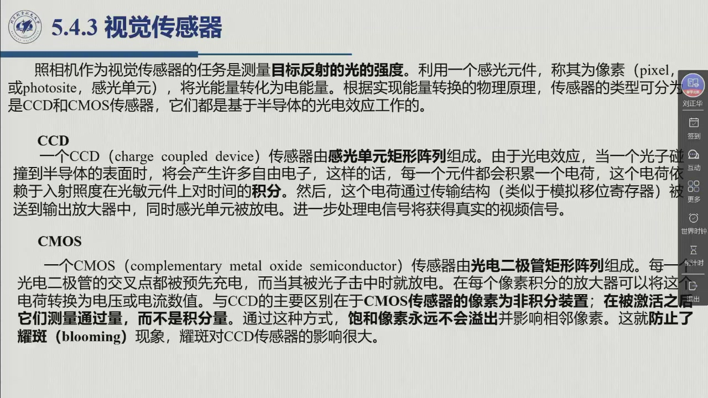
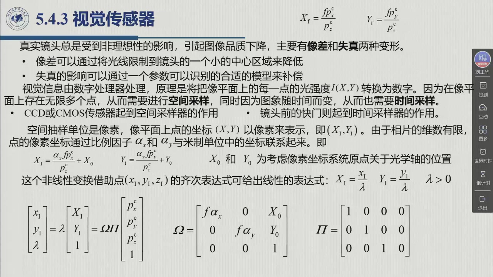

# 5.4.3 视觉传感器

老师用一句话给这一节开了门：「视觉传感器呢，其实就是**照相机**」（02:22:01）。但这句话底下藏着一条相当长的链：光 → 感光元件 → 电荷 → 电压 → 视频信号 → 数字图像 → 像素坐标，中间还夹着镜头、快门、行场扫描和一次模数转换。本节先把**成像器件**（CCD 与 CMOS）的差别讲清，再补上**照相机系统**（镜头、快门、视频标准、帧捕捉器）的其余部件，然后把主要篇幅交给全节的重点——**相机模型**：一个三维空间的点是怎么一步步变成像平面上的一个像素的。这条链就是作业 5.7 要用的那套公式，也是第 10 章视觉控制的入口。录播 02:22:15–02:28:11。

## 5.4.3.1 从光到电：像素、CCD 与 CMOS

::: def 定义 5.4.5 · 视觉传感器、像素与 CCD／CMOS 传感器 {#def-5.4.5}
**任务**：照相机作为视觉传感器的任务是**测量目标反射的光的强度**。为此利用一个**感光元件**，称为**像素**（pixel，或 photosite，感光单元），它能够**将光能量转化为电能量**。根据实现能量转换的**物理原理**不同，传感器的类型也不同；最常用的是 **CCD 与 CMOS 传感器**，它们都是基于**半导体的光电效应**工作的。

**① CCD（charge coupled device，电荷耦合器件）**：由**感光单元矩形阵列**组成。由于光电效应，当一个光子碰撞到半导体的表面时，会产生许多自由电子，于是每一个元件都会**积累一个电荷**——这个电荷取决于**入射照度在光敏元件上对时间的积分**。随后，这个电荷通过**传输结构**（类似于**模拟移位寄存器**）被送到**输出放大器**中，同时感光单元被放电；电信号进一步处理即获得真实的视频信号。

**② CMOS（complementary metal oxide semiconductor）**：由**光电二极管矩形阵列**组成。每一个光电二极管的**交叉点都被预先充电**，当被光子击中时就**放电**；每个像素**集成的放大器**把这个电荷转换为电压或电流数值。

**两条本质差别**：

| | CCD | CMOS |
|:--|:--|:--|
| 像素是不是**积分**器件 | 是——电荷是照度对时间的**积分** | **非积分**——被激活后测量**通过量（throughput）**，而不是积分量（volume） |
| 后果 | **饱和像素会溢出并影响相邻像素** ⇒ 出现**耀斑**（blooming） | 饱和像素**永远不会溢出并影响相邻像素** ⇒ **防止了耀斑** |
| 读出方式 | 电荷经传输结构**串行**送到公共输出放大器 | 每个像素**自带放大器**，输出**直接是二维阵列**，元素可**自由访问** |

**彩色相机**（教材脚注）：由对**三原色（RGB）**敏感的特殊 CCD 构成；复杂的相机有**三个独立的传感器**，每种基色各一个。
:::

老师说这一块（02:22:27）「在上面自己看一下」，但他自己把关键的那条差别说了出来：**「所以 CMOS（每个像素是独立的），所以 CCD 需要一个积分的过程，有可能有（饱和溢出）的情况」**——积分与溢出是同一枚硬币的两面：正因为 CCD 的像素把电荷攒起来再排队搬走，攒过头就会溢到邻居家去（耀斑）。

## 5.4.3.2 照相机：镜头、快门与视频信号

**一个相机不只是一个感光芯片。** 教材提醒：照相机是**不同于光学传感器**的复杂系统，包含**快门、镜头、模拟预处理电子组件**三部分；**镜头**主要负责把物体反射的光**聚集到光学传感器所在的平面上**——这个平面叫**成像平面**。

**输出端有两种活法**（教材 §5.4.3）：

**（一）单色 CCD 相机 → 先出模拟视频，再数字化。** 传感器的输出放大器产生一个信号，经定时模拟电子学处理，按现有的视频标准之一——**CCIR**（欧洲与澳大利亚标准）或 **RS170**（美国与日本标准）——产生电信号。无论如何，视频信号都是**峰峰值为 1 V 的电压**，其幅值顺序表示图像强度。图像的读出方式值得记住：

- 整个图像分为很多**行**（CCIR 标准 **625** 行，RS170 标准 **525** 行），被**相继扫描**；
- **光栅扫描**从头到尾水平扫过每一行，而且**先扫所有偶数行**（形成第一个**扫描场**），**再扫所有奇数行**（第二个场）——一**帧**由两个连续的**场**组成，这种技术叫**隔行扫描**（interlacing）；
- 隔行扫描允许图像**按帧率或按场率**更新：按帧率时更新频率就是整幅画面的更新频率（CCIR **25 Hz**、RS170 **30 Hz**）；按场率时更新频率可以**翻倍**，前提是能容忍**一半的纵向分辨率**。

**测量处理的最后一步**是把模拟视频信号**数字化**。为视频信号获取而采用的专用模数转换器称为**帧捕捉器**（frame grabber）：把相机的输出接到帧捕捉器上，视频波形被**抽样并量化**，数值保存在表示图像空间抽样的**二维存储序列**中，即**帧存储器**（framestore）；这个阵列随后以**场率或帧率**更新。

**（二）CMOS 相机 → 直接出二维阵列。** 对 CMOS 相机（教材加了一句：**目前仅对单色图像可行**）而言，得益于允许把**模数转换器集成在每个像素点**上的 CMOS 技术，相机的输出**直接是一个二维阵列**，其元素可以**自由访问**。相对于 CCD 相机，这个优势意味着：**只要访问整个画面的一部分**，就能获得更高的**帧率**——这正是后来「ROI 高速读图」的雏形。

## 5.4.3.3 相机模型：一个三维点怎么变成像素（作业 5.7 的公式）

老师把这一节的必要性说得很直接（02:23:06–02:23:44）：要用视觉传感器做机器人的控制，就「需要建立**模型**」——需要知道**真实物理世界中的一个点**与**相机成像平面**之间「一个点的（映）射关系是什么」。教材的处理是把它拆成**四步**。

**第一步：换坐标系（外参数）。** 考虑固连于相机的坐标系 $O_c-x_cy_cz_c$，其关于基础坐标系的位置由**齐次变换矩阵 $T_b^c$** 确定。取目标的一点，坐标为 $p^c=[p^c_x\ p^c_y\ p^c_z]^{\mathrm T}$——一般地，**选择目标的质心**。则从基础坐标系到相机坐标系的坐标转换描述为（式 5.35）

$$p^c=T_b^c\,\tilde p$$

其中 $\tilde p$ 表示相对于基础坐标系的**目标位置的齐次表达式**。这一步用的正是第二章的齐次变换：「如果我们知道它们之间相对的姿态和位置的关系，其实也就是咱们第二章的内容」（02:24:07）。

**第二步：透视变换（把点投到像平面上）。** 在成像平面上引入参考坐标系，其轴 $X$ 和 $Y$ **平行于相机坐标系的轴 $x_c$ 和 $y_c$**，原点位于**光学轴和成像平面的交点**，称为**主点**。由于**折射现象**，相机坐标系中的点通过**透视变换**转换为成像平面上的点：

$$X_f=-\frac{fp^c_x}{p^c_z},\qquad Y_f=-\frac{fp^c_y}{p^c_z}$$

其中 $(X_f,Y_f)$ 是成像平面上新坐标系的坐标，$f$ 是镜头的**焦距**。两点提醒：这些坐标用**米制单位**表示；该变换在 $p^c_z=0$ 处是**奇异的**（点在光学轴上、投影无定义）。

**正负号与「正面透视」。** 负号的存在与「目标的像在相机像平面是**上下颠倒**」这一现象吻合。为了计算方便，可以改用一个位于**镜头前面**、与 $z_c=f$ 平面对应的**虚拟像平面**，这样就避免了颠倒，得到**正面透视变换**（式 5.36、5.37）：

$$X_f=\frac{fp^c_x}{p^c_z},\qquad Y_f=\frac{fp^c_y}{p^c_z}$$

（教材特意注明：为避免符号滥用，虚拟平面上的变量名**保持不改**。）老师把它讲成一句几何直觉：「透视变换其实也是**相似三角形**」（02:25:34）；「相当于把这个面放到这儿，那这个时候就可以把这个符号给消除了」（02:26:41）——本节的 SVG 图正是按这个模型画的。

**真实的镜头不完美。** 上述关系「仅在理论上成立」，真实镜头总有非理想性，会引起图像品质下降，公认的有两种变形：**像差**（aberrations）与**失真**（geometric distortion）。像差可以通过**把光线限制到镜头的一个小的中心区域**来降低；失真的影响可以通过一个**参数可以被辨识的合适模型**来补偿。

**第三步：采样并换成像素。** 视觉信息一般由**数字处理器**处理，测量原理是把像平面上每一点的光强度 $I(X,Y)$ **转换为数字**。显然，像平面上有**无限多个点**，所以需要**空间采样**；图像随时间而变，所以也需要**时间采样**。谁来干这两件事？——**CCD 或 CMOS 传感器起空间采样器的作用**，**镜头前的快门起时间采样器的作用**。

空间抽样的单位是**像素**，于是像平面中点的坐标 $(X,Y)$ 要**以像素表示**为 $(X_I,Y_I)$。由于相片的维数有限，点的像素坐标通过比例因子 $\alpha_x$ 和 $\alpha_y$ 与米制单位中的坐标联系起来（式 5.38、5.39）：

$$X_I=\frac{\alpha_xfp^c_x}{p^c_z}+X_0,\qquad Y_I=\frac{\alpha_yfp^c_y}{p^c_z}+Y_0$$

其中 $X_0$ 和 $Y_0$ 是考虑**像素坐标系统原点关于光学轴的位置**（偏移）。这一步老师也点到了（02:27:28）：「（前面）其实是以米制单位来进行的表示，但实际的相机（图像）空间它是以像素的形式来进行坐标的描述，所以我们要把米制的表示转化成像素的表示，它也是一个线性的关系。」

**线性化：把除法收进齐次坐标。** 这个非线性变换可以借助点 $(x_I,y_I,z_I)$ 的**齐次表达式**写成线性形式——令 $X_I=\dfrac{x_I}{\lambda}$、$Y_I=\dfrac{y_I}{\lambda}$（$\lambda>0$），于是式（5.38）（5.39）可改写为（式 5.40）

$$\begin{bmatrix}x_I\\ y_I\\ \lambda\end{bmatrix}=\lambda\begin{bmatrix}X_I\\ Y_I\\ 1\end{bmatrix}=\Omega\Pi\begin{bmatrix}p^c_x\\ p^c_y\\ p^c_z\\ 1\end{bmatrix}$$

其中（式 5.41、5.42）

$$\Omega=\begin{bmatrix}f\alpha_x&0&X_0\\ 0&f\alpha_y&Y_0\\ 0&0&1\end{bmatrix},\qquad
\Pi=\begin{bmatrix}1&0&0&0\\ 0&1&0&0\\ 0&0&1&0\end{bmatrix}$$

$\Pi$ 只干一件事：把三维齐次向量 $(p^c_x,p^c_y,p^c_z,1)$ 截成三维 $(p^c_x,p^c_y,p^c_z)$（丢掉常数 1）；$\Omega$ 则一次完成「乘焦距、乘比例因子、加偏移」。

**第四步：合成——照相机校准矩阵。** 到这一步，从**观察对象的笛卡儿空间**到**图像的像空间中像素**的全局转换，就是式（5.35）与式（5.40）的复合（式 5.43）：

$$\Xi=\Omega\Pi T_b^c$$

这就是所谓的**照相机校准矩阵**。它里面装着两类参数：

| 参数类 | 在哪个矩阵里 | 取决于什么 |
|:--|:--|:--|
| **内参数**（intrinsic） $\alpha_x,\alpha_y,X_0,Y_0,f$ | $\Omega$ | **传感器和镜头**的特征 |
| **外参数**（extrinsic） | $T_b^c$ | **相机相对于基础坐标系**的相对位置和方向 |

**为什么要标定**：为了尽可能精确地计算**笛卡儿空间与像空间之间的变换**，现有一些技术来**辨识这些参数**（教材 §5.4.3；参考书里也专门给出了一种最常用的视觉系统校准技术）。内参数由制造与装配决定（$\alpha_x,\alpha_y$ 还反映像素的物理尺寸），外参数则由相机装在机械手上的**位姿**决定——作业 5.7 给的那组 $f=8\ \mathrm{mm}$、$\alpha_x=79.2\ \mathrm{pixel/mm}$、$\alpha_y=120.5\ \mathrm{pixel/mm}$、$X_0=Y_0=250$ 就是内参数。

**规范化坐标（一个计算上的小工具）。** 如果相机的**内参数已知**，从计算的观点看，方便改用**规范化坐标** $(X,Y)$，它由**规范化透视变换**定义（式 5.44）：

$$\lambda\begin{bmatrix}X\\ Y\\ 1\end{bmatrix}=\Pi\begin{bmatrix}p^c_x\\ p^c_y\\ p^c_z\\ 1\end{bmatrix}$$

这些坐标也用米制单位定义；当 $f=1$ 时，它们与式（5.36）（5.37）的坐标一致。比较式（5.40）与式（5.44），得到可逆变换（式 5.45）

$$\begin{bmatrix}X_I\\ Y_I\\ 1\end{bmatrix}=\Omega\begin{bmatrix}X\\ Y\\ 1\end{bmatrix}$$

——即**通过内参数矩阵**把规范化坐标与像素坐标联系起来。**「先归一化、再上内参」**这条分解，正是后来相机标定与视觉伺服里最常用的写法。

<figure>
<svg class="figure-svg" viewBox="0 0 900 430" xmlns="http://www.w3.org/2000/svg" role="img" aria-labelledby="fig-5433-t fig-5433-d">
<title id="fig-5433-t">相机模型：针孔几何（正面透视）与从三维点到像素的变换链</title>
<desc id="fig-5433-d">上半部分是侧视的针孔模型：左侧为目标 p 所在平面，中间为透镜中心与光学轴，透镜左侧是位于 z_c = f 的虚拟像平面，右侧是真实像平面；两条光线从目标顶端与底端经透镜中心射到像平面上，在虚拟像平面上交于 (X_f, Y_f)。下半部分是变换链：基础坐标系中的点 p 经外参数 T_b^c 变为相机坐标系中的 p^c，再经透视变换得到像平面的 X_f、Y_f，最后经内参数矩阵 Ω 变为像素坐标 X_I、Y_I，整体合成为相机校准矩阵 Ξ = Ω Π T_b^c。</desc>
<defs>
<marker id="f5433-a" markerWidth="9" markerHeight="9" refX="7" refY="3" orient="auto"><path d="M0,0 L7,3 L0,6 Z" fill="var(--muted)"/></marker>
</defs>
<text class="diagram-text" x="40" y="30">① 针孔几何：透视变换 = 相似三角形（侧视）</text>
<line x1="120" y1="180" x2="700" y2="180" stroke="var(--line-strong)" stroke-width="1.2" stroke-dasharray="6 5"/>
<text class="diagram-note" x="702" y="172">光学轴</text>
<ellipse cx="520" cy="180" rx="9" ry="44" fill="none" stroke="var(--fig-blue)" stroke-width="1.8"/>
<text class="diagram-note" x="520" y="248" text-anchor="middle">透镜中心</text>
<line x1="392" y1="92" x2="392" y2="268" stroke="var(--line-strong)" stroke-width="1.2" stroke-dasharray="5 4"/>
<text class="diagram-note" x="330" y="86">虚拟像平面 $z_c=f$</text>
<line x1="650" y1="80" x2="650" y2="282" stroke="var(--muted)" stroke-width="2"/>
<text class="diagram-note" x="662" y="76">真实像平面（像上下颠倒）</text>
<line x1="150" y1="120" x2="150" y2="240" stroke="var(--fig-gold)" stroke-width="2.4"/>
<text class="diagram-note" x="52" y="112">目标 $p$：$p^c=[p^c_x,p^c_y,p^c_z]^{\mathrm T}$</text>
<line x1="150" y1="120" x2="650" y2="201" stroke="var(--fig-blue)" stroke-width="1.2"/>
<line x1="150" y1="240" x2="650" y2="159" stroke="var(--fig-blue)" stroke-width="1.2"/>
<circle cx="392" cy="159" r="3.5" fill="var(--fig-gold)"/>
<circle cx="392" cy="201" r="3.5" fill="var(--fig-gold)"/>
<text class="diagram-note" x="404" y="212">$Y_f=fp^c_y/p^c_z$（正面透视，不变号）</text>
<line x1="522" y1="300" x2="648" y2="300" stroke="var(--muted)" stroke-width="1.4"/>
<line x1="522" y1="294" x2="522" y2="306" stroke="var(--muted)" stroke-width="1.4"/>
<line x1="648" y1="294" x2="648" y2="306" stroke="var(--muted)" stroke-width="1.4"/>
<text class="diagram-note" x="585" y="320" text-anchor="middle">焦距 $f$</text>
<text class="diagram-text" x="40" y="352">② 变换链</text>
<rect x="40" y="362" width="140" height="30" rx="6" fill="none" stroke="var(--line-strong)"/>
<text class="diagram-note" x="110" y="382" text-anchor="middle">$p$：基础坐标系</text>
<line x1="180" y1="377" x2="212" y2="377" stroke="var(--muted)" stroke-width="1.4" marker-end="url(#f5433-a)"/>
<rect x="214" y="362" width="176" height="30" rx="6" fill="none" stroke="var(--fig-blue)" stroke-width="1.6"/>
<text class="diagram-note" x="302" y="382" text-anchor="middle">$p^{c}=T_b^{c}p$（外参数）</text>
<line x1="390" y1="377" x2="422" y2="377" stroke="var(--muted)" stroke-width="1.4" marker-end="url(#f5433-a)"/>
<rect x="424" y="362" width="176" height="30" rx="6" fill="none" stroke="var(--line-strong)"/>
<text class="diagram-note" x="512" y="382" text-anchor="middle">$X_f,Y_f$（透视变换）</text>
<line x1="600" y1="377" x2="632" y2="377" stroke="var(--muted)" stroke-width="1.4" marker-end="url(#f5433-a)"/>
<rect x="634" y="362" width="236" height="30" rx="6" fill="none" stroke="var(--fig-gold)" stroke-width="1.6"/>
<text class="diagram-note" x="752" y="382" text-anchor="middle">$X_I,Y_I$（$\Omega$：内参数 $f\alpha_x,f\alpha_y,X_0,Y_0$）</text>
<text class="diagram-note" x="450" y="418" text-anchor="middle">合成：$\Xi=\Omega\Pi T_b^{c}$ —— 照相机校准矩阵（内参数 × 透视 × 外参数）</text>
</svg>
<figcaption>相机模型与变换链（本教程绘）：上半按**正面透视**（虚拟像平面）画，因此像与物同向、公式中不出现负号；下半把一个点从基础坐标系走到像素坐标的四步与两块矩阵（$T_b^c$ 与 $\Omega$）并排摆开——作业 5.7 就是在已知 $T_b^c$（由机械手位姿算出）与 $\Omega$（$f,\alpha_x,\alpha_y,X_0,Y_0$）的前提下，把 $p$ 一路推到 $(X_I,Y_I)$。</figcaption>
</figure>

## 5.4.3.4 从低水平到高水平：这一串步骤站在哪一层

教材在收尾处给整节内容定了个「层次」：

> 上述的从图形信息到图像获取的一系列步骤，可以被归为**低水平处理**（low-level vision）一类；这包括**提取基本图像特征**，例如**质心和亮度的不连续**。

也就是说，从镜头、CCD/CMOS、扫描到像素坐标，这一整套做的都是**把光变成可计算的数**、并在这些数上提取最原始的特征。而真正意义上的「眼」还要往上一层：**只有当模拟认知（cognition）程度的处理可行的时候，一个机器人系统才可以看作是真正的自主系统**——教材举的标准例子是「**从一个存储在数据库中的 CAD 模型集合中识别出一个观测目标**」；在这种情况下，人工视觉处理可以被称为**高水平视觉**（high-level vision）。

（**本编补注**：这一传统里通常把层次划成**低 / 中 / 高**三级——低水平是滤波、边缘、角点这类基本特征；**中水平**是分割与描述（把像素聚成区域/物体并给出描述子）；**高水平**才是识别与理解。教材原文只显式点名了低与高两级，中间那级是同一分类里的常规叫法，读者读到「分割、描述」时知道它落在哪一层即可。）

**工业应用在哪一层？** 教材本节没有铺开应用清单，但它给了两条线索：其一，高水平视觉的判据就是**从 CAD 模型库中识别出观测目标**；其二，本章卷首语说视觉传感器的作用是在机械手与环境互动时「**测量相应目标的特征参数**」——这些参数正是后续（第 10 章）用视觉参与控制的输入。老师 02:23:06 也是从「用视觉传感器（做）机器人的控制」切进来的。（**背景补充**：工程上机器视觉的典型用途——**在线检测与缺陷判别、尺寸测量、定位与引导抓取、字符/条码识别**——全都落在这三级里：特征→描述→识别一层层往上走。）

::: think 考点 · 老师原话（录播时间点）

> **视觉就是照相机，成像靠 CCD/CMOS。** 「一般使用 CCD 或者是 CMOS 相机（来）成像」（02:22:15）。

> **两种器件的关键差别。** 「所以 CMOS（每个像素是独立的），所以 CCD 需要一个**积分**的过程，有可能有（饱和溢出）的情况」（02:22:33–02:22:44）。

> **为什么要建模。** 「（用）视觉传感器（做）机器人的控制，这是需要**建立模型**的……我们需要知道一个**真实物理世界**中的（点）和**相机的成像平面**……一个点的（映）射关系是什么」（02:23:06–02:23:42）。

> **第一步就是第二章的齐次变换。** 「如果我们知道它们之间相对的**姿态和位置**的关系，其实也就是咱们**第二章**的内容……就可以（表示）出来同一点 $P$ 在不同空间（的）表示」（02:24:07–02:24:24）。

> **透视变换就是相似三角形。** 「**透视变换**其实也是**相似三角形**」，「可以得到这样的一个关系」（02:25:34）；「正面透视……相当于把这个面放到这儿，那这个时候就可以把这个符号给消除了」（02:26:41）。

> **米制 → 像素是一个线性关系。** 「（前面）其实是以**米制单位**来进行的表示，但实际的相机（图像）空间它是以**像素**的形式来进行坐标的描述……它也是一个**线性**的关系」；「$X_0$（与）$Y_0$（是用来）进行比较（的偏移）」（02:27:28–02:28:06）。

> **点到即止，第十章再见。** 「下面大家自己去看一下。咱们到**第十章**的时候可能会涉及到这些内容」（02:28:15–02:28:35）。
:::

::: think 默写点 · 合上书再写（主动回忆）

1. CCD 与 CMOS 的**两条**本质区别是什么？各自的后果是什么？
2. 写出一套相机参数下「三维点 → 像素坐标」的完整步骤（四个式子），并说明 $\Omega$、$\Pi$、$T_b^c$ 各装了什么。
3. 透视变换里的负号从哪来？「正面透视」用的是什么手段消掉它的？
4. 什么叫空间采样、什么叫时间采样？各由相机的哪个部件负责？「低水平视觉」与「高水平视觉」的分界在哪？

::: sol 核对

**积分 vs 非积分**：CCD 的像素积累的是**入射照度对时间的积分**，CMOS 的像素被激活后测量**通过量**而非积分量；**后果**是 CCD 的饱和像素会**溢出并影响相邻像素**（**耀斑** blooming），CMOS 不会溢出、不产生耀斑。**读出方式**：CCD 靠**传输结构（模拟移位寄存器）串行**送往公共输出放大器并放电；CMOS 每个像素**自带放大器**，输出**直接是二维阵列**且元素**可自由访问**（因此只读部分画面即可获得更高帧率）。

① $p^c=T_b^c\tilde p$（外参数：基础系 → 相机系，用的就是第二章的齐次变换）；② 正面透视 $X_f=\dfrac{fp^c_x}{p^c_z}$、$Y_f=\dfrac{fp^c_y}{p^c_z}$（米制、像平面坐标）；③ 像素化 $X_I=\dfrac{\alpha_xfp^c_x}{p^c_z}+X_0$、$Y_I=\dfrac{\alpha_yfp^c_y}{p^c_z}+Y_0$；④ 齐次线性化 $[x_I,y_I,\lambda]^{\mathrm T}=\Omega\Pi[p^c_x,p^c_y,p^c_z,1]^{\mathrm T}$，全局合成 $\Xi=\Omega\Pi T_b^c$。$\Omega$ 装**内参数**（$f\alpha_x,f\alpha_y,X_0,Y_0$，取决于传感器与镜头），$\Pi$ 是把齐次四维截成三维的**投影矩阵**，$T_b^c$ 装**外参数**（相机相对基础坐标系的位置与方向）。

负号来自**折射成像使目标的像在像平面上上下颠倒**（$X_f=-fp^c_x/p^c_z$，$Y_f=-fp^c_y/p^c_z$）。消除手段是改用位于**镜头前面**、对应 $z_c=f$ 平面的**虚拟像平面**（正面透视），于是 $X_f=fp^c_x/p^c_z$、$Y_f=fp^c_y/p^c_z$ 不再带负号（教材注明：虚拟平面上变量名不改，属「滥用记号」）。

**空间采样**：像平面上点有无穷多个，必须抽成有限个**像素**——由 **CCD/CMOS 传感器**完成；**时间采样**：图像随时间变化，必须在时间上取帧——由**镜头前的快门**完成。**低水平视觉** = 从图形信息到图像获取的这一串步骤与**基本图像特征**（质心、亮度不连续）的提取；**高水平视觉** = 具备**模拟认知**能力的处理，例如从数据库中的 CAD 模型集合里识别出观测目标（中间的分割/描述一层通常称为中水平视觉）。

:::

:::

## 5.4.3 小结与常见错误

- **一条链**：光 → **像素**（光能转电能）→ CCD（积分、串行转移、会耀斑）／CMOS（非积分、每像素放大器、可随机访问）→ 镜头/快门/模拟预处理 → 视频标准与**隔行扫描** → **帧捕捉器 + 帧存储器**（CMOS 则直接得到二维阵列）。
- **一套模型**：$p\xrightarrow{T_b^c}p^c\xrightarrow{\text{透视}}X_f,Y_f\xrightarrow{\Omega}X_I,Y_I$，合成 **$\Xi=\Omega\Pi T_b^c$**（内参数 × 透视 × 外参数）；**标定**就是为了把这套参数辨识出来。
- **一个层次**：这一整节都在**低水平处理**里（成图 + 基本特征）；**高水平视觉**才谈识别（例如从 CAD 模型库中认出目标）。

::: think 常见错误清单 · 自查三条
1. 把 CCD 与 CMOS 的差别只记成「谁更便宜/更省电」——考试要的是**积分/非积分**与**耀斑/随机访问**这两条本质差别。
2. 相机模型里把**主点**（光学轴与成像平面的交点）与**像素坐标系原点**混为一谈——两者差一个 $(X_0,Y_0)$ 的偏移。
3. 以为透视变换是线性映射——它**在 $p^c_z=0$ 处奇异**，本质是**除法**（相似三角形）；只有把除法收进齐次坐标（$\lambda$）之后，整条链才写成矩阵乘积。
:::