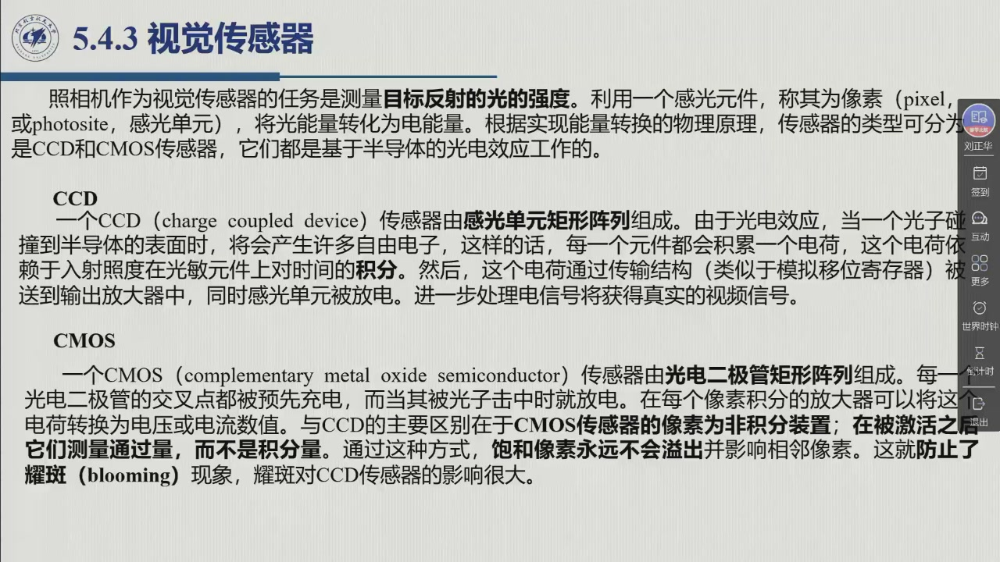
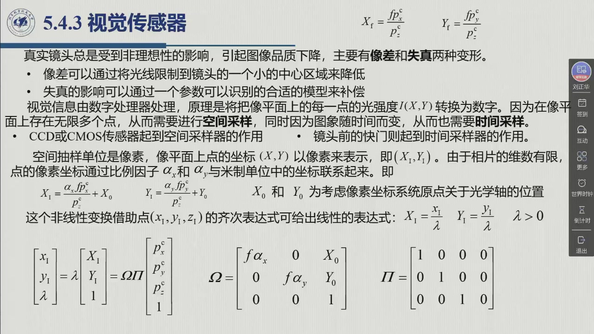

# 5.4.3 视觉传感器

前面两小节分别在接触后测力、在接触前测单点或扫描距离。本节走完“能量—驱动—传动—测量”链上的最后一种外部传感器（视觉传感器／相机），它一次采集整幅二维图像，提供的信息量最丰富，也是第十章视觉伺服的直接入口。要把图像特征变成机器人空间控制量，必须先把一个三维空间点精确映射到二维像素坐标，并看清这一步映射究竟丢掉了哪一维信息。课堂回看：02:22:15–02:28:11。

## 5.4.3.1 从光到电：像素、CCD 与 CMOS

相机阵列里的每个感光单元（像素，pixel/photosite）利用半导体光电效应在曝光时间窗内将入射光能量转换成电荷，形成可读出的电信号。CCD 与常见有源像素 CMOS 都会积累光生电荷，两者的真正区别在于电荷怎样搬运和放大读出（02:22:15–02:22:57）。

::: def 定义 5.4.5 · 视觉传感器、像素与 CCD／CMOS 传感器 {#def-5.4.5}
| 比较项 | CCD（电荷耦合器件） | 常见有源像素 CMOS |
|:--|:--|:--|
| 曝光过程 | 在感光单元积累与照度和曝光时间积分相关的光生电荷 | 同样可在曝光期内积累光生电荷 |
| 信号读出 | 电荷经模拟移位寄存器依次串行转移到公共输出放大器并放电 | 像素附近自带放大器完成电转换，按行列矩阵结构读出（具体 ADC 共享方式依芯片而定） |
| 过曝饱和影响 | 电荷攒满后可能溢出到相邻像元，产生耀斑（blooming），需防溢出设计 | 各像素读出更独立，但同样存在饱和及相应伪影，不能绝对保证毫无邻域影响 |

单色相机阵列出灰度值，彩色相机则通过在像素前加装 RGB 滤色阵列或使用分光棱镜配三片传感器获得三色通道。
:::

曝光是在一段有限时间内积累光子，如果曝光期间相机或工件高速运动，图像就会出现运动模糊；因此把视觉读数和关节编码器联用时，必须做时间戳同步，不能把曝光窗口内的结果无条件当成某一瞬时的静态坐标。

## 5.4.3.2 照相机：镜头、快门与视频信号

完整照相机包含镜头（把物体反射光汇聚到像平面）、快门（决定时间采样窗口）、感光阵列（完成连续像平面的空间离散采样）以及读出预处理电路。空间采样决定分辨率（像素行列数），时间采样决定曝光时间和帧率（两者是不同的时间量）。早期的模拟 CCD 相机常按 CCIR（625 行、25 帧/秒）或 RS170（525 行、30 帧/秒）标准隔行扫描输出视频信号再由帧捕捉器数字化，现代数字相机及 CMOS 局部兴趣区（ROI）读出已改用高速数字接口；芯片类型本身不锁定接口标准。

下面先忽略镜头几何畸变、像差、运动模糊与卷帘快门时间差，建立用于空间坐标映射的理想针孔成像模型。

## 5.4.3.3 相机模型：一个三维点怎么变成像素（作业 5.7 的公式）

设基础坐标系中有一目标点 $p^b$（例如目标质心）。把它转换成二维图像里的像素坐标 $(X_I,Y_I)$，拆成三步走：先换坐标系，再做透视投影，最后按像素密度和原点偏移换算成像素（02:23:24–02:28:25）。

### 第一步：用外参数换到相机坐标系

以相机镜头光学中心为原点 $O_c$、光轴朝前为 $+z_c$ 建立相机坐标系 $O_c-x_cy_cz_c$。设 $p^c=(p_x^c,p_y^c,p_z^c)^{\mathrm T}$ 为目标点在相机系下的坐标，用第二章的[齐次变换](../recall.md#homogeneous)写出（教材式 5.35）：

$$\begin{bmatrix}p^c\\1\end{bmatrix}=T_b^c\begin{bmatrix}p^b\\1\end{bmatrix}. \tag{5.35}$$

$T_b^c$ 描述相机相对于基础系的外参数位姿转换（把向量表示从 $b$ 变到 $c$）；如果正运动学算出来的是相机在基础系下的位姿 $T_c^b$，必须先求逆 $T_b^c=(T_c^b)^{-1}$ 再代入，且左右两端都必须保留 4 维齐次分量 1。

### 第二步：用深度做正面透视除法

真实物理像平面在光心后方 $z_c=-f$ 处，成像是上下左右颠倒的（公式带负号）。为消掉负号方便运算，把像平面对称挪到光心前方 $z_c=f$ 处的虚拟像平面（正面透视），此时投影点与空间点在过光心的同一条射线上，符号不变。由相似三角形得比例关系

$$\frac{X_f}{f}=\frac{p_x^c}{p_z^c},\qquad
\frac{Y_f}{f}=\frac{p_y^c}{p_z^c},$$

整理即得虚拟像平面上的物理长度坐标（教材式 5.36–5.37）：

$$X_f=\frac{fp_x^c}{p_z^c},\qquad Y_f=\frac{fp_y^c}{p_z^c}. \tag{5.36–5.37}$$

这一步里 $X_f,Y_f,f,p^c$ 采用一致的长度单位（例如同取 m 或同取 mm）。分母 $p_z^c$ 是点沿光轴的深度：投影只对前方 $p_z^c>0$ 的点有效，$p_z^c=0$ 时公式无定义。

### 第三步：从物理长度换成像素坐标

像平面坐标 $(X_f,Y_f)$ 的单位是物理长度（如 mm），且原点在光轴与像平面交点（主点）；数字图像数组却以“像素（pixel）”为单位计数，坐标原点通常在图像左上角，因此还要做一次仿射拉伸和平移（02:27:35–02:28:15）。

设相机感光芯片在水平和垂直方向上的像素密度比例因子分别为 $\alpha_x,\alpha_y$（单位 $\mathrm{pixel/mm}$ 或 $\mathrm{pixel/m}$，数值上等于像元物理间距的倒数，表示物理像平面上每单位长度排了多少个像素），主点在图像像素坐标系里的偏移位置为 $(X_0,Y_0)$（单位 $\mathrm{pixel}$）。忽略像素轴非正交倾斜，将 (5.36)–(5.37) 代入像素换算式，得教材式 (5.38)–(5.39)：

$$X_I=\alpha_xX_f+X_0=\frac{f\alpha_xp_x^c}{p_z^c}+X_0, \tag{5.38}$$

$$Y_I=\alpha_yY_f+Y_0=\frac{f\alpha_yp_y^c}{p_z^c}+Y_0. \tag{5.39}$$

在合并形式里，乘积 $f\alpha_x$（毫米焦距乘以 $\mathrm{pixel/mm}$）与 $f\alpha_y$ 称为**以像素为单位的等效焦距（像素焦距）**，单位是 $\mathrm{pixel}$。注意单位一定要匹配：焦距 $f$ 取 mm 时，$\alpha_x,\alpha_y$ 必须取 $\mathrm{pixel/mm}$；若 $f$ 换算成 m，则 $\alpha_x,\alpha_y$ 须同乘 $1000$ 换成 $\mathrm{pixel/m}$，使乘积 $f\alpha_x$ 保持不变。另外主点 $(X_0,Y_0)$ 由镜头装配与芯片安装决定，不一定恰好等于图像宽高的一半。

拿作业 5.7 的内参数算一个点：取 $f=8\ \mathrm{mm}$，$\alpha_x=79.2\ \mathrm{pixel/mm}$（像素焦距 $f\alpha_x=633.6\ \mathrm{pixel}$），$\alpha_y=120.5\ \mathrm{pixel/mm}$（$f\alpha_y=964.0\ \mathrm{pixel}$），主点 $X_0=Y_0=250\ \mathrm{pixel}$。已知相机系中一点 $p^c=(50,25,1000)^{\mathrm T}\ \mathrm{mm}$，先算物理像面坐标：

$$X_f=8\times\frac{50}{1000}=0.4\ \mathrm{mm},\qquad Y_f=8\times\frac{25}{1000}=0.2\ \mathrm{mm},$$

再换算到像素坐标：

$$X_I=79.2\times0.4+250=281.68\ \mathrm{pixel},\qquad
Y_I=120.5\times0.2+250=274.10\ \mathrm{pixel}.$$

工程上先检查算出的 $(X_I,Y_I)$ 是否落在相机感光有效视场范围内，再视需要取整或保留亚像素精度。若原始输入给出的是基础系坐标 $p^b$，务必先执行式 (5.35) 的外参变换。

### 齐次矩阵写法与归一化坐标

为了把前面四条公式写成一条连乘链，不能直接消除除以 $p_z^c$ 的非线性操作，但可以把这个除数收进图像齐次向量的比例因子 $\lambda=p_z^c$ 里。定义无量纲归一化平面坐标 $X=p_x^c/p_z^c$、$Y=p_y^c/p_z^c$，并定义相机内参数矩阵 $\Omega$（含传感器与镜头参数）和 $3\times4$ 截断投影矩阵 $\Pi$（教材式 5.41–5.42）：

$$\Omega=\begin{bmatrix}f\alpha_x&0&X_0\\0&f\alpha_y&Y_0\\0&0&1\end{bmatrix},\qquad
\Pi=\begin{bmatrix}1&0&0&0\\0&1&0&0\\0&0&1&0\end{bmatrix}. \tag{5.41–5.42}$$

于是三维点到像素的全局映射写成齐次线性乘积（教材式 5.40、5.43）：

$$\lambda\begin{bmatrix}X_I\\Y_I\\1\end{bmatrix}
=\Omega\Pi T_b^c\begin{bmatrix}p^b\\1\end{bmatrix}
=\Xi\begin{bmatrix}p^b\\1\end{bmatrix},\qquad\lambda=p_z^c, \tag{5.40}$$

其中 $3\times4$ 矩阵 $\Xi=\Omega\Pi T_b^c$ 称为**照相机校准矩阵**（外参数矩阵 $T_b^c$ 负责基础系到相机系，透视矩阵 $\Pi$ 取三维射线，内参数矩阵 $\Omega$ 负责换算像素）。把后两步拆开即教材式 (5.44)–(5.45)：

$$p_z^c\begin{bmatrix}X\\Y\\1\end{bmatrix}=\Pi\begin{bmatrix}p^c\\1\end{bmatrix},\qquad
\begin{bmatrix}X_I\\Y_I\\1\end{bmatrix}=\Omega\begin{bmatrix}X\\Y\\1\end{bmatrix}.$$

牢记矩阵乘完后必须用结果向量的第 3 个分量 $\lambda=p_z^c$ 去除前两个分量，才得到真正的像素坐标 $(X_I,Y_I)$。齐次记号只是把除法推迟到最后一步，并没有把透视成像变成线性变换。真实系统还须通过相机标定辨识 $\Omega,T_b^c$ 以及镜头径向／切向畸变系数。

<figure>
<svg class="figure-svg" viewBox="0 0 900 430" xmlns="http://www.w3.org/2000/svg" role="img" aria-labelledby="fig-5433-t fig-5433-d">
<title id="fig-5433-t">相机模型：针孔几何（正面透视）与从三维点到像素的变换链</title>
<desc id="fig-5433-d">上半部分是侧视的针孔模型：左侧为目标 p 所在平面，中间为透镜中心与光学轴，透镜左侧是位于 z_c = f 的虚拟像平面，右侧是真实像平面；两条光线从目标顶端与底端经透镜中心射到像平面上，在虚拟像平面上交于 (X_f, Y_f)。下半部分是变换链：基础坐标系中的点 p 经外参数 T_b^c 变为相机坐标系中的 p^c，再经透视变换得到像平面的 X_f、Y_f，最后经内参数矩阵 Ω 变为像素坐标 X_I、Y_I，整体合成为相机校准矩阵 Ξ = Ω Π T_b^c。</desc>
<defs>
<marker id="f5433-a" markerWidth="9" markerHeight="9" refX="7" refY="3" orient="auto"><path d="M0,0 L7,3 L0,6 Z" fill="var(--muted)"/></marker>
</defs>
<text class="diagram-text" x="40" y="30">① 针孔几何：透视变换 = 相似三角形（侧视）</text>
<line x1="120" y1="180" x2="700" y2="180" stroke="var(--line-strong)" stroke-width="1.2" stroke-dasharray="6 5"/>
<text class="diagram-note" x="702" y="172">光学轴</text>
<ellipse cx="520" cy="180" rx="9" ry="44" fill="none" stroke="var(--fig-blue)" stroke-width="1.8"/>
<text class="diagram-note" x="520" y="248" text-anchor="middle">透镜中心</text>
<line x1="392" y1="92" x2="392" y2="268" stroke="var(--line-strong)" stroke-width="1.2" stroke-dasharray="5 4"/>
<text class="diagram-note" x="330" y="86">虚拟像平面 $z_c=f$</text>
<line x1="650" y1="80" x2="650" y2="282" stroke="var(--muted)" stroke-width="2"/>
<text class="diagram-note" x="662" y="76">真实像平面（像上下颠倒）</text>
<line x1="150" y1="120" x2="150" y2="240" stroke="var(--fig-gold)" stroke-width="2.4"/>
<text class="diagram-note" x="52" y="112">目标 $p$：$p^c=[p^c_x,p^c_y,p^c_z]^{\mathrm T}$</text>
<line x1="150" y1="120" x2="650" y2="201" stroke="var(--fig-blue)" stroke-width="1.2"/>
<line x1="150" y1="240" x2="650" y2="159" stroke="var(--fig-blue)" stroke-width="1.2"/>
<circle cx="392" cy="159" r="3.5" fill="var(--fig-gold)"/>
<circle cx="392" cy="201" r="3.5" fill="var(--fig-gold)"/>
<text class="diagram-note" x="404" y="212">$Y_f=fp^c_y/p^c_z$（正面透视，不变号）</text>
<line x1="522" y1="300" x2="648" y2="300" stroke="var(--muted)" stroke-width="1.4"/>
<line x1="522" y1="294" x2="522" y2="306" stroke="var(--muted)" stroke-width="1.4"/>
<line x1="648" y1="294" x2="648" y2="306" stroke="var(--muted)" stroke-width="1.4"/>
<text class="diagram-note" x="585" y="320" text-anchor="middle">焦距 $f$</text>
<text class="diagram-text" x="40" y="352">② 变换链</text>
<rect x="40" y="362" width="140" height="30" rx="6" fill="none" stroke="var(--line-strong)"/>
<text class="diagram-note" x="110" y="382" text-anchor="middle">$p$：基础坐标系</text>
<line x1="180" y1="377" x2="212" y2="377" stroke="var(--muted)" stroke-width="1.4" marker-end="url(#f5433-a)"/>
<rect x="214" y="362" width="176" height="30" rx="6" fill="none" stroke="var(--fig-blue)" stroke-width="1.6"/>
<text class="diagram-note" x="302" y="382" text-anchor="middle">$p^{c}=T_b^{c}p$（外参数）</text>
<line x1="390" y1="377" x2="422" y2="377" stroke="var(--muted)" stroke-width="1.4" marker-end="url(#f5433-a)"/>
<rect x="424" y="362" width="176" height="30" rx="6" fill="none" stroke="var(--line-strong)"/>
<text class="diagram-note" x="512" y="382" text-anchor="middle">$X_f,Y_f$（透视变换）</text>
<line x1="600" y1="377" x2="632" y2="377" stroke="var(--muted)" stroke-width="1.4" marker-end="url(#f5433-a)"/>
<rect x="634" y="362" width="236" height="30" rx="6" fill="none" stroke="var(--fig-gold)" stroke-width="1.6"/>
<text class="diagram-note" x="752" y="382" text-anchor="middle">$X_I,Y_I$（$\Omega$：内参数 $f\alpha_x,f\alpha_y,X_0,Y_0$）</text>
<text class="diagram-note" x="450" y="418" text-anchor="middle">合成：$\Xi=\Omega\Pi T_b^{c}$ —— 照相机校准矩阵（内参数 × 透视 × 外参数）</text>
</svg>
<figcaption>虚拟像平面位于光心前方，用相似三角形完成透视除法。外参数换坐标，内参数换像素尺度和主点；最后仍需除以齐次尺度才能得到像素。</figcaption>
</figure>

## 5.4.3.4 从低水平到高水平：这一串步骤站在哪一层

获取图像、滤波以及提取质心、边缘和角点等基本几何特征属于低水平视觉处理；分割与区域描述处于中层；从 CAD 模型数据库里识别目标、估计位姿并规划动作则属于高水平认知视觉（能否构成自主系统还要看整套决策与控制）。

从视觉反推三维空间位置时必须记住投影丢掉的维度：已知内参数矩阵 $\Omega$ 和一个观测像素 $(X_I,Y_I)$，只能恢复出一条从光心出发的三维射线，深度 $Z>0$ 仍是自由参数：

$$p^c=Z\begin{bmatrix}(X_I-X_0)/(f\alpha_x)\\(Y_I-Y_0)/(f\alpha_y)\\1\end{bmatrix},\qquad Z>0.$$

所有沿同一射线倍乘缩放的三维点（例如把 $p^c$ 三个分量同时乘以 2）都会投影到完全相同的像素 $(X_I,Y_I)$。必须补充已知物体几何尺寸、已知支撑平面、双目或多视角几何等深度约束，才能唯一确定三维点；把视觉接入第十章视觉伺服时，也必须明确控制律用的是像素特征误差、位姿估计还是深度信息。

::: think 检查理解
1. $T_c^b$ 与 $T_b^c$ 为什么不能在同一位置直接互换？
2. 把上面的相机点全部乘2，像素为什么不变？
3. 归一化坐标 $X,Y$、米制坐标 $X_f,Y_f$ 与像素坐标各是什么单位？
4. 整体投影矩阵已经乘完，为什么还要除以第三个分量？

::: sol 核对
1. 两者变换方向相反且互为逆矩阵，$T_b^c$ 将基础系坐标变到相机系，$T_c^b$ 则相反。
2. 坐标各分量同时乘以 2 后，透视比值 $p_x^c/p_z^c$ 和 $p_y^c/p_z^c$ 保持不变，因此单目投影无法仅凭像素恢复绝对深度。
3. 归一化坐标 $X,Y$ 无量纲，物理像平面坐标 $X_f,Y_f$ 用长度单位（如 m 或 mm），像素坐标 $X_I,Y_I$ 以 pixel 为单位（相应地 $\alpha_x,\alpha_y$ 为 pixel/长度，$f\alpha_x,f\alpha_y$ 为 pixel）。
4. 齐次乘积 $\Omega\Pi T_b^c[p^b;1]$ 得到的第 3 个分量是深度尺度 $\lambda=p_z^c$，只有将前两行除以 $\lambda$ 才得到实际像素坐标。
:::
:::

## 5.4.3 小结与常见错误

CCD 与 CMOS 均通过光电效应积分或转换光照信号，主要差异在串行电荷转移与独立像素放大读出。针孔相机模型将三维基础系点经外参数 $T_b^c$、正面透视除法以及内参数矩阵 $\Omega$（含像素密度 $\alpha_x,\alpha_y$、焦距 $f$ 和主点 $X_0,Y_0$）合成照相机校准矩阵 $\Xi=\Omega\Pi T_b^c$；单目成像丢掉深度自由度，反推只能得到空间射线。

::: think 常见错误清单 · 自查三条
1. 混淆参数单位：把 $\alpha_x$（pixel/mm）和像素焦距 $f\alpha_x$（pixel）混用，或把毫米焦距 $f$ 直接配米制坐标代入。
2. 把矩阵连乘 $\Xi=\Omega\Pi T_b^c$ 误认为线性投影，算完矩阵乘法后忘记除以齐次向量的第 3 分量 $\lambda=p_z^c$。
3. 以为已知内外参数就能从单个像素唯一反算出三维坐标，忽略了透视投影沿视线方向丢掉的深度尺度 $Z$。
:::
