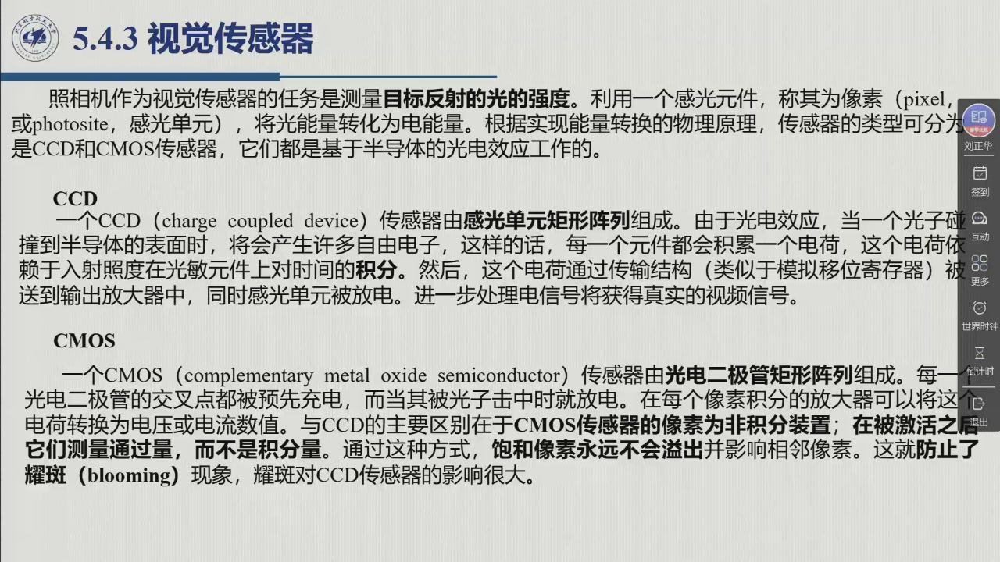
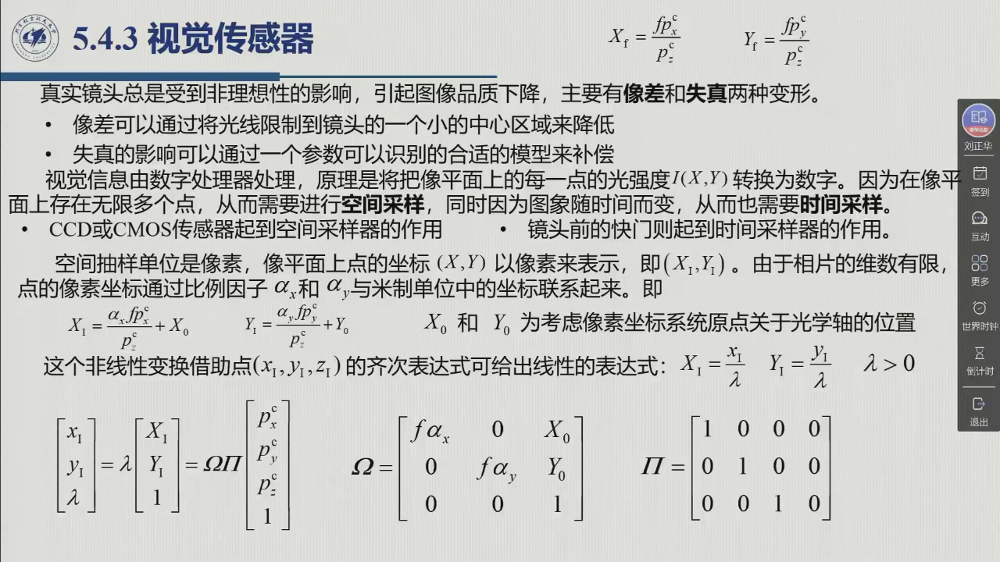

# 5.4.3 视觉传感器

相机给出的是二维图像。机器人若要用图像引导运动，需要知道三维点怎样投到像素上，以及这些像素能约束哪些空间信息。本节先说明图像如何获得，再沿一个点完成外参换坐标、透视除法与像素换算。课堂回看：02:22:15–02:28:11。

## 5.4.3.1 从光到电：像素、CCD 与 CMOS

::: def 定义 5.4.5 · 视觉传感器、像素与 CCD／CMOS 传感器 {#def-5.4.5}
感光阵列把场景的光分布转换为电信号。阵列中的感光单元称为像素（pixel/photosite）；在曝光时间内，它将光照转换为可读出的信号。CCD 和常见的 CMOS 图像传感器都可以积累光生电荷，不能用“积分与非积分”区分二者。

CCD 主要通过电荷转移结构把信号送往输出端；常见的有源像素 CMOS 在像素附近完成信号转换，并按行列组织读出。具体器件的放大器、模数转换器和读出通道安排不同，不能概括为每个 CMOS 像素都配一个 ADC。

| 比较项 | CCD | 常见有源像素 CMOS |
|:--|:--|:--|
| 曝光 | 积累光生电荷 | 同样可积累光生电荷 |
| 主要读出方式 | 转移电荷到输出端 | 像素附近转换信号，按行列读出 |
| 饱和影响 | 可能发生电荷溢出，需看防溢出设计 | 也有饱和及相关伪影，不能保证永不影响邻域 |

彩色成像可在像素上配置滤色阵列，也可用分光系统和多个传感器。芯片类型本身不决定相机只能输出单色。
:::

每次曝光都在一段时间内积累光。相机或物体若在此期间运动，读数便可能混合这段运动中的成像结果，不能一概视为精确瞬时测量。与关节读数联用时，还须对应两者的测量时间。

## 5.4.3.2 照相机：镜头、快门与视频信号

镜头把场景成像到感光面，曝光和读出电路将光信号转换为像素数值。空间采样产生有限大小的像素阵列，时间采样产生一帧帧图像；曝光时间与帧间隔是不同的量。

教材中的模拟视频采集卡、按行或隔行读出，属于特定历史接口示例。实际图像尺寸、帧率、局部读出和快门方式，应由所用接口确定；不能仅按CCD、CMOS名称推断前者必然输出模拟视频，或后者必然支持任意像素随机读取。

下面暂时忽略镜头畸变、运动模糊与读出时间差，建立理想针孔投影。这个几何模型与CCD、CMOS的读出电路是两个层次的问题。

## 5.4.3.3 相机模型：一个三维点怎么变成像素（作业 5.7 的公式）

### 先把点换到相机坐标系

设 $p^b$ 是基础系中的三维点，$p^c=(p_x^c,p_y^c,p_z^c)^{\mathrm T}$ 为同一点的相机坐标。用[齐次变换](../recall.md#homogeneous)写成

$$\begin{bmatrix}p^c\\1\end{bmatrix}=T_b^c\begin{bmatrix}p^b\\1\end{bmatrix}. \tag{5.35}$$

$T_b^c$ 把基础系分量变到相机系；若已知的是“相机在基础系中的位姿” $T_c^b$，应先取逆。两边都是四维齐次向量，不能把左侧只写成三维 $p^c$。

### 再用深度做透视除法

取相机光心为原点，$+z_c$ 朝前，虚拟像平面位于 $z_c=f$。空间点和投影点位于同一条过光心的直线上，由相似三角形，

$$\frac{X_f}{f}=\frac{p_x^c}{p_z^c},\qquad
\frac{Y_f}{f}=\frac{p_y^c}{p_z^c},$$

所以

$$X_f=\frac{fp_x^c}{p_z^c},\qquad Y_f=\frac{fp_y^c}{p_z^c}. \tag{5.36–5.37}$$

$X_f,Y_f,f,p^c$ 在这一步使用相容的长度单位。分母 $p_z^c$ 是深度；通常只投影 $p_z^c>0$ 的点。深度为零时公式无定义。若使用光心后方的真实倒像平面，坐标会带相应负号；本节统一使用前方虚拟平面，不在中途更换约定。

### 最后转换为像素

令 $\alpha_x,\alpha_y$ 为单位长度对应的像素数，主点像素坐标为 $(X_0,Y_0)$。在忽略像素轴倾斜的模型中，

$$X_I=\alpha_xX_f+X_0=\frac{f\alpha_xp_x^c}{p_z^c}+X_0, \tag{5.38}$$

$$Y_I=\alpha_yY_f+Y_0=\frac{f\alpha_yp_y^c}{p_z^c}+Y_0. \tag{5.39}$$

主点是光轴与像平面的交点，不一定等于图像数组原点，也不必恰好位于图像正中央。焦距若用mm，比例系数就须用pixel/mm；若改用m，也须同时换算比例系数。

用作业中的内参演示：$f=8$ mm，$\alpha_x=79.2$ pixel/mm，$\alpha_y=120.5$ pixel/mm，$X_0=Y_0=250$。另外选一个相机点 $p^c=(50,25,1000)^{\mathrm T}$ mm，则

$$X_f=8\frac{50}{1000}=0.4\ \mathrm{mm},\qquad Y_f=8\frac{25}{1000}=0.2\ \mathrm{mm},$$

$$X_I=79.2\times0.4+250=281.68,\qquad
Y_I=120.5\times0.2+250=274.10.$$

先检查投影点是否在图像范围内，再决定是否量化到整数像素。这个算例已经给出了相机坐标；若输入是基础系坐标，还必须先做外参变换。

### 矩阵写法仍然包含除法

定义无量纲归一化坐标 $X=p_x^c/p_z^c$、$Y=p_y^c/p_z^c$，内参矩阵和选取矩阵为

$$\Omega=\begin{bmatrix}f\alpha_x&0&X_0\\0&f\alpha_y&Y_0\\0&0&1\end{bmatrix},\qquad
\Pi=\begin{bmatrix}1&0&0&0\\0&1&0&0\\0&0&1&0\end{bmatrix}. \tag{5.41–5.42}$$

于是

$$\lambda\begin{bmatrix}X_I\\Y_I\\1\end{bmatrix}
=\Omega\Pi T_b^c\begin{bmatrix}p^b\\1\end{bmatrix},\qquad\lambda=p_z^c. \tag{5.40}$$

记 $\Xi=\Omega\Pi T_b^c$，便得到教材的整体投影矩阵(5.43)。矩阵乘法给出的是图像齐次坐标，除以第三个分量后才得到实际像素。因此齐次写法并未消除透视除法，也不表示原来的透视关系已经线性化。

相应地，教材 (5.44)–(5.45) 可写成

$$p_z^c\begin{bmatrix}X\\Y\\1\end{bmatrix}=\Pi\begin{bmatrix}p^c\\1\end{bmatrix},\qquad
\begin{bmatrix}X_I\\Y_I\\1\end{bmatrix}=\Omega\begin{bmatrix}X\\Y\\1\end{bmatrix}.$$

内参负责从归一化射线方向换到像素，外参负责坐标系间的相对位姿。实际还要标定畸变和其他必要参数；仅凭理想矩阵不能保证整幅图处处达到相同测量精度。

<figure>
<svg class="figure-svg" viewBox="0 0 900 430" xmlns="http://www.w3.org/2000/svg" role="img" aria-labelledby="fig-5433-t fig-5433-d">
<title id="fig-5433-t">相机模型：针孔几何（正面透视）与从三维点到像素的变换链</title>
<desc id="fig-5433-d">上半部分是侧视的针孔模型：左侧为目标 p 所在平面，中间为透镜中心与光学轴，透镜左侧是位于 z_c = f 的虚拟像平面，右侧是真实像平面；两条光线从目标顶端与底端经透镜中心射到像平面上，在虚拟像平面上交于 (X_f, Y_f)。下半部分是变换链：基础坐标系中的点 p 经外参数 T_b^c 变为相机坐标系中的 p^c，再经透视变换得到像平面的 X_f、Y_f，最后经内参数矩阵 Ω 变为像素坐标 X_I、Y_I，整体合成为相机校准矩阵 Ξ = Ω Π T_b^c。</desc>
<defs>
<marker id="f5433-a" markerWidth="9" markerHeight="9" refX="7" refY="3" orient="auto"><path d="M0,0 L7,3 L0,6 Z" fill="var(--muted)"/></marker>
</defs>
<text class="diagram-text" x="40" y="30">① 针孔几何：透视变换 = 相似三角形（侧视）</text>
<line x1="120" y1="180" x2="700" y2="180" stroke="var(--line-strong)" stroke-width="1.2" stroke-dasharray="6 5"/>
<text class="diagram-note" x="702" y="172">光学轴</text>
<ellipse cx="520" cy="180" rx="9" ry="44" fill="none" stroke="var(--fig-blue)" stroke-width="1.8"/>
<text class="diagram-note" x="520" y="248" text-anchor="middle">透镜中心</text>
<line x1="392" y1="92" x2="392" y2="268" stroke="var(--line-strong)" stroke-width="1.2" stroke-dasharray="5 4"/>
<text class="diagram-note" x="330" y="86">虚拟像平面 $z_c=f$</text>
<line x1="650" y1="80" x2="650" y2="282" stroke="var(--muted)" stroke-width="2"/>
<text class="diagram-note" x="662" y="76">真实像平面（像上下颠倒）</text>
<line x1="150" y1="120" x2="150" y2="240" stroke="var(--fig-gold)" stroke-width="2.4"/>
<text class="diagram-note" x="52" y="112">目标 $p$：$p^c=[p^c_x,p^c_y,p^c_z]^{\mathrm T}$</text>
<line x1="150" y1="120" x2="650" y2="201" stroke="var(--fig-blue)" stroke-width="1.2"/>
<line x1="150" y1="240" x2="650" y2="159" stroke="var(--fig-blue)" stroke-width="1.2"/>
<circle cx="392" cy="159" r="3.5" fill="var(--fig-gold)"/>
<circle cx="392" cy="201" r="3.5" fill="var(--fig-gold)"/>
<text class="diagram-note" x="404" y="212">$Y_f=fp^c_y/p^c_z$（正面透视，不变号）</text>
<line x1="522" y1="300" x2="648" y2="300" stroke="var(--muted)" stroke-width="1.4"/>
<line x1="522" y1="294" x2="522" y2="306" stroke="var(--muted)" stroke-width="1.4"/>
<line x1="648" y1="294" x2="648" y2="306" stroke="var(--muted)" stroke-width="1.4"/>
<text class="diagram-note" x="585" y="320" text-anchor="middle">焦距 $f$</text>
<text class="diagram-text" x="40" y="352">② 变换链</text>
<rect x="40" y="362" width="140" height="30" rx="6" fill="none" stroke="var(--line-strong)"/>
<text class="diagram-note" x="110" y="382" text-anchor="middle">$p$：基础坐标系</text>
<line x1="180" y1="377" x2="212" y2="377" stroke="var(--muted)" stroke-width="1.4" marker-end="url(#f5433-a)"/>
<rect x="214" y="362" width="176" height="30" rx="6" fill="none" stroke="var(--fig-blue)" stroke-width="1.6"/>
<text class="diagram-note" x="302" y="382" text-anchor="middle">$p^{c}=T_b^{c}p$（外参数）</text>
<line x1="390" y1="377" x2="422" y2="377" stroke="var(--muted)" stroke-width="1.4" marker-end="url(#f5433-a)"/>
<rect x="424" y="362" width="176" height="30" rx="6" fill="none" stroke="var(--line-strong)"/>
<text class="diagram-note" x="512" y="382" text-anchor="middle">$X_f,Y_f$（透视变换）</text>
<line x1="600" y1="377" x2="632" y2="377" stroke="var(--muted)" stroke-width="1.4" marker-end="url(#f5433-a)"/>
<rect x="634" y="362" width="236" height="30" rx="6" fill="none" stroke="var(--fig-gold)" stroke-width="1.6"/>
<text class="diagram-note" x="752" y="382" text-anchor="middle">$X_I,Y_I$（$\Omega$：内参数 $f\alpha_x,f\alpha_y,X_0,Y_0$）</text>
<text class="diagram-note" x="450" y="418" text-anchor="middle">合成：$\Xi=\Omega\Pi T_b^{c}$ —— 照相机校准矩阵（内参数 × 透视 × 外参数）</text>
</svg>
<figcaption>虚拟像平面位于光心前方，用相似三角形完成透视除法。外参数换坐标，内参数换像素尺度和主点；最后仍需除以齐次尺度才能得到像素。</figcaption>
</figure>

## 5.4.3.4 从低水平到高水平：这一串步骤站在哪一层

获取图像、滤波和提取边缘、角点，为后续算法提供图像与特征。识别目标、估计位姿和决定动作，还需任务模型与推理。教材用低层、高层区分这些职责，不能仅凭某个算法所属层次判断系统是否自主。

还必须分清投影与三维重建。若像素 $(X_I,Y_I)$ 和内参已知，反算只能得到射线

$$p^c=Z\begin{bmatrix}(X_I-X_0)/(f\alpha_x)\\(Y_I-Y_0)/(f\alpha_y)\\1\end{bmatrix},\qquad Z>0.$$

所有不同的 $Z$ 都投到同一像素。需要目标尺寸、已知平面、多视图或其他深度信息，才能进一步确定空间点。后续把视觉接入控制时，要明确实际使用的是像素误差、位姿估计还是深度测量，三者不是同一种输入。

::: think 检查理解
1. $T_c^b$ 与 $T_b^c$ 为什么不能在同一位置直接互换？
2. 把上面的相机点全部乘2，像素为什么不变？
3. 归一化坐标 $X,Y$、米制坐标 $X_f,Y_f$ 与像素坐标各是什么单位？
4. 整体投影矩阵已经乘完，为什么还要除以第三个分量？

::: sol 核对
两矩阵映射方向相反，互为逆。坐标同时缩放使透视比值不变，因此缺少深度时不能唯一反算三维点。归一化坐标无量纲，米制像平面用长度，像素坐标以pixel表示。齐次图像向量只规定比例，第三个分量提供恢复实际像素所需的尺度。
:::
:::
