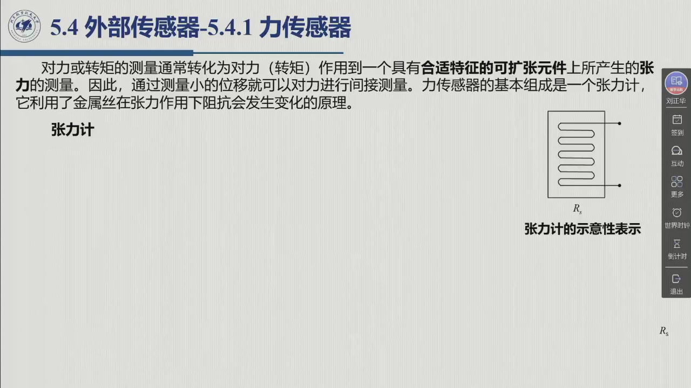

# 5.4 外部传感器

前面几节把「执行」这一半讲完了：能源 → 功放 → 伺服发动机 → 传动装置 → 关节，再由本体传感器（编码器、旋转变压器、转速计）把关节自己的位置和速度读回来，闭环就闭合了。但这个环**只包住了机器人自己的身体**。机械手真正要干的活——抓住杯子、拧紧螺栓、绕开工作台上的障碍——全都发生在**身体之外**，那里没有编码器。本节就讲这一半：**外部传感器（exteroceptive sensors）**测量的是什么量、它与本体传感器如何分工，以及力 / 距离 / 视觉这三类代表各自解决什么工程问题。录播 02:00:11–02:01:51。

::: def 定义 5.4.1 · 外部传感器 exteroceptive sensors {#def-5.4.1}
教材把机器人传感器一分为二（§5.3 末、§5.4 开场）：

| | **本体传感器** proprioceptive | **外部传感器** exteroceptive |
|:--|:--|:--|
| 测什么 | 机械手**内部状态变量**：关节位置、关节速度、关节力矩 | **周围环境**的信息，以及机器人与环境**交互**时产生的量 |
| 为什么需要 | 参数辨识与控制算法必须**在线测量**内部状态，才能产生「与任务规划相对应的机械结构协调运动」 | 提取**表征机器人与环境目标交互作用的特征**，以提高系统的自动化程度 |
| 典型成员 | 编码器、旋转变压器（位置）；转速计（速度） | **力传感器、触觉传感器、接近传感器、距离传感器、视觉传感器**；此外，声音、湿度、烟尘、压力、温度等特殊传感器也属这一类 |

一句话记法：**本体传感器闭环的是「我的身体」，外部传感器闭环的是「我与世界的关系」。** 前者保证指令被执行；后者保证执行得**对**——这就是「闭环到外部世界」的那一环。

**老师举的实例**（00:17:33–00:17:48、00:18:00）：外部传感器「可能有**激光雷达**，或者是**视觉传感器**，或者是**视频相机**；也包括比如说**触觉传感器**，还有就是**距离传感器**、**温度传感器**等等」——它们的共同点是**跟环境交互**；安装位置也不限于机器人本体：「可以有些装在机器人上，也可能装在空间上」。「因为外部传感器的目的呢，是**了解机器人周围环境的状态**，它是给控制系统提供一个参考」。

本章卷首语已把三类代表点明：**力传感器**测量末端执行器的力，**距离传感器**检测工作空间中的障碍物，**视觉传感器**在机械手与环境互动时测量相应目标的特征参数。
:::

::: note 外部传感器的使命：从「感知」到「执行」 {#note-5.4.1}
教材给外部传感器的定位不是「多装几个探头」，而是**自主性**：

> 外部传感器的基本功能是提供机器人以**自主方式**进行「智能」行为所需要的信息（教材 §5.4.2 开场）。

这条线索一路向上：多种可用传感器的**数据融合**可以用于（**高层**）任务规划，任务规划反过来把机器人表征为一个「**由感知到执行的智能联系**」（教材 §5.3 末）。也就是说，外部传感器这一层是机器人「智能」的最底层入口——先有环境信息，才谈得上决策。

老师 02:12:04 把这件事讲得很直白：「机器人要实现智能，它得了解环境的特征……它需要根据环境的特征来进行决策，而不是（由）人告诉它怎么走、怎么动。」
:::

## 5.4.1 力传感器

**它回答的问题**：「我的手现在**碰到了什么、用了多大力**？」一旦末端执行器与环境接触，关节的编码器就再也说不出接触面上发生了什么——那里需要专门的力觉。

**这一节里有什么**：

- **张力计（strain gauge）**：力 → 弹性体的**张力/应变** → 金属丝**电阻变化** → 惠斯通电桥的电压输出；温度补偿与灵敏度提升各靠「再加一个张力计」解决；
- **轴转矩传感器**：把中空转轴夹在马达与关节之间，用**低抗扭刚度 + 高抗弯刚度**的设计保证张力只由扭转产生；
- **腕力传感器**：在腕部连接外链与末端执行器，同时测**3 个力分量 + 3 个力矩分量**（六维）；「马耳他十字」结构用 8 个张力计的输出经**传感器校准矩阵**重构成 6 个分量；
- **坐标系问题**：测量值是相对**传感器坐标系**的，必须变换到第 9 章才会正式引入的**约束坐标系**才能用于力/运动控制算法。这条变换与 [3.8.2](../ch03/sec3-8.md#sec-3.8.2) 的速度/力对偶是同一套结构。

老师 02:00:25 说这一类「是非常比较常用的一种传感器，在机器人里面」，尤其「在跟环境交互上是比较常用的一种传感器」（02:05:38）。详见 [5.4.1 力传感器](sec5-4-1.md)。

## 5.4.2 距离传感器

**它回答的问题**：「在我**指定方向上、多远的地方**有东西？」这是机器人从「盲操作」走向「自主」的第一类外部信息。

**这一节里有什么**：

- **接近传感器**（proximity）是距离传感器的简化形式：不接触、只知道「敏感距离」内有没有目标；
- **声纳/超声**：用**传播时间**（time-of-flight）测距，$d_o=c_st_v/2$，音速随温度修正；成本低、重量轻、功耗低、计算量小，水下与低能见度环境下常常是**唯一可行**的方式；短板是盲区、波束角、镜面反射与多径；
- **激光**：两条技术路线——**传播时间法**（类同声纳，但有模糊时间间隔、单点测量、需扫描）与**三角测量法**（反射光斑落在 CCD 上的位置给出距离信号，工程上靠标定回避几何计算）；
- 量级对照：激光传播时间传感器测程 $5\sim100$ m、精度 $5\sim10$ mm、数据率 $1000\sim25000$ Hz。

老师 02:11:42 提醒「其实在**自动驾驶**上是比较多的」，而在机器人上则是「操作的平面需要距离传感器」（02:11:50）。详见 [5.4.2 距离传感器](sec5-4-2.md)。

## 5.4.3 视觉传感器

**它回答的问题**：「这是个**什么东西**、在什么位置、朝向如何？」——图像是信息量最大的一类外部测量。

**这一节里有什么**：

- **从图形信息到图像获取的一串步骤**：感光元件（**像素** pixel / photosite）把光能变成电能 → **CCD**（积分、串行转移、会耀斑）或 **CMOS**（非积分、每像素带放大器、不溢出）→ 快门/镜头/模拟预处理 → 视频标准与隔行扫描 → **帧捕捉器**与帧存储器；
- **相机模型**：基础坐标系 → （**外参数** $T_b^c$）→ 相机坐标系 → （**透视变换**、正面透视与虚拟像平面）→ 像平面米制坐标 → （**内参数** $\alpha_x,\alpha_y,X_0,Y_0,f$）→ **像素坐标**；合起来就是相机校准矩阵 $\Xi=\Omega\Pi T_b^c$；
- **标定**：内参数与外参数都要靠标定技术辨识出来，才能尽可能精确地在笛卡儿空间与像空间之间来回换算；作业 5.7 用的就是这一套公式；
- **处理层次的划分**：这一串步骤属于**低水平处理**（提取质心、亮度不连续这类基本特征）；真正自主还要求**高水平视觉**（例如从数据库中的 CAD 模型集合里识别出观测目标）。

老师 02:22:01 一句话概括：「视觉传感器呢，其实**就是照相机**」——「自然光照到物体上，感光，接受到相机，一般使用 CCD 或者 CMOS 相机成像」。他还提示这一块「到第十章的时候可能会涉及到」（02:28:30）。详见 [5.4.3 视觉传感器](sec5-4-3.md)。

::: think 考点 · 老师原话（录播时间点）

> **外部传感器有哪几类。** 「外部传感器，刚才提到**力传感器、距离传感器、视觉传感器**等等」（02:00:16）。

> **距离传感器的用武之地在自动驾驶。** 「（距离传感器）其实在**自动驾驶**上是比较多的，但是在机器人上其实也会用到一些，比如说机器人操作的平面，（也）是需要距离传感器」（02:11:42–02:11:50）。

> **为什么需要外部信息。** 「机器人要实现智能，它得**了解环境的特征**……它需要根据环境的特征来进行**决策**」（02:12:12）。

> **视觉就是照相机。** 「视觉传感器呢，其实就是**照相机**」（02:22:01）；「自然光照到物体上，感光，接受到相机，一般使用 CCD 或者 CMOS 相机成像」（02:22:08）。

> **视觉的内容留到第十章。** 「咱们到**第十章**的时候可能会涉及到这些内容」（02:28:30）——本节只建立模型与接口。
:::

::: think 默写点 · 合上书再写（主动回忆）

1. 本体传感器与外部传感器各自测量什么？各举三个典型成员。
2. 外部传感器的「基本功能」是什么？它如何一路连到（高层）任务规划？
3. 力 / 距离 / 视觉三类各回答一个什么问题（用一句话）？
4. 为什么说力传感器的测量值不能**直接**用于力/运动控制算法？

::: sol 核对

本体传感器测**机械手内部状态变量**（关节位置、速度、力矩），成员如编码器、旋转变压器、转速计；外部传感器提供**周围环境信息**与**交互量**，成员如力、触觉、接近、距离、视觉传感器（声音、湿度、烟尘、压力、温度等也属此类）。

基本功能是**提供机器人以自主方式进行「智能」行为所需要的信息**。多种传感器的**数据融合**可用于（高层）任务规划，而任务规划把机器人表征为「由感知到执行的智能联系」——所以它是智能的最底层入口。

力：碰到了什么、用了多大力（接触力/力矩）；距离：指定方向上多远有目标（避障、建图、识别）；视觉：是什么目标、在何处、姿态如何（目标特征参数）。

因为力传感器测到的是**作用在传感器坐标系上的等价力**，它与真正作用在末端执行器上的力不同；必须先把力从**传感器坐标系 $s$** 变换到**约束坐标系 $c$**（第 9 章），变换依赖两坐标系的相对位置与姿态，而这两个量只在末端执行器**静止**时才保持不变。

:::

:::

## 5.4 小结与常见错误

- **一条分界**：本体传感器测「自己」（关节位置/速度/力矩），外部传感器测「世界」与「交互」——力、触觉、接近、距离、视觉，另有声音/湿度/烟尘/压力/温度等特殊量。
- **一个目标**：提取表征机器人与环境目标交互作用的特征，供（高层）任务规划做数据融合；外部传感器是「从感知到执行」这条链的入口。
- **三块内容**：力（[5.4.1](sec5-4-1.md)，接触与六维力）、距离（[5.4.2](sec5-4-2.md)，声纳与激光）、视觉（[5.4.3](sec5-4-3.md)，成像、相机模型与标定）。

::: think 常见错误清单 · 自查三条
1. 把**力传感器**当成本体传感器——它测的是末端与**环境**的交互力，属外部传感器；本体侧的「关节力矩」是另一条链（电流/转矩估计）。
2. 以为外部传感器只是「多加几个探头」——教材的定位是**自主性**：没有外部信息，机器人的任务规划就无从谈起。
3. 以为测到了力就能直接用——力必须先从**传感器坐标系**变换到**约束坐标系**（§5.4.1、第 9 章），且变换参数只在末端**静止**时不变。
:::