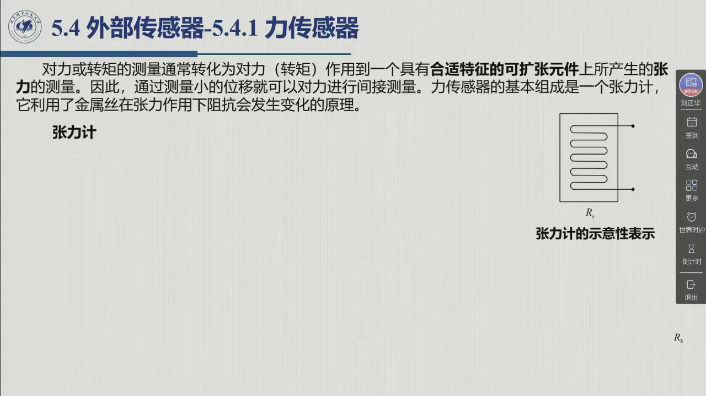

# 5.4 外部传感器

编码器能告诉控制器关节转到了哪里，但不能单独告诉它工件是否移位、工具是否碰到表面。外部传感器补充环境和交互信息，使任务能够依据实际场景调整。测到这些信息后，还要确认[坐标](../recall.md#rotation)、时间和[误差](../recall.md#sensor)，才能接入控制。课堂回看：02:00:11–02:01:51。

::: def 定义 5.4.1 · 外部传感器 exteroceptive sensors {#def-5.4.1}
外部传感器测量环境或机器人与环境的交互量，例如目标图像、距离、接触力和触觉。它可以装在机器人上，也可以固定在工作区；安装位置不决定分类。

本体与外部测量往往需要一起使用：关节位置确定相机或工具当前的位姿，图像或力测量再提供环境相关信息。两者都不能单独保证任务一定成功。
:::

::: intuition 动手实验 · 外部传感器的位置与视场（3D）
对腕力、距离和相机分别找出测量原点、测量方向及覆盖范围。再改变机械臂姿态，判断哪些测量轴随机器人移动，哪些环境对象保持不动。这些相对关系正是后面坐标换算的输入。

:::

::: note 从读数到任务信息 {#note-5.4.1}
读数本身不一定就是控制目标。力传感器可能输出电桥电压，测距器可能输出飞行时间，相机输出像素强度。控制器需要的却可能是接触力、目标距离或工件位姿。

中间还要经过标定、几何模型和必要的估计。每一步都带有条件，不能因为接上了传感器就认为已经获得准确的环境状态。
:::

## 5.4.1 力传感器

力传感器通常先把负载变成弹性体的微小变形，再把应变转成电信号。轴转矩传感器测量某一轴段传递的力矩；六维腕力传感器测量关于指定原点的三维合力和合力矩，两者不能互相代替。

[下一节](sec5-4-1.md)从应变片与电桥计算信号，再用标定矩阵恢复力分量。传感器原点与接触点不同时，力矩还要按力臂迁移；表达轴不同时，则要换基。所需变换是否恒定，取决于两系的相对安装关系，与机械臂整体是否运动无直接对应关系。

## 5.4.2 距离传感器

接近传感器主要判断指定范围内是否有目标；距离传感器还需要给出目标有多远。传播时间法把往返时间转换为距离，三角测量法则用已知光路几何和光斑位置求距离。

[§5.4.2](sec5-4-2.md)会分别检查盲区、反射方向、波束范围和时间分辨率。一束光或声波给出的测距结果只覆盖相应的观测方向，不能直接当成整个机器人周围的完整障碍物地图。

## 5.4.3 视觉传感器

相机把场景投影为二维图像。为了将图像特征与机器人位置联系起来，需要先把三维点换到相机坐标系，再做透视投影和像素换算。外参数描述相机与参考系的相对位姿，内参数描述相机成像与像素坐标之间的关系。

投影把三维点映到二维图像，通常会失去深度信息，因此一个像素不能在没有额外条件时唯一确定三维点。[§5.4.3](sec5-4-3.md)逐步计算三维点到像素的映射，说明深度为什么出现在分母，以及标定后的投影为何仍不能无条件反演。

::: think 检查理解
1. 为什么腕力、距离和相机不能只按安装在手腕上就归为同一种测量？
2. 机械臂移动时，工具和腕传感器之间的变换是否必然改变？
3. 相机内外参数已知，为什么一个像素通常仍不能唯一确定三维点？

::: sol 核对
三者的被测量和测量模型不同。若两个坐标系刚性固连，相对变换可保持恒定，尽管它们相对基座都在动。透视投影消除了沿视线的尺度，缺少深度或其他约束时，一个像素对应一条空间射线。
:::
:::
