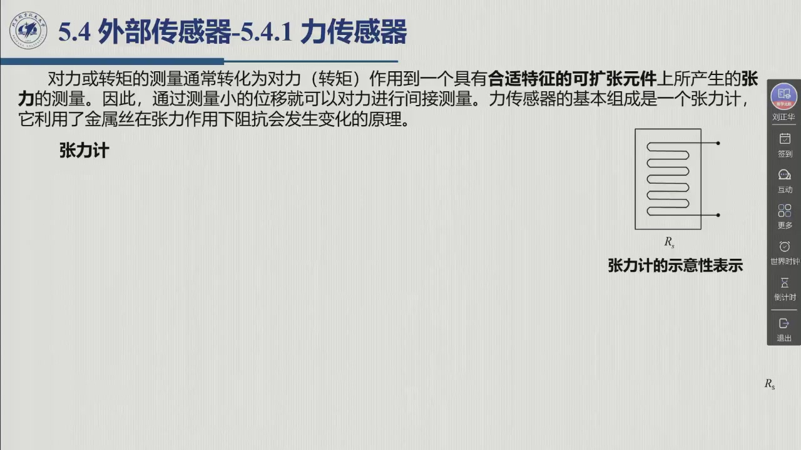

# 5.4 外部传感器

[§5.3](sec5-3.md) 到 [§5.3.2](sec5-3-2.md) 解决了“能量—驱动—传动—测量”链上的本体测量：编码器和转速计把关节自己转了多少、转得多快送回控制器。但这个反馈环只包住了机器人自己的关节；一旦要抓起移位的工件、拧紧螺栓或绕开工作台上的障碍物，单靠关节编码器就无从得知末端碰到了什么、用了多大力、目标在哪。本节转向链条中面向环境的这一端——外部传感器：说明它们提供什么信息、怎样和本体传感一起换算坐标，以及接下来力、距离、视觉三个小节各自解决什么工程问题。课堂回看：02:00:11–02:01:51（总述与定位同时参照 00:17:36–00:18:17 及 02:11:36–02:12:40）。

::: def 定义 5.4.1 · 外部传感器 exteroceptive sensors {#def-5.4.1}
外部传感器测量周围环境的状态以及机器人与环境交互的物理量，包括力传感器、触觉传感器、接近传感器、距离传感器和视觉传感器（声音、湿度、温度、烟尘、压力等专用传感器也属此类）。它可以装在机器人腕部或连杆上，也可以固定在工作空间里，分类取决于测什么而不是装在哪（00:17:36–00:18:17）。

本体感知与外部感知常须联合使用：关节角通过正运动学确定手腕或相机当前位姿，力、距离或图像测量再给出环境目标或接触力信息；把多源传感数据融合后送入高层规划，才构成“从感知到执行的自主联系”（02:12:04–02:12:35）。
:::

::: intuition 动手实验 · 外部传感器的位置与视场（3D）
对腕力、距离和相机分别找出测量原点、测量方向及覆盖范围。再改变机械臂姿态，判断哪些测量轴随机器人移动，哪些环境对象保持不动。这些相对关系正是后面坐标换算的输入。

:::

::: note 从读数到任务信息 {#note-5.4.1}
传感器的原始输出往往还不能直接当控制目标使用：力传感器输出电桥电压，激光脉冲测距输出往返时间，相机输出像素强度阵列；控制器要的却是接触力、障碍距离和三维目标位姿。中间必须经过器件标定、坐标系变换和几何或力学反演，每一步都要明确所用假设和有效区间。
:::

## 5.4.1 力传感器

当末端执行器与环境接触时，[§5.4.1](sec5-4-1.md) 先把负载转换成弹性体的微小应变和惠斯通电桥电压（串联轴转矩传感器测单轴力矩，六维腕力传感器用马耳他十字等弹性体和 $6\times8$ 标定矩阵恢复传感器坐标系下的三维合力与合力矩）。因为控制任务常在接触点或约束坐标系 $c$ 中指定，还须再用力与力矩坐标变换把读数从传感器系 $s$ 搬到 $c$（是否恒定取决于两系之间是否刚性固连，与机械臂整体是否运动无必然绑定）。

## 5.4.2 距离传感器

接近传感器判断是否已有物体进入敏感距离；距离传感器进一步给出距离和观测方位，服务于避障与环境建图（02:11:42–02:13:58）。[§5.4.2](sec5-4-2.md) 先算声纳与激光的飞行时间公式 $d=ct/2$（包括声纳音速温度修正、压电换能器的近距离盲区、临界角漏检与镜面多径虚检），再用相似三角形推导激光三角测量公式 $Z=fb/x_p$，说明一束波束只覆盖单个方向，成图需要扫描或多波束。

## 5.4.3 视觉传感器

相机提供信息最丰富的二维图像，也是第十章视觉伺服的基础（02:22:01–02:28:40）。[§5.4.3](sec5-4-3.md) 先区分 CCD 与 CMOS 传感器的曝光与读出差异，再把三维空间点 $p^b$ 依次经外参 $T_b^c$ 换到相机系、经正面透视除法投到像平面、经内参矩阵 $\Omega$ 换算成像素 $(X_I,Y_I)$。透视投影把同一条视线上的不同深度压到同一个像素上，因此仅靠标定矩阵本身不能在没有额外约束时唯一反推出三维深度。

::: think 检查理解
1. 为什么腕力、距离和相机不能只按安装在手腕上就归为同一种测量？
2. 机械臂移动时，工具和腕传感器之间的变换是否必然改变？
3. 相机内外参数已知，为什么一个像素通常仍不能唯一确定三维点？

::: sol 核对
1. 三者的被测量、物理原理和几何/力学模型完全不同。
2. 不必然。只要工具坐标系与传感器坐标系刚性固连，两系之间的相对变换就保持恒定，即使它们一起随机械臂运动。
3. 透视除法消去了一维尺度，缺少深度、目标尺寸或已知平面等附加约束时，一个像素对应空间中一整条射线。
:::
:::

## 5.4 小结与常见错误

外部传感器感知环境与交互量，补充本体关节测量的盲区，主要包含力、距离和视觉三类分支。原始读数都必须经过标定、坐标换算与误差条件核查，才能送入任务规划和控制律。

::: think 常见错误清单 · 自查三条
1. 把腕力传感器误认为本体传感器：虽然它装在机械手上，但测的是末端与环境交互的接触力与力矩。
2. 以为传感器接上就能直接输出控制量，跳过电信号标定、参考点迁移和坐标系变换。
3. 忽视单传感器视场与信息维度限制（如单束测距只看一条线、单目像素丢掉深度信息）。
:::
