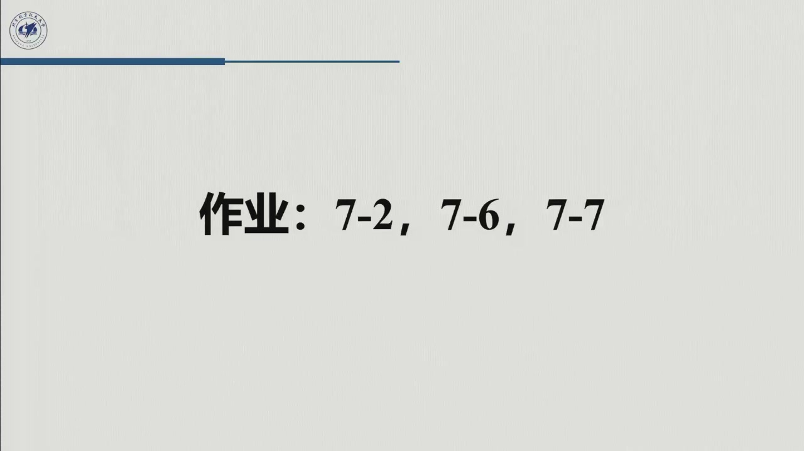

# 作业六：教材习题 7-2 / 7-6 / 7-7（附详细解答与验算）

> 课堂板书在最后 1 分钟留的作业：**7-2、7-6、7-7**（对应原书第 7 章）。
>
> 
> 三题分别练三件事：**$C$ 的不同选法与反对称性的两种陈述**（7-2）、**换广义坐标后动力学方程怎么变**
> （7-6）、**末端力经雅可比转置折算成关节力矩**（7-7）。三题都不需要新公式，只需要把
> [6.2.1](../ch06/sec6-2-1.md)、[6.3.2](../ch06/sec6-3-2.md) 的推导真正走一遍。

::: note 提交与评分
- **来源**：教材 Problems 7.2 / 7.6 / 7.7；课堂布置于 2026-10-19 第 7 周星期一第 3–5 节末。
- **提交**：智学北航 → 我的课 → 机器人控制技术 → **课程作业**（以平台实际条目与截止时间为准）。
- **评分**：每题按「建模 40% + 推导 40% + 结论/验算 20%」给分；只写答案不写中间步骤，最多 60%。
:::

## 习题 7-2：换一种 $C$，看看两条结论谁还成立

::: ex 题目
对 §7.3.2 的两连杆平面臂，证明：**取另一种满足式 (7.43) 的 $C$ 时，式 (7.49)
（$\dot{\boldsymbol q}^{\mathrm T}N\dot{\boldsymbol q}=0$）仍然成立，而式 (7.48)
（对任意 $\boldsymbol w$，$\boldsymbol w^{\mathrm T}N\boldsymbol w=0$）不成立**。
:::

### 解答

**第一步：取「直接」的 $C$。** 不把 $\partial b_{ij}/\partial q_k$ 对称化，直接令

$$c_{ij}=\sum_{k=1}^{2}h_{ijk}\dot q_k,\qquad
h_{ijk}=\frac{\partial b_{ij}}{\partial q_k}-\frac12\frac{\partial b_{jk}}{\partial q_i}.$$

对平面臂，$b_{11},b_{12}$ 只依赖 $\vartheta_2$，记 $h=-m_2a_1\ell_2s_2$，则

$$\frac{\partial b_{11}}{\partial\vartheta_2}=2h,\qquad
\frac{\partial b_{12}}{\partial\vartheta_2}=h,\qquad
\frac{\partial b_{22}}{\partial\vartheta_2}=0,\qquad
\frac{\partial b_{ij}}{\partial\vartheta_1}=0.$$

逐项算 $h_{ijk}$（$i$ 为行、$j$ 为列、$k$ 为求导变量）：

$$h_{112}=2h,\quad h_{122}=h,\quad h_{211}=-h,\quad h_{212}=\frac h2,\quad h_{221}=-\frac h2,$$

其余为零。于是

$$c_{11}=h_{111}\dot\vartheta_1+h_{112}\dot\vartheta_2=2h\dot\vartheta_2,\qquad
c_{12}=h_{121}\dot\vartheta_1+h_{122}\dot\vartheta_2=h\dot\vartheta_2,$$

$$c_{21}=h_{211}\dot\vartheta_1+h_{212}\dot\vartheta_2=-h\dot\vartheta_1+\frac h2\dot\vartheta_2,\qquad
c_{22}=h_{221}\dot\vartheta_1+h_{222}\dot\vartheta_2=-\frac h2\dot\vartheta_1.$$

所以

$$C_{\text{alt}}=\begin{bmatrix}
2h\dot\vartheta_2&h\dot\vartheta_2\\
-h\dot\vartheta_1+\dfrac h2\dot\vartheta_2&-\dfrac h2\dot\vartheta_1
\end{bmatrix}.$$

**验证它满足式 (7.43)**：

$$C_{\text{alt}}\dot{\boldsymbol q}
=\begin{bmatrix}
2h\dot\vartheta_1\dot\vartheta_2+h\dot\vartheta_2^2\\
-h\dot\vartheta_1^2+\dfrac h2\dot\vartheta_1\dot\vartheta_2-\dfrac h2\dot\vartheta_1\dot\vartheta_2
\end{bmatrix}
=\begin{bmatrix}
h(2\dot\vartheta_1\dot\vartheta_2+\dot\vartheta_2^2)\\
-h\dot\vartheta_1^2
\end{bmatrix},$$

与 Christoffel 选法的 $C\dot{\boldsymbol q}$ 完全一致——**$C\dot q$ 唯一，$C$ 不唯一**。

**第二步：算 $N=\dot B-2C_{\text{alt}}$。**

$$\dot B=\begin{bmatrix}2h\dot\vartheta_2&h\dot\vartheta_2\\h\dot\vartheta_2&0\end{bmatrix},$$

$$N=\begin{bmatrix}
2h\dot\vartheta_2-4h\dot\vartheta_2&h\dot\vartheta_2-2h\dot\vartheta_2\\
h\dot\vartheta_2+2h\dot\vartheta_1-h\dot\vartheta_2&0+h\dot\vartheta_1
\end{bmatrix}
=\begin{bmatrix}
-2h\dot\vartheta_2&-h\dot\vartheta_2\\
2h\dot\vartheta_1&h\dot\vartheta_1
\end{bmatrix}.$$

它**不是反对称的**：$N_{12}=-h\dot\vartheta_2$，而 $-N_{21}=-2h\dot\vartheta_1$，一般不相等。
取 $\boldsymbol w=[1,0]^{\mathrm T}$，则

$$\boldsymbol w^{\mathrm T}N\boldsymbol w=N_{11}=-2h\dot\vartheta_2\neq0\ (\text{当}\ \dot\vartheta_2\neq0),$$

所以式 (7.48) 不成立。

**第三步：验证式 (7.49)。**

$$\dot{\boldsymbol q}^{\mathrm T}N\dot{\boldsymbol q}
=\begin{bmatrix}\dot\vartheta_1&\dot\vartheta_2\end{bmatrix}
\begin{bmatrix}-2h\dot\vartheta_2&-h\dot\vartheta_2\\2h\dot\vartheta_1&h\dot\vartheta_1\end{bmatrix}
\begin{bmatrix}\dot\vartheta_1\\\dot\vartheta_2\end{bmatrix}.$$

先算 $N\dot{\boldsymbol q}$：

$$N\dot{\boldsymbol q}
=\begin{bmatrix}
-2h\dot\vartheta_2\dot\vartheta_1-h\dot\vartheta_2^2\\
2h\dot\vartheta_1^2+h\dot\vartheta_1\dot\vartheta_2
\end{bmatrix}.$$

再左乘 $\dot{\boldsymbol q}^{\mathrm T}$：

$$\dot{\boldsymbol q}^{\mathrm T}N\dot{\boldsymbol q}
=-2h\dot\vartheta_1^2\dot\vartheta_2-h\dot\vartheta_1\dot\vartheta_2^2
+2h\dot\vartheta_1^2\dot\vartheta_2+h\dot\vartheta_1\dot\vartheta_2^2=0.$$

$\blacksquare$

### 结论与启示

| 陈述 | Christoffel 的 $C$ | 另一种 $C$ | 原因 |
|:--|:--|:--|:--|
| $\dot q^{\mathrm T}N\dot q=0$（式 7.49） | ✅ | ✅ | 能量守恒，对任意 $C$ 成立 |
| $w^{\mathrm T}Nw=0$ 对任意 $w$（式 7.48） | ✅ | ❌ | 只有 Christoffel 选法使 $N$ 真正反对称 |

**一句话**：**式 (7.49) 是物理的，式 (7.48) 是选法的**。做题时先看清题目问的是哪一个；若只验证了
$\dot q^{\mathrm T}N\dot q=0$ 就说「$N$ 反对称」，是把两个命题混为一谈。

::: think 自评标准
- 能写出另一种 $C$ 并验证 $C\dot q$ 与标准 $C$ 一致（40%）；
- 能算出 $N$ 并指出 $N_{12}\neq-N_{21}$，举出具体的 $w$（40%）；
- 能展开 $\dot q^{\mathrm T}N\dot q$ 并说明它恒为零（20%）。
:::

## 习题 7-6：换绝对角作广义坐标

::: ex 题目
对图 7.4 的两连杆平面臂，取**相对基座的绝对角** $x_1,x_2$ 为广义坐标，用拉格朗日法求动力学模型，
并与式 (7.82)（相对角 $\vartheta_1,\vartheta_2$ 的模型）比较。
:::

### 解答

**坐标变换**：

$$x_1=\vartheta_1,\qquad x_2=\vartheta_1+\vartheta_2
\qquad\Longleftrightarrow\qquad
\vartheta_1=x_1,\quad \vartheta_2=x_2-x_1.$$

速度层面：

$$\dot{\boldsymbol x}=\begin{bmatrix}\dot x_1\\\dot x_2\end{bmatrix}
=\begin{bmatrix}1&0\\1&1\end{bmatrix}\begin{bmatrix}\dot\vartheta_1\\\dot\vartheta_2\end{bmatrix}
=J_A\dot{\boldsymbol q},\qquad J_A=\begin{bmatrix}1&0\\1&1\end{bmatrix},\quad
J_A^{-1}=\begin{bmatrix}1&0\\-1&1\end{bmatrix}.$$

$J_A$ 恒非奇异（$\det J_A=1$），所以绝对角是一组合法的广义坐标。

**惯性矩阵**（用 $B_A=J_A^{-\mathrm T}BJ_A^{-1}$，或直接把 $T$ 用 $x$ 重写）：

$$B_A=\begin{bmatrix}b_{A11}&b_{A12}\\b_{A12}&b_{A22}\end{bmatrix},$$

$$b_{A11}=b_{11}+b_{22}-2b_{12}
=I_1+m_1\ell_1^2+k_{r_1}^2I_{m_1}+m_2a_1^2+(1-k_{r_2})^2I_{m_2}+m_{m_2}a_1^2,$$

$$b_{A12}=b_{12}-b_{22}
=m_2a_1\ell_2\cos(x_2-x_1)+k_{r_2}(1-k_{r_2})I_{m_2},$$

$$b_{A22}=b_{22}=I_2+m_2\ell_2^2+k_{r_2}^2I_{m_2}.$$

**两个可读的结论**：

1. **对角元与位形无关**：$b_{A11}$ 里没有 $x_2-x_1$，$b_{A22}$ 是常数——换成绝对角后，
   「每个连杆绕自己关节的惯量」不再随另一关节的角度变。
2. **转子 2 的交叉项变了**：$b_{A12}$ 里出现 $k_{r_2}(1-k_{r_2})I_{m_2}$，而不是 $k_{r_2}I_{m_2}$。
   若 $k_{r_2}=1$（直驱），这一项为零；但 $b_{A22}$ 仍含 $k_{r_2}^2I_{m_2}=I_{m_2}$，不会消失。

**速度项**：对 $B_A$ 用 Christoffel 符号（只有 $b_{A12}$ 依赖 $x_2-x_1$），记

$$h=-m_2a_1\ell_2\sin(x_2-x_1),$$

则

$$C_A\dot{\boldsymbol x}=\begin{bmatrix}h\dot x_2^2\\-h\dot x_1^2\end{bmatrix}.$$

**关键观察**：**没有 $\dot x_1\dot x_2$ 的科氏项**！原因是绝对角下连杆 2 的转动是相对基座描述的，
与连杆 1 的转动无关——两个角速度在运动学上「解耦」，交叉项自然消失。

**重力项**：

$$\boldsymbol g_A=\begin{bmatrix}
(m_1\ell_1+m_{m_2}a_1+m_2a_1)g\cos x_1\\
m_2\ell_2g\cos x_2
\end{bmatrix}.$$

**完整方程**：

$$B_A\ddot{\boldsymbol x}+C_A\dot{\boldsymbol x}+\boldsymbol g_A=\boldsymbol\tau_A.$$

### 与相对角模型的比较

| 项 | 相对角 $\vartheta$ | 绝对角 $x$ |
|:--|:--|:--|
| $B$ 的对角元 | $b_{11}$ 依赖 $\vartheta_2$，$b_{22}$ 常数 | $b_{A11},b_{A22}$ **都与位形无关** |
| $B$ 的非对角元 | $m_2a_1\ell_2c_2+k_{r_2}I_{m_2}$ | $m_2a_1\ell_2\cos(x_2-x_1)+k_{r_2}(1-k_{r_2})I_{m_2}$ |
| 速度项 | 含 $\dot\vartheta_1\dot\vartheta_2$ 与 $\dot\vartheta_2^2$、$\dot\vartheta_1^2$ | 只有 $\dot x_2^2$、$\dot x_1^2$，**无科氏交叉项** |
| 重力项 | $g_1$ 含 $c_1,c_{12}$；$g_2$ 含 $c_{12}$ | $g_{A1}$ 只含 $c_1$；$g_{A2}$ 只含 $c_2$ |

**物理解释**：绝对角把「连杆 2 的转动」从「相对连杆 1 的转动」改成了「相对基座的转动」，
于是 $B_A$ 的对角元变成两个**各自独立的惯量**，交叉耦合只剩「关节 2 轴随连杆 1 平移」这一部分
（$b_{A12}$ 的 $\cos(x_2-x_1)$ 项）。这也解释了为什么绝对角在某些控制方案里更好用：
**对角元常数 ⇒ 惯量估计更简单**。

::: think 自评标准
- 写出 $x$ 与 $\vartheta$ 的变换及 $J_A$（20%）；
- 正确算出 $B_A$ 的三个元素（40%）；
- 算出 $C_A\dot x$ 并指出无科氏项（25%）；
- 写出 $g_A$ 并与相对角模型逐项对比（15%）。
:::

## 习题 7-7：末端力折成关节力矩

::: ex 题目
对图 7.4 的两连杆平面臂，用例 7.2 的数据与轨迹，求末端施加 $\boldsymbol f=[500,500]^{\mathrm T}\ \mathrm N$
时两关节所需的力矩。
:::

### 解答

**第一步：末端力如何进方程。** 由式 (7.42)，

$$B\ddot{\boldsymbol q}+C\dot{\boldsymbol q}+\boldsymbol g=\boldsymbol\tau-J^{\mathrm T}\boldsymbol h_e.$$

这里 $\boldsymbol h_e$ 是**末端执行器作用在环境上的力**。若机器人要对外施加 $\boldsymbol f$，
执行器必须额外提供 $\boldsymbol\tau_f=J^{\mathrm T}\boldsymbol f$：

$$\boldsymbol\tau=B\ddot{\boldsymbol q}+C\dot{\boldsymbol q}+\boldsymbol g+J^{\mathrm T}\boldsymbol f.$$

**第二步：写雅可比。** 平面臂末端的平动雅可比（2×2，只取位置）：

$$J(\boldsymbol q)=\begin{bmatrix}
-a_1s_1-a_2s_{12}&-a_2s_{12}\\
a_1c_1+a_2c_{12}&a_2c_{12}
\end{bmatrix}.$$

于是

$$J^{\mathrm T}\boldsymbol f
=\begin{bmatrix}
-a_1s_1-a_2s_{12}&a_1c_1+a_2c_{12}\\
-a_2s_{12}&a_2c_{12}
\end{bmatrix}
\begin{bmatrix}500\\500\end{bmatrix}
=500\begin{bmatrix}
-(a_1s_1+a_2s_{12})+(a_1c_1+a_2c_{12})\\
a_2(c_{12}-s_{12})
\end{bmatrix}.$$

**第三步：代入例 7.2 的数据与轨迹。** 数据：

$$a_1=a_2=1,\ \ell_1=\ell_2=0.5,\ m_1=m_2=50,\ I_1=I_2=10,\ k_{r_1}=k_{r_2}=100,\
m_{m_1}=m_{m_2}=5,\ I_{m_1}=I_{m_2}=0.01.$$

初始位形：末端 $(0.2,0)$ m、肘下垂 $\Rightarrow q_1\approx1.4706$ rad，$q_2\approx-2.9413$ rad；
两关节各转 $\pi/2$、用时 $0.5$ s、三角形速度曲线（前半程 $+\ddot q$，后半程 $-\ddot q$，
$|\ddot q|=4\Delta q/T^2=4\cdot(\pi/2)/0.25\approx25.13\ \mathrm{rad/s^2}$）。

用上面的 $B,C,g$ 与 $J^{\mathrm T}f$ 逐点计算，得到（$\tau$ 为不施力，$\tau_f$ 为施力 $[500,500]^{\mathrm T}$ N）：

| $t$ / s | $q_1$ / rad | $q_2$ / rad | $\tau_1$ / N·m | $\tau_2$ / N·m | $\tau_{f1}$ / N·m | $\tau_{f2}$ / N·m |
|--:|--:|--:|--:|--:|--:|--:|
| 0.000 | 1.4706 | −2.9413 | 3873.2 | 3078.2 | 3973.2 | 3625.7 |
| 0.125 | 1.6670 | −2.7449 | 4205.5 | 3110.6 | 4336.9 | 3787.6 |
| 0.250 | 2.2560 | −2.1559 | −2360.7 | −3901.2 | −2616.7 | −3453.7 |
| 0.375 | 2.8451 | −1.5668 | −5564.5 | −3847.9 | −6523.4 | −4182.5 |
| 0.500 | 3.0414 | −1.3705 | −6797.9 | −3818.9 | −7892.9 | −4366.4 |

> 表中的数由 `tools/verify_homework06.py` 复算（$g=9.81$，重力沿 $-y$）。$t=0.25$ s 处
> 加速度由 $+$ 变 $-$，力矩出现跳变，这是三角形速度曲线的固有特性，不是算错。

**第四步：读表。**

1. **末端力主要改变关节 1 的力矩**：$J^{\mathrm T}f$ 的第一分量含 $a_1$ 的力臂，量级几百 N·m；
   第二分量只与 $a_2(c_{12}-s_{12})$ 有关，量级也在几百 N·m。
2. **符号随位形翻转**：$t=0$ 时 $J^{\mathrm T}f\approx[100,548]^{\mathrm T}$，$t=0.5$ 时约
   $[-1095,-548]^{\mathrm T}$——同一个方向的末端力，在不同位形下对关节的作用方向可以相反。
3. **不能把末端力当常数加到关节上**：必须每步用当前 $q$ 重算 $J^{\mathrm T}$。

::: think 自评标准
- 写出带 $J^{\mathrm T}h_e$ 的方程并说明符号（30%）；
- 写出 $J$ 与 $J^{\mathrm T}f$ 的解析式（30%）；
- 至少算出两个时刻的数值并解释符号变化（40%）。
:::

## 三题的共同点

| 题 | 考什么 | 最容易错的地方 |
|:--|:--|:--|
| 7-2 | $C$ 不唯一；两条反对称陈述的区别 | 把 $\dot q^{\mathrm T}N\dot q=0$ 当成 $N$ 反对称 |
| 7-6 | 换广义坐标；$B_A=J_A^{-\mathrm T}BJ_A^{-1}$ | 把 $J_A$ 与 $J_A^{-1}$ 乘反；漏掉 $k_{r_2}(1-k_{r_2})I_{m_2}$ |
| 7-7 | 末端力经 $J^{\mathrm T}$ 折算 | 符号（$h_e$ 是末端对环境还是环境对末端）；忘记 $J$ 随位形变 |

::: think 交卷前自查
1. 7-2 是否**同时**给出了「式 (7.49) 成立」与「式 (7.48) 不成立」两个结论，并各给了理由？
2. 7-6 是否把 $B_A$ 的三个元素都写全，并指出「无科氏项」？
3. 7-7 是否写清了 $\boldsymbol f$ 的方向约定，并用当前位形算 $J^{\mathrm T}$？
4. 三题的公式是否与 [6.2.1](../ch06/sec6-2-1.md)、[6.3.2](../ch06/sec6-3-2.md) 的记号一致？
:::
