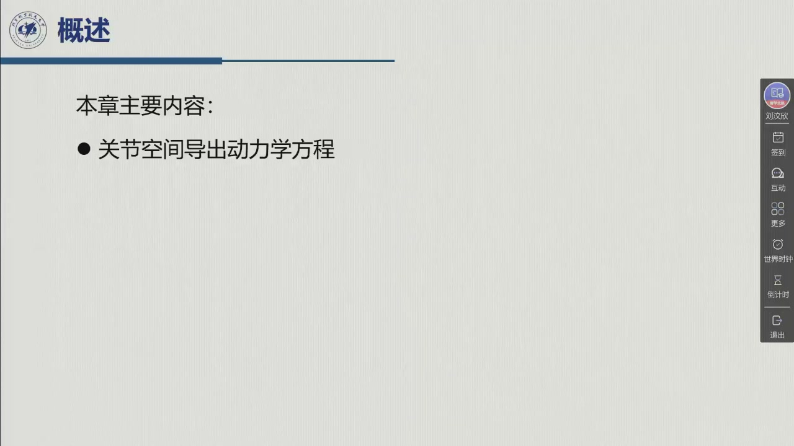

# 第六章 · 动力学

> **核心问题**：给定位置、速度和加速度需求 $\boldsymbol q,\dot{\boldsymbol q},\ddot{\boldsymbol q}$ 以及末端与环境的接触广义力 $\boldsymbol h_e$，执行器需要提供多大的驱动力或力矩 $\boldsymbol\tau$？反过来，已知 $\boldsymbol\tau(t)$ 时系统怎样运动？

第二章到第四章回答了“机械臂在哪、动多快、沿什么轨迹走”；第五章给出了执行器折算惯量、粘滞摩擦和传感器读数接口。本章在这些几何与驱动基础之上建立**动力学模型**（对应原书第 7 章）：先把物理规律写成闭合的微分方程，再导出它在控制设计、参数辨识、递推计算与任务空间转换中的标准用法。

::: note 章号说明（与原书对照）
原书第 6 章为控制架构，本教程按授课顺序将该部分编入[第七章](../ch07/overview.md)与后续控制章节，因此**本教程第六章对应原书第 7 章**（式号引用均沿用原书第 7 章编号）。
:::


## 先看一个直觉检验：放慢动作一定能举住吗？

把两连杆平面机械臂放到竖直平面内，取每根杆长 $1\,\mathrm m$、质量 $1\,\mathrm{kg}$，摆到第一杆水平、第二杆竖直向上的位形 $q_A=(0,\pi/2)$。如果第一关节驱动电机在关节侧最多只能输出 $12\,\mathrm{N\cdot m}$：

1. 静止悬停在 $q_A$ 时，第一关节需要托起两杆重力（力臂分别为 $0.5\,\mathrm m$ 与 $1\,\mathrm m$），静态重力补偿就达 $14.715\,\mathrm{N\cdot m}$——只把运动放慢甚至完全停住，依然无法保持。
2. 如果在 $q_A$ 让第一关节产生 $\ddot q_1=1\,\mathrm{rad/s^2}$ 而第二关节保持 $\ddot q_2=0$，第二关节需要输出零力矩吗？并不需要为零：第一杆的角加速度会通过惯性耦合项 $b_{21}\ddot q_1=\frac13\,\mathrm{N\cdot m}$ 传到第二关节。

要系统回答这类耦合、惯性与重力账单，需要把“力和运动的关系”写成明确的数学模型。学完 [6.1.3 势能](sec6-1.md#part-6.1.2)、[6.1.4 运动方程](sec6-1.md#part-6.1.3) 与 [6.3.2 两连杆平面臂](sec6-3.md#part-6.3.2) 后，可在[两连杆第七关](../training/two-link.md#mission-load)完成完整数值核算。



## 全章结构与两条建模路线

```text
路线一：拉格朗日法（能量视角，解析建模与控制设计）
  广义坐标 q → 动能 T = ½ q̇ᵀ B(q) q̇ 与势能 U(q)（6.1）
             → 运动方程 B(q)q̈ + C(q,q̇)q̇ + F_v q̇ + F_s sgn(q̇) + g(q) = τ − Jᵀh_e
             → 两条结构性质（6.2）：Ḃ − 2C 反对称、τ = Y(q,q̇,q̈)π 参数线性
             → 两个基准算例（6.3）：正交笛卡儿臂（解耦） vs 平面 2R 臂（强耦合）

路线二：牛顿–欧拉法（受力递推，O(n) 实时计算）
  单连杆动量/动量矩平衡 → 前向递推运动量（i = 1→n）→ 后向递推力与力矩（i = n→1）（6.4）

工程转化（6.5–6.7）
  正解（数值积分仿真）与逆解（前馈力矩校验）（6.5）
  动态时间标度（超限时重排时间律）（6.6，选学）
  操作空间动力学（末端空间有效惯量与冗余零空间）（6.7，选学）
```

## 本章导航与学习权重

| 节 | 核心内容 | 掌握要求 |
|:--|:--|:--|
| [6.1 拉格朗日公式](sec6-1.md) | 虚功消去约束力；动能矩阵 $B(\boldsymbol q)$、势能梯度 $\boldsymbol g(\boldsymbol q)$、运动方程与符号约定 | **核心必考** |
| [6.2 动力学结构性质](sec6-2.md) | $C$ 的非唯一性与 $\dot B-2C$ 反对称性（稳定性质）；扩展连杆法与 $\boldsymbol\tau=Y\boldsymbol\pi$ 线性回归（辨识基础） | **核心必考** |
| [6.3 两连杆动力学算例](sec6-3.md) | 正交 PR 笛卡儿臂解耦条件；平面 2R 臂完整 $B,C,\boldsymbol g$ 手算与 8 参数线性化 | **核心必考** |
| [6.4 牛顿–欧拉递推](sec6-4.md) | 单连杆牛顿/欧拉方程与转子角动量耦合；$O(n)$ 两遍递推算法与虚拟基座重力吸收 | **重点掌握** |
| [6.5 动力学正解与逆解](sec6-5.md) | 正解 $\ddot{\boldsymbol q}=B^{-1}(\boldsymbol\tau-\boldsymbol\tau')$ 积分流程、逆解递推与 $B(\boldsymbol q)$ 列采样法、复杂度口径 | **重点掌握** |
| [6.6 轨迹的动态标度](sec6-6.md) | 时间重参数化 $\boldsymbol q(t)=\bar{\boldsymbol q}(r(t))$、线性标度 $1/T^2$ 定律与重力不缩减反例 | 选学·精简 |
| [6.7 操作空间动力学模型](sec6-7.md) | 几何与分析雅可比转换、操作空间惯量 $B_A=(J_AB^{-1}J_A^{\mathrm T})^{-1}$、伪动能与冗余边界 | 选学·精简 |

**配套练习与核验**：[作业六（7-2, 7-6, 7-7）](homework06.md)、[作业六·补（7-8, 7-10）](homework06b.md)、[习题集](exercises.md)、[自检表](checklist.md)、[回忆卡](recall-cards.md)、[自测卷](mock-exam.md)。

::: note 为什么学习显式物理模型？
在数据驱动或学习控制中，显式刚体动力学仍承担先验骨架、安全边界与混合模型 $\dot{\boldsymbol x}=\boldsymbol f_{\mathrm{physics}}(\boldsymbol x,\boldsymbol u)+\boldsymbol f_{\mathrm{learned}}(\boldsymbol x,\boldsymbol u)$ 的物理基准。第 7 章（运动控制）的重力补偿、计算力矩前馈以及自适应控制均直接建立在本章的 $B,C,\boldsymbol g$ 与 $\boldsymbol\tau=Y\boldsymbol\pi$ 之上。
:::
