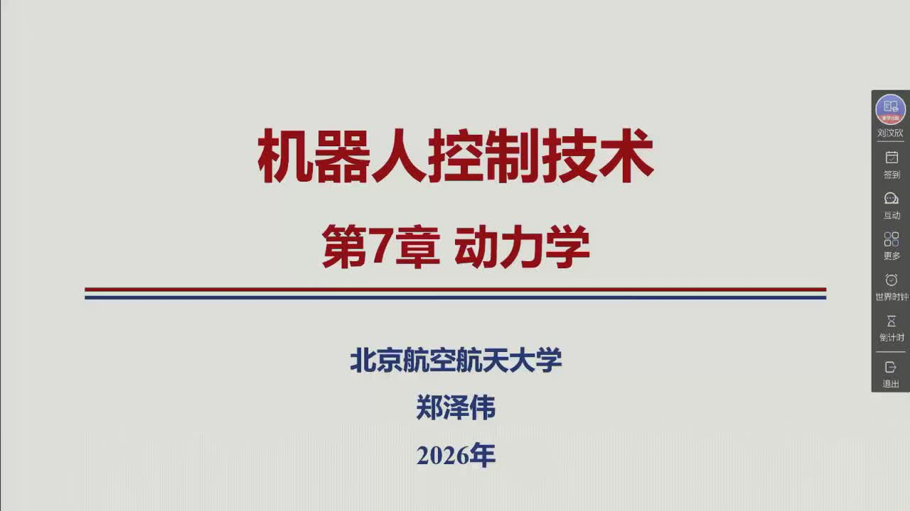
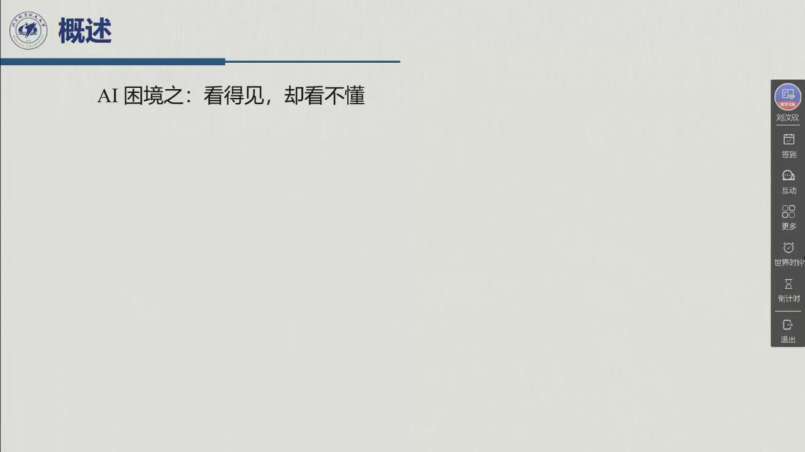
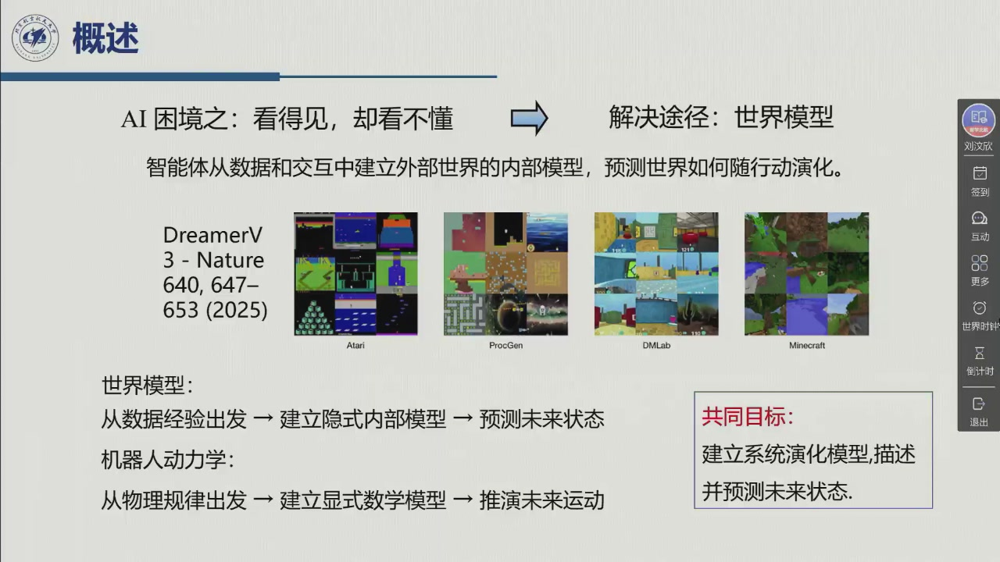
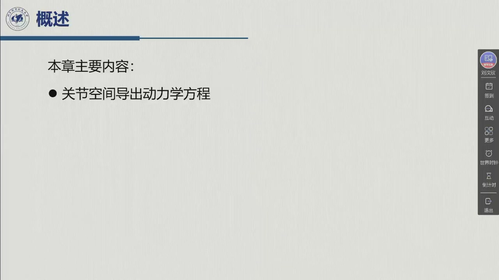

# 第六章 · 动力学

## 放慢以后，能不能举住？

把两连杆机械臂放在竖直平面内，给每根杆加上质量。第一杆水平、第二杆竖直时，两个关节是否都需要抗重力？如果电机太弱，把运动放慢能否解决？可以先用第三章学过的力臂作出判断。

读 [6.1.2 势能](sec6-1-2.md)，用质心高度算保持力矩，再与力臂计算比较；随后读 [6.1.3 运动方程](sec6-1-3.md)和 [6.3.2 两连杆模型](sec6-3-2.md)，加入惯性与速度相关项。

[两连杆第七关](../training/two-link.md#mission-load)要求分别计算静止与加速时的力矩。做完后解释：第二关节没有加速度，为什么仍可能需要驱动力矩？下次换一个姿势重算重力项。第七章则会讨论实际质量与模型不一致时，怎样根据偏差修正运动。

## 本章范围与来源

> **对应原书第 7 章**。本章由第 7、8 周两次课讲完（2026-10-19、2026-10-26，各 2:29:00，学院路校区 B-228），
> 覆盖原书 §7.1–§7.8：拉格朗日公式与运动方程、两条结构性质、两个两连杆算例（§7.1–§7.3，第 7 周），
> 牛顿–欧拉递推、动力学正解与逆解、轨迹的动态标度、操作空间动力学模型（§7.4–§7.8，第 8 周）。
> 前五章给出了位置、速度、路径以及驱动与测量接口。本章进一步计算实现这些运动所需的力和力矩，为第七章的模型前馈、反馈补偿和参数估计提供依据。


::: note 章号说明（本书与原书在此错位）
原书第 6 章是「控制架构」，本课程本学期的录播**没有覆盖**（第 6 周讲第 5 章，第 7 周直接进第 7 章）；
因此本书把动力学编为**第六章**，并在所有交叉引用里注明「原书第 7 章」。**本书第六章 = 原书第 7 章**，
不要按书号去找原书第 6 章。
:::

## 本编信息（录播）

::: note 素材与生成方式
- **两讲录播**：
  - 第 7 周（2026-10-19 09:50–12:15）§7.1–§7.3；`sub_id=5883742`，平台课件 259 帧，精选 25 幅；
    平台语音转写未生成，whisper 2442 句（未校对）。
  - 第 8 周（2026-10-26 09:50–12:15）§7.4–§7.8，**01:55:58 起转入第八章运动控制**（本书第七章）；
    `sub_id=5890058`，平台课件 214 帧、板书帧 298 帧（30 s/帧），平台 ASR 3069 句。
    该讲教师流音轨约 2:22:39 之后不可解码，whisper 只覆盖 0–02:21:23，末尾按平台 ASR + 板书整理。
- **主讲**：课件封面署名**郑泽伟**（课表任课教师为刘正华）。第 7 周开场他说明：后半门课由他讲五次，
  内容从动力学到控制。
- **教材**：Siciliano 等《Robotics: Modelling, Planning and Control》第 7 章（中文版第 7 章），
  本编公式编号（7.1）–（7.84）沿用英文原版，便于逐条对照。
:::



## 为什么要学动力学：从「看得见」到「算得出」

老师在正式讲公式前，用一组「AI 困境」的幻灯片做了动机铺垫（00:16:38–00:21:47）：

- **AI 困境：看得见，却看不懂**——视频模型能生成很逼真的画面，但不知道物体为什么会那样动；
- **解决途径：世界模型**——智能体从数据和交互中建立外部世界的内部模型，预测世界如何随行动演化
  （幻灯片举了 DreamerV3、Nature 640, 647–653 (2025) 等例子）；
- **机器人动力学的定位**——「世界模型：从数据经验出发，建立隐式内部模型，预测未来状态；
  **机器人动力学：从物理规律出发，建立显式数学模型，推演未来运动**」；
- **混合动力学模型**——$\dot x=f_{\text{physics}}(x,u)+f_{\text{learned}}(x,u)$，
  「动力学先验 × 数据 AI 学习」，是当前机器人学习的一个活跃方向。







课件将数据得到的隐式模型与物理规律得到的显式模型并列，讨论二者的分工。本章从后者入手，学习用拉格朗日方程构造可计算、可核验的机械臂模型。

::: note 正动力学与逆动力学（老师用一张幻灯片把两个问题分开）
- **正动力学问题（forward dynamics）**：给定力/力矩，求机器人的运动。要解**非线性微分方程组**，
  一般没有闭式解，只能数值积分——「求解困难」。
- **逆动力学问题（inverse dynamics）**：已知机器人的运动（$q,\dot q,\ddot q$），求实现该运动所需的
  力/力矩。**不需求解非线性方程组**，只是代入公式——「求解简单」。

逆动力学可根据参考运动生成前馈力矩，正动力学则预测给定输入下的运动。本章的模型 $B(q)\ddot q+C(q,\dot q)\dot q+g(q)=\tau$ 可从两个方向使用：代入运动求力矩，或解出 $\ddot q$ 后积分。
:::

## 全章路线图

本章可以按「两条方法 → 一组性质 → 两个算例 → 三类应用」来读：

```text
方法一：拉格朗日（能量路线，6.1–6.3）
  广义坐标 q → 动能 T=½q̇ᵀB(q)q̇（6.1.1）→ 势能 U(q)（6.1.2）
      → 运动方程 Bq̈+Cq̇+Fq̇+f+g = τ−Jᵀh（6.1.3）
      → 两条结构性质：Ḃ−2C 反对称（6.2.1）、τ=Yπ 参数线性（6.2.2）
      → 两个算例：笛卡儿臂（解耦）、平面臂（耦合，可手算）

方法二：牛顿–欧拉（递推路线，6.4）
  逐杆列牛顿/欧拉方程 → 向外递推运动量、向内递推力/力矩 → O(n)

应用（6.5–6.7）
  正解（仿真）/ 逆解（控制与规划）
  轨迹的动态标度：τ 超限时重排时间
  操作空间动力学：把模型搬到末端位姿，交给第七章做控制
```

将动能写成 $\frac12\dot q^{\mathrm T}B\dot q$、势能写成 $U(q)$，代入拉格朗日方程，就得到关于 $q$ 的二阶运动方程；牛顿–欧拉法按连杆递推计算同一模型。随后分别检查 $B$ 的对称正定性、所选 $\dot B-2C$ 的反对称性，以及 $\tau=Y\pi$ 的参数线性结构。

## 十二节一览

| 节 | 这一节回答的问题 | 优先级 |
|:--|:--|:--|
| [6.1 拉格朗日公式](sec6-1.md) | 为什么用能量而不是力来列方程？广义力怎么算？ | **核心（必知）** |
| [6.1.1 动能计算](sec6-1-1.md) | 连杆与转子的动能怎么写成 $\frac12\dot q^{\mathrm T}B\dot q$？ | **核心（重点）** |
| [6.1.2 势能计算](sec6-1-2.md) | 为什么势能只依赖 $q$，不依赖 $\dot q$？ | 概念（必知） |
| [6.1.3 运动方程](sec6-1-3.md) | $B,C,g$ 三项各是什么物理意义？摩擦与末端力怎么进方程？ | **核心（重点）** |
| [6.2.1 $\dot B-2C$ 的反对称性](sec6-2-1.md) | 为什么 $C$ 不唯一？Christoffel 符号怎么选？ | **精读（证明）** |
| [6.2.2 动力学参数的线性性](sec6-2-2.md) | 为什么力矩能写成 $Y(q,\dot q,\ddot q)\pi$？ | **核心（重点）** |
| [6.3.1 两连杆笛卡儿臂](sec6-3-1.md) | 什么情况下 $B$ 是常数、$C=0$、两轴完全解耦？ | 精读（算例） |
| [6.3.2 两连杆平面臂](sec6-3-2.md) | 位形相关的 $B(q)$、离心/科氏项、重力项怎么算？ | **核心（重点）** |
| [6.4 牛顿–欧拉递推](sec6-4.md) | 两遍递推怎么算？和拉格朗日法比，好在哪里？ | **核心（重点）** |
| [6.5 动力学正解与逆解](sec6-5.md) | 已知力矩求运动、已知运动求力矩，各难在哪？ | 概念（必知） |
| [6.6 轨迹的动态标度](sec6-6.md) | 力矩超出电机能力时，怎样拉长时间而不改轨迹形状？ | 精读（选学） |
| [6.7 操作空间动力学模型](sec6-7.md) | 动力学方程怎样写到末端空间？$B_x,C_x,g_x$ 从哪来？ | 精读（选学） |

**优先级说明（按课堂权重）**

- **核心 · 必知**（6.1）：由标量能量构造拉格朗日方程，适合展示多连杆模型的来源。能量换基后不变，但质心位置、速度和惯性张量仍须先采用相容坐标，不能理解成不需要参考系。
- **核心 · 重点**（6.1.1、6.1.3）：动能写成二次型是全部结构性质的来源；运动方程的三项
  （惯性、速度耦合、重力）是控制里逐项补偿的对象。
- **精读 · 证明**（6.2.1）：按Christoffel选法逐步证明 $\dot B-2C$ 反对称，再验证 $w^{\mathrm T}Nw=0$。同时区分任意测试向量的二次型与只沿实际速度成立的能量恒等式。
- **核心 · 重点**（6.2.2）：$\tau=Y\pi$ 是参数辨识与自适应控制的入口；老师说这条性质
  「对于动力学参数辨识以及控制算法推导都有帮助」。
- **核心 · 重点**（6.3.2）：完整手算平面臂的 $B,C,g$，识别惯性、离心、科氏和重力各项的来源。再与§6.3.1的正交移动臂比较，分开判断惯性是否恒定、轴间是否耦合。
- **核心 · 重点**（6.4）：给定一次状态与要求加速度时，两遍牛顿–欧拉递推可用 $O(n)$ 运算求关节力矩。学习重点是各运动量的传递方向、力矩参考点与重力初始化；比较计算量时仍要注明任务。
- **概念 · 必知**（6.5）：正动力学先解当前加速度，再随时间积分；逆动力学代入给定运动求力矩。两者可用相同模型互相核验，不能只按名称比较求解难度。
- **精读 · 选学**（6.6、6.7）：动态标度分别检查动态力矩、重力与摩擦，判断改时间是否可行；操作空间模型为第七章的任务反馈提供动力学关系，使用前需明确局部坐标与秩条件。

> **第一遍的验收标准**：能默写拉格朗日方程并解释 $L=T-U$；能把 $n$ 连杆的动能写成
> $\frac12\dot q^{\mathrm T}B\dot q$ 并说出 $B$ 的三条性质；能写出完整的关节空间运动方程并解释
> $B\ddot q$、$C\dot q$、$g$ 各是什么；能证明 $\dot B-2C$ 反对称；能说明 $\tau=Y\pi$ 中 $Y$ 与 $\pi$
> 各是什么；能手算两连杆平面臂的 $B(q)$ 与 Christoffel 符号。

## 第 7 周开场定下的三个基调

::: think 本讲的「弦外之音」（据开场 00:00–06:00 与课件）
1. **这是后半门课的第一讲**：老师明说接下来五次课由他讲，内容是「动力学 + 后面的控制」。
   也就是说，本章不是孤立的数学，而是后面运动控制、力控制、视觉伺服的**模型基础**。
2. **动力学模型用于前馈与补偿**：由 $B,C,g$ 计算参考运动所需的力矩，再结合实际误差修正输入。模型简化时仍可设计反馈，但需检查残余项；第七章（原书第8章）将分别推导这些方案。
3. **两条结构性质比公式本身更重要**：$\dot B-2C$ 反对称（能量守恒的代数表达）与 $\tau=Y\pi$
   线性（参数辨识的入口）——老师把这两条单独列为 §7.2，并在标题里用了「Notable Properties」。
:::

## 怎么用这一编

- **对照录播**：每节标题后的括注是该节在录播中的时间区间；图注「课堂幻灯片 · mm:ss」标出课件首现时刻。
- **先看「物理意义」再看推导**：$B$ 的对角元是「锁住其他关节时该轴的惯量」，非对角元是「加速度耦合」；
  $C\dot q$ 的平方项是离心、交叉项是科氏；$g$ 是重力矩。公式很长，但每一项都有名字。
- **动手算一遍平面臂**：按§6.3.2展开 $B(q)$、Christoffel系数与 $C$，并用静止保持、加速和能量关系核对。目标是能追溯各项来源，而非只认出公式外形。
- **作业**：第 7 周布置教材习题 **7-2、7-6、7-7**（见[作业六](homework06.md)）；第 8 周布置
  教材习题 **7-8、7-10**（见[作业六·补](homework06b.md)）。两套合起来覆盖原书第 7 章的全部考点：
  作业六练 $C$ 的选法、换广义坐标与力折算，作业六·补练递推牛顿–欧拉与操作空间模型的反对称性。
- **配套使用**：正文覆盖原书§7.1–§7.8。章末材料包括[总结](summary.md)、[勘误](errata.md)、[习题集](exercises.md)、[自检表](checklist.md)、[回忆卡](recall-cards.md)和[自测卷](mock-exam.md)。习题集以§7.1–§7.3为主；后续递推与操作空间推导还应结合上面的作业六·补。阅读范围与各页练习覆盖范围要分别确认。
