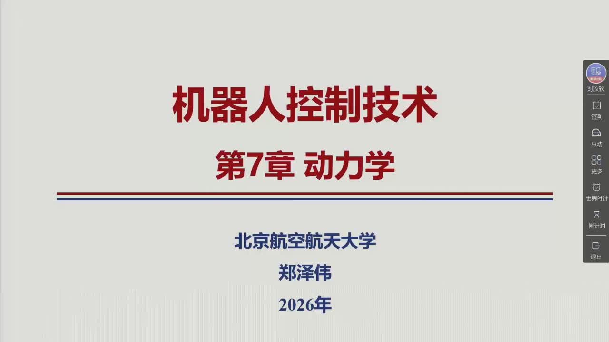
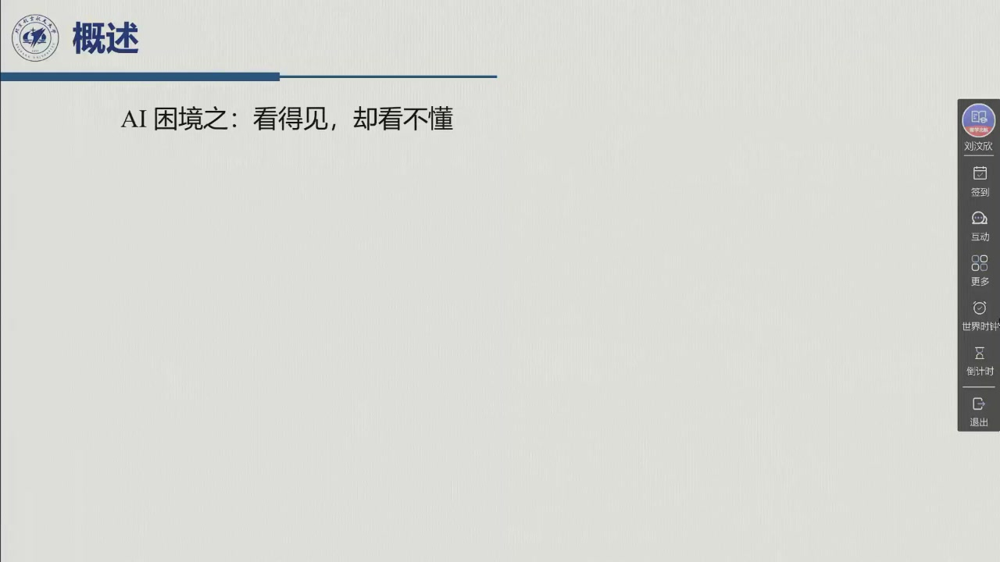
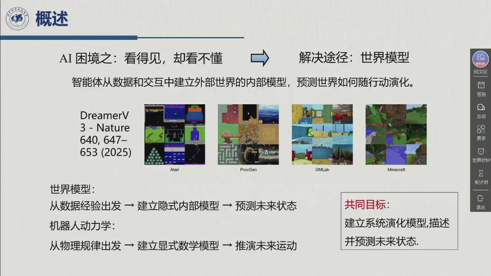
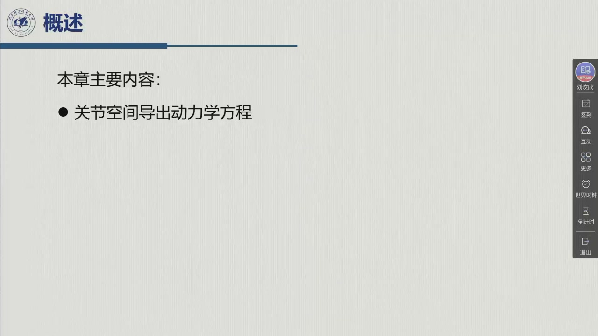

# 第六章 · 动力学

> **对应原书第 7 章**。本章依据《机器人控制技术》第 7 周星期一第 3–5 节录播
> （2026-10-19，2:29:00，学院路校区 B-228）整理，覆盖原书 §7.1–§7.3：拉格朗日公式、
> 动能与势能、运动方程、动力学模型的两个重要性质（$\dot B-2C$ 的反对称性、动力学参数的
> 线性性），以及两个两连杆算例（笛卡儿臂、平面臂）。
> 前五章一直在回答「机器人**在哪、动多快、怎么走**」；这一章回答「**要多大的力/力矩，
> 才能让它这样动**」。这是从运动学到控制的桥：没有动力学，控制器只能「试参数」；
> 有了动力学，才能谈前馈补偿、计算力矩、参数辨识与自适应控制。

::: note 章号说明（本书与原书在此错位）
原书第 6 章是「控制架构」，本课程本学期的录播**没有覆盖**（第 6 周讲第 5 章，第 7 周直接进第 7 章）；
因此本书把动力学编为**第六章**，并在所有交叉引用里注明「原书第 7 章」。**本书第六章 = 原书第 7 章**，
不要按书号去找原书第 6 章。
:::

## 本编信息（录播）

::: note 素材与生成方式
- **录播**：《机器人控制技术》第 7 周星期一第 3–5 节（2026-10-19 09:50–12:15），时长 2:29:00，
  学院路校区 B-228；平台会话 `sub_id=5883742`、教师流 `resource_guid=efca978655034a4ea49210441aac07f2`。
- **主讲**：课件封面署名**郑泽伟**（课表任课教师为刘正华；本讲是课程后半段换讲后的第一讲，
  老师开场说明「从这个课开始应该说五次课吧，然后我来给大家上，主要是动力学，还有后边……控制相关」）。
- **课件**：平台课件检测器触发 **259 帧**，按像素差去重后约 163 个状态（含动画中间态），
  本编从 259 帧中精选 **25 幅**随文嵌入，每幅标注课件首现时刻。
- **口述**：平台语音转写本周**未生成**（`search-trans-result` 返回「未查询到语音数据」，
  与第 6 周相同）；本编转写由教师流音频本地 `whisper.cpp`（large-v3-turbo-q8_0）完成，
  2442 句，未逐字校对；术语错字按课件与教材订正，代表例见[勘误页](errata.md)。
- **教材**：Siciliano 等《Robotics: Modelling, Planning and Control》第 7 章（中文版第 7 章），
  本编公式编号（7.1）–（7.84）沿用英文原版，便于逐条对照。
:::



## 为什么要学动力学：从「看得见」到「算得出」

老师在正式讲公式前，用一组「AI 困境」的幻灯片做了动机铺垫（00:16:38–00:21:47）：

- **AI 困境：看得见，却看不懂**——视频模型能生成很逼真的画面，但不知道物体为什么会那样动；
- **解决途径：世界模型**——智能体从数据和交互中建立外部世界的内部模型，预测世界如何随行动演化
  （幻灯片举了 DreamerV3、Nature 640, 647–653 (2025) 等例子）；
- **机器人动力学的定位**——「世界模型：从数据经验出发，建立隐式内部模型，预测未来状态；
  **机器人动力学：从物理规律出发，建立显式数学模型，推演未来运动**」；
- **混合动力学模型**——$\dot x=f_{\text{physics}}(x,u)+f_{\text{learned}}(x,u)$，
  「动力学先验 × 数据 AI 学习」，是当前机器人学习的一个活跃方向。







这段铺垫的落点不是「AI 取代动力学」，而是反过来：**数据方法越强，越需要显式的物理模型做先验、
做约束、做可解释的基线**。本章讲的拉格朗日方程，就是最常见的那条「显式模型」路线。

::: note 正动力学与逆动力学（老师用一张幻灯片把两个问题分开）
- **正动力学问题（forward dynamics）**：给定力/力矩，求机器人的运动。要解**非线性微分方程组**，
  一般没有闭式解，只能数值积分——「求解困难」。
- **逆动力学问题（inverse dynamics）**：已知机器人的运动（$q,\dot q,\ddot q$），求实现该运动所需的
  力/力矩。**不需求解非线性方程组**，只是代入公式——「求解简单」。

控制里最常用的是**逆动力学**：给定期望轨迹，算出前馈力矩；正动力学则用于仿真。
本章推导的是逆动力学的显式公式 $B(q)\ddot q+C(q,\dot q)\dot q+g(q)=\tau$，它同时是正动力学
（解出 $\ddot q$）的基础。
:::

## 全章路线图

本章的逻辑是一条直线，三步走：

```text
广义坐标 q
   │
   ├─ 动能 T = ½ q̇ᵀB(q)q̇      ← 6.1.1（连杆 + 转子，雅可比 + 惯性张量）
   ├─ 势能 U = U(q)            ← 6.1.2（只含 q，不含 q̇）
   │
   └─ 拉格朗日方程 d/dt(∂L/∂q̇) − ∂L/∂q = ξ，L = T − U
          │
          ├─ 运动方程 B(q)q̈ + C(q,q̇)q̇ + F q̇ + f + g(q) = τ − Jᵀh   ← 6.1.3
          │
          ├─ 性质一：N = Ḃ − 2C 反对称（Christoffel 符号）           ← 6.2.1
          ├─ 性质二：τ = Y(q,q̇,q̈)π，对动力学参数线性（回归矩阵）      ← 6.2.2
          │
          └─ 算例：两连杆笛卡儿臂（B 常数、解耦）                      ← 6.3.1
                   两连杆平面臂（B(q) 随位形变、耦合、Christoffel）    ← 6.3.2
```

**一句话主线**：**动能写成 $\frac12\dot q^{\mathrm T}B\dot q$，势能写成 $U(q)$，拉格朗日方程就把它们变成关于 $q$ 的二阶微分方程**；$B$ 的对称正定、$\dot B-2C$ 的反对称、$\tau=Y\pi$ 的线性性，是这条主线上最重要的三条结构性质。

## 八节一览

| 节 | 这一节回答的问题 | 优先级 |
|:--|:--|:--|
| [6.1 拉格朗日公式](sec6-1.md) | 为什么用能量而不是力来列方程？广义力怎么算？ | **核心（必知）** |
| [6.1.1 动能计算](sec6-1-1.md) | 连杆与转子的动能怎么写成 $\frac12\dot q^{\mathrm T}B\dot q$？ | **核心（重点）** |
| [6.1.2 势能计算](sec6-1-2.md) | 为什么势能只依赖 $q$，不依赖 $\dot q$？ | 概念（必知） |
| [6.1.3 运动方程](sec6-1-3.md) | $B,C,g$ 三项各是什么物理意义？摩擦与末端力怎么进方程？ | **核心（重点）** |
| [6.2.1 $\dot B-2C$ 的反对称性](sec6-2-1.md) | 为什么 $C$ 不唯一？Christoffel 符号怎么选？ | **精读（证明）** |
| [6.2.2 动力学参数的线性性](sec6-2-2.md) | 为什么力矩能写成 $Y(q,\dot q,\ddot q)\pi$？ | **核心（重点）** |
| [6.3.1 两连杆笛卡儿臂](sec6-3-1.md) | 什么情况下 $B$ 是常数、$C=0$、两轴完全解耦？ | 精读（算例） |
| [6.3.2 两连杆平面臂](sec6-3-2.md) | 位形相关的 $B(q)$、离心/科氏项、重力项怎么算？ | **核心（重点）** |

**优先级说明（按课堂权重）**

- **核心 · 必知**（6.1）：拉格朗日方程本身是本章的「发动机」。老师强调它**不依赖参考系**、
  只需要标量能量，因此比牛顿–欧拉更适合手工推导多连杆模型。
- **核心 · 重点**（6.1.1、6.1.3）：动能写成二次型是全部结构性质的来源；运动方程的三项
  （惯性、速度耦合、重力）是控制里逐项补偿的对象。
- **精读 · 证明**（6.2.1）：$\dot B-2C$ 的反对称性来自 Christoffel 符号的构造，证明是「指标搬运」，
  考试常考「验证 $w^{\mathrm T}Nw=0$」。
- **核心 · 重点**（6.2.2）：$\tau=Y\pi$ 是参数辨识与自适应控制的入口；老师说这条性质
  「对于动力学参数辨识以及控制算法推导都有帮助」。
- **核心 · 重点**（6.3.2）：平面臂是唯一一个手算完整 $B,C,g$ 的例子，离心项、科氏项、
  重力项的系数都在这里第一次出现；笛卡儿臂（6.3.1）是它的「解耦对照组」。

> **第一遍的验收标准**：能默写拉格朗日方程并解释 $L=T-U$；能把 $n$ 连杆的动能写成
> $\frac12\dot q^{\mathrm T}B\dot q$ 并说出 $B$ 的三条性质；能写出完整的关节空间运动方程并解释
> $B\ddot q$、$C\dot q$、$g$ 各是什么；能证明 $\dot B-2C$ 反对称；能说明 $\tau=Y\pi$ 中 $Y$ 与 $\pi$
> 各是什么；能手算两连杆平面臂的 $B(q)$ 与 Christoffel 符号。

## 老师在开场定下的三个基调

::: think 本讲的「弦外之音」（据开场 00:00–06:00 与课件）
1. **这是后半门课的第一讲**：老师明说接下来五次课由他讲，内容是「动力学 + 后面的控制」。
   也就是说，本章不是孤立的数学，而是后面运动控制、力控制、视觉伺服的**模型基础**。
2. **动力学在控制里的角色是「前馈 + 补偿」**：知道了 $B,C,g$，才能把控制器写成
   「计算力矩 + 反馈」；不知道，就只能把每个关节当独立系统去调 PID。第 8 章会反复回到这一点。
3. **两条结构性质比公式本身更重要**：$\dot B-2C$ 反对称（能量守恒的代数表达）与 $\tau=Y\pi$
   线性（参数辨识的入口）——老师把这两条单独列为 §7.2，并在标题里用了「Notable Properties」。
:::

## 怎么用这一编

- **对照录播**：每节标题后的括注是该节在录播中的时间区间；图注「课堂幻灯片 · mm:ss」标出课件首现时刻。
- **先看「物理意义」再看推导**：$B$ 的对角元是「锁住其他关节时该轴的惯量」，非对角元是「加速度耦合」；
  $C\dot q$ 的平方项是离心、交叉项是科氏；$g$ 是重力矩。公式很长，但每一项都有名字。
- **动手算一遍平面臂**：6.3.2 的 $B(q)$、Christoffel 符号与 $C$ 是本章唯一适合手算的完整例子，
  跟着算一遍，比背十条公式有用。
- **作业**：教材习题 **7-2、7-6、7-7**（见[作业六](homework06.md)），分别练「$C$ 的不同选法」、
  「换广义坐标（绝对角）」与「末端力经 $J^{\mathrm T}$ 折算成关节力矩」。
- **本章进度**：目前覆盖原书 §7.1–§7.3（第 7 周）。章末五件套（[总结](summary.md)、[勘误](errata.md)、
  [习题集](exercises.md)、[自检表](checklist.md)、[回忆卡](recall-cards.md)、[自测卷](mock-exam.md)）
  已按 §7.1–§7.3 的内容补齐；§7.4 之后（牛顿–欧拉、闭链、参数辨识算例）讲授时再对各页做增量扩充，
  习题 D4 已为此留了预告接口。
