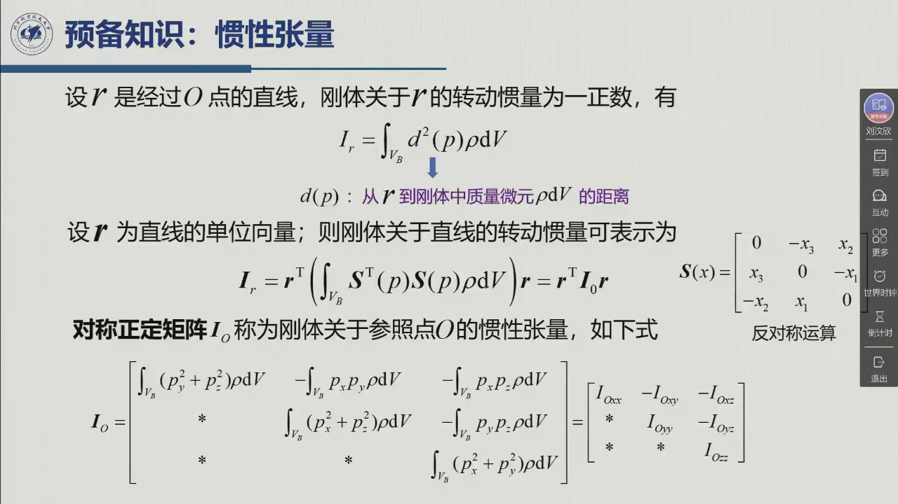
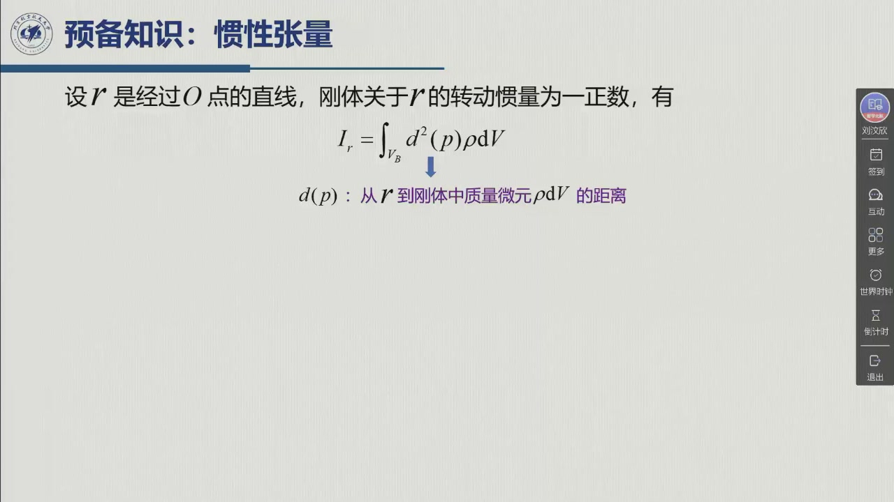
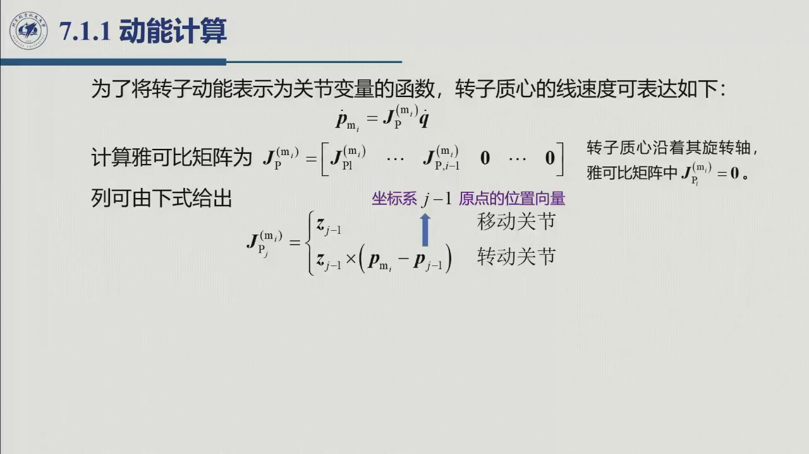
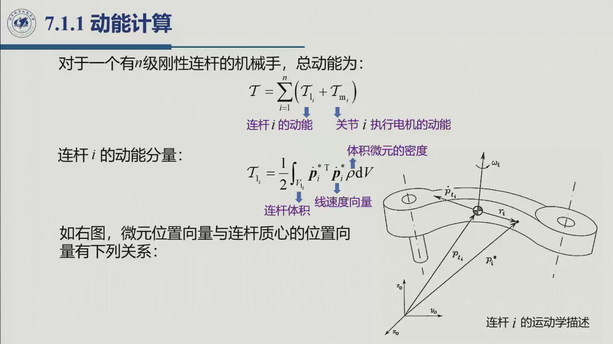
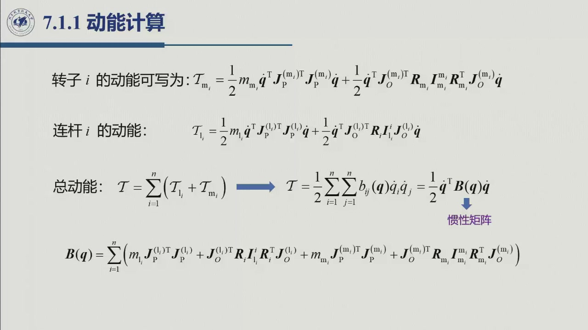

# 6.1.1 动能计算

> 录播 00:49:30–01:09:10。本节的任务只有一个：把 $n$ 连杆 + $n$ 个转子的总动能，写成
> 关节速度的二次型 $\frac12\dot{\boldsymbol q}^{\mathrm T}B(\boldsymbol q)\dot{\boldsymbol q}$，
> 并认出 $B$ 就是**惯性矩阵**。所有结构性质（对称、正定、随位形变）都从这一步来。

## 6.1.1.1 总动能 = 连杆 + 转子

对 $n$ 个刚性连杆的机械手，总动能是各连杆动能与各关节电机转子动能之和：

$$T=\sum_{i=1}^{n}\bigl(T_i+T_{m_i}\bigr),$$

其中 $T_i$ 是连杆 $i$ 的动能，$T_{m_i}$ 是驱动关节 $i$ 的转子动能（连杆 0 固定，不贡献）。

## 6.1.1.2 连杆动能：平动 + 转动

连杆 $i$ 上体积微元 $\mathrm dV$ 的质量为 $\rho\,\mathrm dV$（$\rho$ 为密度），其位置记为 $\boldsymbol p_i^*$。
连杆动能是

$$T_i=\frac12\int_{V_i}\dot{\boldsymbol p}_i^{*\mathrm T}\dot{\boldsymbol p}_i^*\,\rho\,\mathrm dV.$$

把微元位置写成「质心位置 + 相对质心的矢径」：

$$\boldsymbol r_i=[r_{ix},r_{iy},r_{iz}]^{\mathrm T}=\boldsymbol p_i^*-\boldsymbol p_i,\qquad
\boldsymbol p_i=\frac{1}{m_i}\int_{V_i}\boldsymbol p_i^*\rho\,\mathrm dV,$$

其中 $m_i$ 是连杆质量，$\boldsymbol p_i$ 是质心位置。对时间求导，并用角速度 $\boldsymbol\omega_i$ 表示
刚体上一点的线速度：

$$\dot{\boldsymbol p}_i^*=\dot{\boldsymbol p}_i+\boldsymbol\omega_i\times\boldsymbol r_i
=\dot{\boldsymbol p}_i+S(\boldsymbol\omega_i)\boldsymbol r_i,$$

这里 $S(\cdot)$ 是**叉乘的反对称矩阵**：

$$S(\boldsymbol a)=\begin{bmatrix}0&-a_z&a_y\\ a_z&0&-a_x\\ -a_y&a_x&0\end{bmatrix},
\qquad S(\boldsymbol a)\boldsymbol b=\boldsymbol a\times\boldsymbol b.$$

把速度代回积分，动能自然分成三块：

**① 平动项**

$$\frac12\int_{V_i}\dot{\boldsymbol p}_i^{\mathrm T}\dot{\boldsymbol p}_i\,\rho\,\mathrm dV
=\frac12 m_i\dot{\boldsymbol p}_i^{\mathrm T}\dot{\boldsymbol p}_i.$$

**② 交叉项（平动 × 转动）**

$$\int_{V_i}\dot{\boldsymbol p}_i^{\mathrm T}S(\boldsymbol\omega_i)\boldsymbol r_i\,\rho\,\mathrm dV
=\dot{\boldsymbol p}_i^{\mathrm T}S(\boldsymbol\omega_i)\int_{V_i}(\boldsymbol p_i^*-\boldsymbol p_i)\rho\,\mathrm dV=0,$$

因为按质心定义 $\int\boldsymbol p_i^*\rho\,\mathrm dV=\boldsymbol p_i\int\rho\,\mathrm dV$，括号里的积分为零。
**质心系的最大好处就是这一项自动消失。**

**③ 转动项**

$$\frac12\int_{V_i}\boldsymbol r_i^{\mathrm T}S^{\mathrm T}(\boldsymbol\omega_i)S(\boldsymbol\omega_i)\boldsymbol r_i\,\rho\,\mathrm dV
=\frac12\boldsymbol\omega_i^{\mathrm T}\boldsymbol I_i\boldsymbol\omega_i,$$

其中用到 $S(\boldsymbol\omega)\boldsymbol r=-S(\boldsymbol r)\boldsymbol\omega$（叉乘反交换），以及**惯性张量**

$$\boldsymbol I_i=\int_{V_i}S^{\mathrm T}(\boldsymbol r_i)S(\boldsymbol r_i)\rho\,\mathrm dV
=\begin{bmatrix}
\displaystyle\int(r_{iy}^2+r_{iz}^2)\rho\,\mathrm dV&-\displaystyle\int r_{ix}r_{iy}\rho\,\mathrm dV&-\displaystyle\int r_{ix}r_{iz}\rho\,\mathrm dV\\[2mm]
*&\displaystyle\int(r_{ix}^2+r_{iz}^2)\rho\,\mathrm dV&-\displaystyle\int r_{iy}r_{iz}\rho\,\mathrm dV\\[2mm]
*&*&\displaystyle\int(r_{ix}^2+r_{iy}^2)\rho\,\mathrm dV
\end{bmatrix}.$$

它是一个**对称矩阵**，对角元是绕三个坐标轴的转动惯量，非对角元是惯性积的负值。
因此

$$T_i=\frac12 m_i\dot{\boldsymbol p}_i^{\mathrm T}\dot{\boldsymbol p}_i
+\frac12\boldsymbol\omega_i^{\mathrm T}\boldsymbol I_i\boldsymbol\omega_i.$$

::: note 惯性张量的两件事（老师专门停在这里讲）
1. **参考系**：$\boldsymbol I_i$ 是相对**质心**、在**基坐标系**中表达的惯性张量，随机械手位形变化；
   若改到固连在连杆 $i$ 的坐标系（DH 系）中表达，它是**常数矩阵** $\boldsymbol I_i^i$，两者关系为
   $$\boldsymbol I_i=\boldsymbol R_i\,\boldsymbol I_i^i\,\boldsymbol R_i^{\mathrm T}.$$
   这就是为什么建模时总把惯性张量写在连杆系里——**常数**，不用每步重算。
2. **平行轴定理**：若参考点从质心 $C$ 平移到 $O$，则
   $$\boldsymbol I_O=\boldsymbol I_C+m\,S^{\mathrm T}(\boldsymbol p_C)S(\boldsymbol p_C).$$
   板书的写法是 $\boldsymbol I_O=\boldsymbol I_C+mS^{\mathrm T}(\boldsymbol p_C)S(\boldsymbol p_C)$，
   其中 $\boldsymbol p_C$ 是质心相对新原点的位置。
:::

## 6.1.1.3 用雅可比把质心速度写成 $\dot{\boldsymbol q}$

质心线速度与连杆角速度都是关节速度的线性组合：

$$\dot{\boldsymbol p}_i=J_P^{(i)}(\boldsymbol q)\dot{\boldsymbol q},\qquad
\boldsymbol\omega_i=J_O^{(i)}(\boldsymbol q)\dot{\boldsymbol q}.$$

其中 $J_P^{(i)}$、$J_O^{(i)}$ 是**只取到连杆 $i$** 的雅可比矩阵（第 $i$ 列之后全为零）：

$$J_P^{(i)}=\bigl[j_{P1}^{(i)}\ \cdots\ j_{Pi}^{(i)}\ 0\ \cdots\ 0\bigr],\qquad
J_O^{(i)}=\bigl[j_{O1}^{(i)}\ \cdots\ j_{Oi}^{(i)}\ 0\ \cdots\ 0\bigr],$$

其列按第 3 章的几何法给出：

$$j_{Pj}^{(i)}=\begin{cases}
\boldsymbol z_{j-1},&\text{移动关节}\\[1mm]
\boldsymbol z_{j-1}\times(\boldsymbol p_i-\boldsymbol p_{j-1}),&\text{转动关节}
\end{cases}
\qquad
j_{Oj}^{(i)}=\begin{cases}
\boldsymbol 0,&\text{移动关节}\\[1mm]
\boldsymbol z_{j-1},&\text{转动关节}
\end{cases}$$

（$\boldsymbol p_{j-1}$ 是坐标系 $j-1$ 原点的位置，$\boldsymbol z_{j-1}$ 是 $z_{j-1}$ 轴单位向量。）

代入 $T_i$ 得

$$T_i=\frac12 m_i\dot{\boldsymbol q}^{\mathrm T}J_P^{(i)\mathrm T}J_P^{(i)}\dot{\boldsymbol q}
+\frac12\dot{\boldsymbol q}^{\mathrm T}J_O^{(i)\mathrm T}\boldsymbol R_i\boldsymbol I_i^i\boldsymbol R_i^{\mathrm T}J_O^{(i)}\dot{\boldsymbol q}.$$

## 6.1.1.4 转子动能与减速比

转子 $i$ 的动能与连杆同构：

$$T_{m_i}=\frac12 m_{m_i}\dot{\boldsymbol p}_{m_i}^{\mathrm T}\dot{\boldsymbol p}_{m_i}
+\frac12\boldsymbol\omega_{m_i}^{\mathrm T}\boldsymbol I_{m_i}\boldsymbol\omega_{m_i}.$$

刚性传动下，转子转角 $\vartheta_{m_i}$ 与关节角满足

$$k_{r_i}\dot q_i=\dot\vartheta_{m_i}\qquad\Longrightarrow\qquad
\boldsymbol\omega_{m_i}=\boldsymbol\omega_{i-1}+k_{r_i}\dot q_i\,\boldsymbol z_{m_i},$$

其中 $\boldsymbol z_{m_i}$ 是转子轴单位向量。转子的线速度同样写成雅可比形式
$\dot{\boldsymbol p}_{m_i}=J_P^{(m_i)}\dot{\boldsymbol q}$，角速度写成
$\boldsymbol\omega_{m_i}=J_O^{(m_i)}\dot{\boldsymbol q}$，其列在 $j=i$ 处多出 $k_{r_i}\boldsymbol z_{m_i}$。

于是

$$T_{m_i}=\frac12 m_{m_i}\dot{\boldsymbol q}^{\mathrm T}J_P^{(m_i)\mathrm T}J_P^{(m_i)}\dot{\boldsymbol q}
+\frac12\dot{\boldsymbol q}^{\mathrm T}J_O^{(m_i)\mathrm T}\boldsymbol R_{m_i}\boldsymbol I_{m_i}^{m_i}\boldsymbol R_{m_i}^{\mathrm T}J_O^{(m_i)}\dot{\boldsymbol q}.$$

## 6.1.1.5 总动能与惯性矩阵

把连杆与转子的贡献相加，利用 $T=\frac12\sum_i\sum_j b_{ij}(\boldsymbol q)\dot q_i\dot q_j$：

$$\boxed{\ T=\frac12\dot{\boldsymbol q}^{\mathrm T}B(\boldsymbol q)\dot{\boldsymbol q}\ }$$

$$B(\boldsymbol q)=\sum_{i=1}^{n}\Bigl[
m_iJ_P^{(i)\mathrm T}J_P^{(i)}+J_O^{(i)\mathrm T}\boldsymbol R_i\boldsymbol I_i^i\boldsymbol R_i^{\mathrm T}J_O^{(i)}
+m_{m_i}J_P^{(m_i)\mathrm T}J_P^{(m_i)}+J_O^{(m_i)\mathrm T}\boldsymbol R_{m_i}\boldsymbol I_{m_i}^{m_i}\boldsymbol R_{m_i}^{\mathrm T}J_O^{(m_i)}
\Bigr].$$

**$B(\boldsymbol q)$ 的三条性质**（板书在公式下方逐条标注）：

1. **对称**：$B=B^{\mathrm T}$；
2. **正定**：$\dot{\boldsymbol q}^{\mathrm T}B\dot{\boldsymbol q}=2T>0$（$\dot{\boldsymbol q}\neq0$）；
3. **一般随位形变化**：$B=B(\boldsymbol q)$，只有特殊结构（如笛卡儿臂）才是常数。

::: think 老师强调的三个「技巧点」
1. **叉乘写成矩阵**：$\boldsymbol\omega\times\boldsymbol r=S(\boldsymbol\omega)\boldsymbol r=-S(\boldsymbol r)\boldsymbol\omega$。
   后者把 $\boldsymbol\omega$ 提到积分外，是得到 $\boldsymbol I_i$ 的关键一步——**没有这个反交换，
   转动项就积不出惯性张量**。
2. **质心系消交叉项**：交叉项为零不是「忽略」，而是质心定义直接给出来的恒等式。
3. **惯性张量写在连杆系里是常数**：$\boldsymbol I_i=\boldsymbol R_i\boldsymbol I_i^i\boldsymbol R_i^{\mathrm T}$，
   建模时只需存 6 个独立分量（对称矩阵），运行时用 $R$ 变换。
:::

## 6.1.1.6 小结与常见错误

- **一句话**：连杆动能 = 平动 $\frac12m\dot p^{\mathrm T}\dot p$ + 转动 $\frac12\omega^{\mathrm T}I\omega$；
  用雅可比把 $\dot p,\omega$ 换成 $\dot q$，再对 $i$ 求和，就得到 $T=\frac12\dot q^{\mathrm T}B\dot q$。
- **$B$ 的组成**：四块——连杆平动、连杆转动、转子平动、转子转动；每块都是「雅可比 × 质量/惯量 × 雅可比$^{\mathrm T}$」。
- **$B$ 的三性质**：对称、正定、随位形变。

::: think 常见错误清单
1. **把 $J_P^{(i)}$ 写成整机雅可比**：只能取到连杆 $i$，第 $i$ 列之后必须为零，否则会把后面关节的速度算进来。
2. **忘记 $\boldsymbol R_i\boldsymbol I_i^i\boldsymbol R_i^{\mathrm T}$ 的变换**：直接把连杆系的惯量当基座系用。
3. **转子项漏掉 $k_r^2$**：$\omega_m=k_r\dot q$，平方后进动能，系数是 $k_r^2$。
4. **把 $B$ 当常数**：除笛卡儿结构等特例外，$B$ 随 $q$ 变；后面 $\dot B$ 项就是由此而来。
:::

::: think 默写点 · 合上书再写
1. 写出 $T_i$ 的平动项、交叉项、转动项，并说明交叉项为什么为零。
2. 写出惯性张量 $\boldsymbol I_i$ 的定义与平行轴定理。
3. 写出 $B(\boldsymbol q)$ 的四块贡献与三条性质。
4. 转子的角速度如何用关节速度表示？减速比出现在哪几处？
:::
