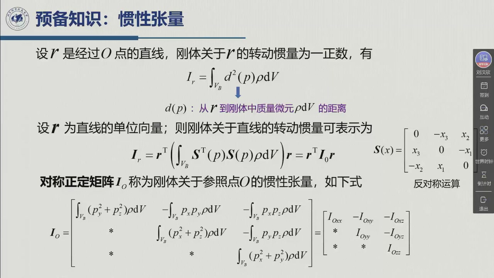
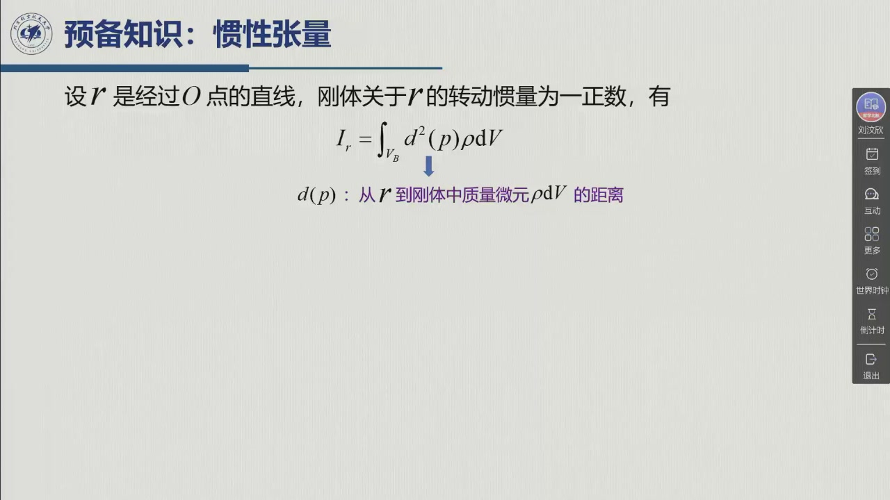
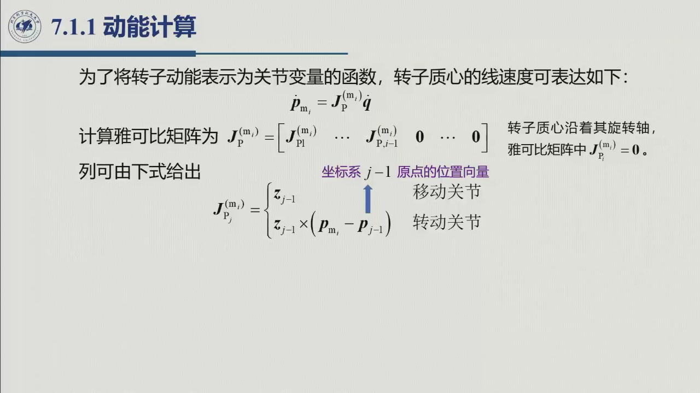
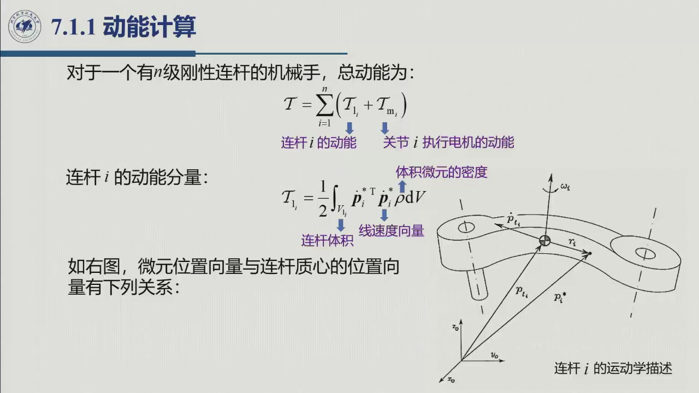
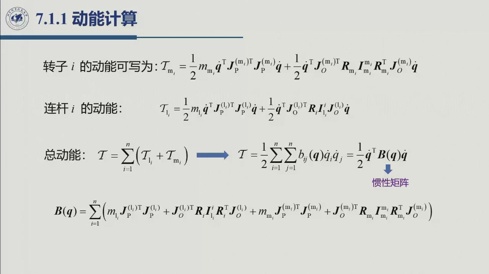

# 6.1.1 动能计算

单摆或单刚体可以直接写出绕固定轴的转动动能，遇到 $n$ 根连杆连成一串的机械臂，各杆质心既在平动又在转动，速度还同时依赖前面几个关节的角速度与位移，必须先把所有刚体和电机转子的速度统一写成关节速度 $\dot{\boldsymbol q}$ 的函数，才能放进 [6.1](sec6-1.md) 的拉格朗日方程求偏导。本节把总动能整理成关节速度的二次型 $T=\frac12\dot{\boldsymbol q}^{\mathrm T}B(\boldsymbol q)\dot{\boldsymbol q}$，从而读出惯性矩阵 $B(\boldsymbol q)$ 的四块来源和三条结构性质。课堂回看：00:49:30–01:09:10。

## 6.1.1.1 总动能 = 连杆 + 转子

对 $n$ 个刚性连杆的机械手，总动能是各连杆动能与各关节电机转子动能之和：

$$T=\sum_{i=1}^{n}\bigl(T_i+T_{m_i}\bigr),$$

其中 $T_i$ 是连杆 $i$ 的动能，$T_{m_i}$ 是驱动关节 $i$ 的转子动能（连杆 0 固定，不贡献）。

## 6.1.1.2 连杆动能：平动 + 转动

连杆 $i$ 上体积微元 $\mathrm dV$ 的质量为 $\rho\,\mathrm dV$（$\rho$ 为密度），其位置记为 $\boldsymbol p_i^*$。
连杆动能是

$$T_i=\frac12\int_{V_i}\dot{\boldsymbol p}_i^{*\mathrm T}\dot{\boldsymbol p}_i^*\,\rho\,\mathrm dV.$$

把微元位置写成「质心位置 + 相对质心的矢径」：

$$\boldsymbol r_i=[r_{ix},r_{iy},r_{iz}]^{\mathrm T}=\boldsymbol p_i^*-\boldsymbol p_i,\qquad
\boldsymbol p_i=\frac{1}{m_i}\int_{V_i}\boldsymbol p_i^*\rho\,\mathrm dV,$$

其中 $m_i$ 是连杆质量，$\boldsymbol p_i$ 是质心位置。对时间求导，并用角速度 $\boldsymbol\omega_i$ 表示
刚体上一点的线速度：

$$\dot{\boldsymbol p}_i^*=\dot{\boldsymbol p}_i+\boldsymbol\omega_i\times\boldsymbol r_i
=\dot{\boldsymbol p}_i+S(\boldsymbol\omega_i)\boldsymbol r_i,$$

其中 $S(\cdot)$ 是**叉乘的反对称矩阵**：

$$S(\boldsymbol a)=\begin{bmatrix}0&-a_z&a_y\\ a_z&0&-a_x\\ -a_y&a_x&0\end{bmatrix},
\qquad S(\boldsymbol a)\boldsymbol b=\boldsymbol a\times\boldsymbol b,\qquad S(\boldsymbol a)^{\mathrm T}=-S(\boldsymbol a).$$

求积分之前先看一个问题：角速度 $\boldsymbol\omega_i$ 随时间变，不随微元位置变，但在 $S(\boldsymbol\omega_i)\boldsymbol r_i$ 中它处在左端，无法直接提到体积积分外。把 $\dot{\boldsymbol p}_i^*$ 代入 $T_i$ 展开：

$$\dot{\boldsymbol p}_i^{*\mathrm T}\dot{\boldsymbol p}_i^*
=\dot{\boldsymbol p}_i^{\mathrm T}\dot{\boldsymbol p}_i
+2\dot{\boldsymbol p}_i^{\mathrm T}S(\boldsymbol\omega_i)\boldsymbol r_i
+\boldsymbol r_i^{\mathrm T}S^{\mathrm T}(\boldsymbol\omega_i)S(\boldsymbol\omega_i)\boldsymbol r_i,$$

积分自然分成三项：

**① 平动项**：$\dot{\boldsymbol p}_i$ 与微元无关，提到积分外，$m_i=\int_{V_i}\rho\,\mathrm dV$，得

$$\frac12\int_{V_i}\dot{\boldsymbol p}_i^{\mathrm T}\dot{\boldsymbol p}_i\,\rho\,\mathrm dV
=\frac12 m_i\dot{\boldsymbol p}_i^{\mathrm T}\dot{\boldsymbol p}_i.$$

**② 交叉项（平动 × 转动）**

$$\int_{V_i}\dot{\boldsymbol p}_i^{\mathrm T}S(\boldsymbol\omega_i)\boldsymbol r_i\,\rho\,\mathrm dV
=\dot{\boldsymbol p}_i^{\mathrm T}S(\boldsymbol\omega_i)\int_{V_i}(\boldsymbol p_i^*-\boldsymbol p_i)\rho\,\mathrm dV=0,$$

因为按质心定义 $\int_{V_i}\boldsymbol p_i^*\rho\,\mathrm dV=m_i\boldsymbol p_i=\int_{V_i}\boldsymbol p_i\rho\,\mathrm dV$，括号内积分恰好为零，交叉项恒等消去。若把参考点换成非质心，这一积分不再为零，平动与转动之间就会多出交叉项，后续也无法直接把 $T_i$ 拆成质心平动和自转两块。

**③ 转动项**

$$\boldsymbol\omega_i\times\boldsymbol r_i=S(\boldsymbol\omega_i)\boldsymbol r_i=-S(\boldsymbol r_i)\boldsymbol\omega_i.$$

转置后得 $\boldsymbol r_i^{\mathrm T}S^{\mathrm T}(\boldsymbol\omega_i)=\boldsymbol\omega_i^{\mathrm T}S(\boldsymbol r_i)$（负号在两个因子中各出一次，乘积为正）。于是 $\boldsymbol\omega_i$ 被移到左右两侧、提到体积积分外：

$$\frac12\int_{V_i}\boldsymbol r_i^{\mathrm T}S^{\mathrm T}(\boldsymbol\omega_i)S(\boldsymbol\omega_i)\boldsymbol r_i\,\rho\,\mathrm dV
=\frac12\boldsymbol\omega_i^{\mathrm T}\left(\int_{V_i}S^{\mathrm T}(\boldsymbol r_i)S(\boldsymbol r_i)\rho\,\mathrm dV\right)\boldsymbol\omega_i
=\frac12\boldsymbol\omega_i^{\mathrm T}\boldsymbol I_i\boldsymbol\omega_i,$$

这就是课上强调把叉乘写成反对称矩阵并反交换的关键一步——没有它，转动项积不出只与质量分布有关的**惯性张量**：
$$\boldsymbol I_i=\int_{V_i}S^{\mathrm T}(\boldsymbol r_i)S(\boldsymbol r_i)\rho\,\mathrm dV
=\begin{bmatrix}
\displaystyle\int(r_{iy}^2+r_{iz}^2)\rho\,\mathrm dV&-\displaystyle\int r_{ix}r_{iy}\rho\,\mathrm dV&-\displaystyle\int r_{ix}r_{iz}\rho\,\mathrm dV\\[2mm]
*&\displaystyle\int(r_{ix}^2+r_{iz}^2)\rho\,\mathrm dV&-\displaystyle\int r_{iy}r_{iz}\rho\,\mathrm dV\\[2mm]
*&*&\displaystyle\int(r_{ix}^2+r_{iy}^2)\rho\,\mathrm dV
\end{bmatrix}.$$

它是一个**对称矩阵**，对角元 $\int(r_{iy}^2+r_{iz}^2)\rho\,\mathrm dV$ 等分别是微元到三根坐标轴距离平方的质量积分（绕坐标轴的转动惯量），非对角元是惯性积的负值；对称性使 $3\times3$ 矩阵的 9 个位置里只有 6 个独立分量。例如长、宽、高在质心系沿坐标轴对齐的均匀长方体，积分为奇函数抵消后惯性积全为零，只剩三个对角元。
因此

$$T_i=\frac12 m_i\dot{\boldsymbol p}_i^{\mathrm T}\dot{\boldsymbol p}_i
+\frac12\boldsymbol\omega_i^{\mathrm T}\boldsymbol I_i\boldsymbol\omega_i.$$

::: note 惯量的参考点与表达坐标系
1. **参考系与表达系**：上面算出的 $\boldsymbol I_i$ 是相对**质心**、在**基坐标系**中表达的惯性张量。连杆转动时，微元在基坐标系里的坐标 $\boldsymbol r_i$ 时刻在变，所以 $\boldsymbol I_i$ 随构形变化。若改用固连在连杆 $i$ 上的坐标系（DH 系）写 $\boldsymbol r_i^i$，由 $\boldsymbol r_i=\boldsymbol R_i\boldsymbol r_i^i$ 以及旋转矩阵正交性 $S(\boldsymbol R_i\boldsymbol r_i^i)=\boldsymbol R_i S(\boldsymbol r_i^i)\boldsymbol R_i^{\mathrm T}$，代入积分得
   $$\boldsymbol I_i=\boldsymbol R_i\,\boldsymbol I_i^i\,\boldsymbol R_i^{\mathrm T},$$
   其中 $\boldsymbol I_i^i$ 在连杆坐标系中是**常数矩阵**（只取决于连杆形状和质量分布，存 6 个常数即可），运行时再按当前姿态矩阵 $\boldsymbol R_i(\boldsymbol q)$ 换回基系。
2. **平行轴定理**：若参考点从质心 $C$ 平移到另一个点 $O$（质心相对 $O$ 的矢径为 $\boldsymbol p_C$），新矢径 $\boldsymbol r'=\boldsymbol r+\boldsymbol p_C$ 代入积分后，质心定义的交叉项为零，得到
   $$\boldsymbol I_O=\boldsymbol I_C+m\,S^{\mathrm T}(\boldsymbol p_C)S(\boldsymbol p_C).$$
   两项必须在**同一表达系**、**平行坐标轴**下相加。取质量 $m$ 的质点距轴 $d$ 检验：$\boldsymbol I_C=0$，$S^{\mathrm T}(\boldsymbol p_C)S(\boldsymbol p_C)$ 沿垂直于 $\boldsymbol p_C$ 的方向给出 $d^2$，于是 $I_O=md^2$；沿 $\boldsymbol p_C$ 本身方向得 $0$，与初等力学一致。
:::

## 6.1.1.3 用雅可比把质心速度写成 $\dot{\boldsymbol q}$

质心线速度与连杆角速度都是关节速度的线性组合：

$$\dot{\boldsymbol p}_i=J_P^{(i)}(\boldsymbol q)\dot{\boldsymbol q},\qquad
\boldsymbol\omega_i=J_O^{(i)}(\boldsymbol q)\dot{\boldsymbol q}.$$

其中 $J_P^{(i)}$、$J_O^{(i)}$ 是**只取到连杆 $i$** 的雅可比矩阵（第 $i$ 列之后全为零）：

$$J_P^{(i)}=\bigl[j_{P1}^{(i)}\ \cdots\ j_{Pi}^{(i)}\ 0\ \cdots\ 0\bigr],\qquad
J_O^{(i)}=\bigl[j_{O1}^{(i)}\ \cdots\ j_{Oi}^{(i)}\ 0\ \cdots\ 0\bigr],$$

其列按第 3 章的几何法给出：

$$j_{Pj}^{(i)}=\begin{cases}
\boldsymbol z_{j-1},&\text{移动关节}\\[1mm]
\boldsymbol z_{j-1}\times(\boldsymbol p_i-\boldsymbol p_{j-1}),&\text{转动关节}
\end{cases}
\qquad
j_{Oj}^{(i)}=\begin{cases}
\boldsymbol 0,&\text{移动关节}\\[1mm]
\boldsymbol z_{j-1},&\text{转动关节}
\end{cases}$$

（$\boldsymbol p_{j-1}$ 是坐标系 $j-1$ 原点的位置，$\boldsymbol z_{j-1}$ 是 $z_{j-1}$ 轴单位向量，均在基坐标系中表达。）

注意两点：第一，[逐列构造](../recall.md#jacobian-column)的规则与第三章完全相同，只是线速度雅可比的力臂终点从工具点换成连杆质心 $\boldsymbol p_i$；第二，转动部分必须先把连杆系的常数惯性张量换到基坐标系，才能与基系角速度 $\boldsymbol\omega_i=J_O^{(i)}\dot{\boldsymbol q}$ 相乘。先看维度：$J_P^{(i)},J_O^{(i)}$ 都是 $3\times n$，而 $(J_P^{(i)}\dot{\boldsymbol q})^{\mathrm T}=\dot{\boldsymbol q}^{\mathrm T}J_P^{(i)\mathrm T}$、$(J_O^{(i)}\dot{\boldsymbol q})^{\mathrm T}=\dot{\boldsymbol q}^{\mathrm T}J_O^{(i)\mathrm T}$；将其和 $\boldsymbol I_i=\boldsymbol R_i\boldsymbol I_i^i\boldsymbol R_i^{\mathrm T}$ 依次代入平动项与转动项：

$$\frac12 m_i\dot{\boldsymbol p}_i^{\mathrm T}\dot{\boldsymbol p}_i
=\frac12 m_i\bigl(J_P^{(i)}\dot{\boldsymbol q}\bigr)^{\mathrm T}\bigl(J_P^{(i)}\dot{\boldsymbol q}\bigr)
=\frac12 m_i\dot{\boldsymbol q}^{\mathrm T}J_P^{(i)\mathrm T}J_P^{(i)}\dot{\boldsymbol q},$$

$$\frac12\boldsymbol\omega_i^{\mathrm T}\boldsymbol I_i\boldsymbol\omega_i
=\frac12\bigl(J_O^{(i)}\dot{\boldsymbol q}\bigr)^{\mathrm T}\bigl(\boldsymbol R_i\boldsymbol I_i^i\boldsymbol R_i^{\mathrm T}\bigr)\bigl(J_O^{(i)}\dot{\boldsymbol q}\bigr)
=\frac12\dot{\boldsymbol q}^{\mathrm T}J_O^{(i)\mathrm T}\boldsymbol R_i\boldsymbol I_i^i\boldsymbol R_i^{\mathrm T}J_O^{(i)}\dot{\boldsymbol q}.$$

于是连杆 $i$ 的动能完全写成 $\dot{\boldsymbol q}$ 的二次型，其中的矩阵因子都是 $n\times n$：

$$T_i=\frac12 m_i\dot{\boldsymbol q}^{\mathrm T}J_P^{(i)\mathrm T}J_P^{(i)}\dot{\boldsymbol q}
+\frac12\dot{\boldsymbol q}^{\mathrm T}J_O^{(i)\mathrm T}\boldsymbol R_i\boldsymbol I_i^i\boldsymbol R_i^{\mathrm T}J_O^{(i)}\dot{\boldsymbol q}.$$

### 用一块质点动能检查矩阵乘序

取第三章两杆各1 m、$q=(0,\pi/2)$ 的位置雅可比，只计算工具处2 kg质点的贡献：

$$J_P=\begin{bmatrix}-1&-1\\1&0\end{bmatrix},\qquad
B_{point}=2J_P^{\mathrm T}J_P=\begin{bmatrix}4&2\\2&2\end{bmatrix}.$$

给 $\dot q=(1,-1)^{\mathrm T}$ rad/s，质点速度为 $(0,1)^{\mathrm T}$ m/s，直接计算动能为1 J。由关节二次型计算则为

$$\tfrac12\dot q^{\mathrm T}B_{point}\dot q
=\tfrac12[4+2(2)(1)(-1)+2]=1\ \mathrm J.$$

二次型展开时，每个非对角元贡献两次；漏掉交叉项，本例就会被算成 3 J。这里得到的只是工具处质点对惯性矩阵的贡献，整机计算还要把每根连杆和每个电机转子的二次型矩阵加在一起。

## 6.1.1.4 转子动能与减速比

转子 $i$ 的动能与连杆同构：

$$T_{m_i}=\frac12 m_{m_i}\dot{\boldsymbol p}_{m_i}^{\mathrm T}\dot{\boldsymbol p}_{m_i}
+\frac12\boldsymbol\omega_{m_i}^{\mathrm T}\boldsymbol I_{m_i}\boldsymbol\omega_{m_i}.$$

刚性传动下，转子转角 $\vartheta_{m_i}$ 与关节角满足

$$k_{r_i}\dot q_i=\dot\vartheta_{m_i}\qquad\Longrightarrow\qquad
\boldsymbol\omega_{m_i}=\boldsymbol\omega_{i-1}+k_{r_i}\dot q_i\,\boldsymbol z_{m_i},$$

其中 $\boldsymbol z_{m_i}$ 是转子旋转轴的单位向量，$\boldsymbol\omega_{i-1}$ 是承载该电机的上游连杆角速度（第 1 轴电机固定在基座上，故 $\boldsymbol\omega_0=\boldsymbol 0$）。和连杆一样，把转子的质心线速度和总角速度写成关节速度的雅可比乘积 $\dot{\boldsymbol p}_{m_i}=J_P^{(m_i)}\dot{\boldsymbol q}$、$\boldsymbol\omega_{m_i}=J_O^{(m_i)}\dot{\boldsymbol q}$。$J_P^{(m_i)}$ 由转子质心位置 $\boldsymbol p_{m_i}$ 确定，第 $i$ 列及之后为零（转动关节 $i$ 本身的转动不移动装在轴上的转子质心）；而 $J_O^{(m_i)}$ 的前 $i-1$ 列与承载它的连杆角速度雅可比一致，第 $i$ 列则因减速比变为 $k_{r_i}\boldsymbol z_{m_i}$，第 $i$ 列之后全为零：

$$J_O^{(m_i)}=\bigl[j_{O1}^{(m_i)}\ \cdots\ j_{O,i-1}^{(m_i)}\ k_{r_i}\boldsymbol z_{m_i}\ 0\ \cdots\ 0\bigr].$$

把 $\dot{\boldsymbol p}_{m_i}$、$\boldsymbol\omega_{m_i}$ 以及 $\boldsymbol I_{m_i}=\boldsymbol R_{m_i}\boldsymbol I_{m_i}^{m_i}\boldsymbol R_{m_i}^{\mathrm T}$ 按上面完全相同的转置展开代入 $T_{m_i}$，得到

$$T_{m_i}=\frac12 m_{m_i}\dot{\boldsymbol q}^{\mathrm T}J_P^{(m_i)\mathrm T}J_P^{(m_i)}\dot{\boldsymbol q}
+\frac12\dot{\boldsymbol q}^{\mathrm T}J_O^{(m_i)\mathrm T}\boldsymbol R_{m_i}\boldsymbol I_{m_i}^{m_i}\boldsymbol R_{m_i}^{\mathrm T}J_O^{(m_i)}\dot{\boldsymbol q}.$$

其中 $J_O^{(m_i)}$ 第 $i$ 列的 $k_{r_i}$ 在前后两个转置因子中各出现一次，乘出 $k_{r_i}^2$ 进入惯性矩阵的第 $i$ 个对角元；第 $j<i$ 列与第 $i$ 列相乘则出现一次项 $k_{r_i}$（见 [6.3.2](sec6-3-2.md) 平面臂的 $b_{12}$）。

## 6.1.1.5 总动能与惯性矩阵

把连杆与转子的贡献相加，利用 $T=\frac12\sum_i\sum_j b_{ij}(\boldsymbol q)\dot q_i\dot q_j$：

$$\boxed{\ T=\frac12\dot{\boldsymbol q}^{\mathrm T}B(\boldsymbol q)\dot{\boldsymbol q}\ }$$

$$B(\boldsymbol q)=\sum_{i=1}^{n}\Bigl[
m_iJ_P^{(i)\mathrm T}J_P^{(i)}+J_O^{(i)\mathrm T}\boldsymbol R_i\boldsymbol I_i^i\boldsymbol R_i^{\mathrm T}J_O^{(i)}
+m_{m_i}J_P^{(m_i)\mathrm T}J_P^{(m_i)}+J_O^{(m_i)\mathrm T}\boldsymbol R_{m_i}\boldsymbol I_{m_i}^{m_i}\boldsymbol R_{m_i}^{\mathrm T}J_O^{(m_i)}
\Bigr].$$

把各杆与各转子的四块 $n\times n$ 矩阵相加，$B(\boldsymbol q)$ 就有三条可直接从表达式读出的性质：

1. **对称**（$B=B^{\mathrm T}$）：每块形如 $J^{\mathrm T}MJ$，且 $\boldsymbol I_i^i,\boldsymbol I_{m_i}^{m_i}$ 本身对称，故 $(J^{\mathrm T}MJ)^{\mathrm T}=J^{\mathrm T}M^{\mathrm T}J=J^{\mathrm T}MJ$，求和后仍对称。
2. **正定**（$\dot{\boldsymbol q}^{\mathrm T}B\dot{\boldsymbol q}=2T>0$，对 $\dot{\boldsymbol q}\neq\boldsymbol 0$）：在独立关节坐标、非零关节速度必引起至少一根连杆或一个转子运动的通常刚体模型下，系统总动能恒正。单独一根连杆的 $J^{\mathrm T}MJ$ 只到半正定（例如前面只看连杆 1 时第 2 列全零，若只让 $\dot q_2\neq0$ 它的贡献为零），必须把所有连杆与转子相加，才得到正定的总惯性矩阵。
3. **一般随位形变化**（$B=B(\boldsymbol q)$）：$J_P^{(i)},J_O^{(i)}$ 和旋转矩阵 $\boldsymbol R_i$ 都随 $\boldsymbol q$ 改变；只有关节轴方向与力臂结构特殊的机构（如 [6.3.1](sec6-3-1.md) 的正交笛卡儿臂）才退化为常矩阵。

## 6.1.1.6 小结与常见错误

把单根刚体的动能拆成质心平动 $\frac12m_i\dot{\boldsymbol p}_i^{\mathrm T}\dot{\boldsymbol p}_i$ 与绕质心转动 $\frac12\boldsymbol\omega_i^{\mathrm T}\boldsymbol I_i\boldsymbol\omega_i$（交叉项因质心定义恒为零），再通过到连杆 $i$ 的质心雅可比把速度换成 $\dot{\boldsymbol q}$、通过 $\boldsymbol I_i=\boldsymbol R_i\boldsymbol I_i^i\boldsymbol R_i^{\mathrm T}$ 把连杆系常数惯量换到基系，对全部连杆和转子求和即得 $T=\frac12\dot{\boldsymbol q}^{\mathrm T}B(\boldsymbol q)\dot{\boldsymbol q}$。$B$ 由四块（连杆平动、连杆转动、转子平动、转子转动）构成，对称、正定且一般随位形变化。

::: think 常见错误清单
1. **把 $J_P^{(i)}$ 写成整机雅可比**：只能取到连杆 $i$，第 $i$ 列之后必须为零，否则会把后面关节的速度算进来。
2. **忘记 $\boldsymbol R_i\boldsymbol I_i^i\boldsymbol R_i^{\mathrm T}$ 的变换**：直接把连杆系的常数惯量当基座系用，或忘记与角速度 $\boldsymbol\omega_i$ 采用同一表达系。
3. **转子项漏掉 $k_r^2$**：$\dot\vartheta_{m_i}=k_{r_i}\dot q_i$，经 $J_O^{(m_i)\mathrm T}(\cdot)J_O^{(m_i)}$ 平方后进入对角元，系数是 $k_{r_i}^2$（与前上游连杆的交叉项则带一次 $k_{r_i}$）。
4. **把 $B$ 当常数**：除笛卡儿结构等特例外，$B$ 随 $q$ 变；后面 $\dot B$ 和速度二次项就是由此而来。
:::

::: think 默写点 · 合上书再写
1. 写出 $T_i$ 的平动项、交叉项、转动项，并说明交叉项为什么为零。
2. 写出惯性张量 $\boldsymbol I_i$ 的定义、连杆系与基系变换及平行轴定理。
3. 写出 $B(\boldsymbol q)$ 的四块贡献与三条性质，并说明各自为什么成立。
4. 转子的角速度如何用关节速度表示？减速比 $k_{r_i}$ 出现在哪几处？
:::
