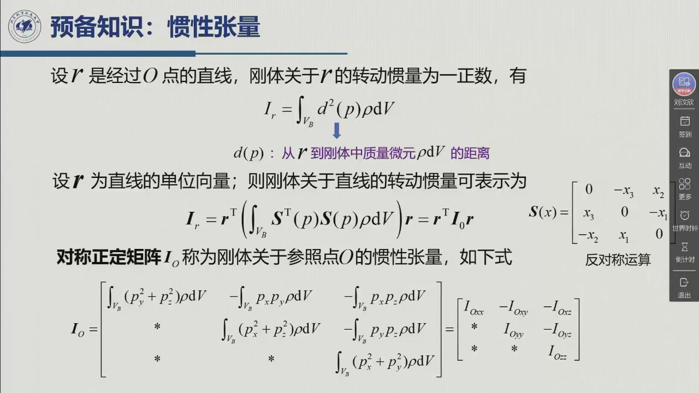
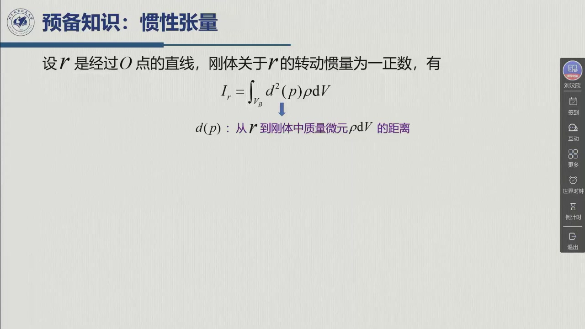
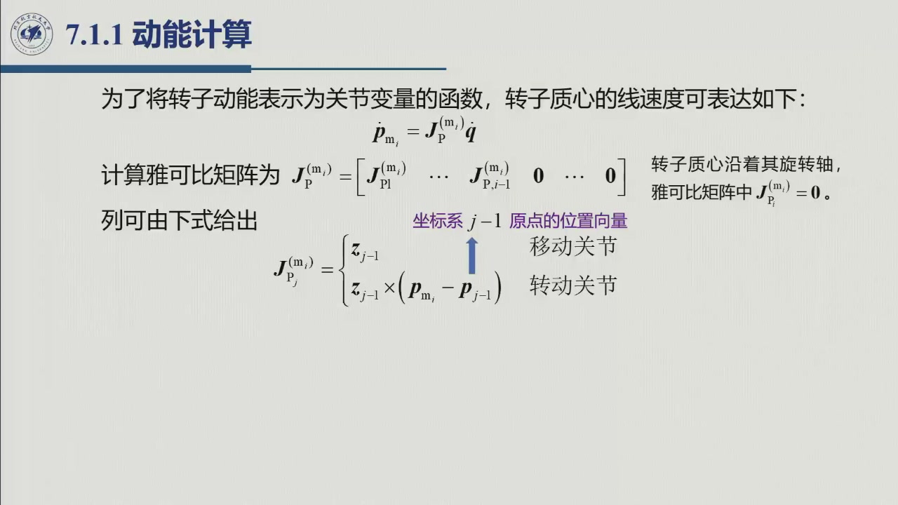
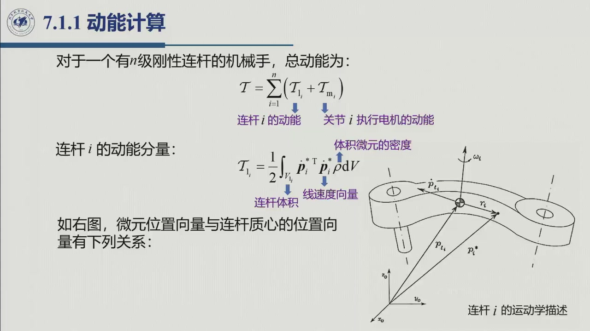
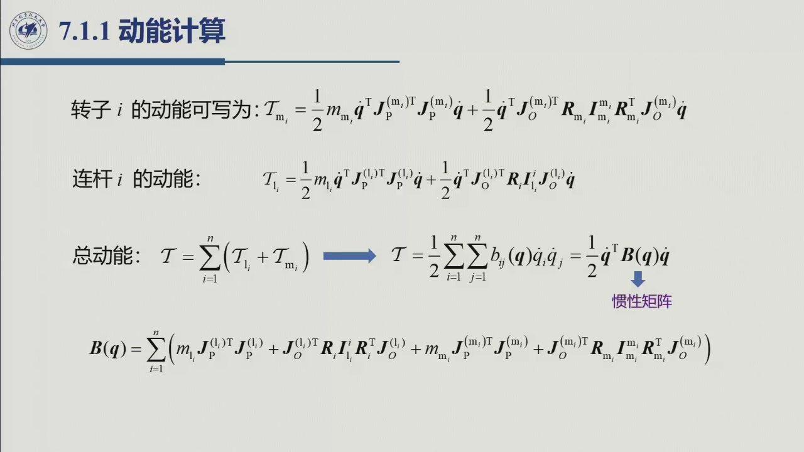

# 6.1.1 动能计算

拉格朗日方程首先需要系统动能。单根刚体的动能包括质心平移和绕质心转动，整机还要加上各连杆与转子的贡献。下面将这些运动速度统一写成关节速度，收集出惯性矩阵 $B(q)$。课堂回看：00:49:30–01:09:10。
## 6.1.1.1 总动能 = 连杆 + 转子

对 $n$ 个刚性连杆的机械手，总动能是各连杆动能与各关节电机转子动能之和：

$$T=\sum_{i=1}^{n}\bigl(T_i+T_{m_i}\bigr),$$

其中 $T_i$ 是连杆 $i$ 的动能，$T_{m_i}$ 是驱动关节 $i$ 的转子动能（连杆 0 固定，不贡献）。

## 6.1.1.2 连杆动能：平动 + 转动

连杆 $i$ 上体积微元 $\mathrm dV$ 的质量为 $\rho\,\mathrm dV$（$\rho$ 为密度），其位置记为 $\boldsymbol p_i^*$。
连杆动能是

$$T_i=\frac12\int_{V_i}\dot{\boldsymbol p}_i^{*\mathrm T}\dot{\boldsymbol p}_i^*\,\rho\,\mathrm dV.$$

把微元位置写成「质心位置 + 相对质心的矢径」：

$$\boldsymbol r_i=[r_{ix},r_{iy},r_{iz}]^{\mathrm T}=\boldsymbol p_i^*-\boldsymbol p_i,\qquad
\boldsymbol p_i=\frac{1}{m_i}\int_{V_i}\boldsymbol p_i^*\rho\,\mathrm dV,$$

其中 $m_i$ 是连杆质量，$\boldsymbol p_i$ 是质心位置。对时间求导，并用角速度 $\boldsymbol\omega_i$ 表示
刚体上一点的线速度：

$$\dot{\boldsymbol p}_i^*=\dot{\boldsymbol p}_i+\boldsymbol\omega_i\times\boldsymbol r_i
=\dot{\boldsymbol p}_i+S(\boldsymbol\omega_i)\boldsymbol r_i,$$

这里 $S(\cdot)$ 是**叉乘的反对称矩阵**：

$$S(\boldsymbol a)=\begin{bmatrix}0&-a_z&a_y\\ a_z&0&-a_x\\ -a_y&a_x&0\end{bmatrix},
\qquad S(\boldsymbol a)\boldsymbol b=\boldsymbol a\times\boldsymbol b.$$

把速度代回积分，动能自然分成三块：

**① 平动项**

$$\frac12\int_{V_i}\dot{\boldsymbol p}_i^{\mathrm T}\dot{\boldsymbol p}_i\,\rho\,\mathrm dV
=\frac12 m_i\dot{\boldsymbol p}_i^{\mathrm T}\dot{\boldsymbol p}_i.$$

**② 交叉项（平动 × 转动）**

$$\int_{V_i}\dot{\boldsymbol p}_i^{\mathrm T}S(\boldsymbol\omega_i)\boldsymbol r_i\,\rho\,\mathrm dV
=\dot{\boldsymbol p}_i^{\mathrm T}S(\boldsymbol\omega_i)\int_{V_i}(\boldsymbol p_i^*-\boldsymbol p_i)\rho\,\mathrm dV=0,$$

按质心定义，有 $\int\boldsymbol p_i^*\rho\,\mathrm dV=\boldsymbol p_i\int\rho\,\mathrm dV$，因此括号内积分恰好为零，交叉项随之消失。这是质心定义的直接结果，不是忽略小量；若改用非质心参考点，就不能原样删去。

**③ 转动项**

$$\frac12\int_{V_i}\boldsymbol r_i^{\mathrm T}S^{\mathrm T}(\boldsymbol\omega_i)S(\boldsymbol\omega_i)\boldsymbol r_i\,\rho\,\mathrm dV
=\frac12\boldsymbol\omega_i^{\mathrm T}\boldsymbol I_i\boldsymbol\omega_i,$$

其中用到 $S(\boldsymbol\omega)\boldsymbol r=-S(\boldsymbol r)\boldsymbol\omega$（叉乘反交换），以及**惯性张量**

$$\boldsymbol I_i=\int_{V_i}S^{\mathrm T}(\boldsymbol r_i)S(\boldsymbol r_i)\rho\,\mathrm dV
=\begin{bmatrix}
\displaystyle\int(r_{iy}^2+r_{iz}^2)\rho\,\mathrm dV&-\displaystyle\int r_{ix}r_{iy}\rho\,\mathrm dV&-\displaystyle\int r_{ix}r_{iz}\rho\,\mathrm dV\\[2mm]
*&\displaystyle\int(r_{ix}^2+r_{iz}^2)\rho\,\mathrm dV&-\displaystyle\int r_{iy}r_{iz}\rho\,\mathrm dV\\[2mm]
*&*&\displaystyle\int(r_{ix}^2+r_{iy}^2)\rho\,\mathrm dV
\end{bmatrix}.$$

它是一个**对称矩阵**，对角元是绕三个坐标轴的转动惯量，非对角元是惯性积的负值。
因此

$$T_i=\frac12 m_i\dot{\boldsymbol p}_i^{\mathrm T}\dot{\boldsymbol p}_i
+\frac12\boldsymbol\omega_i^{\mathrm T}\boldsymbol I_i\boldsymbol\omega_i.$$

::: note 惯量的参考点与表达坐标系
1. **参考系**：$\boldsymbol I_i$ 是相对**质心**、在**基坐标系**中表达的惯性张量，随机械手位形变化；
   若改到固连在连杆 $i$ 的坐标系（DH 系）中表达，它是**常数矩阵** $\boldsymbol I_i^i$，两者关系为
   $$\boldsymbol I_i=\boldsymbol R_i\,\boldsymbol I_i^i\,\boldsymbol R_i^{\mathrm T}.$$
   连杆固连系中的惯量可保存为常数；转到基系表达时，仍须按当前旋转矩阵换算。
2. **平行轴定理**：若参考点从质心 $C$ 平移到 $O$，则
   $$\boldsymbol I_O=\boldsymbol I_C+m\,S^{\mathrm T}(\boldsymbol p_C)S(\boldsymbol p_C).$$
   这里两种惯量须采用平行的坐标轴，并在同一表达系中写分量。
   其中 $\boldsymbol p_C$ 是质心相对新原点的位置。
:::

## 6.1.1.3 用雅可比把质心速度写成 $\dot{\boldsymbol q}$

质心线速度与连杆角速度都是关节速度的线性组合：

$$\dot{\boldsymbol p}_i=J_P^{(i)}(\boldsymbol q)\dot{\boldsymbol q},\qquad
\boldsymbol\omega_i=J_O^{(i)}(\boldsymbol q)\dot{\boldsymbol q}.$$

其中 $J_P^{(i)}$、$J_O^{(i)}$ 是**只取到连杆 $i$** 的雅可比矩阵（第 $i$ 列之后全为零）：

$$J_P^{(i)}=\bigl[j_{P1}^{(i)}\ \cdots\ j_{Pi}^{(i)}\ 0\ \cdots\ 0\bigr],\qquad
J_O^{(i)}=\bigl[j_{O1}^{(i)}\ \cdots\ j_{Oi}^{(i)}\ 0\ \cdots\ 0\bigr],$$

其列按第 3 章的几何法给出：

$$j_{Pj}^{(i)}=\begin{cases}
\boldsymbol z_{j-1},&\text{移动关节}\\[1mm]
\boldsymbol z_{j-1}\times(\boldsymbol p_i-\boldsymbol p_{j-1}),&\text{转动关节}
\end{cases}
\qquad
j_{Oj}^{(i)}=\begin{cases}
\boldsymbol 0,&\text{移动关节}\\[1mm]
\boldsymbol z_{j-1},&\text{转动关节}
\end{cases}$$

（$\boldsymbol p_{j-1}$ 是坐标系 $j-1$ 原点的位置，$\boldsymbol z_{j-1}$ 是 $z_{j-1}$ 轴单位向量。）

这里的线速度雅可比对应**质心**而非工具点。[逐列构造](../recall.md#jacobian-column)的规则相同，只把力臂终点换成质心。先看维度：$J_P,J_O$ 都是 $3\times n$，所以 $J_P^{\mathrm T}mJ_P$ 和 $J_O^{\mathrm T}IJ_O$ 都是 $n\times n$，才可进入惯性矩阵。将 $v=J_P\dot q$ 代入 $v^{\mathrm T}mv$ 时，转置必须倒序：$(J_P\dot q)^{\mathrm T}=\dot q^{\mathrm T}J_P^{\mathrm T}$。这一步解释了两侧雅可比的排列。

代入 $T_i$ 得

$$T_i=\frac12 m_i\dot{\boldsymbol q}^{\mathrm T}J_P^{(i)\mathrm T}J_P^{(i)}\dot{\boldsymbol q}
+\frac12\dot{\boldsymbol q}^{\mathrm T}J_O^{(i)\mathrm T}\boldsymbol R_i\boldsymbol I_i^i\boldsymbol R_i^{\mathrm T}J_O^{(i)}\dot{\boldsymbol q}.$$

### 用一块质点动能检查矩阵乘序

取第三章两杆各1 m、$q=(0,\pi/2)$ 的位置雅可比，只计算工具处2 kg质点的贡献：

$$J_P=\begin{bmatrix}-1&-1\\1&0\end{bmatrix},\qquad
B_{point}=2J_P^{\mathrm T}J_P=\begin{bmatrix}4&2\\2&2\end{bmatrix}.$$

给 $\dot q=(1,-1)^{\mathrm T}$ rad/s，质点速度为 $(0,1)^{\mathrm T}$ m/s，直接计算动能为1 J。由关节二次型计算则为

$$\tfrac12\dot q^{\mathrm T}B_{point}\dot q
=\tfrac12[4+2(2)(1)(-1)+2]=1\ \mathrm J.$$

二次型展开时，每个非对角元贡献两次；漏掉交叉项，本例就会被算成3 J。这里得到的只是工具处质点对惯性矩阵的贡献，整机计算还要加入连杆与转子动能。

## 6.1.1.4 转子动能与减速比

转子 $i$ 的动能与连杆同构：

$$T_{m_i}=\frac12 m_{m_i}\dot{\boldsymbol p}_{m_i}^{\mathrm T}\dot{\boldsymbol p}_{m_i}
+\frac12\boldsymbol\omega_{m_i}^{\mathrm T}\boldsymbol I_{m_i}\boldsymbol\omega_{m_i}.$$

刚性传动下，转子转角 $\vartheta_{m_i}$ 与关节角满足

$$k_{r_i}\dot q_i=\dot\vartheta_{m_i}\qquad\Longrightarrow\qquad
\boldsymbol\omega_{m_i}=\boldsymbol\omega_{i-1}+k_{r_i}\dot q_i\,\boldsymbol z_{m_i},$$

其中 $\boldsymbol z_{m_i}$ 是转子轴单位向量。转子的线速度同样写成雅可比形式
$\dot{\boldsymbol p}_{m_i}=J_P^{(m_i)}\dot{\boldsymbol q}$，角速度写成
$\boldsymbol\omega_{m_i}=J_O^{(m_i)}\dot{\boldsymbol q}$，其列在 $j=i$ 处多出 $k_{r_i}\boldsymbol z_{m_i}$。

于是

$$T_{m_i}=\frac12 m_{m_i}\dot{\boldsymbol q}^{\mathrm T}J_P^{(m_i)\mathrm T}J_P^{(m_i)}\dot{\boldsymbol q}
+\frac12\dot{\boldsymbol q}^{\mathrm T}J_O^{(m_i)\mathrm T}\boldsymbol R_{m_i}\boldsymbol I_{m_i}^{m_i}\boldsymbol R_{m_i}^{\mathrm T}J_O^{(m_i)}\dot{\boldsymbol q}.$$

## 6.1.1.5 总动能与惯性矩阵

把连杆与转子的贡献相加，利用 $T=\frac12\sum_i\sum_j b_{ij}(\boldsymbol q)\dot q_i\dot q_j$：

$$\boxed{\ T=\frac12\dot{\boldsymbol q}^{\mathrm T}B(\boldsymbol q)\dot{\boldsymbol q}\ }$$

$$B(\boldsymbol q)=\sum_{i=1}^{n}\Bigl[
m_iJ_P^{(i)\mathrm T}J_P^{(i)}+J_O^{(i)\mathrm T}\boldsymbol R_i\boldsymbol I_i^i\boldsymbol R_i^{\mathrm T}J_O^{(i)}
+m_{m_i}J_P^{(m_i)\mathrm T}J_P^{(m_i)}+J_O^{(m_i)\mathrm T}\boldsymbol R_{m_i}\boldsymbol I_{m_i}^{m_i}\boldsymbol R_{m_i}^{\mathrm T}J_O^{(m_i)}
\Bigr].$$

将各项按关节速度收集后，依次检查惯性矩阵的对称性、正定性和位形依赖：

1. **对称**：$B=B^{\mathrm T}$；
2. **正定性须对应模型**：在独立关节坐标、非零广义速度必产生正动能的通常刚体模型中，$\dot q^{\mathrm T}B\dot q=2T>0$。单独一根杆的 $J^{\mathrm T}MJ$ 贡献可能仅半正定，必须检查总和。
3. **一般随位形变化**：$B=B(\boldsymbol q)$，只有特殊结构（如笛卡儿臂）才是常数。

## 6.1.1.6 小结与常见错误

刚体动能由质心平动和绕质心转动组成。将两种速度用对应质心雅可比表示，再按 $J^{\mathrm T}MJ$ 收集关节速度二次型，就得到惯性矩阵。连杆和转子都要计入，惯性张量必须与角速度采用同一表达系。

::: think 常见错误清单
1. **把 $J_P^{(i)}$ 写成整机雅可比**：只能取到连杆 $i$，第 $i$ 列之后必须为零，否则会把后面关节的速度算进来。
2. **忘记 $\boldsymbol R_i\boldsymbol I_i^i\boldsymbol R_i^{\mathrm T}$ 的变换**：直接把连杆系的惯量当基座系用。
3. **转子项漏掉 $k_r^2$**：$\omega_m=k_r\dot q$，平方后进动能，系数是 $k_r^2$。
4. **把 $B$ 当常数**：除笛卡儿结构等特例外，$B$ 随 $q$ 变；后面 $\dot B$ 项就是由此而来。
:::
