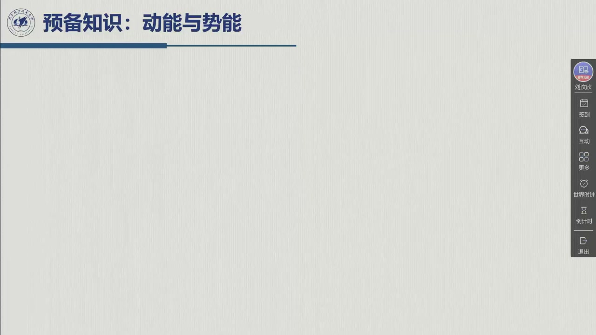
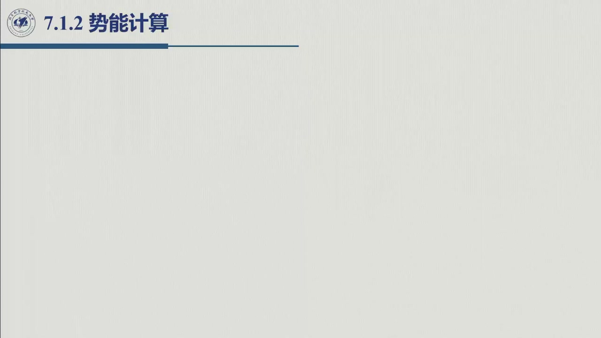

# 6.1.2 势能计算

> 录播 01:09:10–01:15:30。这一节很短，但有一个关键结论：**势能只依赖位形 $\boldsymbol q$，不依赖速度 $\dot{\boldsymbol q}$**。
> 后面拉格朗日方程里「$\partial U/\partial\dot q=0$」、重力项只出现在 $\partial U/\partial q$ 中，都靠这一条。

## 6.1.2.1 只算重力

对刚性连杆，势能来自重力（弹性、磁力等暂不考虑）：

$$U=\sum_{i=1}^{n}\bigl(U_i+U_{m_i}\bigr),$$

$$U_i=-\int_{V_i}\boldsymbol g_0^{\mathrm T}\boldsymbol p_i^*\,\rho\,\mathrm dV
=-m_i\boldsymbol g_0^{\mathrm T}\boldsymbol p_i,\qquad
U_{m_i}=-m_{m_i}\boldsymbol g_0^{\mathrm T}\boldsymbol p_{m_i},$$

其中 $\boldsymbol g_0$ 是基坐标系中的重力加速度向量。若 $z$ 轴竖直向上，则

$$\boldsymbol g_0=[0,\ 0,\ -g]^{\mathrm T},\qquad g=9.81\ \mathrm{m/s^2}.$$

于是

$$\boxed{\ U(\boldsymbol q)=-\sum_{i=1}^{n}\bigl(m_i\boldsymbol g_0^{\mathrm T}\boldsymbol p_i(\boldsymbol q)
+m_{m_i}\boldsymbol g_0^{\mathrm T}\boldsymbol p_{m_i}(\boldsymbol q)\bigr)\ }$$

## 6.1.2.2 为什么只依赖 $\boldsymbol q$

质心位置 $\boldsymbol p_i$ 与转子质心位置 $\boldsymbol p_{m_i}$ 都是**位形**的函数（由正运动学给出），
与速度无关。因此

$$U=U(\boldsymbol q),\qquad \frac{\partial U}{\partial\dot{\boldsymbol q}}=\boldsymbol 0.$$

这一条会直接简化拉格朗日方程：$\dfrac{\partial L}{\partial\dot q_i}=\dfrac{\partial T}{\partial\dot q_i}$，
势能只从 $\dfrac{\partial L}{\partial q_i}=-\dfrac{\partial U}{\partial q_i}$ 这一项进来。

## 6.1.2.3 势能的梯度就是重力矩

把 $U$ 对 $q_i$ 求偏导，用链式法则：

$$\frac{\partial U}{\partial q_i}
=-\sum_{j=1}^{n}\Bigl(m_j\boldsymbol g_0^{\mathrm T}\frac{\partial\boldsymbol p_j}{\partial q_i}
+m_{m_j}\boldsymbol g_0^{\mathrm T}\frac{\partial\boldsymbol p_{m_j}}{\partial q_i}\Bigr).$$

而 $\dfrac{\partial\boldsymbol p_j}{\partial q_i}=j_{Pi}^{(j)}$（雅可比第 $i$ 列），所以

$$\frac{\partial U}{\partial q_i}
=-\sum_{j=1}^{n}\Bigl(m_j\boldsymbol g_0^{\mathrm T}j_{Pi}^{(j)}
+m_{m_j}\boldsymbol g_0^{\mathrm T}j_{Pi}^{(m_j)}\Bigr)
\triangleq -g_i(\boldsymbol q).$$

这里的 $g_i(\boldsymbol q)$ 就是**重力在关节 $i$ 上产生的等效力矩**——把重力看成作用在各质心的力，
经雅可比转置折回关节。写成向量：

$$\boldsymbol g(\boldsymbol q)=\frac{\partial U}{\partial\boldsymbol q}
=\sum_{j=1}^{n}\Bigl(m_jJ_P^{(j)\mathrm T}\boldsymbol g_0+m_{m_j}J_P^{(m_j)\mathrm T}\boldsymbol g_0\Bigr).$$

::: note 符号与直觉
- 本教程把 $\boldsymbol g(\boldsymbol q)$ 定义为**重力矩**（即 $\partial U/\partial q$），运动方程中它出现在左端：
  $B\ddot q+C\dot q+\boldsymbol g=\tau$。也就是说，**要平衡重力，执行器必须提供 $+\boldsymbol g$ 的力矩**。
- 若 $\boldsymbol g_0=[0,0,-g]^{\mathrm T}$（$z$ 向上），质心越高势能越大；$\partial U/\partial q$ 的符号
  与「抬升该关节需要做正功还是负功」一致，可以用单摆检验：摆角 $\vartheta$ 从垂下位置增大时，
  $U=mgl(1-\cos\vartheta)$ 增大，$\partial U/\partial\vartheta=mgl\sin\vartheta>0$，需要电机提供正力矩。
:::

## 6.1.2.4 小结与常见错误

- **一句话**：$U=-\sum(m_i\boldsymbol g_0^{\mathrm T}\boldsymbol p_i+m_{m_i}\boldsymbol g_0^{\mathrm T}\boldsymbol p_{m_i})$，
  只依赖 $\boldsymbol q$；它的梯度就是重力矩。
- **两条推论**：$\partial U/\partial\dot q=0$；运动方程中的重力项 $\boldsymbol g(\boldsymbol q)=\partial U/\partial q$。

::: think 常见错误清单
1. **把势能写成速度的函数**：$U$ 与 $\dot q$ 无关；若写了，说明把动能项混进来了。
2. **重力方向与坐标轴不一致**：$\boldsymbol g_0$ 的符号取决于 $z$ 轴朝向；平面臂若取 $y$ 竖直，
   $\boldsymbol g_0=[0,-g,0]^{\mathrm T}$，不是 $[0,0,-g]^{\mathrm T}$。
3. **重力矩符号反**：先用手算单摆检验——摆角增大时重力矩应为正（阻止继续抬起）还是负，
   取决于角度定义；符号错了，后面的控制前馈会整体反向。
:::
