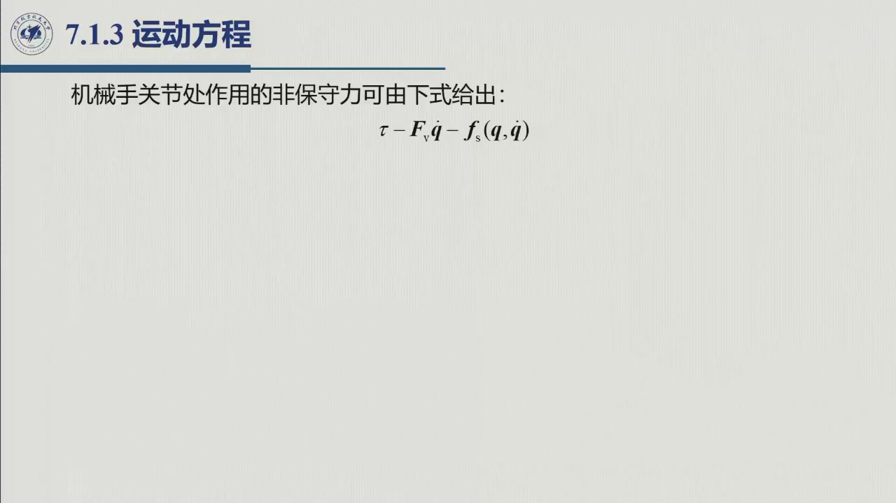
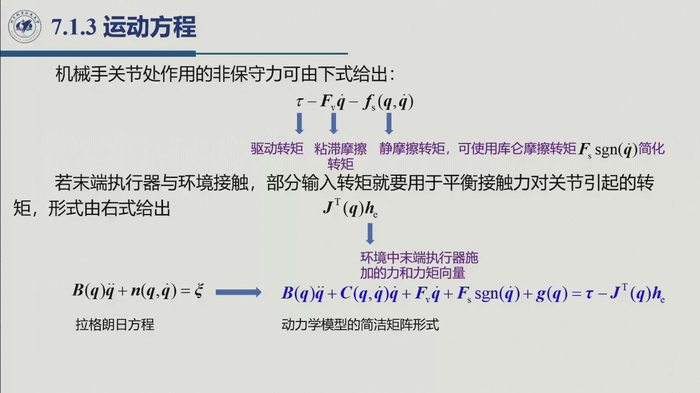

# 6.1.3 运动方程

前两节已经把总动能写成二次型 $T=\frac12\dot{\boldsymbol q}^{\mathrm T}B(\boldsymbol q)\dot{\boldsymbol q}$，并由重力势能得到左端重力项 $\boldsymbol g(\boldsymbol q)=\nabla_{\boldsymbol q}U$。下一步把 $L=T-U$ 代入[拉格朗日方程](../recall.md#lagrange)，把导数拆成加速度项、速度二次项和重力项，整理出标准关节空间动力学模型，给每一项一个明确的物理名字，再补上摩擦与末端接触力。课堂回看：01:15:30–01:22:30。
## 6.1.3.1 代入拉格朗日方程

$$L(\boldsymbol q,\dot{\boldsymbol q})=T(\boldsymbol q,\dot{\boldsymbol q})-U(\boldsymbol q)
=\frac12\dot{\boldsymbol q}^{\mathrm T}B(\boldsymbol q)\dot{\boldsymbol q}-U(\boldsymbol q).$$

先把二次型展开成标量求和 $T=\frac12\sum_{j=1}^{n}\sum_{k=1}^{n}b_{jk}(\boldsymbol q)\dot q_j\dot q_k$。注意下标约定：$i$ 固定代表第 $i$ 个方程，$j,k$ 是求和哑指标。求 $\partial T/\partial\dot q_i$ 时，乘积 $\dot q_j\dot q_k$ 中 $j=i$ 和 $k=i$ 两个因子都会对 $\dot q_i$ 求导，分别贡献一次（例如 $T=\frac12(b_{11}\dot q_1^2+b_{12}\dot q_1\dot q_2+b_{21}\dot q_2\dot q_1+b_{22}\dot q_2^2)$ 对 $\dot q_1$ 求偏导得 $b_{11}\dot q_1+\frac12 b_{12}\dot q_2+\frac12 b_{21}\dot q_1$——最后两项因 $b_{12}=b_{21}$ 合并为 $b_{12}\dot q_2$）：

$$\frac{\partial T}{\partial\dot q_i}
=\frac12\sum_{k=1}^{n}b_{ik}\dot q_k+\frac12\sum_{j=1}^{n}b_{ji}\dot q_j
=\sum_{j=1}^{n}b_{ij}(\boldsymbol q)\dot q_j,$$

最后一步把第一项的哑指标 $k$ 改写为 $j$，并利用 $B$ 的对称性 $b_{ji}=b_{ij}$ 将两项合并。接着沿实际运动对时间求导：因为 $b_{ij}(\boldsymbol q)$ 也随构形变化，必须同时对 $b_{ij}$ 和 $\dot q_j$ 用乘积法则求导，其中 $\frac{\mathrm d}{\mathrm dt}b_{ij}(\boldsymbol q)=\sum_{k=1}^{n}\frac{\partial b_{ij}}{\partial q_k}\dot q_k$：

$$\frac{\partial L}{\partial\dot q_i}=\frac{\partial T}{\partial\dot q_i}
=\sum_{j=1}^{n}b_{ij}(\boldsymbol q)\dot q_j
\qquad\Longrightarrow\qquad
\frac{\mathrm d}{\mathrm dt}\frac{\partial L}{\partial\dot q_i}
=\sum_{j=1}^{n}b_{ij}\ddot q_j+\sum_{j=1}^{n}\sum_{k=1}^{n}\frac{\partial b_{ij}}{\partial q_k}\dot q_k\dot q_j.$$

再算位置偏导。因为 $U$ 不含 $\dot{\boldsymbol q}$，$\partial L/\partial q_i=\partial T/\partial q_i-\partial U/\partial q_i$。在 $T=\frac12\sum_{j,k}b_{jk}(\boldsymbol q)\dot q_j\dot q_k$ 中，求偏导时 $\dot q_j,\dot q_k$ 当作常量，只对 $b_{jk}(\boldsymbol q)$ 求导：

$$\frac{\partial L}{\partial q_i}
=\frac12\sum_{j=1}^{n}\sum_{k=1}^{n}\frac{\partial b_{jk}}{\partial q_i}\dot q_k\dot q_j
-\frac{\partial U}{\partial q_i}.$$

将前面的时间导数减去位置偏导，得到拉格朗日方程左端：

$$\sum_{j=1}^{n}b_{ij}\ddot q_j
+\sum_{j=1}^{n}\sum_{k=1}^{n}\Bigl(\frac{\partial b_{ij}}{\partial q_k}
-\frac12\frac{\partial b_{jk}}{\partial q_i}\Bigr)\dot q_k\dot q_j
+\frac{\partial U}{\partial q_i}=\xi_i.$$

## 6.1.3.2 分量形式与 $h_{ijk}$

定义

$$h_{ijk}(\boldsymbol q)=\frac{\partial b_{ij}}{\partial q_k}-\frac12\frac{\partial b_{jk}}{\partial q_i},$$

则

$$\boxed{\ \sum_{j=1}^{n}b_{ij}(\boldsymbol q)\ddot q_j
+\sum_{j=1}^{n}\sum_{k=1}^{n}h_{ijk}(\boldsymbol q)\dot q_k\dot q_j
+g_i(\boldsymbol q)=\xi_i,\qquad i=1,\dots,n\ }$$

其中 $g_i=\partial U/\partial q_i$ 是方程左端的重力项，其相反数才是重力实际施加的广义力（见 [6.1.2](sec6-1-2.md)）。

## 6.1.3.3 矩阵形式

把速度二次项收进矩阵 $C(\boldsymbol q,\dot{\boldsymbol q})$，要求其元素满足

$$\sum_{j=1}^{n}c_{ij}(\boldsymbol q,\dot{\boldsymbol q})\dot q_j
=\sum_{j=1}^{n}\sum_{k=1}^{n}h_{ijk}(\boldsymbol q)\dot q_k\dot q_j.$$

于是

$$\boxed{\ B(\boldsymbol q)\ddot{\boldsymbol q}+C(\boldsymbol q,\dot{\boldsymbol q})\dot{\boldsymbol q}
+\boldsymbol g(\boldsymbol q)=\boldsymbol\xi\ }$$

再把广义力的摩擦与末端接触力补上，得到**完整的关节空间动力学模型**：

$$\boxed{\ B(\boldsymbol q)\ddot{\boldsymbol q}+C(\boldsymbol q,\dot{\boldsymbol q})\dot{\boldsymbol q}
+F_{\mathrm v}\dot{\boldsymbol q}+F_{\mathrm s}\operatorname{sgn}(\dot{\boldsymbol q})
+\boldsymbol g(\boldsymbol q)=\boldsymbol\tau-J^{\mathrm T}(\boldsymbol q)\boldsymbol h_e\ }$$

这就是全章的核心方程：左边由质量分布和几何决定 $B$、由位形变化产生速度二次项 $C\dot{\boldsymbol q}$、由势能梯度给出重力项 $\boldsymbol g$，再加上摩擦；右边是驱动力矩减末端接触力折算。接下来给左端每一项定名，再用单摆检验各项符号。

## 6.1.3.4 每一项的物理意义

| 项 | 名称 | 物理意义 |
|:--|:--|:--|
| $b_{ii}\ddot q_i$ | 自惯量项 | **锁住其他关节**时，关节 $i$ 轴上的等效转动惯量 |
| $b_{ij}\ddot q_j\ (i\neq j)$ | 耦合惯量项 | 关节 $j$ 的加速度在关节 $i$ 上引起的惯性力矩 |
| $h_{ijj}\dot q_j^2$ | 离心项 | 关节 $j$ 的速度在关节 $i$ 上产生的离心力矩；$h_{iii}=\frac12\partial b_{ii}/\partial q_i$，仅当 $b_{ii}$ 不依赖 $q_i$（如常规开链转动关节或平面臂）时为零 |
| $h_{ijk}\dot q_j\dot q_k\ (j\neq k)$ | 科氏项 | 关节 $j,k$ 的速度在关节 $i$ 上产生的科氏力矩 |
| $g_i(\boldsymbol q)$ | 重力项 | 当前位形下平衡重力所需的广义力；实际重力广义力为 $-g_i$ |
| $F_{\mathrm v}\dot q_i$ | 粘滞摩擦 | 与速度成正比，低速时也要补 |
| $F_{\mathrm s}\operatorname{sgn}\dot q_i$ | 库仑摩擦 | 方向与速度相反，速度过零时跳变（难建模） |
| $J^{\mathrm T}\boldsymbol h_e$ | 末端接触力 | 末端力/力矩经雅可比转置折回关节 |

::: note 「锁住其他关节」是什么意思
$b_{ii}$ 的定义来自 $T=\frac12\dot q^{\mathrm T}B\dot q$：若只让关节 $i$ 以单位速度转、其余关节速度为零，
则 $T=\frac12b_{ii}$。所以 $b_{ii}$ 是「其他关节锁死时，关节 $i$ 看到的惯量」。它不是连杆 $i$ 自己的惯量，
而是**该关节之后所有连杆折算到该轴的惯量**（因为锁住其他关节后，后面所有连杆都随关节 $i$ 一起动）。
:::

::: intuition 速度二次项不能只从 $\dot B\dot q$ 取出
时间求导确实产生 $\dot B\dot q$，但拉格朗日方程还要减去 $\partial T/\partial q$。两部分合起来才是完整的速度项。

看一个标量模型 $T=\tfrac12b(q)\dot q^2$：

$$\frac{d}{dt}\frac{\partial T}{\partial\dot q}=b\ddot q+b'\dot q^2,\qquad
\frac{\partial T}{\partial q}=\tfrac12b'\dot q^2.$$

相减后只剩 $b\ddot q+\tfrac12b'\dot q^2$。如果直接把 $\dot b\dot q$ 当成速度二次项，就会把系数多算一倍。这也解释了为什么一般 $h_{iii}=\tfrac12\partial b_{ii}/\partial q_i$，只有在 $b_{ii}$ 确实不依赖 $q_i$ 时才为零。
:::

::: ex 例 6.1.3.A · 同一位置，保持、自由下落、主动加速需要多少力矩 {#ex-6.1.3.A}
沿用 [势能节的质点单摆](sec6-1-2.md#ex-6.1.2.A)：$m=2\ \mathrm{kg}$、$l=0.5\ \mathrm m$，
$q=\pi/6$、当前 $\dot q=0$。忽略摩擦与末端接触，求 (a) 静止保持；(b) 关闭电机；(c) 要求 $\ddot q=2\ \mathrm{rad/s^2}$ 时的结果。

::: sol 解
先把模型压缩为一个标量：$B=ml^2=0.5\ \mathrm{kg\cdot m^2}$ 为常数，$C=0$，
$g=mgl\sin q=4.905\ \mathrm{N\cdot m}$，所以

$$0.5\ddot q+4.905=\tau.$$

(a) 保持要求 $\ddot q=0$，故 $\tau=4.905\ \mathrm{N\cdot m}$。
(b) 关闭电机是 $\tau=0$，故 $\ddot q=-9.81\ \mathrm{rad/s^2}$，负号表示朝垂下位置加速。
(c) 所需力矩 $\tau=0.5\times2+4.905=5.905\ \mathrm{N\cdot m}$，其中 $4.905$ 用于抵消重力，$1$ 用于加速。

当前速度为零只能消去速度项，不能据此消去加速度项。静止保持与自由释放在这一瞬间可以具有相同的 $q,\dot q$，输入力矩不同，加速度便不同。
:::
:::

::: think 迁移练习 · 加速方向改了，力矩必须反向吗
若同一位形要求 $\ddot q=-2\ \mathrm{rad/s^2}$，力矩是多少？为什么它仍可为正？

::: sol 核对
$\tau=0.5\times(-2)+4.905=3.905\ \mathrm{N\cdot m}$。
电机向正方向拉，但它的力矩小于保持所需值，重力合力矩仍为负，所以摆向负方向加速。
若认为「负加速度必配负电机力矩」，回读本节矩阵方程，把 $-g$ 放到右侧看净力矩；
若把 $\dot q=0$ 误作 $\ddot q=0$，重做例题 (a)、(b) 的对比。
:::
:::

## 6.1.3.5 接下来需要检查的两个结构问题

::: think 本节埋下的两个问题（6.2 回答）
1. **$C$ 不唯一**：运动方程只要求 $\sum_j c_{ij}\dot q_j=\sum_{j,k}h_{ijk}\dot q_k\dot q_j$，$C$ 本身可以有无数组选法。不同的 $C$ 会改变 $\dot B-2C$ 的对称性，这正是 [6.2.1](sec6-2-1.md) 要解决的问题。
2. **$C$ 与 $\boldsymbol g$ 的生成来源不同**：$h_{ijk}$ 只依赖 $B$ 的偏导，而 $\boldsymbol g$ 来自 $U$ 的偏导。只要算出 $B(\boldsymbol q)$ 和 $U(\boldsymbol q)$，其余项都可以按偏导公式自动生成；只知道 $B$ 还恢复不出重力。
:::

## 6.1.3.6 小结与常见错误

把 $T=\frac12\dot{\boldsymbol q}^{\mathrm T}B\dot{\boldsymbol q}$ 与 $U(\boldsymbol q)$ 代入拉格朗日方程，得到 $B(\boldsymbol q)\ddot{\boldsymbol q}+C(\boldsymbol q,\dot{\boldsymbol q})\dot{\boldsymbol q}+F_{\mathrm v}\dot{\boldsymbol q}+F_{\mathrm s}\operatorname{sgn}(\dot{\boldsymbol q})+\boldsymbol g(\boldsymbol q)=\boldsymbol\tau-J^{\mathrm T}(\boldsymbol q)\boldsymbol h_e$。其中 $h_{ijk}=\frac{\partial b_{ij}}{\partial q_k}-\frac12\frac{\partial b_{jk}}{\partial q_i}$ 唯一确定了乘积 $C\dot{\boldsymbol q}$，矩阵 $C$ 本身还需要进一步约定选法。

::: think 常见错误清单
1. **把 $C\dot q$ 写成 $C$ 乘 $\dot q$ 但 $C$ 里漏了 $\dot q$**：$C$ 本身是 $q,\dot q$ 的函数，$C\dot q$ 才是力矩。
2. **$h_{ijk}$ 的系数 $1/2$ 漏掉**：第二项是 $-\frac12\partial b_{jk}/\partial q_i$，不是 $-\partial b_{jk}/\partial q_i$。
3. **摩擦项符号**：摩擦总是**阻碍**运动，故在左端取正、移到右端取负；$\operatorname{sgn}\dot q$ 在 $\dot q=0$ 处不连续。
4. **末端力方向**：$\boldsymbol h_e$ 是末端作用在环境上的力；若已知环境反作用于末端的力 $\boldsymbol f=-\boldsymbol h_e$，右端应写成 $\boldsymbol\tau+J^{\mathrm T}\boldsymbol f$。写控制律时先统一约定。
:::

::: think 默写点 · 合上书再写
1. 从 $L=T-U$ 推到 $B\ddot{\boldsymbol q}+C\dot{\boldsymbol q}+\boldsymbol g=\boldsymbol\xi$ 的完整步骤（包括 $\frac{\mathrm d}{\mathrm dt}\frac{\partial T}{\partial\dot q_i}$ 与 $\frac{\partial T}{\partial q_i}$）。
2. 写出 $h_{ijk}$ 的定义，并解释 $b_{ii}$、$b_{ij}$、$h_{ijj}$、$h_{ijk}$、$g_i$ 的物理意义。
3. 写出含粘滞摩擦、库仑摩擦与末端力的完整关节空间运动方程。
4. 为什么运动方程只唯一确定 $C\dot{\boldsymbol q}$ 而不唯一确定 $C$？这会带来什么后果？
:::
