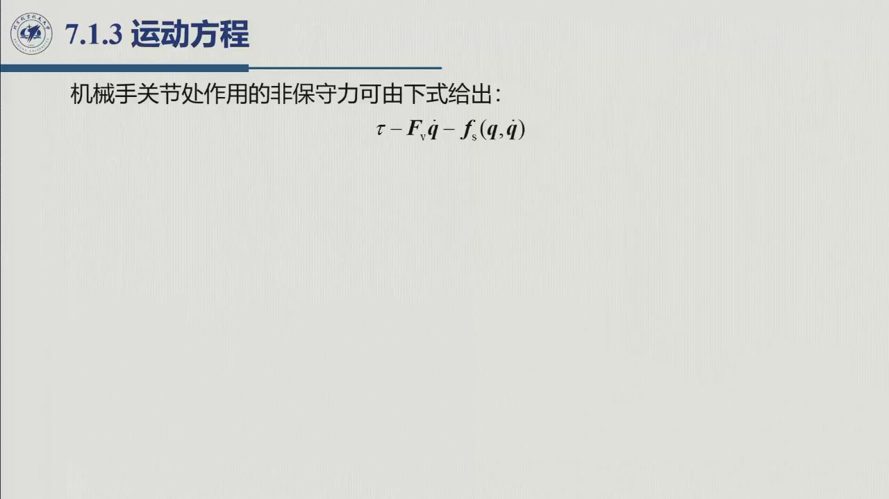
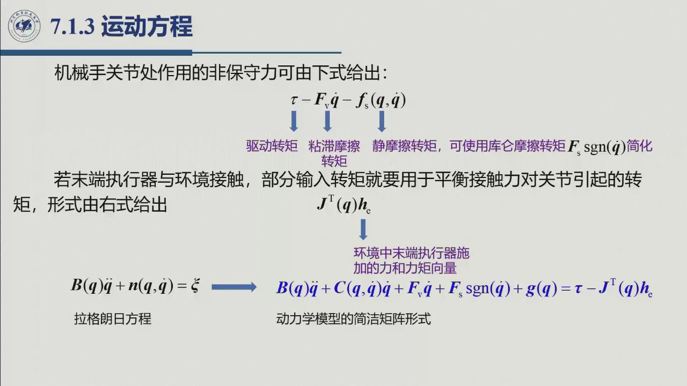

# 6.1.3 运动方程

> 录播 01:15:30–01:22:30。把 $T=\frac12\dot{\boldsymbol q}^{\mathrm T}B\dot{\boldsymbol q}$ 与 $U=U(\boldsymbol q)$
> 代进拉格朗日方程，就得到**关节空间动力学模型**。这一节要把方程的每一项「叫出名字」，
> 因为原书第 8 章的控制律就是逐项补偿这些名字。

## 6.1.3.1 代入拉格朗日方程

$$L(\boldsymbol q,\dot{\boldsymbol q})=T(\boldsymbol q,\dot{\boldsymbol q})-U(\boldsymbol q)
=\frac12\dot{\boldsymbol q}^{\mathrm T}B(\boldsymbol q)\dot{\boldsymbol q}-U(\boldsymbol q).$$

先算速度项：

$$\frac{\partial L}{\partial\dot q_i}=\frac{\partial T}{\partial\dot q_i}
=\sum_{j=1}^{n}b_{ij}(\boldsymbol q)\dot q_j
\qquad\Longrightarrow\qquad
\frac{\mathrm d}{\mathrm dt}\frac{\partial L}{\partial\dot q_i}
=\sum_{j=1}^{n}b_{ij}\ddot q_j+\sum_{j=1}^{n}\sum_{k=1}^{n}\frac{\partial b_{ij}}{\partial q_k}\dot q_k\dot q_j.$$

再算位置项（$U$ 不含 $\dot q$）：

$$\frac{\partial L}{\partial q_i}=\frac{\partial T}{\partial q_i}-\frac{\partial U}{\partial q_i}
=\frac12\sum_{j=1}^{n}\sum_{k=1}^{n}\frac{\partial b_{jk}}{\partial q_i}\dot q_k\dot q_j
-\frac{\partial U}{\partial q_i}.$$

两式相减：

$$\sum_{j=1}^{n}b_{ij}\ddot q_j
+\sum_{j=1}^{n}\sum_{k=1}^{n}\Bigl(\frac{\partial b_{ij}}{\partial q_k}
-\frac12\frac{\partial b_{jk}}{\partial q_i}\Bigr)\dot q_k\dot q_j
+\frac{\partial U}{\partial q_i}=\xi_i.$$

## 6.1.3.2 分量形式与 $h_{ijk}$

定义

$$h_{ijk}(\boldsymbol q)=\frac{\partial b_{ij}}{\partial q_k}-\frac12\frac{\partial b_{jk}}{\partial q_i},$$

则

$$\boxed{\ \sum_{j=1}^{n}b_{ij}(\boldsymbol q)\ddot q_j
+\sum_{j=1}^{n}\sum_{k=1}^{n}h_{ijk}(\boldsymbol q)\dot q_k\dot q_j
+g_i(\boldsymbol q)=\xi_i,\qquad i=1,\dots,n\ }$$

其中 $g_i=\partial U/\partial q_i$ 是方程左端的重力项，其相反数才是重力实际施加的广义力（见 [6.1.2](sec6-1-2.md)）。

## 6.1.3.3 矩阵形式

把速度二次项收进矩阵 $C(\boldsymbol q,\dot{\boldsymbol q})$，要求其元素满足

$$\sum_{j=1}^{n}c_{ij}(\boldsymbol q,\dot{\boldsymbol q})\dot q_j
=\sum_{j=1}^{n}\sum_{k=1}^{n}h_{ijk}(\boldsymbol q)\dot q_k\dot q_j.$$

于是

$$\boxed{\ B(\boldsymbol q)\ddot{\boldsymbol q}+C(\boldsymbol q,\dot{\boldsymbol q})\dot{\boldsymbol q}
+\boldsymbol g(\boldsymbol q)=\boldsymbol\xi\ }$$

再把广义力的摩擦与末端接触力补上，得到**完整的关节空间动力学模型**：

$$\boxed{\ B(\boldsymbol q)\ddot{\boldsymbol q}+C(\boldsymbol q,\dot{\boldsymbol q})\dot{\boldsymbol q}
+F_{\mathrm v}\dot{\boldsymbol q}+F_{\mathrm s}\operatorname{sgn}(\dot{\boldsymbol q})
+\boldsymbol g(\boldsymbol q)=\boldsymbol\tau-J^{\mathrm T}(\boldsymbol q)\boldsymbol h_e\ }$$

这就是全章要推的「那一行公式」。后面 6.2 的两条性质、6.3 的两个算例，都是在补全或检验它。

## 6.1.3.4 每一项的物理意义

| 项 | 名称 | 物理意义 |
|:--|:--|:--|
| $b_{ii}\ddot q_i$ | 自惯量项 | **锁住其他关节**时，关节 $i$ 轴上的等效转动惯量 |
| $b_{ij}\ddot q_j\ (i\neq j)$ | 耦合惯量项 | 关节 $j$ 的加速度在关节 $i$ 上引起的惯性力矩 |
| $h_{ijj}\dot q_j^2$ | 离心项 | 关节 $j$ 的速度在关节 $i$ 上产生的离心力矩；$h_{iii}=0$（因 $\partial b_{ii}/\partial q_i=0$） |
| $h_{ijk}\dot q_j\dot q_k\ (j\neq k)$ | 科氏项 | 关节 $j,k$ 的速度在关节 $i$ 上产生的科氏力矩 |
| $g_i(\boldsymbol q)$ | 重力项 | 当前位形下平衡重力所需的广义力；实际重力广义力为 $-g_i$ |
| $F_{\mathrm v}\dot q_i$ | 粘滞摩擦 | 与速度成正比，低速时也要补 |
| $F_{\mathrm s}\operatorname{sgn}\dot q_i$ | 库仑摩擦 | 方向与速度相反，速度过零时跳变（难建模） |
| $J^{\mathrm T}\boldsymbol h_e$ | 末端接触力 | 末端力/力矩经雅可比转置折回关节 |

::: note 「锁住其他关节」是什么意思
$b_{ii}$ 的定义来自 $T=\frac12\dot q^{\mathrm T}B\dot q$：若只让关节 $i$ 以单位速度转、其余关节速度为零，
则 $T=\frac12b_{ii}$。所以 $b_{ii}$ 是「其他关节锁死时，关节 $i$ 看到的惯量」。它不是连杆 $i$ 自己的惯量，
而是**该关节之后所有连杆折算到该轴的惯量**（因为锁住其他关节后，后面所有连杆都随关节 $i$ 一起动）。
:::

::: intuition 为什么会有离心项和科氏项
想象一个人握着哑铃转圈：手臂伸得越长（$q$ 变），转动惯量越大；收臂时（$\dot q$ 与 $\partial b/\partial q$ 同时非零），
即使没有电机加速，也会感到「被甩」——这就是离心项。科氏项则是两个关节同时运动时的交叉耦合：
一个关节的速度改变了另一个关节的有效惯量，于是产生额外的力矩。数学上它们都来自
$\dfrac{\mathrm d}{\mathrm dt}(B\dot q)=B\ddot q+\dot B\dot q$ 里的 $\dot B\dot q$，即 $B$ 随位形变化。
:::

::: ex 例 6.1.3.A · 同一位置，保持、自由下落、主动加速需要多少力矩 {#ex-6.1.3.A}
沿用 [势能节的质点单摆](sec6-1-2.md#ex-6.1.2.A)：$m=2\ \mathrm{kg}$、$l=0.5\ \mathrm m$，
$q=\pi/6$、当前 $\dot q=0$。忽略摩擦与末端接触，求 (a) 静止保持；(b) 关闭电机；(c) 要求 $\ddot q=2\ \mathrm{rad/s^2}$ 时的结果。

::: sol 解
先把模型压缩为一个标量：$B=ml^2=0.5\ \mathrm{kg\cdot m^2}$ 为常数，$C=0$，
$g=mgl\sin q=4.905\ \mathrm{N\cdot m}$，所以

$$0.5\ddot q+4.905=\tau.$$

(a) 保持要求 $\ddot q=0$，故 $\tau=4.905\ \mathrm{N\cdot m}$。
(b) 关闭电机是 $\tau=0$，故 $\ddot q=-9.81\ \mathrm{rad/s^2}$，负号表示朝垂下位置加速。
(c) 所需力矩 $\tau=0.5\times2+4.905=5.905\ \mathrm{N\cdot m}$，其中 $4.905$ 用于抵消重力，$1$ 用于加速。

**现在速度为零只会消掉速度项，不能自动消掉加速度项。** 静止保持与自由释放在这一瞬间可以有相同的 $q,\dot q$，但因输入不同，加速度不同。
:::
:::

::: think 迁移练习 · 加速方向改了，力矩必须反向吗
若同一位形要求 $\ddot q=-2\ \mathrm{rad/s^2}$，力矩是多少？为什么它仍可为正？

::: sol 核对
$\tau=0.5\times(-2)+4.905=3.905\ \mathrm{N\cdot m}$。
电机向正方向拉，但它的力矩小于保持所需值，重力合力矩仍为负，所以摆向负方向加速。
若认为「负加速度必配负电机力矩」，回读本节矩阵方程，把 $-g$ 放到右侧看净力矩；
若把 $\dot q=0$ 误作 $\ddot q=0$，重做例题 (a)、(b) 的对比。
:::
:::

## 6.1.3.5 老师强调的两个「伏笔」

::: think 本节埋下的两个问题（6.2 回答）
1. **$C$ 不唯一**：只要满足 $\sum_j c_{ij}\dot q_j=\sum_{j,k}h_{ijk}\dot q_k\dot q_j$，$C$ 可以有无数组。
   不同的 $C$ 会改变 $\dot B-2C$ 的对称性——这正是 [6.2.1](sec6-2-1.md) 要讲的。
2. **$h_{ijk}$ 的结构**：它只依赖 $B$ 的偏导，所以 $B$ 一旦算出，$C$ 与重力项都是「求导 + 组合」。
   编程时不需要分别推 $C$ 和 $g$，可以从 $B$ 与 $U$ 自动生成。
:::

## 6.1.3.6 小结与常见错误

- **一句话**：$B\ddot q+C\dot q+\boldsymbol g=\boldsymbol\tau-J^{\mathrm T}h_e$，外加摩擦项。
- **三块**：惯性（$B\ddot q$）、速度耦合（$C\dot q$）、重力（$g$）；摩擦与末端力是外延。
- **一个关键结构**：$C$ 的元素来自 $B$ 的偏导，因此 $C$ 不唯一。

::: think 常见错误清单
1. **把 $C\dot q$ 写成 $C$ 乘 $\dot q$ 但 $C$ 里漏了 $\dot q$**：$C$ 本身是 $q,\dot q$ 的函数，$C\dot q$ 才是力矩。
2. **$h_{ijk}$ 的系数 $1/2$ 漏掉**：第二项是 $-\frac12\partial b_{jk}/\partial q_i$，不是 $-\partial b_{jk}/\partial q_i$。
3. **摩擦项符号**：摩擦总是**阻碍**运动，故在左端取正、移到右端取负；$\operatorname{sgn}\dot q$ 在 $\dot q=0$ 处不连续。
4. **末端力方向**：$h_e$ 是末端作用在环境上的力；环境反力则符号相反。写控制律时先统一约定。
:::

::: think 默写点 · 合上书再写
1. 从 $L=T-U$ 推到 $B\ddot q+C\dot q+g=\xi$ 的完整步骤。
2. 写出 $h_{ijk}$ 的定义，并解释 $b_{ii}$、$b_{ij}$、$h_{ijj}$、$h_{ijk}$、$g_i$ 的物理意义。
3. 写出含摩擦与末端力的完整方程。
4. 为什么 $C$ 不唯一？这会带来什么后果？
:::
