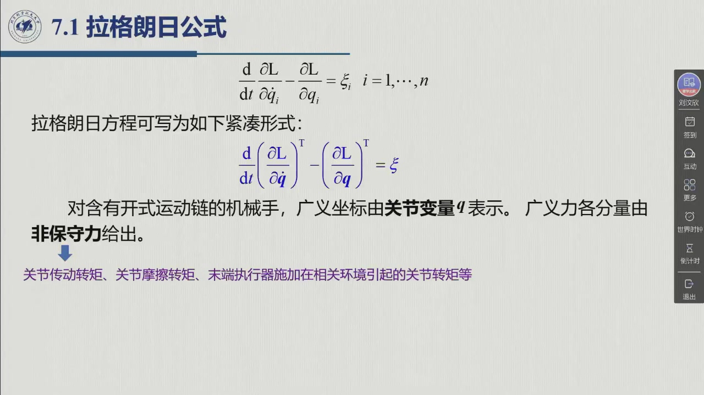
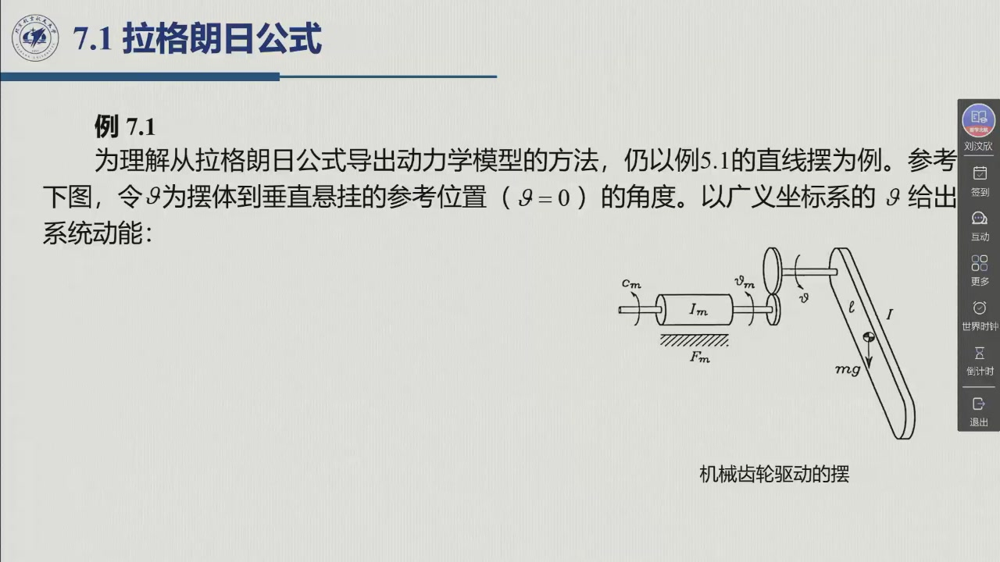

# 6.1 拉格朗日公式

> 录播 00:33:00–00:49:30（含例 7.1）。本节回答两个问题：**为什么用能量列方程**，以及
> **广义力到底包含哪些东西**。前者决定方法的适用面，后者决定方程右端写不写得对。

## 6.1.1 从「力」换到「能量」

牛顿–欧拉路线要逐杆画受力图、消内部约束力；拉格朗日路线只做两件事：**写动能 $T$、写势能 $U$**，
然后代一个固定的微分公式。对 $n$ 自由度开链机械手，取关节变量

$$\boldsymbol q=[q_1,\ q_2,\ \dots,\ q_n]^{\mathrm T}$$

为**广义坐标**（generalized coordinates）。它们能完全确定各连杆的位置，因而也确定整个系统的能量。

::: def 定义 6.1.1 · 拉格朗日函数与拉格朗日方程 {#def-6.1.1}
机械系统的**拉格朗日函数**定义为动能与势能之差

$$L(\boldsymbol q,\dot{\boldsymbol q})=T(\boldsymbol q,\dot{\boldsymbol q})-U(\boldsymbol q).$$

**拉格朗日方程**为

$$\frac{\mathrm d}{\mathrm dt}\left(\frac{\partial L}{\partial \dot q_i}\right)-\frac{\partial L}{\partial q_i}=\xi_i,
\qquad i=1,\dots,n,$$

其中 $\xi_i$ 是与广义坐标 $q_i$ 对应的**广义力**。写成向量形式：

$$\frac{\mathrm d}{\mathrm dt}\left(\frac{\partial L}{\partial \dot{\boldsymbol q}}\right)^{\mathrm T}
-\left(\frac{\partial L}{\partial \boldsymbol q}\right)^{\mathrm T}=\boldsymbol\xi.$$
:::

::: intuition 为什么可以「不画受力图」
拉格朗日方程里的 $\dfrac{\mathrm d}{\mathrm dt}\dfrac{\partial L}{\partial \dot q_i}-\dfrac{\partial L}{\partial q_i}$
已经把**所有保守力**（重力、弹簧力）自动装进去了——它们藏在 $U$ 里。理想约束力（关节反力、连杆内力）
不做虚功，因此**根本不需要出现在方程里**。这就是能量法最省事的地方：**约束越复杂，越划算**。
代价是：非保守力（执行器力矩、摩擦、末端接触力）必须自己作为 $\xi_i$ 补到右端。
:::

## 6.1.2 广义力 $\xi_i$ 的四个来源

对开链机械手，右端通常由四部分组成：

$$\xi_i=\tau_i-\bigl(F_{\mathrm v}\dot{\boldsymbol q}\bigr)_i-\bigl(F_{\mathrm s}\operatorname{sgn}\dot{\boldsymbol q}\bigr)_i
-\bigl(J^{\mathrm T}(\boldsymbol q)\boldsymbol h_e\bigr)_i.$$

| 来源 | 符号 | 说明 |
|:--|:--|:--|
| 关节执行器力矩 | $\boldsymbol\tau$ | 电机经减速器作用在关节上的驱动力矩（移动关节则为力） |
| 粘滞摩擦 | $F_{\mathrm v}\dot{\boldsymbol q}$ | $F_{\mathrm v}$ 为 $n\times n$ 对角矩阵，与速度成正比 |
| 库仑摩擦 | $F_{\mathrm s}\operatorname{sgn}\dot{\boldsymbol q}$ | $F_{\mathrm s}$ 为对角矩阵，方向与速度相反；是静摩擦的简化模型 |
| 末端接触力 | $J^{\mathrm T}(\boldsymbol q)\boldsymbol h_e$ | $\boldsymbol h_e$ 为末端执行器施加在环境上的力/力矩，经雅可比转置折回关节 |

::: note 符号约定（后面各节统一）
- $\boldsymbol h_e$ 的方向：**末端执行器作用在环境上的力**。若环境反作用于末端，则右端取 $+J^{\mathrm T}\boldsymbol h_e$；
  本教程沿用教材约定，写成 $\boldsymbol\tau-J^{\mathrm T}\boldsymbol h_e$（执行器力矩的一部分用来**平衡**接触力）。
- 移动关节的 $\tau_i$ 是力不是力矩，$q_i$ 是位移不是角度；公式形式不变。
- 摩擦项在建模阶段常先省略（难以精确建模），但在控制实验里必须补，否则低速爬行与稳态误差会很明显。
:::

## 6.1.3 例 7.1：带齿轮的摆（老师逐行推的第一道题）

> 教材例 7.1（对应图 5.8 的摆）。这道题把「动能 + 势能 + 广义力」的完整流程走了一遍，
> 也是后面所有多连杆推导的模板。

**系统**：摆杆绕 $O$ 点转动，转角 $\vartheta$（下垂位置为 $\vartheta=0$），杆的转动惯量 $I$；
电机转子经减速比 $k_r$ 驱动，转子惯量 $I_m$，转子粘滞摩擦系数 $F_m$，关节粘滞摩擦系数 $F$。

**动能**：摆杆与转子都随关节转动。转子的角速度是 $k_r\dot\vartheta$（刚性传动，无打滑），故

$$T=\frac12 I\dot\vartheta^2+\frac12 I_m k_r^2\dot\vartheta^2
=\frac12\bigl(I+I_m k_r^2\bigr)\dot\vartheta^2.$$

**势能**：以垂下位置为零势能点，质心升高 $l(1-\cos\vartheta)$：

$$U=mgl\,(1-\cos\vartheta).$$

**拉格朗日函数**：

$$L=T-U=\frac12\bigl(I+I_m k_r^2\bigr)\dot\vartheta^2-mgl\,(1-\cos\vartheta).$$

**代方程**：

$$\frac{\partial L}{\partial\dot\vartheta}=\bigl(I+I_m k_r^2\bigr)\dot\vartheta,\qquad
\frac{\mathrm d}{\mathrm dt}\frac{\partial L}{\partial\dot\vartheta}=\bigl(I+I_m k_r^2\bigr)\ddot\vartheta,$$

$$\frac{\partial L}{\partial\vartheta}=-mgl\sin\vartheta.$$

因此

$$\bigl(I+I_m k_r^2\bigr)\ddot\vartheta+mgl\sin\vartheta=\xi.$$

**广义力**：执行器力矩 $\tau$，减去关节粘滞摩擦 $F\dot\vartheta$，再减去折算到关节侧的转子摩擦
$F_m k_r^2\dot\vartheta$：

$$\xi=\tau-F\dot\vartheta-F_m k_r^2\dot\vartheta.$$

**完整方程**：

$$\boxed{\ \bigl(I+I_m k_r^2\bigr)\ddot\vartheta+\bigl(F+F_m k_r^2\bigr)\dot\vartheta+mgl\sin\vartheta=\tau\ }$$

这与第 5 章把转子量折算到关节侧得到的方程一致（原书式 (5.29)）——**拉格朗日法自动给出「折算」**，
不需要再单独推一遍减速器的惯量/摩擦折算。

::: think 老师在这道题上强调的三件事
1. **转子的动能也要算**：$T$ 里两项，第二项 $I_m k_r^2\dot\vartheta^2$ 不是可选项。忽略转子惯量，
   高速启停时力矩会明显偏小。
2. **广义力要「折算到关节侧」**：$F_m k_r^2\dot\vartheta$ 的 $k_r^2$ 来自 $\omega_m=k_r\dot\vartheta$，
   与动能里转子项的系数同源；不要漏平方。
3. **非线性只来自重力**：$\sin\vartheta$ 是唯一的非线性项；惯量与摩擦都是线性的。
   多连杆时非线性会多得多（$B(q)$、离心/科氏项），但「先写能量、再代公式」的流程不变。
:::

## 6.1.4 拉格朗日法与牛顿–欧拉法的分工

| 维度 | 拉格朗日法 | 牛顿–欧拉法 |
|:--|:--|:--|
| 出发点 | 标量能量 $T,U$ | 逐杆受力图 + 牛顿/欧拉方程 |
| 参考系 | 不需要选参考系 | 必须选，且要在各杆坐标系间变换 |
| 中间量 | 只有 $T,U$ | 关节反力、连杆内力（要消去） |
| 适合 | 手工推导、少自由度、教学 | 递推计算、多自由度、实时 $O(n)$ |
| 复杂度 | 展开后项数多，易漏项 | 递推结构清晰，程序化容易 |

> 本章用拉格朗日法推公式（**为了看懂结构**），实际软件多用牛顿–欧拉递推（**为了算得快**）。
> 两者给出同一个 $B,C,g$；原书第 8 章的控制律只关心最终形式，不关心用哪种方法推出来。

## 6.1.5 小结与常见错误

- **一句话**：拉格朗日法 = 「写两个标量（$T,U$） + 代一个公式」，约束力自动消失，非保守力补右端。
- **三步流程**：选广义坐标 $\to$ 写 $T,U$ $\to$ 代 $\dfrac{\mathrm d}{\mathrm dt}\dfrac{\partial L}{\partial\dot q}-\dfrac{\partial L}{\partial q}=\xi$。
- **右端四件套**：$\tau$、粘滞摩擦、库仑摩擦、$J^{\mathrm T}h_e$。

::: think 常见错误清单
1. **漏掉转子动能**：尤其是大减速比时 $I_m k_r^2$ 可能比连杆惯量还大。
2. **势能零点选错导致符号反**：$U=mgl(1-\cos\vartheta)$ 的零点在垂下位置；若选水平位置为零，
   表达式会多一个常数，但**不影响运动方程**（常数求导为零）——符号错在 $\partial U/\partial q$ 上才致命。
3. **把 $\xi$ 写成 $\tau$**：摩擦与末端力都算广义力，不能只写电机力矩。
4. **对 $\dot q$ 与 $q$ 的偏导混淆**：$\partial L/\partial\dot q$ 是先对速度求偏导、再对时间求全导；
   $\partial L/\partial q$ 只对位置求偏导。
:::

::: think 默写点 · 合上书再写
1. 写出拉格朗日函数与拉格朗日方程（标量形式与向量形式）。
2. 写出带齿轮的摆的 $T,U,L$ 与最终运动方程。
3. 广义力的四个来源各是什么？末端力为什么要乘 $J^{\mathrm T}$？
4. 拉格朗日法与牛顿–欧拉法各适合什么场合？
:::
