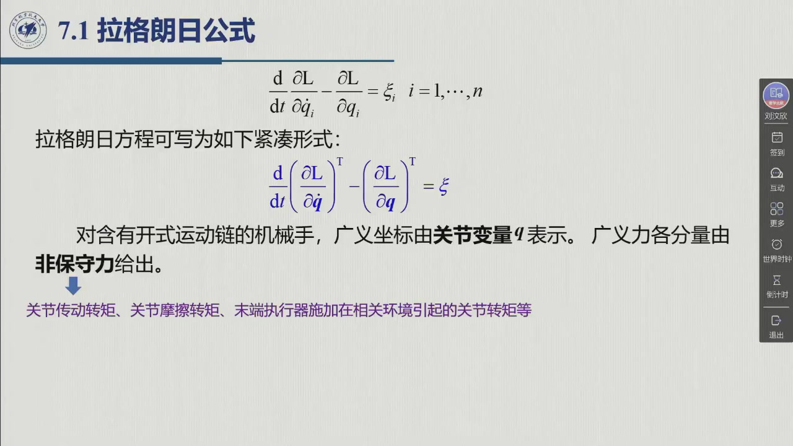
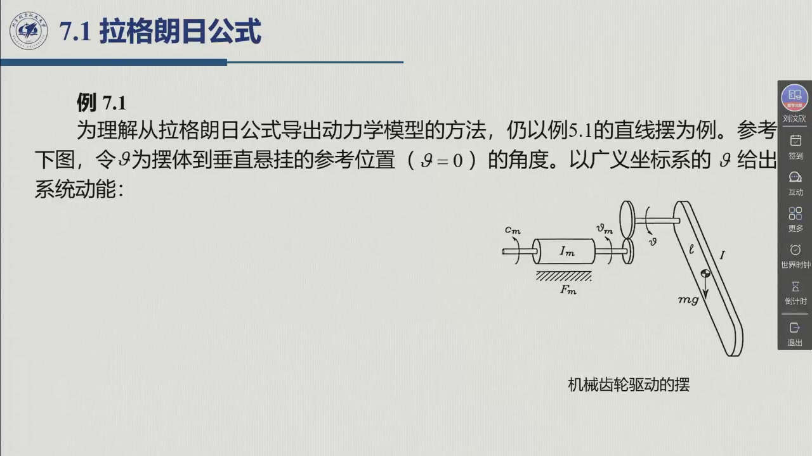

# 6.1 拉格朗日公式

第三章建立关节运动与末端速度的关系，第四章规划期望轨迹，第五章说明执行器怎样提供驱动力。要把这些环节连接起来，还需计算沿轨迹加速、同时承担重力所需的关节力矩。这正是本章动力学模型要回答的问题。课堂回看：00:33:00–00:49:30。

## 6.1.1 从「力」换到「能量」

逐杆使用牛顿和欧拉方程，需要处理各杆之间的作用力。拉格朗日法则先把系统的动能和势能写成关节坐标的函数，再对这些标量求导。两种方法描述同一个机械系统，但保留的中间量不同。

取 $q=[q_1,\ldots,q_n]^{\mathrm T}$ 为独立广义坐标。对本章的固定基座刚性开链，关节坐标确定各连杆构形；速度 $\dot q$ 决定它们此刻怎样运动。转动关节的坐标用rad，移动关节用m，同一列中可以有两种单位。

::: def 定义 6.1.1 · 拉格朗日函数与拉格朗日方程 {#def-6.1.1}
本章采用 $U=U(q)$ 的保守势能，定义

$$L(q,\dot q)=T(q,\dot q)-U(q).$$

第 $i$ 个关节的运动方程为

$$\frac{d}{dt}\left(\frac{\partial L}{\partial\dot q_i}\right)-\frac{\partial L}{\partial q_i}=\xi_i.$$

$\xi_i$ 是与 $q_i$ 配对的非保守广义力。若把梯度统一写成列向量，可合成

$$\frac{d}{dt}\nabla_{\dot q}L-\nabla_qL=\xi.$$
:::

这两次求导采用的变量条件不同。求 $\partial L/\partial\dot q_i$ 时，将坐标与速度视为独立自变量，并固定其余量；随后沿实际运动求时间导数，$q$ 和 $\dot q$ 都随时间变化，需用链式法则展开。只说“对速度求导”会遗漏第二步。

采用适当独立坐标时，理想约束反力在允许虚位移上的总虚功为零，因此可以不显式保留。重力等保守力通过势能进入左端，摩擦、驱动和未计入势能的接触作用进入右端。这种处理依赖约束与模型假设，不代表关节内力、摩擦或柔性都可忽略。

## 6.1.2 广义力 $\xi_i$ 的四个来源

广义力按虚功定义：$\delta W=\xi^{\mathrm T}\delta q$。所以转角对应力矩，直线位移对应力；在混合关节机构中，“广义力向量”各项不必有同一种单位。

对本章的常用模型，可写成

$$\xi=\tau-F_v\dot q-F_s\operatorname{sgn}(\dot q)-J^{\mathrm T}h_e.$$

$\tau$ 为关节驱动力，$F_v$ 表黏滞摩擦系数，$F_s$ 表滑动库仑摩擦幅值，$h_e$ 取机器人施加给环境的末端广义力。环境反作用于机器人的力为 $-h_e$，所以相应项是 $-J^{\mathrm T}h_e$，与[§3.8](../ch03/sec3-8.md)一致。

库仑项近似滑动时大小恒定、方向与速度相反的摩擦；在速度为零时，静摩擦能在一定范围内承担负载，不能只靠取 $\operatorname{sgn}(0)=0$ 完整描述。暂不计摩擦时应明确说明，不能在求稳态偏差时又默认它不存在。

## 6.1.3 例 7.1：带齿轮的摆（老师逐行推的第一道题）

用第五章的齿轮摆把完整过程算一次。这里关节力矩 $\tau$ 已写在摆轴一侧，不能再乘一次减速比。$l$ 指支点到质心的距离；若另给整杆长度，要先确认质心在哪里。

**系统**：摆杆绕 $O$ 点转动，转角 $\vartheta$（下垂位置为 $\vartheta=0$），杆的转动惯量 $I$；
电机转子经减速比 $k_r$ 驱动，转子惯量 $I_m$，转子粘滞摩擦系数 $F_m$，关节粘滞摩擦系数 $F$。

**动能**：摆杆与转子都随关节转动。转子的角速度是 $k_r\dot\vartheta$（刚性传动，无打滑），故

$$T=\frac12 I\dot\vartheta^2+\frac12 I_m k_r^2\dot\vartheta^2
=\frac12\bigl(I+I_m k_r^2\bigr)\dot\vartheta^2.$$

**势能**：以垂下位置为零势能点，质心升高 $l(1-\cos\vartheta)$：

$$U=mgl\,(1-\cos\vartheta).$$

**拉格朗日函数**：

$$L=T-U=\frac12\bigl(I+I_m k_r^2\bigr)\dot\vartheta^2-mgl\,(1-\cos\vartheta).$$

**代方程**：

$$\frac{\partial L}{\partial\dot\vartheta}=\bigl(I+I_m k_r^2\bigr)\dot\vartheta,\qquad
\frac{\mathrm d}{\mathrm dt}\frac{\partial L}{\partial\dot\vartheta}=\bigl(I+I_m k_r^2\bigr)\ddot\vartheta,$$

$$\frac{\partial L}{\partial\vartheta}=-mgl\sin\vartheta.$$

因此

$$\bigl(I+I_m k_r^2\bigr)\ddot\vartheta+mgl\sin\vartheta=\xi.$$

**广义力**：执行器力矩 $\tau$，减去关节粘滞摩擦 $F\dot\vartheta$，再减去折算到关节侧的转子摩擦
$F_m k_r^2\dot\vartheta$：

$$\xi=\tau-F\dot\vartheta-F_m k_r^2\dot\vartheta.$$

**完整方程**：

$$\boxed{\ \bigl(I+I_m k_r^2\bigr)\ddot\vartheta+\bigl(F+F_m k_r^2\bigr)\dot\vartheta+mgl\sin\vartheta=\tau\ }$$

所得方程与第五章的齿轮摆模型一致（原书式(5.29)）。以关节角写转子动能时，惯量折算已经计入；摩擦也已在广义力中换到同一轴侧，最终方程里不应重复折算。

把最后方程在静止状态检查：$\dot\vartheta=\ddot\vartheta=0$ 时，保持力矩为 $mgl\sin\vartheta$。再把重力关掉，惯量系数就是 $I+I_mk_r^2$，与动能中 $\dot\vartheta^2/2$ 的系数相同。两个检查分别针对重力符号和惯量折算。

## 6.1.4 拉格朗日法与牛顿–欧拉法的分工

| 比较项 | 拉格朗日法 | 牛顿–欧拉法 |
|:--|:--|:--|
| 主要中间量 | 动能、势能及其导数 | 逐杆速度、加速度、力与力矩 |
| 坐标要求 | 能量可为标量，但位置、速度与惯量仍须采用一致坐标 | 逐杆处理，并显式换系传递向量 |
| 计算用途 | 便于展示惯性、重力和速度项的结构 | 便于递推求给定运动所需的驱动力 |
| 结果核对 | 给定相同参数和假设，应得到相同关节动力学 | 同左；具体 $C$ 矩阵表示可能不同，但 $C\dot q$ 应一致 |

能量是标量，仍需先在相容坐标下计算质心位置、角速度与惯性张量。正确换基后能量值不变，并不表示拉格朗日法不需要参考系。

## 6.1.5 小结与常见错误

后续三节分别构造动能、势能并完成求导。复习时从本例重建流程：先统一轴侧和坐标，写 $T,U,L$，再按顺序计算偏导与时间导数，最后补上非保守广义力。若某一项符号可疑，先用静止保持或无重力加速检查，不要通过改势能常数来凑结果。

::: think 检查理解
1. 为什么 $\partial L/\partial\dot q_i$ 之后还必须做一次全时间导数？
2. 摆轴力矩与电机轴力矩相差什么？若动能已含 $I_mk_r^2$，是否还要再加一次折算惯量？
3. 为何静摩擦不能简单等于 $F_s\operatorname{sgn}(0)$？
4. $h_e$ 若改定义成环境施加给机器人的力，方程中的符号应如何改变？

::: sol 核对
第一次得到仍依赖状态的函数，时间导数还会出现加速度和构形变化。轴侧力矩按传动关系折算；能量已经计入的项不能重复添加。静摩擦在零速时可取平衡负载所需的范围内数值。若以环境输入力为正，则其广义力应写为 $+J^{\mathrm T}h_e$。
:::
:::
