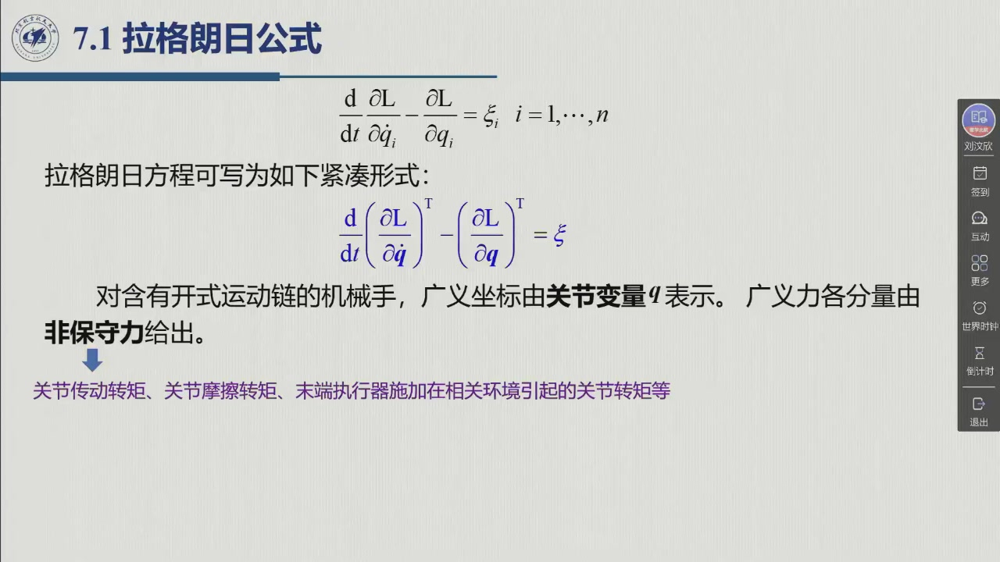
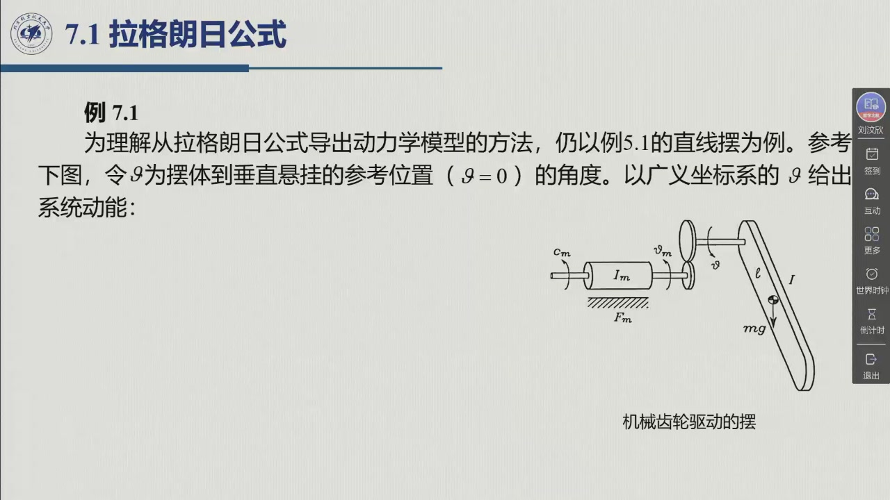

# 6.1 拉格朗日公式

第四章给出了期望的关节轨迹 $q(t)$，第五章说明了电机经减速器能提供多大的力矩。两者之间还缺一个关系：沿这条轨迹加速、同时托住重力，每个关节此刻需要多大的力矩。动力学模型回答的就是这个问题，它把关节力矩与 $q,\dot q,\ddot q$ 联系起来；末端受到的接触力则经第三章的雅可比折回关节。本节介绍建模的第一种方法，即拉格朗日法，并用第五章的齿轮摆完整算一遍。课堂回看：00:33:00–00:49:30。

## 6.1.1 从「力」换到「能量」

最直接的做法是逐杆画受力图，对每根杆列牛顿方程和欧拉方程。麻烦在于相邻两杆在关节处互相施加约束反力和反力矩：一个转动关节只允许绕一根轴转，其余五个方向的相对运动都靠反力挡住。这些反力不是我们要求的量，却出现在每根杆的方程里，最后还得一一消去。拉格朗日法换一条路：把整机的动能 $T$ 和势能 $U$ 写成独立坐标的函数，再对这两个标量按固定公式求导。

两个标量的写法，课上先复习过（00:33:03–00:36:04）。单根刚体的动能是质心平动动能加绕质心的转动动能：平面情形 $\frac12mv_C^2+\frac12I_C\omega^2$，空间情形 $\frac12m\dot p_C^{\mathrm T}\dot p_C+\frac12\omega^{\mathrm T}I_C\omega$。老师特意提醒（00:34:44），速度要取质心速度，惯量要取相对质心的惯量；换成刚体上别的点，平动与转动之间会多出交叉项（[6.1.1](sec6-1-1.md) 推导了它为什么在质心处为零）。势能只与位置有关：重力做功与路径无关，整根刚体的重力势能等于把全部质量集中到质心的 $mg\,z_C$。机械臂把各杆的动能、势能分别相加。

要把能量写成函数，先得选自变量。能完整确定系统位形、个数最少、彼此独立的一组坐标叫**广义坐标**。课上用几个例子数过（00:38:03–00:40:21）。一个质点需要 $x,y,z$ 三个量。平面刚体若用两点坐标 $(x_1,y_1,x_2,y_2)$ 描述，用了四个量，但两点距离固定，四个量之间有一条约束；改用一点坐标加一个转角，三个量就够了，而且互不约束。空间刚体需要六个：三个位置、三个姿态。按第二章 DH 法建系的机械臂，每个关节有一个关节变量，$n$ 个关节就是 $n$ 个变量，它们确定全部连杆的位置，彼此独立。所以取

$$q=[q_1,\ldots,q_n]^{\mathrm T}$$

为广义坐标。对本章的固定基座刚性开链，$q$ 确定各连杆构形，速度 $\dot q$ 决定它们此刻怎样运动；因此 $T$ 是 $q,\dot q$ 的函数，$U$ 只依赖 $q$。转动关节的坐标用rad，移动关节用m，同一列中可以有两种单位。

::: def 定义 6.1.1 · 拉格朗日函数与拉格朗日方程 {#def-6.1.1}
本章采用 $U=U(q)$ 的保守势能，定义

$$L(q,\dot q)=T(q,\dot q)-U(q).$$

第 $i$ 个关节（$i=1,\ldots,n$）的运动方程为

$$\frac{d}{dt}\left(\frac{\partial L}{\partial\dot q_i}\right)-\frac{\partial L}{\partial q_i}=\xi_i.$$

$\xi_i$ 是与 $q_i$ 配对的非保守广义力。若把梯度统一写成列向量，可合成

$$\frac{d}{dt}\nabla_{\dot q}L-\nabla_qL=\xi.$$

课件把行向量 $\partial L/\partial\dot q$ 转置后写成 $\frac{d}{dt}\bigl(\frac{\partial L}{\partial\dot q}\bigr)^{\mathrm T}-\bigl(\frac{\partial L}{\partial q}\bigr)^{\mathrm T}=\xi$，与上式相同。
:::

方程里的两次求导，变量条件不同。求 $\partial L/\partial\dot q_i$ 时，把 $q$ 与 $\dot q$ 当作 $2n$ 个独立自变量，只让 $\dot q_i$ 变、其余固定。得到的结果一般仍同时依赖 $q$ 和 $\dot q$。随后沿实际运动对时间求导，$q(t)$ 与 $\dot q(t)$ 都在变，链式法则给出两组项：

$$\frac{d}{dt}\frac{\partial L}{\partial\dot q_i}
=\sum_{k=1}^{n}\frac{\partial^2L}{\partial q_k\,\partial\dot q_i}\,\dot q_k
+\sum_{k=1}^{n}\frac{\partial^2L}{\partial\dot q_k\,\partial\dot q_i}\,\ddot q_k .$$

第二组含 $\ddot q$，运动方程因此是二阶的。本章的动能是 $\dot q$ 的二次型（[6.1.1](sec6-1-1.md)），第一组就是 $\dot q$ 的二次项，只要惯量随构形变化就不为零；[6.1.3](sec6-1-3.md) 会把它和 $\partial L/\partial q_i$ 中的速度项一起整理成离心与科氏项。只说“对速度求导”，会漏掉第一组。下面齿轮摆的惯量是常数，第一组恰好为零。

约束反力不出现在方程里，是因为它们不做虚功。理想约束（关节无摩擦、连杆刚性）的反力只挡住关节不允许的相对运动，而广义坐标互相独立，任取一组虚位移 $\delta q$，得到的都是关节允许的运动。关节两侧的反力大小相等、方向相反，合起来只对两杆的相对运动做功，而理想反力与这个方向垂直，所以总虚功为零：反力既不进 $T,U$，也不进右端。约束越复杂，这样省掉的工作越多；代价是非保守力必须自己补到右端，见下一小节。两个假设都在用：关节摩擦不满足「理想」，要作为非保守力补回右端；连杆柔性不满足刚性，不在本章模型之内。拉格朗日方程本身的推导属于分析力学，要用到虚位移、达朗贝尔原理（动静法）等，课上没有展开，只要求会用（00:40:59–00:41:22）。

## 6.1.2 广义力 $\xi_i$ 的四个来源

哪些力进左端、哪些进右端，课上按保守与非保守来分（00:42:29–00:43:34）。重力、弹簧力这类保守力做的功只取决于起点和终点，与怎样运动过去无关，已经写进势能 $U$ 放在左端，不再进 $\xi$。驱动力矩、摩擦力矩和环境的接触力与运动过程有关，都归入右端的广义力。课件列的是“关节传动转矩、关节摩擦转矩、末端执行器施加在相关环境引起的关节转矩等”。

广义力按虚功定义：给坐标一组虚位移 $\delta q$，全部非保守力的总虚功写成 $\delta W=\xi^{\mathrm T}\delta q$，$\delta q_i$ 前的系数就是 $\xi_i$。所以转角对应力矩，直线位移对应力；在混合关节机构中，“广义力向量”各项不必有同一种单位。对本章的常用模型，

$$\xi=\tau-F_v\dot q-F_s\operatorname{sgn}(\dot q)-J^{\mathrm T}h_e.$$

逐项看它们的虚功。$\tau$ 为关节驱动力，直接作用在关节轴上，虚功为 $\tau^{\mathrm T}\delta q$。$F_v$ 表黏滞摩擦系数，$F_s$ 表滑动库仑摩擦幅值，两者都是 $n\times n$ 对角矩阵，因为每个关节的摩擦只取决于本关节的速度；$\operatorname{sgn}$ 逐分量取符号，负号表示摩擦与速度反向。末端项要多走一步。$h_e$ 取机器人施加给环境的末端广义力（力与力矩），环境反作用于机器人的力为 $-h_e$。末端的虚位移是 $J\delta q$，所以这份反作用力的虚功为

$$(-h_e)^{\mathrm T}J\,\delta q=\bigl(-J^{\mathrm T}h_e\bigr)^{\mathrm T}\delta q,$$

对应的广义力就是 $-J^{\mathrm T}h_e$。静止、无重力、无摩擦时，方程退化为 $\tau=J^{\mathrm T}h_e$，与[§3.8](../ch03/sec3-8.md)的静力学关系一致：驱动力矩恰好平衡末端力。若题目给的是环境作用在末端上的力 $f=-h_e$，同一项写成 $+J^{\mathrm T}f$；两种写法说的是同一件事，代数之前先统一约定。

库仑项描述滑动摩擦：一旦在动，大小恒为 $F_s$，方向与速度相反。速度为零时它就不够用了。取 $\operatorname{sgn}(0)=0$ 等于说静止时没有摩擦，而静摩擦可以在 $[-F_s,F_s]$ 内取任意值，只要足以平衡其余力矩，关节就不动。拿下面例 7.1 的摆试一下：取 $m=1$ kg、$l=0.5$ m，$mgl=4.905$ N·m，关节库仑摩擦 $F_s=0.2$ N·m，不加驱动。只要 $mgl|\sin\vartheta|\le F_s$，即 $|\vartheta|\le\arcsin(0.2/4.905)\approx2.34^\circ$，摆就能停住，停在哪里取决于此前的运动；取 $\operatorname{sgn}(0)=0$ 则只剩 $\vartheta=0$ 一个平衡点。这 $2.34^\circ$ 本身就是一种稳态偏差。摩擦难以精确建模，推导时常先略去，但要写明这一假设；求稳态偏差或做低速实验时不能再默认它不存在。

## 6.1.3 例 7.1：带齿轮的摆（老师逐行推的第一道题）

课件的例 7.1 沿用第五章例 5.1 的齿轮摆。老师在 00:43:51–00:48:47 逐行推了一遍：选坐标，写 $T,U,L$，求导，补广义力。

**系统**：摆杆绕 $O$ 点转动，转角 $\vartheta$（下垂位置为 $\vartheta=0$）；$I$ 是摆杆对摆轴 $O$ 的转动惯量，$m$ 是摆杆质量，$l$ 指支点到质心的距离，若另给整杆长度，要先确认质心在哪里。电机转子经减速比 $k_r$ 驱动，转子惯量 $I_m$，转子粘滞摩擦系数 $F_m$，关节粘滞摩擦系数 $F$。

**坐标**：图中有摆杆和转子两个转动体，但齿轮把转子转角锁定为 $\vartheta_m=k_r\vartheta$，二者不能各自独立地转，所以只需一个广义坐标 $\vartheta$。课上先问的就是几个量能描述整个系统（00:44:38–00:45:07）。

**动能**：摆杆绕固定轴 $O$ 转动，$O$ 点速度为零，可以直接写 $\frac12I\dot\vartheta^2$。课上也说明了按质心拆成两项的写法（00:45:55–00:46:30）：$\frac12I_C\dot\vartheta^2+\frac12m(l\dot\vartheta)^2$，由平行轴定理 $I=I_C+ml^2$，结果相同；这种一步写出的捷径只对定轴转动成立。转子也绕固定轴转，角速度是 $k_r\dot\vartheta$（刚性传动，无打滑），故

$$T=\frac12 I\dot\vartheta^2+\frac12 I_m k_r^2\dot\vartheta^2
=\frac12\bigl(I+I_m k_r^2\bigr)\dot\vartheta^2.$$

转子项的系数是 $k_r^2$：转速放大了 $k_r$ 倍，动能又是速度的平方。这一项不能省。取 $I_m=10^{-4}\ \mathrm{kg\,m^2}$、$k_r=100$，折算后 $I_mk_r^2=1\ \mathrm{kg\,m^2}$；若摆杆相当于 1 kg 集中在 0.5 m 处，$I=0.25\ \mathrm{kg\,m^2}$，转子贡献是它的 4 倍，漏掉就少算总惯量的 80%。

**势能**：以垂下位置为零势能点，质心升高 $l(1-\cos\vartheta)$：

$$U=mgl\,(1-\cos\vartheta).$$

**拉格朗日函数**：

$$L=T-U=\frac12\bigl(I+I_m k_r^2\bigr)\dot\vartheta^2-mgl\,(1-\cos\vartheta).$$

**代方程**：惯量系数是常数，所以时间导数只剩 $\ddot\vartheta$ 一项：

$$\frac{\partial L}{\partial\dot\vartheta}=\bigl(I+I_m k_r^2\bigr)\dot\vartheta,\qquad
\frac{\mathrm d}{\mathrm dt}\frac{\partial L}{\partial\dot\vartheta}=\bigl(I+I_m k_r^2\bigr)\ddot\vartheta,$$

$$\frac{\partial L}{\partial\vartheta}=-mgl\sin\vartheta.$$

因此

$$\bigl(I+I_m k_r^2\bigr)\ddot\vartheta+mgl\sin\vartheta=\xi.$$

**广义力**：$\tau$ 已写在摆轴一侧，即电机力矩 $C_m$ 经减速器放大后的 $k_rC_m$，代入时不再乘减速比。按虚功逐项算：给摆一个虚转角 $\delta\vartheta$，转子跟着转 $k_r\delta\vartheta$。关节摩擦的虚功为 $-F\dot\vartheta\,\delta\vartheta$。转子摩擦力矩 $F_m\dot\vartheta_m=F_mk_r\dot\vartheta$ 作用在转子轴上，虚功为 $-F_mk_r\dot\vartheta\cdot k_r\delta\vartheta$。收集 $\delta\vartheta$ 的系数：

$$\xi=\tau-F\dot\vartheta-F_m k_r^2\dot\vartheta.$$

$F_mk_r^2$ 中的一个 $k_r$ 来自转子转速，另一个来自转子虚位移，与动能中 $I_mk_r^2$ 的平方同源。

**完整方程**：

$$\boxed{\ \bigl(I+I_m k_r^2\bigr)\ddot\vartheta+\bigl(F+F_m k_r^2\bigr)\dot\vartheta+mgl\sin\vartheta=\tau\ }$$

所得方程与第五章的齿轮摆模型一致（原书式(5.29)）：把式 (5.29) 两边乘 $k_r$，代入 $\omega_m=k_r\dot\vartheta$、$I_{eq}=I_m+I/k_r^2$、$F_{eq}=F_m+F/k_r^2$ 与 $\tau=k_rC_m$，就得到上式。第五章要对转子和负载分别列方程，再消去齿轮间的啮合力；这里啮合力是理想约束反力，没有出现。以关节角写转子动能时，惯量折算已经计入；摩擦也已在广义力中换到同一轴侧，最终方程里不应重复折算。

方程里唯一的非线性项是 $mgl\sin\vartheta$，惯量与摩擦项都是线性的。多连杆时 $B$ 随位形变化，还会出现离心与科氏项，非线性多得多，但先写能量、再代公式的流程不变。

把最后方程在静止状态检查：$\dot\vartheta=\ddot\vartheta=0$ 时，保持力矩为 $mgl\sin\vartheta$。再把重力关掉，惯量系数就是 $I+I_mk_r^2$，与动能中 $\dot\vartheta^2/2$ 的系数相同。两个检查分别针对重力符号和惯量折算。

## 6.1.4 拉格朗日法与牛顿–欧拉法的分工

上面的推导里，齿轮啮合力和摆轴反力都没有出现。[§6.4](sec6-4.md) 的牛顿–欧拉法走另一条路：对每根杆列牛顿方程（质心加速度与合力）和欧拉方程（角加速度与合力矩），从基座向外逐杆算速度和加速度，再从末端向内逐杆算关节处传递的力和力矩。两种方法描述同一个机械系统，保留的中间量不同：

| 比较项 | 拉格朗日法 | 牛顿–欧拉法 |
|:--|:--|:--|
| 主要中间量 | 动能、势能及其导数 | 逐杆速度、加速度、力与力矩 |
| 约束反力 | 不出现 | 作为中间量逐杆算出 |
| 坐标要求 | 能量是标量，换基后数值不变；但质心位置、角速度与惯性张量仍须先在相容坐标下算出，例如 $\frac12\omega^{\mathrm T}I\omega$ 中的 $\omega$ 与 $I$ 必须在同一坐标系中表达 | 逐杆处理，并显式换系传递向量 |
| 计算用途 | 便于展示惯性、重力和速度项的结构；展开后项数多，手推容易漏项 | 便于递推求给定一次运动所需的驱动力，此时计算量随杆数线性增长 |
| 结果核对 | 给定相同参数和假设，应得到相同关节动力学 | 同左；具体 $C$ 矩阵（[6.1.3](sec6-1-3.md)）表示可能不同，但 $C\dot q$ 应一致 |

本章用拉格朗日法推公式，为的是看清 $B,C,g$ 各项从哪里来；程序里给定一次 $q,\dot q,\ddot q$ 求力矩，多用牛顿–欧拉递推。第七章（原书第 8 章）的控制律只用到最终的 $B,C,g$，不关心它们是用哪种方法推出来的。

## 6.1.5 小结与常见错误

拉格朗日法只需写两个标量 $T$ 和 $U$，再代入一个固定公式。理想约束反力不做虚功，自动不出现；保守力进 $U$；驱动、摩擦和末端接触作为广义力 $\xi=\tau-F_v\dot q-F_s\operatorname{sgn}(\dot q)-J^{\mathrm T}h_e$ 补到右端。[6.1.1](sec6-1-1.md)–[6.1.3](sec6-1-3.md) 对 $n$ 连杆机械臂依次构造动能、势能并完成求导。复习时从例 7.1 重建流程：先统一轴侧和坐标，写 $T,U,L$，再按顺序计算偏导与时间导数，最后补上非保守广义力。若某一项符号可疑，先用静止保持或无重力加速检查。

::: think 常见错误清单
1. **漏掉转子动能**：大减速比时 $I_mk_r^2$ 可能比连杆惯量还大，例 7.1 的数值中是 4 倍。
2. **以为势能零点会改变方程**：$U=mgl(1-\cos\vartheta)$ 的零点在垂下位置；改选水平位置为零，表达式只多一个常数，求偏导后为零，运动方程不变。致命的是非常数项写错，例如把 $\cos$ 写成 $\sin$，$\partial U/\partial q$ 随之出错；不能通过改势能常数来凑结果。
3. **把 $\xi$ 写成 $\tau$**：摩擦与末端力都属于广义力，不能只写电机力矩。
4. **两次求导混淆**：$\partial L/\partial\dot q$ 是先对速度求偏导，再沿运动对时间求全导；$\partial L/\partial q$ 只对位置求偏导。
:::

::: think 检查理解
1. 为什么 $\partial L/\partial\dot q_i$ 之后还必须做一次全时间导数？
2. 摆轴力矩与电机轴力矩相差什么？若动能已含 $I_mk_r^2$，是否还要再加一次折算惯量？
3. 为何静摩擦不能简单等于 $F_s\operatorname{sgn}(0)$？
4. $h_e$ 若改定义成环境施加给机器人的力，方程中的符号应如何改变？

::: sol 核对
1. 第一次求导得到的仍是依赖状态的函数；沿实际运动求时间导数，才出现加速度项和构形变化带来的速度项。
2. 理想传动下，摆轴力矩是电机轴力矩乘 $k_r$。动能里的 $I_mk_r^2$ 已经完成惯量折算，不能重复添加。
3. 零速时静摩擦可在 $[-F_s,F_s]$ 内取平衡负载所需的数值。取 $\operatorname{sgn}(0)=0$ 等于假设没有静摩擦，例 7.1 的摆就从 $\pm2.34^\circ$ 的停止范围变成只有 $\vartheta=0$ 一个平衡点。
4. 若以环境输入力为正，则其广义力应写为 $+J^{\mathrm T}h_e$。
:::
:::

::: think 默写点 · 合上书再写
1. 写出拉格朗日函数与拉格朗日方程（标量形式与向量形式）。
2. 写出带齿轮的摆的 $T,U,L$ 与最终运动方程。
3. 广义力的四个来源各是什么？末端力为什么要乘 $J^{\mathrm T}$？
4. 拉格朗日法与牛顿–欧拉法各适合什么场合？
:::
