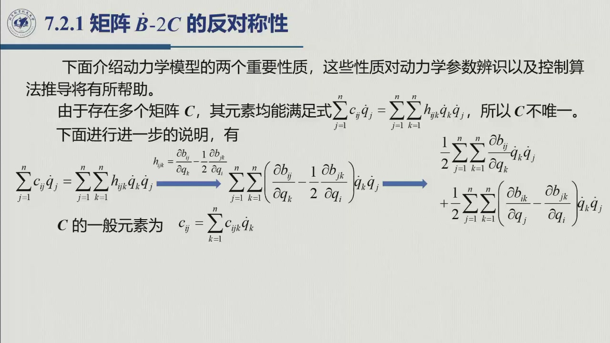
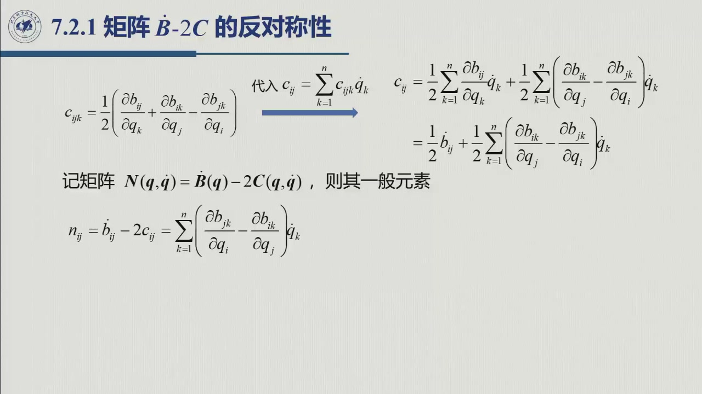

# 6.2.1 $\dot B-2C$ 的反对称性

上一节把速度二次项收进 $C(\boldsymbol q,\dot{\boldsymbol q})\dot{\boldsymbol q}$，只约束了乘积 $\sum_j c_{ij}\dot q_j=\sum_{j,k}h_{ijk}\dot q_k\dot q_j$，矩阵 $C$ 本身还有无穷多种写法。控制设计分析能量与无源性时，需要知道矩阵 $N=\dot B-2C$ 何时对所有向量保持反对称、何时只沿当前速度方向做功为零。本节先展示 $C$ 的自由度，再用第一类 Christoffel 符号构造一组特定 $C$，证明 $N$ 的反对称性，并严格区分两种恒等式。课堂回看：01:22:30–01:30:20。

## 6.2.1.1 先解决「$C$ 不唯一」

在运动方程里，$C$ 只以 $C\dot{\boldsymbol q}$ 的形式出现，其中

$$\sum_{j=1}^{n}c_{ij}\dot q_j=\sum_{j=1}^{n}\sum_{k=1}^{n}h_{ijk}\dot q_k\dot q_j,
\qquad h_{ijk}=\frac{\partial b_{ij}}{\partial q_k}-\frac12\frac{\partial b_{jk}}{\partial q_i}.$$

记当前速度为 $\boldsymbol v=\dot{\boldsymbol q}$。往任一满足上式的 $C$ 上加上一个矩阵 $H(\boldsymbol q,\boldsymbol v)$，只要它把当前速度映为零（$H\boldsymbol v=\boldsymbol 0$），就有 $(C+H)\boldsymbol v=C\boldsymbol v$，对应的物理力矩和运动方程完全不变。这一条只需要 $H$ 的零空间包含 $\boldsymbol v$，不要求 $H$ 反对称；反过来，反对称矩阵保证 $\boldsymbol v^{\mathrm T}H\boldsymbol v=0$，一般也不满足向量等式 $H\boldsymbol v=\boldsymbol 0$（例如二维反对称阵 $\begin{bmatrix}0&1\\-1&0\end{bmatrix}$ 乘 $(1,0)^{\mathrm T}$ 得 $(0,-1)^{\mathrm T}\neq\boldsymbol 0$）。

拿课上思路构造一个具体例子（01:19:48–01:20:26 的变式）：取

$$H(\boldsymbol v)=\begin{bmatrix}-v_2&v_1\\0&0\end{bmatrix}.$$

计算 $H\boldsymbol v$，第一行为 $-v_2v_1+v_1v_2=0$，第二行为 $0$，因此 $H\boldsymbol v=\boldsymbol 0$ 对任意 $\boldsymbol v$ 都成立，$C+H$ 给出完全相同的速度项，但 $H$ 显然不反对称。可见仅凭运动方程，矩阵 $C$ 本身并不唯一，唯一确定的只有速度项乘积 $C\dot{\boldsymbol q}$。

为得到有用的结构，回到上一节的系数

$$h_{ijk}=\frac{\partial b_{ij}}{\partial q_k}-\frac12\frac{\partial b_{jk}}{\partial q_i}.$$

由于 $\dot q_j\dot q_k=\dot q_k\dot q_j$，将第一项拆成两半，其中一半交换求和下标，可写成

$$\sum_{j,k}\frac{\partial b_{ij}}{\partial q_k}\dot q_j\dot q_k
=\frac12\sum_{j,k}\left(\frac{\partial b_{ij}}{\partial q_k}
+\frac{\partial b_{ik}}{\partial q_j}\right)\dot q_j\dot q_k.$$

于是我们把对称化之后的系数定为 $C$ 的构造法则，采用[Christoffel 选法](../recall.md#christoffel)：

$$c_{ij}=\sum_{k=1}^{n}c_{ijk}\dot q_k,\qquad
c_{ijk}=\frac12\Bigl(\frac{\partial b_{ij}}{\partial q_k}
+\frac{\partial b_{ik}}{\partial q_j}-\frac{\partial b_{jk}}{\partial q_i}\Bigr).$$

$c_{ijk}$ 称第一类 Christoffel 系数。交换 $j,k$ 并用 $b_{jk}=b_{kj}$，可验证 $c_{ijk}=c_{ikj}$。这个对称化不改变 $C\dot q$，却规定了接下来使用的 $C$。

## 6.2.1.2 $N=\dot B-2C$ 反对称

沿实际轨迹求导，$b_{ij}(\boldsymbol q)$ 的全时间导数为 $\dot b_{ij}=\sum_{k=1}^{n}\frac{\partial b_{ij}}{\partial q_k}\dot q_k$。把上面 $c_{ij}=\sum_k c_{ijk}\dot q_k$ 拆成两块，第一部分恰好出现 $\frac12\dot b_{ij}$：

$$c_{ij}=\frac12\sum_{k=1}^{n}\frac{\partial b_{ij}}{\partial q_k}\dot q_k
+\frac12\sum_{k=1}^{n}\Bigl(\frac{\partial b_{ik}}{\partial q_j}
-\frac{\partial b_{jk}}{\partial q_i}\Bigr)\dot q_k
=\frac12\dot b_{ij}
+\frac12\sum_{k=1}^{n}\Bigl(\frac{\partial b_{ik}}{\partial q_j}
-\frac{\partial b_{jk}}{\partial q_i}\Bigr)\dot q_k.$$

两边乘 $2$ 再从 $\dot b_{ij}$ 中减去，$\dot b_{ij}$ 恰好抵消，得到矩阵 $N=\dot B-2C$ 的第 $(i,j)$ 个元素：

$$n_{ij}=\dot b_{ij}-2c_{ij}=\sum_{k=1}^{n}\Bigl(\frac{\partial b_{jk}}{\partial q_i}
-\frac{\partial b_{ik}}{\partial q_j}\Bigr)\dot q_k.$$

把指标 $i,j$ 对调，括号里的两项恰好反号：

$$n_{ji}=\sum_{k=1}^{n}\Bigl(\frac{\partial b_{ik}}{\partial q_j}
-\frac{\partial b_{jk}}{\partial q_i}\Bigr)\dot q_k=-n_{ij},$$

所以

$$\boxed{\ N^{\mathrm T}=-N\ }$$

即 $N(\boldsymbol q,\dot{\boldsymbol q})$ 是**反对称矩阵**。进一步，任取一个与状态无关或有关的三维/一般 $n$ 维测试向量 $\boldsymbol w$，因为标量 $\boldsymbol w^{\mathrm T}N\boldsymbol w$ 的转置等于它自己：

$$\boldsymbol w^{\mathrm T}N\boldsymbol w=(\boldsymbol w^{\mathrm T}N\boldsymbol w)^{\mathrm T}
=\boldsymbol w^{\mathrm T}N^{\mathrm T}\boldsymbol w=-\boldsymbol w^{\mathrm T}N\boldsymbol w
\qquad\Longrightarrow\qquad
\boxed{\ \boldsymbol w^{\mathrm T}N(\boldsymbol q,\dot{\boldsymbol q})\boldsymbol w=0\ }$$

这里零的是二次型 $\boldsymbol w^{\mathrm T}N\boldsymbol w$，不是向量 $N\boldsymbol w$。例如前面 $\begin{bmatrix}0&1\\-1&0\end{bmatrix}$ 乘 $(1,0)^{\mathrm T}$ 得 $(0,-1)^{\mathrm T}$，再左乘 $(1,0)$ 才得 $0$。

## 6.2.1.3 两个命题要分清

::: thm[core] 定理 6.2.1 · 反对称性的两种陈述 {#thm-6.2.1}
(A) Christoffel选法保证 $N=\dot B-2C$ 反对称，因而 $w^{\mathrm T}Nw=0$ 对任意 $w$ 成立。

(B) 对任何产生同一个物理速度项 $C\dot q$ 的选法，沿当前速度仍有 $\dot q^{\mathrm T}N\dot q=0$。

(A) 蕴含 (B)（直接取 $\boldsymbol w=\dot{\boldsymbol q}$ 即可）；但 (B) 不能推出 (A)，因为 $N(\boldsymbol q,\dot{\boldsymbol q})$ 本身依赖 $\dot{\boldsymbol q}$，沿自身速度方向为零不能约束其他测试方向 $\boldsymbol w$。也有其他 $C$ 的选法可能保持 (A)，是否成立须逐一验证，不能只看 $C\dot{\boldsymbol q}$ 相同就直接套用。
:::

用上面的 $H$ 把“只沿 $\boldsymbol v$ 为零、换 $\boldsymbol w$ 不为零”算成具体数字。取 $\boldsymbol v=(1,2)^{\mathrm T}$，前面验证过 $H(\boldsymbol v)=\begin{bmatrix}-2&1\\0&0\end{bmatrix}$ 满足 $H\boldsymbol v=\boldsymbol 0$。设原模型在 Christoffel 选法下恰好有 $N=\dot B-2C=O$，改用 $C'=C+H$ 后矩阵变为

$$N'=\dot B-2(C+H)=N-2H=\begin{bmatrix}4&-2\\0&0\end{bmatrix}.$$

沿当前速度方向算得 $\boldsymbol v^{\mathrm T}N'\boldsymbol v=[1,2]\begin{bmatrix}4&-2\\0&0\end{bmatrix}\begin{bmatrix}1\\2\end{bmatrix}=[1,2]\begin{bmatrix}0\\0\end{bmatrix}=0$，但换一个测试方向 $\boldsymbol w=(1,0)^{\mathrm T}$，立即算出 $\boldsymbol w^{\mathrm T}N'\boldsymbol w=N'_{11}=4\neq0$，且 $N'_{12}=-2\neq-N'_{21}=0$，它甚至不是反对称矩阵。

### 能量式中的抵消究竟说明什么

为证明命题 (B) 对所有合法 $C$ 成立，不依赖 $c_{ijk}$ 的代数对称性，而是直接对系统动能求导。由 $T=\frac12\dot{\boldsymbol q}^{\mathrm T}B(\boldsymbol q)\dot{\boldsymbol q}$ 与 $B^{\mathrm T}=B$，时间导数为

$$\dot T=\dot{\boldsymbol q}^{\mathrm T}B\ddot{\boldsymbol q}+\frac12\dot{\boldsymbol q}^{\mathrm T}\dot B\dot{\boldsymbol q}.$$

将完整动力学方程代入 $B\ddot{\boldsymbol q}=\boldsymbol\xi-C\dot{\boldsymbol q}-\boldsymbol g$，并把 $-\dot{\boldsymbol q}^{\mathrm T}C\dot{\boldsymbol q}=-\frac12\dot{\boldsymbol q}^{\mathrm T}(2C)\dot{\boldsymbol q}$ 与 $\frac12\dot{\boldsymbol q}^{\mathrm T}\dot B\dot{\boldsymbol q}$ 合并：

$$\dot T=\dot{\boldsymbol q}^{\mathrm T}(\boldsymbol\xi-\boldsymbol g)
+\frac12\dot{\boldsymbol q}^{\mathrm T}(\dot B-2C)\dot{\boldsymbol q}.$$

另一方面，势能变化率为 $\dot U=\bigl(\frac{\partial U}{\partial\boldsymbol q}\bigr)^{\mathrm T}\dot{\boldsymbol q}=\boldsymbol g^{\mathrm T}\dot{\boldsymbol q}=\dot{\boldsymbol q}^{\mathrm T}\boldsymbol g$。按机械能守恒，总机械能的变化率必须等于非保守广义力做的功率 $\frac{\mathrm d}{\mathrm dt}(T+U)=\dot{\boldsymbol q}^{\mathrm T}\boldsymbol\xi$，移项即 $\dot T=\dot{\boldsymbol q}^{\mathrm T}(\boldsymbol\xi-\boldsymbol g)$。两式相减，无论 $C$ 采用哪种写法，必有

$$\frac12\dot{\boldsymbol q}^{\mathrm T}(\dot B-2C)\dot{\boldsymbol q}=0.$$

展开右端 $\boldsymbol\xi=\boldsymbol\tau-F_{\mathrm v}\dot{\boldsymbol q}-F_{\mathrm s}\operatorname{sgn}(\dot{\boldsymbol q})-J^{\mathrm T}\boldsymbol h_e$，可看到驱动功率 $\dot{\boldsymbol q}^{\mathrm T}\boldsymbol\tau$ 减去摩擦耗散功率和对外输出功率 $\dot{\boldsymbol q}^{\mathrm T}J^{\mathrm T}\boldsymbol h_e=\boldsymbol v_e^{\mathrm T}\boldsymbol h_e$，恰好等于机械能的增加率。这个等式核对的是总功率平衡：惯性力和速度耦合项把能量在不同关节之间搬运，合起来在当前运动方向上既不产生也不消耗总能量，这正是无源性的来源（第七章用它消去 Lyapunov 导数中的速度交叉项）。至于改用合法替代 $C'=C+H$（$H\dot{\boldsymbol q}=\boldsymbol 0$），新增项 $\dot{\boldsymbol q}^{\mathrm T}H\dot{\boldsymbol q}=0$，由此也从代数上直接看到 (B) 与 $C$ 的具体写法无关。
## 6.2.1.4 小结与常见错误

使用反对称性之前，先核对 $C$ 是按哪条法则定义的。只有按第一类 Christoffel 符号构造 $C$，才能对任意测试向量 $\boldsymbol w$ 写出 $\boldsymbol w^{\mathrm T}(\dot B-2C)\boldsymbol w=0$（式 (7.48)）；对任意满足运动方程的 $C$，只能使用沿当前速度方向的能量恒等式 $\dot{\boldsymbol q}^{\mathrm T}(\dot B-2C)\dot{\boldsymbol q}=0$（式 (7.49)）。

::: think 常见错误清单
1. **把 (A) 与 (B) 混为一谈**：以为验证了 $\dot{\boldsymbol q}^{\mathrm T}N\dot{\boldsymbol q}=0$ 就说明 $N$ 反对称；$N$ 还依赖 $\dot{\boldsymbol q}$，换一个测试向量 $\boldsymbol w$ 一般不为零。
2. **Christoffel 符号的指标位置写反**：$c_{ijk}=\frac12\bigl(\frac{\partial b_{ij}}{\partial q_k}+\frac{\partial b_{ik}}{\partial q_j}-\frac{\partial b_{jk}}{\partial q_i}\bigr)$，后两项分别是 $\partial_j b_{ik}$ 与 $-\partial_i b_{jk}$。
3. **以为 $C$ 唯一**：$C$ 不唯一，只有乘积 $C\dot{\boldsymbol q}$ 唯一；讨论“$C$ 是否对称”必须先说明选法。
4. **忘记 $N$ 依赖 $\dot{\boldsymbol q}$**：$N=N(\boldsymbol q,\dot{\boldsymbol q})$ 是位置和速度的函数，不能当成只依赖 $\boldsymbol q$ 的矩阵。
:::

::: think 检查理解
1. $H\boldsymbol v=\boldsymbol 0$、$\boldsymbol v^{\mathrm T}H\boldsymbol v=0$、$H^{\mathrm T}=-H$，哪两个条件之间有必然蕴含关系？
2. 上面反例中把 $\boldsymbol v$ 换成 $\boldsymbol w=(1,0)^{\mathrm T}$ 后，为什么不能继续引用命题 (B)？
3. 在控制器稳定性证明里，为什么除了本节的反对称性之外，还必须给出能量函数、耗散项和不变集分析？

::: sol 核对
1. $H\boldsymbol v=\boldsymbol 0$ 必然推出 $\boldsymbol v^{\mathrm T}H\boldsymbol v=0$；$H^{\mathrm T}=-H$ 必然推出对任意向量 $\boldsymbol v^{\mathrm T}H\boldsymbol v=0$，但一般推不出 $H\boldsymbol v=\boldsymbol 0$。
2. $N'$ 本身依赖当前速度 $\boldsymbol v$，命题 (B) 只保证与它配对的 $\boldsymbol v$ 方向上二次型为零，不约束其他方向 $\boldsymbol w$。
3. 反对称性只消去 $\dot V$ 里来自 $\dot B-2C$ 的项；完整稳定性还需要证明 $V$ 正定、存在非正的耗散项，并用 LaSalle 不变集定理说明系统收敛到目标平衡点。
:::
:::

::: think 默写点 · 合上书再写
1. 写出 Christoffel 符号 $c_{ijk}$ 与 $c_{ij}$ 的定义，并证明 $c_{ijk}=c_{ikj}$。
2. 证明在 Christoffel 选法下 $N=\dot B-2C$ 反对称。
3. 用动能求导与能量守恒证明 $\dot{\boldsymbol q}^{\mathrm T}(\dot B-2C)\dot{\boldsymbol q}=0$ 对任意合法 $C$ 成立。
4. 说明命题 (A) 与 (B) 的逻辑关系与用途区别，并构造一个满足 (B) 不满足 (A) 的矩阵 $H$。
:::
