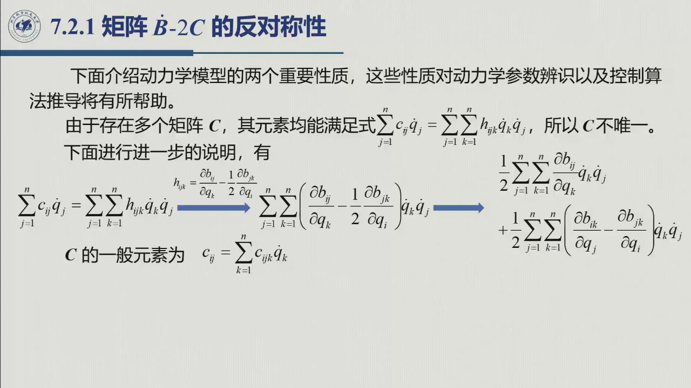
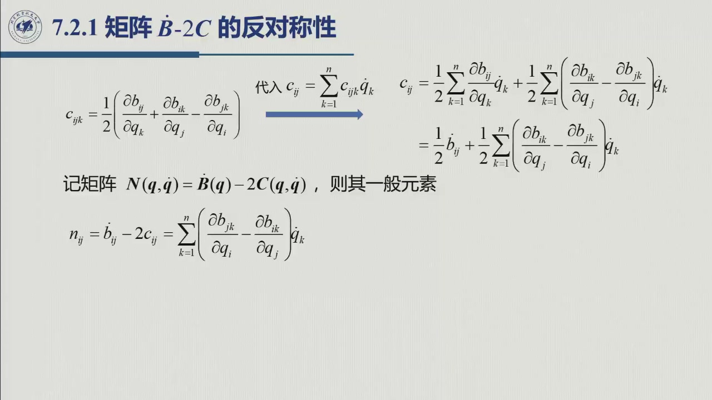

# 6.2.1 $\dot B-2C$ 的反对称性

> 录播 01:22:30–01:30:20。这是动力学模型的**第一条结构性质**。它看起来只是一个矩阵恒等式，
> 实际上是能量守恒在动力学方程里的代数影子——原书第 8 章的稳定性证明、自适应控制的无源性分析都要用它。

## 6.2.1.1 先解决「$C$ 不唯一」

运动方程只要求 $C$ 满足

$$\sum_{j=1}^{n}c_{ij}\dot q_j=\sum_{j=1}^{n}\sum_{k=1}^{n}h_{ijk}\dot q_k\dot q_j,
\qquad h_{ijk}=\frac{\partial b_{ij}}{\partial q_k}-\frac12\frac{\partial b_{jk}}{\partial q_i}.$$

满足这个条件的 $C$ 有**无穷多个**：往 $C$ 里加一个「乘 $\dot q$ 为零」的矩阵（例如反对称矩阵），
方程不变。所以「$C$」本身不是唯一的物理量，**只有 $C\dot q$ 唯一**。

为了得到一个有良好性质的 $C$，把右端的 $h_{ijk}\dot q_k\dot q_j$ 重新配对。利用 $\dot q_j\dot q_k$ 的对称性，
可以把 $\dfrac{\partial b_{ij}}{\partial q_k}\dot q_k\dot q_j$ 拆成两半、交换 $j,k$：

$$\sum_{j,k}\frac{\partial b_{ij}}{\partial q_k}\dot q_k\dot q_j
=\frac12\sum_{j,k}\Bigl(\frac{\partial b_{ij}}{\partial q_k}
+\frac{\partial b_{ik}}{\partial q_j}\Bigr)\dot q_k\dot q_j.$$

于是

$$c_{ij}=\sum_{k=1}^{n}c_{ijk}\dot q_k,\qquad
c_{ijk}=\frac12\Bigl(\frac{\partial b_{ij}}{\partial q_k}
+\frac{\partial b_{ik}}{\partial q_j}
-\frac{\partial b_{jk}}{\partial q_i}\Bigr).$$

$c_{ijk}$ 称为**第一类 Christoffel 符号**（Christoffel symbols of the first type）。由 $B$ 的对称性
$b_{ij}=b_{ji}$ 立刻有

$$c_{ijk}=c_{ikj}.$$

## 6.2.1.2 $N=\dot B-2C$ 反对称

定义

$$N(\boldsymbol q,\dot{\boldsymbol q})=\dot B(\boldsymbol q)-2C(\boldsymbol q,\dot{\boldsymbol q}).$$

先看 $C$ 的元素：

$$c_{ij}=\frac12\sum_k\frac{\partial b_{ij}}{\partial q_k}\dot q_k
+\frac12\sum_k\Bigl(\frac{\partial b_{ik}}{\partial q_j}
-\frac{\partial b_{jk}}{\partial q_i}\Bigr)\dot q_k
=\frac12\dot b_{ij}
+\frac12\sum_k\Bigl(\frac{\partial b_{ik}}{\partial q_j}
-\frac{\partial b_{jk}}{\partial q_i}\Bigr)\dot q_k.$$

因此

$$n_{ij}=\dot b_{ij}-2c_{ij}
=\sum_{k=1}^{n}\Bigl(\frac{\partial b_{jk}}{\partial q_i}
-\frac{\partial b_{ik}}{\partial q_j}\Bigr)\dot q_k.$$

交换 $i,j$：

$$n_{ji}=\sum_{k}\Bigl(\frac{\partial b_{ik}}{\partial q_j}
-\frac{\partial b_{jk}}{\partial q_i}\Bigr)\dot q_k=-n_{ij}.$$

所以

$$\boxed{\ N=N^{\mathrm T}\ \text{不成立，而是}\ N^{\mathrm T}=-N\ }$$

即 $N$ 是**反对称矩阵**。等价地，对任意 $n$ 维向量 $\boldsymbol w$，

$$\boxed{\ \boldsymbol w^{\mathrm T}N(\boldsymbol q,\dot{\boldsymbol q})\boldsymbol w=0\ }$$

（因为标量的转置等于自身：$\boldsymbol w^{\mathrm T}N\boldsymbol w=(\boldsymbol w^{\mathrm T}N\boldsymbol w)^{\mathrm T}
=\boldsymbol w^{\mathrm T}N^{\mathrm T}\boldsymbol w=-\boldsymbol w^{\mathrm T}N\boldsymbol w$，故为零。）

## 6.2.1.3 两个命题要分清

教材特别区分了两件事（这是考试最爱设陷阱的地方）：

::: thm[core] 定理 6.2.1 · 反对称性的两种陈述 {#thm-6.2.1}
**(A) 对 Christoffel 选法的 $C$**：$N=\dot B-2C$ 是反对称矩阵，即对**任意** $\boldsymbol w$ 有
$\boldsymbol w^{\mathrm T}N\boldsymbol w=0$。

**(B) 对任意选法的 $C$**：取 $\boldsymbol w=\dot{\boldsymbol q}$，仍有
$\dot{\boldsymbol q}^{\mathrm T}N\dot{\boldsymbol q}=0$。

**(B) 不蕴含 (A)**：因为 $N$ 还依赖 $\dot{\boldsymbol q}$，$\dot{\boldsymbol q}^{\mathrm T}N\dot{\boldsymbol q}=0$
只是「沿着系统自己的速度方向」成立，不能推出对所有 $\boldsymbol w$ 成立。
:::

**(B) 的证明（能量守恒）**：动能的变化率等于所有力做的功率：

$$\frac12\frac{\mathrm d}{\mathrm dt}\bigl(\dot{\boldsymbol q}^{\mathrm T}B\dot{\boldsymbol q}\bigr)
=\dot{\boldsymbol q}^{\mathrm T}\bigl(\boldsymbol\tau-F_{\mathrm v}\dot{\boldsymbol q}
-F_{\mathrm s}\operatorname{sgn}\dot{\boldsymbol q}-\boldsymbol g-J^{\mathrm T}\boldsymbol h_e\bigr).$$

左边展开：

$$\frac12\frac{\mathrm d}{\mathrm dt}\bigl(\dot{\boldsymbol q}^{\mathrm T}B\dot{\boldsymbol q}\bigr)
=\frac12\dot{\boldsymbol q}^{\mathrm T}\dot B\dot{\boldsymbol q}+\dot{\boldsymbol q}^{\mathrm T}B\ddot{\boldsymbol q}.$$

把 $B\ddot{\boldsymbol q}=\boldsymbol\tau-C\dot{\boldsymbol q}-F_{\mathrm v}\dot{\boldsymbol q}
-F_{\mathrm s}\operatorname{sgn}\dot{\boldsymbol q}-\boldsymbol g-J^{\mathrm T}\boldsymbol h_e$ 代入，得

$$\frac12\frac{\mathrm d}{\mathrm dt}\bigl(\dot{\boldsymbol q}^{\mathrm T}B\dot{\boldsymbol q}\bigr)
=\frac12\dot{\boldsymbol q}^{\mathrm T}\bigl(\dot B-2C\bigr)\dot{\boldsymbol q}
+\dot{\boldsymbol q}^{\mathrm T}\bigl(\boldsymbol\tau-F_{\mathrm v}\dot{\boldsymbol q}
-F_{\mathrm s}\operatorname{sgn}\dot{\boldsymbol q}-\boldsymbol g-J^{\mathrm T}\boldsymbol h_e\bigr).$$

与能量守恒式对照，立即得到 $\dot{\boldsymbol q}^{\mathrm T}(\dot B-2C)\dot{\boldsymbol q}=0$。
**这个结论与 $C$ 的选法无关**——它来自 Hamilton 能量守恒，是物理事实；而 (A) 只在 Christoffel
选法下成立，是代数构造的产物。

::: intuition 为什么「反对称」等于「不做功」
反对称矩阵的二次型恒为零。$N$ 出现在动能变化率里，$\dot q^{\mathrm T}N\dot q=0$ 的意思是：
**惯性力与速度耦合项在系统自己的运动方向上不做净功**——它们只在关节之间搬运能量，不产生或消耗总能量。
这就是「无源性」（passivity）的代数来源，也是为什么基于能量的控制器能保证稳定。
:::

## 6.2.1.4 小结与常见错误

- **一句话**：选 Christoffel 符号构造 $C$，则 $\dot B-2C$ 反对称；对任意 $C$，沿 $\dot q$ 方向仍有
  $\dot q^{\mathrm T}(\dot B-2C)\dot q=0$。
- **两条陈述**：(A) 对所有 $w$；(B) 只对 $w=\dot q$。(B) 是物理的，(A) 是选法的。
- **用途**：稳定性证明、自适应控制、无源性分析。

::: think 常见错误清单
1. **把 (A) 与 (B) 混为一谈**：以为「$\dot q^{\mathrm T}N\dot q=0$」就说明 $N$ 反对称——不，$N$ 依赖 $\dot q$，
   换一个 $w$ 就不为零。
2. **Christoffel 符号的系数写错**：是 $\frac12(\partial_k b_{ij}+\partial_j b_{ik}-\partial_i b_{jk})$，
   三项的指标位置别弄反。
3. **以为 $C$ 唯一**：$C$ 不唯一，只有 $C\dot q$ 唯一；讨论「$C$ 的对称性」本身没有意义。
4. **忘记 $N$ 还依赖 $\dot q$**：$N=N(q,\dot q)$，不是只依赖 $q$。
:::

::: think 默写点 · 合上书再写
1. 写出 Christoffel 符号 $c_{ijk}$ 与 $c_{ij}$。
2. 证明 $N=\dot B-2C$ 反对称。
3. 写出并证明 $\dot q^{\mathrm T}N\dot q=0$（能量守恒路线）。
4. 说明 (A) 与 (B) 的区别，并各举一个用途。
:::
