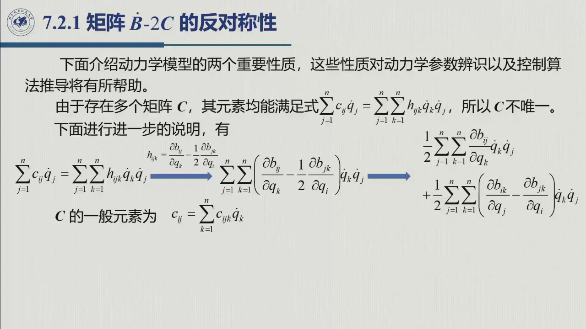
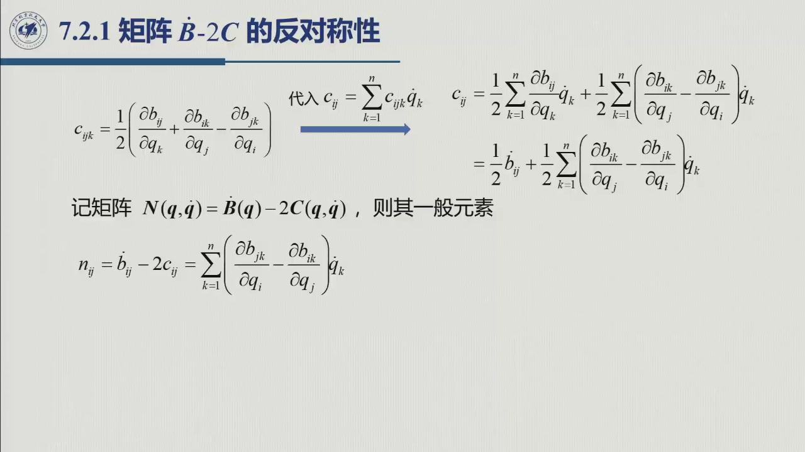

# 6.2.1 $\dot B-2C$ 的反对称性

上一节确定了速度二次项 $C(q,\dot q)\dot q$，矩阵 $C$ 本身仍有不同写法。下面先说明这种自由度，再选出便于能量分析的形式，并区分后续稳定性证明可以使用的两种恒等式。课堂回看：01:22:30–01:30:20。

## 6.2.1.1 先解决「$C$ 不唯一」

记当前速度为 $v=\dot q$。若 $H(q,v)v=0$，则 $(C+H)v=Cv$，所以两种矩阵给出同一速度项。这并不要求 $H$ 反对称。反过来，反对称矩阵只满足 $v^{\mathrm T}Hv=0$，未必满足向量 $Hv=0$。

例如取

$$H(v)=\begin{bmatrix}-v_2&v_1\\0&0\end{bmatrix},$$

第一行与 $v$ 相乘为 $-v_2v_1+v_1v_2=0$，第二行的结果也为零，所以该矩阵可加到 $C$ 上而不改变速度项。但 $H$ 一般并不反对称。

为得到有用的结构，回到上一节的系数

$$h_{ijk}=\frac{\partial b_{ij}}{\partial q_k}-\frac12\frac{\partial b_{jk}}{\partial q_i}.$$

由于 $\dot q_j\dot q_k=\dot q_k\dot q_j$，将第一项拆成两半，其中一半交换求和下标，可写成

$$\sum_{j,k}\frac{\partial b_{ij}}{\partial q_k}\dot q_j\dot q_k
=\frac12\sum_{j,k}\left(\frac{\partial b_{ij}}{\partial q_k}
+\frac{\partial b_{ik}}{\partial q_j}\right)\dot q_j\dot q_k.$$

于是采用[Christoffel选法](../recall.md#christoffel)：

$$c_{ij}=\sum_kc_{ijk}\dot q_k,\qquad
c_{ijk}=\frac12\left(\frac{\partial b_{ij}}{\partial q_k}
+\frac{\partial b_{ik}}{\partial q_j}-\frac{\partial b_{jk}}{\partial q_i}\right).$$

$c_{ijk}$ 称第一类 Christoffel 系数。交换 $j,k$ 并用 $b_{jk}=b_{kj}$，可验证 $c_{ijk}=c_{ikj}$。这个对称化不改变 $C\dot q$，却规定了接下来使用的 $C$。

## 6.2.1.2 $N=\dot B-2C$ 反对称

沿轨迹的矩阵导数满足 $\dot b_{ij}=\sum_k(\partial b_{ij}/\partial q_k)\dot q_k$。把上述 $c_{ij}$ 的第一部分认作 $\dot b_{ij}/2$：

$$c_{ij}=\frac12\dot b_{ij}
+\frac12\sum_k\left(\frac{\partial b_{ik}}{\partial q_j}
-\frac{\partial b_{jk}}{\partial q_i}\right)\dot q_k.$$

因此定义 $N=\dot B-2C$ 后，第 $(i,j)$ 个元素为

$$n_{ij}=\sum_k\left(\frac{\partial b_{jk}}{\partial q_i}
-\frac{\partial b_{ik}}{\partial q_j}\right)\dot q_k.$$

交换 $i,j$，括号里两项次序恰好相反，故 $n_{ji}=-n_{ij}$，即 $N^{\mathrm T}=-N$。

再取任意向量 $w$。标量与自己的转置相等，因此

$$w^{\mathrm T}Nw=(w^{\mathrm T}Nw)^{\mathrm T}
=w^{\mathrm T}N^{\mathrm T}w=-w^{\mathrm T}Nw,$$

从而 $w^{\mathrm T}Nw=0$。这里是一个二次型为零，并不表示 $Nw=0$。

## 6.2.1.3 两个命题要分清

::: thm[core] 定理 6.2.1 · 反对称性的两种陈述 {#thm-6.2.1}
(A) Christoffel选法保证 $N=\dot B-2C$ 反对称，因而 $w^{\mathrm T}Nw=0$ 对任意 $w$ 成立。

(B) 对任何产生同一个物理速度项 $C\dot q$ 的选法，沿当前速度仍有 $\dot q^{\mathrm T}N\dot q=0$。

(A)推出(B)，取 $w=\dot q$ 即可；(B)不能推出(A)。其他 $C$ 也可能保留(A)，但须另外检查，不能说只有Christoffel写法才可能满足反对称性。
:::

把不蕴含关系算具体。取 $v=(1,2)^{\mathrm T}$，上面的 $H=\begin{bmatrix}-2&1\\0&0\end{bmatrix}$，确有 $Hv=0$。若原 $N=0$，换成 $C+H$ 后

$$N'=-2H=\begin{bmatrix}4&-2\\0&0\end{bmatrix}.$$

直接算得 $v^{\mathrm T}N'v=0$，但对 $w=(1,0)^{\mathrm T}$，$w^{\mathrm T}N'w=4$。当前速度方向上的等式不足以约束所有方向。

### 能量式中的抵消究竟说明什么

动能的时间导数为

$$\dot T=\dot q^{\mathrm T}B\ddot q+\frac12\dot q^{\mathrm T}\dot B\dot q.$$

将动力学的 $B\ddot q=\xi-C\dot q-g$ 代入，得到

$$\dot T=\dot q^{\mathrm T}(\xi-g)
+\frac12\dot q^{\mathrm T}(\dot B-2C)\dot q.$$

因为 $\dot U=g^{\mathrm T}\dot q$，恒等式(B)使总机械能满足

$$\frac{d}{dt}(T+U)=\dot q^{\mathrm T}\xi.$$

按本章的摩擦与接触约定展开右端，便得到驱动功率、摩擦耗散和环境交换功率。这个等式检查的是总能量核算；它不表示所有惯性力都不做功。惯性项可以改变动能，重力也可以在动能与势能之间转移能量。

对于 $C'=C+H$ 且 $H\dot q=0$ 的合法替代，额外二次型 $\dot q^{\mathrm T}H\dot q$ 为零，所以同一能量等式仍成立。由此也得到(B)与 $C$ 具体写法无关的直接证明。

## 6.2.1.4 小结与常见错误

使用这条性质前，先确认 $C$ 怎样定义。若按Christoffel构造，可对任意测试向量用反对称二次型；若只知 $C\dot q$ 正确，只能直接使用沿当前速度的能量恒等式，不能任意把测试向量换掉。

::: think 检查理解
1. $Hv=0$、$v^{\mathrm T}Hv=0$、$H^{\mathrm T}=-H$，哪两个条件之间有必然蕴含关系？
2. 上例把 $v$ 换成 $w$ 后，为什么不能继续引用(B)？
3. 证明控制器稳定时，为什么仍需说明能量函数、耗散与不变集，而不能只引用本节反对称性？

::: sol 核对
$Hv=0$必推出该速度方向的二次型为零；反对称也推出任意同向量二次型为零，但不推出 $Hv=0$。$N$ 还依赖实际速度，(B)只保证与它配对的那一方向。反对称性只提供导数中的一项抵消，完整稳定性还要由闭环与相应条件证明。
:::
:::
