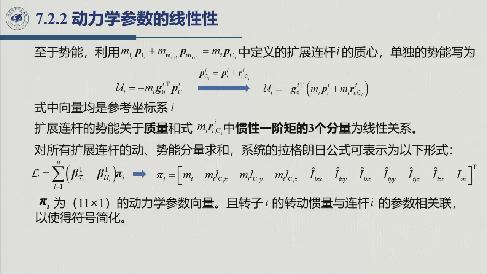
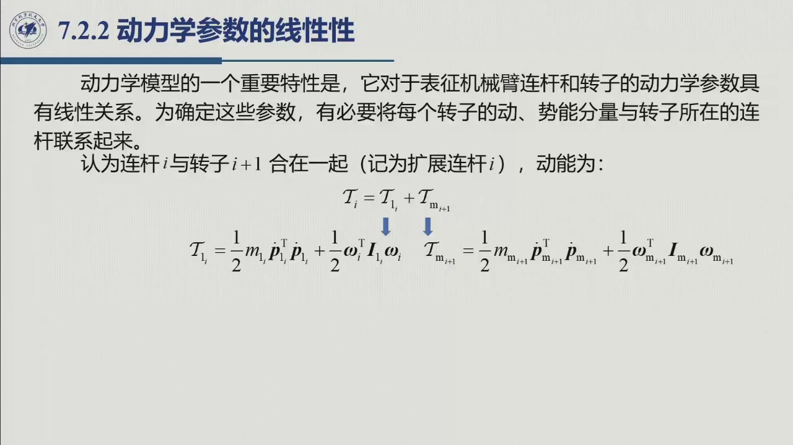
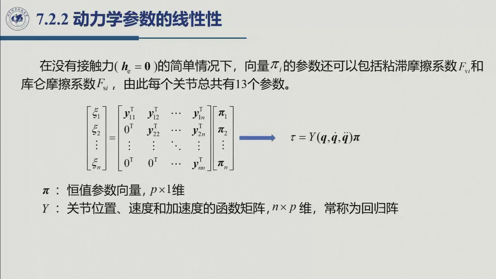

# 6.2.2 动力学参数的线性性

第六章导出的惯性矩阵 $B(\boldsymbol q)$、速度矩阵 $C(\boldsymbol q,\dot{\boldsymbol q})$ 和重力项 $\boldsymbol g(\boldsymbol q)$ 看似对角度 $\boldsymbol q$ 高度非线性（例如含 $\sin q_i,\cos q_i$），实际应用时连杆质量、质心坐标和转动惯量往往测不准或会随负载改变。如果把这些待估物理量当作未知参数，运动方程对它们却是**线性**的——这就让参数辨识退化成一次线性最小二乘求解，也让自适应控制可以直接在线更新参数。本节先用单摆看清“对谁线性”，再把每根连杆和其承载的下一个电机转子合并成“扩展连杆”，找出每杆 11 个线性参数与回归矩阵 $\boldsymbol\tau=Y\boldsymbol\pi$。课堂回看：01:30:20–01:54:30。

### 先看小例子：线性的是参数，不是关节运动

带电机转子和黏滞摩擦的单摆运动方程（见 [6.1](sec6-1.md) 例 7.1）为

$$\tau=(I+I_mk_r^2)\ddot q+mgl\sin q+(F+F_mk_r^2)\dot q.$$

如果把组合常数记为 $\pi_1=I+I_mk_r^2$、$\pi_2=mgl$、$\pi_3=F+F_mk_r^2$，方程就写成

$$\tau=[\ddot q,\ \sin q,\ \dot q]\begin{bmatrix}\pi_1\\\pi_2\\\pi_3\end{bmatrix}=Y(q,\dot q,\ddot q)\,\boldsymbol\pi.$$

对角度 $q$ 它含 $\sin q$，是非线性的；但把 $q,\dot q,\ddot q$ 当作采样测得的已知函数时，它对三个待估常数 $\pi_1,\pi_2,\pi_3$ 是纯线性的。注意两点：第一，这里要求线性的不是单个原始尺寸（如质量和长度单独分开），而是这组组合参数；第二，一次采样只有一条方程，无法解出三个未知数，必须沿一条激励轨迹采集多组 $(q_k,\dot q_k,\ddot q_k,\tau_k)$ 堆叠成 $\mathcal Y\boldsymbol\pi=\boldsymbol\tau$。例如在 $(q,\dot q,\ddot q)=(0,0,1)$、$(\pi/2,0,0)$、$(0,1,0)$ 三组状态下，回归行依次为 $[1,0,0]$、$[0,1,0]$、$[0,0,1]$，三次理想力矩读数直接分开给出 $\pi_1,\pi_2,\pi_3$；反之若单摆全程静止，第一、三列始终为零，样本再多也辨识不出惯量和摩擦。实际求解时需检验堆叠矩阵 $\mathcal Y$ 的列满秩（用 QR 或 SVD 分解处理噪声），不能只靠多采重复样本。
## 6.2.2.1 为什么要「扩展连杆」

一个关节的电机转子通常装在**前一个连杆**上（图 7.2），所以转子 $i+1$ 的动能与连杆 $i$ 的动能
共享同一组运动学量。把「连杆 $i$ + 转子 $i+1$」合并成**扩展连杆 $i$**（augmented Link $i$），
动能可以写成

$$T_i=T_{\text{link }i}+T_{m_{i+1}}.$$

设扩展连杆的质心为 $C_i$，其质量为 $m_i=m_{\text{link }i}+m_{m_{i+1}}$，则连杆与转子的质心速度都可以
用**同一个质心速度** $\dot{\boldsymbol p}_{C_i}$ 加相对矢径表示：

$$\dot{\boldsymbol p}_i=\dot{\boldsymbol p}_{C_i}+\boldsymbol\omega_i\times\boldsymbol r_{C_i,i},\qquad
\dot{\boldsymbol p}_{m_{i+1}}=\dot{\boldsymbol p}_{C_i}+\boldsymbol\omega_i\times\boldsymbol r_{C_i,m_{i+1}}.$$

把两条速度代回连杆与转子的平动动能 $\frac12 m_{\text{link }i}\dot{\boldsymbol p}_i^{\mathrm T}\dot{\boldsymbol p}_i+\frac12 m_{m_{i+1}}\dot{\boldsymbol p}_{m_{i+1}}^{\mathrm T}\dot{\boldsymbol p}_{m_{i+1}}$，按质心定义 $m_{\text{link }i}\boldsymbol r_{C_i,i}+m_{m_{i+1}}\boldsymbol r_{C_i,m_{i+1}}=\boldsymbol 0$ 消去交叉项，再用平行轴定理把两者的惯量都合并到扩展质心 $C_i$，即得扩展连杆动能：

$$T_i=\frac12 m_i\dot{\boldsymbol p}_{C_i}^{\mathrm T}\dot{\boldsymbol p}_{C_i}
+\frac12\boldsymbol\omega_i^{\mathrm T}\bar{\boldsymbol I}_i\boldsymbol\omega_i
+k_{r,i+1}\dot q_{i+1}\boldsymbol z_{m_{i+1}}^{\mathrm T}\boldsymbol I_{m_{i+1}}\boldsymbol\omega_i
+\frac12k_{r,i+1}^2\dot q_{i+1}^2\boldsymbol z_{m_{i+1}}^{\mathrm T}\boldsymbol I_{m_{i+1}}\boldsymbol z_{m_{i+1}},$$

这里 $\bar{\boldsymbol I}_i$ 是扩展连杆相对其**质心** $C_i$ 的惯性张量。如果直接按 $\bar{\boldsymbol I}_i$ 参数化，扩展连杆自身的质心偏置 $\boldsymbol r_{i,C_i}$ 也会和质量 $\bar{\boldsymbol I}_i$ 混成非线性乘积（如 $m_i\|\boldsymbol r\|^2$）。下一步改用固连在连杆 $i$ 原点上的坐标表达，利用平行轴定理 $\boldsymbol I_i^O=\bar{\boldsymbol I}_i^i+m_i S^{\mathrm T}(\boldsymbol\ell_{C_i})S(\boldsymbol\ell_{C_i})$ 把原点惯量单独抽成独立参数，就能把质量、一阶惯量矩和原点惯性张量完全拆成线性项。两者参考点不同（质心 $C_i$ 与连杆原点 $O_i$），不能当作同一个常量矩阵。

## 6.2.2.2 参数向量：11 个

按平行轴定理把参考点从质心移到连杆原点并在连杆系中表达后，每一项动力学参数只做一次乘法，不再出现 $m_i\ell_{C_i}^2$ 之类的二次组合。扩展连杆 $i$ 由此抽出 11 个标准参数（刚体 + 转子惯量）：

$$\boldsymbol\pi_i=\bigl[
m_i,\quad m_i\ell_{C_i x},\quad m_i\ell_{C_i y},\quad m_i\ell_{C_i z},\quad
I^O_{i,xx},\quad I^O_{i,xy},\quad I^O_{i,xz},\quad
I^O_{i,yy},\quad I^O_{i,yz},\quad I^O_{i,zz},\quad I_{m_i}
\bigr]^{\mathrm T}.$$

逐项读：

| 参数 | 含义 |
|:--|:--|
| $m_i$ | 扩展连杆质量 |
| $m_i\ell_{C_i x},m_i\ell_{C_i y},m_i\ell_{C_i z}$ | **一阶惯量矩**（质量 × 质心坐标） |
| $I^O_{i,xx},\dots,I^O_{i,zz}$ | 关于连杆原点、用连杆系表达的惯性张量 6 个独立分量 |
| $I_{m_i}$ | 转子绕自身轴的转动惯量 |

**为什么是线性的**：展开后的动能里，每一项都是「这 11 个参数之一 × 只含运动学量（$q,\dot q$）的系数」——质量乘 $\dot p_i^{\mathrm T}\dot p_i$、一阶矩乘 $\dot p_i^{\mathrm T}S(\omega_i)$、原点惯量乘 $\omega_i^{\mathrm T}(\cdot)\omega_i$、转子惯量乘 $k_{r,i+1}^2\dot q_{i+1}^2$（及与 $\boldsymbol\omega_i$ 的交叉项）。全式没有参数乘参数或参数的平方；同理重力势能 $U_i=-m_i\boldsymbol g_0^{\mathrm T}(\boldsymbol p_{O_i}+\boldsymbol R_i\boldsymbol\ell_{C_i})=-\boldsymbol g_0^{\mathrm T}\boldsymbol p_{O_i}\,m_i-\boldsymbol g_0^{\mathrm T}\boldsymbol R_i\,(m_i\boldsymbol\ell_{C_i})$ 也只对质量 $m_i$ 与一阶矩 $m_i\boldsymbol\ell_{C_i}$ 线性。

## 6.2.2.3 从拉格朗日函数到回归矩阵

把所有扩展连杆的动能、势能相加，拉格朗日函数可以写成

$$L=\sum_{i=1}^{n}\bigl(\boldsymbol\beta_{T_i}^{\mathrm T}-\boldsymbol\beta_{U_i}^{\mathrm T}\bigr)\boldsymbol\pi_i,$$

其中 $\boldsymbol\beta_{T_i}$、$\boldsymbol\beta_{U_i}$ 只依赖 $q,\dot q$（不依赖动力学参数）。
**拉格朗日方程是线性运算**（求偏导、对时间求导、相减），不会破坏「对参数线性」这一性质。因此关节力矩可以写成

$$\xi_i=\sum_{j=1}^{n}\boldsymbol y_{ij}^{\mathrm T}\boldsymbol\pi_j,$$

其中

$$\boldsymbol y_{ij}=\frac{\mathrm d}{\mathrm dt}\frac{\partial\boldsymbol\beta_{T_j}}{\partial\dot q_i}
-\frac{\partial\boldsymbol\beta_{T_j}}{\partial q_i}
+\frac{\partial\boldsymbol\beta_{U_j}}{\partial q_i}.$$

由于扩展连杆 $j$ 的运动学量只依赖关节 $1,\dots,j$ 的变量（$q_1,\dots,q_j$），当 $j<i$ 时 $\boldsymbol\beta_{T_j}$ 与 $\boldsymbol\beta_{U_j}$ 中完全不含 $q_i$ 和 $\dot q_i$，求偏导后 $\boldsymbol y_{ij}=\boldsymbol 0$（注意这种上三角稀疏块结构源自开链的运动学因果顺序；若改写参数分组或加入闭链约束，零块位置会相应变化）：

$$\begin{bmatrix}\xi_1\\ \xi_2\\ \vdots\\ \xi_n\end{bmatrix}
=\begin{bmatrix}
\boldsymbol y_{11}^{\mathrm T}&\boldsymbol y_{12}^{\mathrm T}&\cdots&\boldsymbol y_{1n}^{\mathrm T}\\
\boldsymbol 0^{\mathrm T}&\boldsymbol y_{22}^{\mathrm T}&\cdots&\boldsymbol y_{2n}^{\mathrm T}\\
\vdots&&\ddots&\vdots\\
\boldsymbol 0^{\mathrm T}&\boldsymbol 0^{\mathrm T}&\cdots&\boldsymbol y_{nn}^{\mathrm T}
\end{bmatrix}
\begin{bmatrix}\boldsymbol\pi_1\\ \boldsymbol\pi_2\\ \vdots\\ \boldsymbol\pi_n\end{bmatrix}.$$

紧凑写成

$$\boxed{\ \boldsymbol\tau=Y(\boldsymbol q,\dot{\boldsymbol q},\ddot{\boldsymbol q})\,\boldsymbol\pi\ }$$

其中 $\boldsymbol\pi$ 是 $p\times1$ 的**常参数向量**，$Y$ 是 $n\times p$ 的**回归矩阵**（regressor），
其元素只含 $q,\dot q,\ddot q$。

## 6.2.2.4 参数的个数与「最小参数集」

- 每个关节最多 **13 个**参数：上面 11 个 + 粘滞摩擦系数 $F_{v_i}$ + 库仑摩擦系数 $F_{s_i}$（无接触力时）。
- 但**不是所有参数都会独立出现**：有些参数只以线性组合的形式进入 $Y$，有些列恒为零。
  所以实际可辨识的参数个数 $p\le13n$。
- 对具体结构可以进一步合并，得到**最小参数集**（minimal parameterization）。例如两连杆平面臂的
  22 个「名义参数」可以压到 8 个（教材式 (7.83)），甚至 5 个（习题 7.4）。

实际应用中，参数线性性在两条核心路线上发挥作用：一是**离线参数辨识**——沿一条充分激励的轨迹采样 $(q,\dot q,\ddot q,\boldsymbol\tau)$，把回归方程 $\boldsymbol\tau=Y\boldsymbol\pi$ 堆叠成线性超定方程，用线性最小二乘一次求出 $\hat{\boldsymbol\pi}$，避开了代价高昂的非线性优化，同时 $Y$ 的零列和相关列直接指明哪些参数无法从数据中区分；二是**在线自适应控制**——未知参数用在线估计 $\hat{\boldsymbol\pi}(t)$ 代替，控制律用 $Y\hat{\boldsymbol\pi}$ 做前馈补偿，再利用跟踪误差线性更新 $\dot{\hat{\boldsymbol\pi}}$（见第七章）。

## 6.2.2.5 小结与常见错误

把「连杆 $i$ + 转子 $i+1$」合为扩展连杆并改用连杆原点表达后，动能和重力势能对每杆 11 个动力学参数线性，而拉格朗日算子保持线性，于是得到 $\boldsymbol\tau=Y(\boldsymbol q,\dot{\boldsymbol q},\ddot{\boldsymbol q})\boldsymbol\pi$（含每关节 2 个摩擦参数时共 13 个名义参数，实际可辨识的是列满秩的最小参数集 $p\le 13n$）。

::: think 常见错误清单
1. **把 $Y$ 当成常数矩阵**：常数是 $\boldsymbol\pi$；回归矩阵 $Y(\boldsymbol q,\dot{\boldsymbol q},\ddot{\boldsymbol q})$ 依赖每一时刻的运动状态，每次采样都必须重新计算。
2. **以为 11（或 13）个参数都独立可辨识**：$Y$ 往往存在零列和线性相关列（例如有些转轴方向受约束），必须通过列缩减得到最小参数集，强行对全部名义参数做最小二乘会遇到奇异或病态方程。
3. **转子参数归错连杆**：安装在前一连杆上的转子 $i+1$ 与连杆 $i$ 合并成扩展连杆 $i$，不是与连杆 $i+1$ 合并。
4. **混淆 11 / 13 / 最小参数集三层口径**：11 个是纯刚体惯性参数（含转子惯量），13 个是在无接触力时加粘滞和库仑摩擦系数；有末端接触力时还需额外计入已知或待辨识的接触力项。
:::

::: think 默写点 · 合上书再写
1. 写出扩展连杆的 11 个刚体参数，并说明各自含义（质量、一阶矩、原点惯性张量、转子惯量）。
2. 为什么需要把质心惯量 $\bar{\boldsymbol I}_i$ 换到连杆原点惯量 $I_i^O$ 才出现严格线性？
3. 写出 $\boldsymbol\tau=Y(\boldsymbol q,\dot{\boldsymbol q},\ddot{\boldsymbol q})\boldsymbol\pi$ 的维度，并区分 $\boldsymbol\pi$ 与 $Y$ 各自依赖什么变量。
4. 说明 11、13 与最小参数集三层口径的差别，并说明线性性在参数辨识和自适应控制中的作用。
:::
