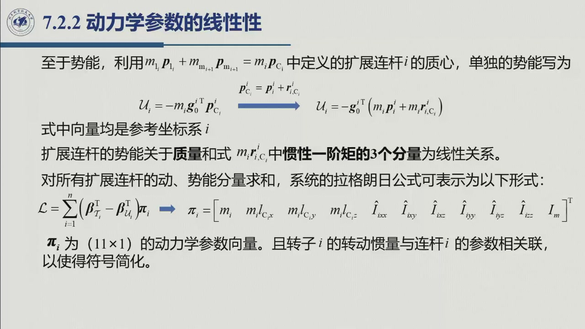
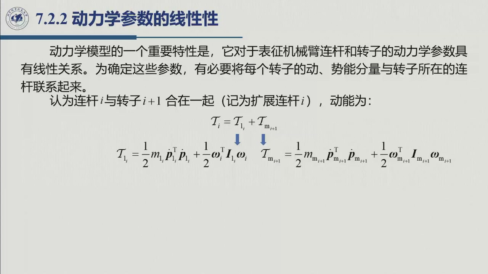
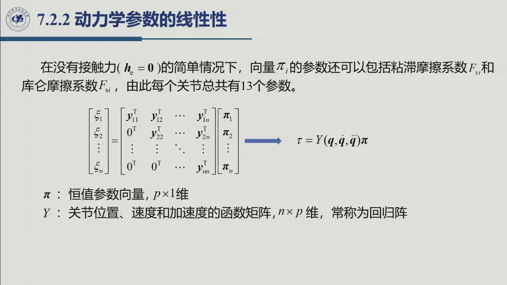

# 6.2.2 动力学参数的线性性

> 录播 01:30:20–01:54:30（其后为课间与答疑）。这是动力学模型的**第二条结构性质**，也是参数辨识与
> 自适应控制的入口：**力矩对一组「动力学参数」是线性的**，于是可以把辨识写成线性最小二乘。

## 6.2.2.1 为什么要「扩展连杆」

一个关节的电机转子通常装在**前一个连杆**上（图 7.2），所以转子 $i+1$ 的动能与连杆 $i$ 的动能
共享同一组运动学量。把「连杆 $i$ + 转子 $i+1$」合并成**扩展连杆 $i$**（augmented Link $i$），
动能可以写成

$$T_i=T_{\text{link }i}+T_{m_{i+1}}.$$

设扩展连杆的质心为 $C_i$，其质量为 $m_i=m_{\text{link }i}+m_{m_{i+1}}$，则连杆与转子的质心速度都可以
用**同一个质心速度** $\dot{\boldsymbol p}_{C_i}$ 加相对矢径表示：

$$\dot{\boldsymbol p}_i=\dot{\boldsymbol p}_{C_i}+\boldsymbol\omega_i\times\boldsymbol r_{C_i,i},\qquad
\dot{\boldsymbol p}_{m_{i+1}}=\dot{\boldsymbol p}_{C_i}+\boldsymbol\omega_i\times\boldsymbol r_{C_i,m_{i+1}}.$$

代入各自的动能、用平行轴定理合并，得到扩展连杆的动能：

$$T_i=\frac12 m_i\dot{\boldsymbol p}_{C_i}^{\mathrm T}\dot{\boldsymbol p}_{C_i}
+\frac12\boldsymbol\omega_i^{\mathrm T}\bar{\boldsymbol I}_i\boldsymbol\omega_i
+k_{r,i+1}\dot q_{i+1}\boldsymbol z_{m_{i+1}}^{\mathrm T}\boldsymbol I_{m_{i+1}}\boldsymbol\omega_i
+\frac12k_{r,i+1}^2\dot q_{i+1}^2\boldsymbol z_{m_{i+1}}^{\mathrm T}\boldsymbol I_{m_{i+1}}\boldsymbol z_{m_{i+1}},$$

其中 $\bar{\boldsymbol I}_i$ 是扩展连杆相对其质心的惯性张量。

## 6.2.2.2 参数向量：11 个

把惯性张量写到连杆系 $i$ 中，并用平行轴定理把它平移到坐标系原点，可以把 $T_i$ 整理成
**对下列 11 个参数线性**的形式：

$$\boldsymbol\pi_i=\bigl[
m_i,\quad m_i\ell_{C_i x},\quad m_i\ell_{C_i y},\quad m_i\ell_{C_i z},\quad
\bar I_{i,xx},\quad \bar I_{i,xy},\quad \bar I_{i,xz},\quad
\bar I_{i,yy},\quad \bar I_{i,yz},\quad \bar I_{i,zz},\quad I_{m_i}
\bigr]^{\mathrm T}.$$

逐项读：

| 参数 | 含义 |
|:--|:--|
| $m_i$ | 扩展连杆质量 |
| $m_i\ell_{C_i x},m_i\ell_{C_i y},m_i\ell_{C_i z}$ | **一阶惯量矩**（质量 × 质心坐标） |
| $\bar I_{i,xx},\dots,\bar I_{i,zz}$ | 惯性张量的 6 个独立分量（对称） |
| $I_{m_i}$ | 转子绕自身轴的转动惯量 |

**为什么是线性的**：动能里每一项都是「参数 × 只含 $q,\dot q$ 的系数」。质量乘 $\dot p^{\mathrm T}\dot p$、
一阶矩乘 $\dot p^{\mathrm T}S(\omega)$、惯量乘 $\omega^{\mathrm T}(\cdot)\omega$、转子惯量乘 $k_r^2\dot q^2$——
参数与运动学量**相乘**，没有「参数的平方」或「参数乘参数」。

## 6.2.2.3 从拉格朗日函数到回归矩阵

把所有扩展连杆的动能、势能相加，拉格朗日函数可以写成

$$L=\sum_{i=1}^{n}\bigl(\boldsymbol\beta_{T_i}^{\mathrm T}-\boldsymbol\beta_{U_i}^{\mathrm T}\bigr)\boldsymbol\pi_i,$$

其中 $\boldsymbol\beta_{T_i}$、$\boldsymbol\beta_{U_i}$ 只依赖 $q,\dot q$（不依赖动力学参数）。
**拉格朗日方程是线性运算**（求偏导、对时间求导、相减），不会破坏「对参数线性」这一性质。因此关节力矩可以写成

$$\xi_i=\sum_{j=1}^{n}\boldsymbol y_{ij}^{\mathrm T}\boldsymbol\pi_j,$$

其中

$$\boldsymbol y_{ij}=\frac{\mathrm d}{\mathrm dt}\frac{\partial\boldsymbol\beta_{T_j}}{\partial\dot q_i}
-\frac{\partial\boldsymbol\beta_{T_j}}{\partial q_i}
+\frac{\partial\boldsymbol\beta_{U_j}}{\partial q_i}.$$

由于 $\boldsymbol\beta_{T_j},\boldsymbol\beta_{U_j}$ 只依赖到关节 $j$ 的变量，当 $j\lt i$ 时偏导为零，
于是矩阵是**下三角**的：

$$\begin{bmatrix}\xi_1\\ \xi_2\\ \vdots\\ \xi_n\end{bmatrix}
=\begin{bmatrix}
\boldsymbol y_{11}^{\mathrm T}&\boldsymbol y_{12}^{\mathrm T}&\cdots&\boldsymbol y_{1n}^{\mathrm T}\\
\boldsymbol 0^{\mathrm T}&\boldsymbol y_{22}^{\mathrm T}&\cdots&\boldsymbol y_{2n}^{\mathrm T}\\
\vdots&&\ddots&\vdots\\
\boldsymbol 0^{\mathrm T}&\boldsymbol 0^{\mathrm T}&\cdots&\boldsymbol y_{nn}^{\mathrm T}
\end{bmatrix}
\begin{bmatrix}\boldsymbol\pi_1\\ \boldsymbol\pi_2\\ \vdots\\ \boldsymbol\pi_n\end{bmatrix}.$$

紧凑写成

$$\boxed{\ \boldsymbol\tau=Y(\boldsymbol q,\dot{\boldsymbol q},\ddot{\boldsymbol q})\,\boldsymbol\pi\ }$$

其中 $\boldsymbol\pi$ 是 $p\times1$ 的**常参数向量**，$Y$ 是 $n\times p$ 的**回归矩阵**（regressor），
其元素只含 $q,\dot q,\ddot q$。

## 6.2.2.4 参数的个数与「最小参数集」

- 每个关节最多 **13 个**参数：上面 11 个 + 粘滞摩擦系数 $F_{v_i}$ + 库仑摩擦系数 $F_{s_i}$（无接触力时）。
- 但**不是所有参数都会独立出现**：有些参数只以线性组合的形式进入 $Y$，有些列恒为零。
  所以实际可辨识的参数个数 $p\le13n$。
- 对具体结构可以进一步合并，得到**最小参数集**（minimal parameterization）。例如两连杆平面臂的
  22 个「名义参数」可以压到 8 个（教材式 (7.83)），甚至 5 个（习题 7.4）。

::: note 这条性质有什么用
1. **参数辨识**：给机械手一条激励轨迹，测 $\tau$ 与 $q,\dot q,\ddot q$，则
   $\boldsymbol\tau=Y\boldsymbol\pi$ 是**线性**方程组，可用最小二乘解 $\boldsymbol\pi$。
   若模型对参数非线性，就得用非线性优化，代价大得多。
2. **自适应控制**：把 $\hat{\boldsymbol\pi}$ 作为在线估计，控制律里用 $Y\hat{\boldsymbol\pi}$ 做前馈补偿，
   再用跟踪误差驱动 $\dot{\hat{\boldsymbol\pi}}$ 更新——这就是自适应机器人的标准结构。
3. **参数筛选**：$Y$ 的零列/相关列直接告诉你「哪些参数根本不可辨识」，避免白费力气去测。
:::

## 6.2.2.5 小结与常见错误

- **一句话**：把「连杆 + 后一个转子」合成扩展连杆，动能/势能对 11 个参数线性，拉格朗日方程保持线性，
  最终 $\boldsymbol\tau=Y(\boldsymbol q,\dot{\boldsymbol q},\ddot{\boldsymbol q})\boldsymbol\pi$。
- **三个数**：11 个参数/连杆；13 个（含摩擦）/关节；$p\le13n$，具体结构可再减。
- **一个用途**：线性最小二乘辨识 + 自适应控制。

::: think 常见错误清单
1. **把 $Y$ 当成常数矩阵**：$Y$ 依赖 $q,\dot q,\ddot q$，每次采样都要重算。
2. **以为 11 个参数都独立可辨识**：$Y$ 的列可能相关，实际最小参数集更小。
3. **转子参数归错连杆**：转子 $i+1$ 与连杆 $i$ 合并，不是与连杆 $i+1$ 合并。
4. **忘记摩擦参数**：无接触力时每关节 13 个；加接触力还会引入末端力分量。
:::

::: think 默写点 · 合上书再写
1. 写出扩展连杆的 11 个参数，并说明每个的物理含义。
2. 说明为什么动能对参数是线性的（举两项为例）。
3. 写出 $\tau=Y\pi$ 的维度与 $Y$ 的依赖变量。
4. 参数辨识为什么能化成线性最小二乘？
:::
