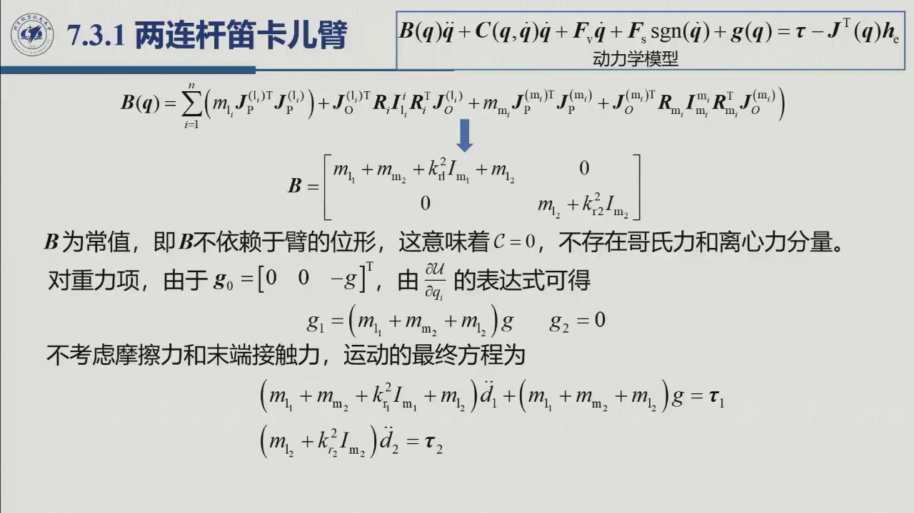

# 6.3.1 两连杆笛卡儿臂

> 录播 01:23:20–01:23:45（课件切换），配合教材 §7.3.1。这是全章最简单的算例：**惯性矩阵是常数、
> 速度耦合项为零、两轴完全解耦**。它存在的意义是给平面臂（6.3.2）做「对照组」——
> 让你看清哪些复杂性来自「转动关节」，哪些来自「位形变化」。

## 6.3.1.1 结构与广义坐标

两连杆笛卡儿臂（教材图 7.3）：关节 1 沿 $z_0$ 方向移动 $d_1$，关节 2 沿与 $z_0$ 垂直的方向移动 $d_2$。
取

$$\boldsymbol q=[d_1,\ d_2]^{\mathrm T}.$$

设两连杆质量 $m_1,m_2$，两转子质量 $m_{m_1},m_{m_2}$，转子绕各自轴的转动惯量 $I_{m_1},I_{m_2}$，
减速比 $k_{r_1},k_{r_2}$。假设转子质心就在关节轴上（$\boldsymbol p_{m_i}=\boldsymbol p_{i-1}$，
$\boldsymbol z_{m_i}=\boldsymbol z_{i-1}$），这是教材的标准简化。

## 6.3.1.2 雅可比与惯性矩阵

移动关节的平动雅可比列为 $\boldsymbol z_{j-1}$，因此

$$J_P^{(1)}=\begin{bmatrix}0&0\\0&0\\1&0\end{bmatrix},\qquad
J_P^{(2)}=\begin{bmatrix}0&1\\0&0\\1&0\end{bmatrix}.$$

两个连杆都**不做转动**（$\boldsymbol\omega_1=\boldsymbol\omega_2=\boldsymbol 0$），所以 $J_O^{(1)}=J_O^{(2)}=0$，
转动动能项全部消失。转子只绕自身轴转：

$$J_O^{(m_1)}=\begin{bmatrix}0&0\\0&0\\k_{r_1}&0\end{bmatrix},\qquad
J_O^{(m_2)}=\begin{bmatrix}0&0\\0&0\\0&k_{r_2}\end{bmatrix}.$$

代入 [6.1.1](sec6-1-1.md) 的 $B(\boldsymbol q)$：

$$B=\begin{bmatrix}
m_1+m_{m_2}+k_{r_1}^2I_{m_1}+m_2&0\\
0&m_2+k_{r_2}^2I_{m_2}
\end{bmatrix}.$$

**关键观察**：$B$ 里没有 $d_1,d_2$，所以 $B$ 是**常数矩阵**，$\dot B=0$。于是
$C\dot q$ 中的 $h_{ijk}$ 全为零，$C=O$——**没有离心项，也没有科氏项**。

## 6.3.1.3 重力项

取 $\boldsymbol g_0=[0,0,-g]^{\mathrm T}$（$z$ 竖直向上），用 $g_i=\partial U/\partial q_i$：

$$g_1=(m_1+m_{m_2}+m_2)g,\qquad g_2=0.$$

物理上：关节 1 竖直运动，要托起「连杆 1 + 转子 2 + 连杆 2」的总重量；关节 2 水平运动，重力不做功。

## 6.3.1.4 运动方程

无摩擦、无末端接触力时：

$$\bigl(m_1+m_{m_2}+k_{r_1}^2I_{m_1}+m_2\bigr)\ddot d_1+(m_1+m_{m_2}+m_2)g=\tau_1,$$

$$\bigl(m_2+k_{r_2}^2I_{m_2}\bigr)\ddot d_2=\tau_2.$$

**两个方程完全解耦**：$\tau_1$ 只影响 $d_1$，$\tau_2$ 只影响 $d_2$。这就是笛卡儿结构的「礼物」——
每个关节可以独立设计控制器，不必考虑耦合。

::: note 解耦的两个条件（缺一不可）
教材特别提醒：解耦不只是「笛卡儿结构」的功劳，还依赖**两关节轴正交**这一几何条件。
若关节 2 的轴与关节 1 的轴成 $\pi/4$（习题 7.1），$B$ 就不再是对角阵，两轴出现耦合。
换句话说：**结构决定 $B$ 是否随位形变，几何决定 $B$ 是否对角**。
:::

## 6.3.1.5 小结与常见错误

- **一句话**：笛卡儿臂的两个关节都只平动，$B$ 为常数对角阵，$C=0$，$g_2=0$，两轴解耦。
- **三条性质**：$B$ 常数（$\dot B=0$）、$C=0$、$B$ 对角（轴正交时）。
- **一个对照**：平面臂（6.3.2）的 $B$ 随 $\vartheta_2$ 变、$C\neq0$、$B$ 非对角——差别全部来自转动关节。

::: think 常见错误清单
1. **忘记转子的 $k_r^2I_m$**：它进的是 $B$ 的对角元，漏了会让 $\ddot d$ 的系数偏小。
2. **把 $g_1$ 写成 $m_1g$**：关节 1 要托起的是它上面所有质量，包括转子 2 与连杆 2。
3. **以为「笛卡儿」就一定解耦**：轴不正交时 $B$ 非对角（习题 7.1）。
4. **在 $C$ 上硬算**：$B$ 常数时 $C=0$，不必套 Christoffel 公式。
:::
